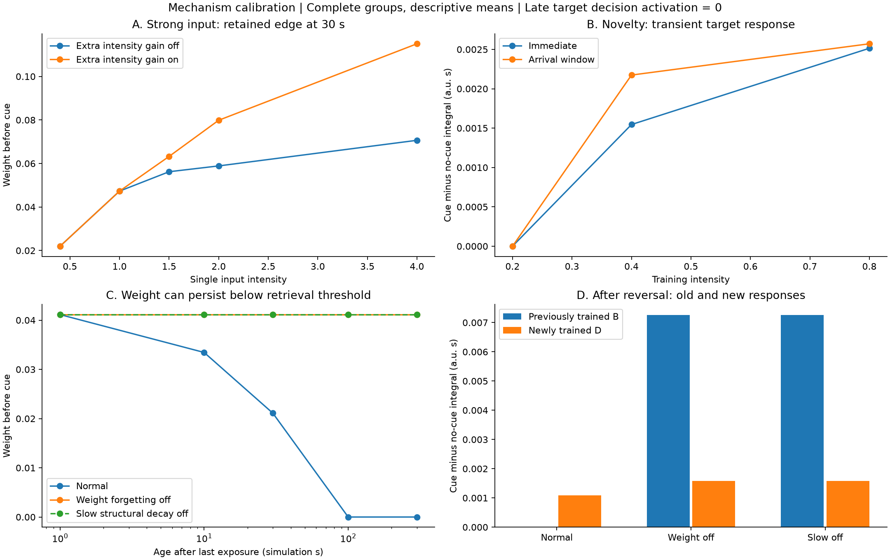

# Intensity, novelty and 300-second retention: calibration results

> **Revision r2 · 2026-10-10**
> Revision reason: Verified original-file relocation; append location-resolution guidance and preserve the experiment conclusions.
> Original: [report.en.md](report.en.md); parent r1: [report.en.md](report.en.md)


[中文](report.zh.md) · 2026-09-29 · Project: `2026-09-29 强刺激、新颖性与遗忘校准`

## Findings

**The strong-input mechanism exists and works.** Its extra term is `intensity_gain × max(0, intensity − 1)`, so earlier intensity-1 input never activated it. A single intensity-4 exposure leaves stronger connections and an observable transient target response at 30 seconds, especially with the extra gain enabled.

**Local novelty exists, but immediate edge formation can precede delayed associative arrival.** A versioned local arrival window retains the old eligibility/formula while waiting for actual signals. At training dose 0.4, target response is **40.66%** greater than immediate settlement; at 0.8 the increase over immediate settlement is **2.26%**; at 0.2 both are zero. No content-importance or correctness score is introduced.

**Failure to retrieve at 300 seconds has two causes.** Ordinary forgetting removes weak new connections; disabling weight forgetting preserves them, yet a 0.5 cue still fails to evoke the target. A cue of 1 evokes a small transient response. Missing output is not always missing structure.

Targets are absent from the later pattern-convergence decision ranks in these tests. The positive effects are early, transient responses in complete trajectories. The main endpoint and secondary measurements are reported separately, without hiding either.



## Design and measurements

There are **786 completed platform instances**: 288 intensity, 216 novelty (including 72 separately registered no-cue controls), 240 forgetting and 42 adaptation cases, plus 12 tiny frozen-source legacy witnesses. Seeds are 9293201/9293202; novelty onset phases are 70/110/170 ms. These are small descriptive checks, not a population study or grounds for significance claims.

Intensity/retention use original `continuous-memory/1` parent states. Novelty uses `continuous-memory/2` with explicit immediate/arrival-window modes and gain 0/0.018. Each test is an independent clone and never updates its parent. Anonymous channel labels exist only in external analysis. Recorded real host telemetry is replayed at intensity 0.2 under its original encoder, with hashes and cycles retained. No AI directs behavior.

Inhibition, short-lived self-suppression, depletion/recovery, facilitation and plasticity stay enabled; only registered variables change. External energy supply offers up to 10 units/s without a total cap. Consumption remains active and all unmet demand is zero; local resources are not forcibly replenished. Existing maintenance accounting remains coupled to the disabled starvation-damage option, so this is not a complete metabolic model.

The primary endpoint ranks actual activation at the end of a pattern-convergence decision window. Original steady-state judgments are retained. Secondary target response integrates full-node samples every 100 ms over 5 s and subtracts the matched no-cue clone. Weights below are measured **before the cue**, excluding probe-induced learning. Novelty means cover two seeds × three phases; other tables average two seeds.

## Strong input

The extra gain is identical on/off at doses 0.4 and 1, and effective above 1. Reception still uses response and soft saturation. At age 30 s with a common 0.5 cue:

|强度 / Intensity|增益关闭：30 秒权重 / Gain off|增益开启：30 秒权重 / Gain on|关闭：目标响应 / Off response|开启：目标响应 / On response|
|---|---:|---:|---:|---:|
|0.4|0.021986|0.021986|0.000000|0.000000|
|1|0.047307|0.047307|0.000000|0.000000|
|1.5|0.056216|0.063251|0.000000|0.000000|
|2|0.058882|0.079865|0.000000|0.000247|
|4|0.070655|0.115014|0.000222|0.001835|


A single dose of 4 and ten doses of 0.4 have equal nominal totals, but different timing. Massed input occurs at seconds 119–128; spaced input at 0,1,2,4,8,16,32,64,96,128. Single exposures also occur at 128, so last-exposure time is matched. Under current forgetting, massed repetition yields more recent target response than this widening schedule. Spacing is not automatically beneficial. Strong single input retains best at 30 s, but new edges in these ordinary-forgetting groups are pruned by 300 s.

No replacement intensity formula or arbitrary forgetting retuning is justified by this audit. Parameter help now explicitly states the greater-than-one threshold. Ordinary UI input and sensory mapping are not silently amplified.

## Novelty

After AB, an overlapping AC pattern creates new edges. Eligible new edges wait until the next propagation time scheduled at birth plus transmission delay. Same-time arrivals are included before one settlement. Eligibility requires a pre-existing local neighborhood and nonzero actual associative touch; gain zero, no neighborhood or no reentry produces no bonus. Deleting an edge cancels its pending birth; a later birth has a new identity. Exact snapshots preserve pending windows.

Within the first observation window, immediate mode awards **8 of 72 births**, versus **24 of 72** with arrival-window mode, among gain-enabled runs. With gain disabled the two modes produce identical target trajectories, guarding against extra scheduling steps creating the effect.

|训练强度 / Training dose|立即计算 / Immediate|延迟触达结算 / Arrival window|相对增加 / Increase|
|---|---:|---:|---:|
|0.2|0.00000000|0.00000000|两者为零 / Both zero|
|0.4|0.00154551|0.00217394|40.66%|
|0.8|0.00251444|0.00257131|2.26%|


At dose 0.8, the new mode gains about 8.18% over gain-off, but only 2.26% over immediate gain-on. These are different comparisons. The unchanged Git `97d8592` ordering also yields zero bonuses in 3 same-dose and 9 crossed-dose AB→AC witnesses: association can reach B rather than the new A/C endpoints; old propagation also depends on receiver response/saturation. Earlier ordering alone is not sufficient. Formula-preservation tests and natural triggering are distinct evidence.

Select arrival-window `continuous-memory/2` for **new-consciousness defaults after acceptance**. Existing models retain their identities/configuration; memory/1 and immediate mode remain available. This follows improved causal timing and measured local effects, not a claim of solved language, persistent target convergence or universal superiority. The kernel remains labeled as a research version.

## Retention and cue threshold

Read-only historical no-training/spaced-training states are probed at ages 1/10/30/100/300 s. `normal` preserves all defaults; `weight_off` sets only forgetting_rate=0; `slow_off` additionally disables stability/support decay. Activation, inhibition, traces, eligibility and learning remain active.

|遗忘条件 / Condition|300 秒时权重 / Weight at 300 s|提示 0.5：目标响应 / Cue 0.5|提示 1：目标响应 / Cue 1|
|---|---:|---:|---:|
|normal|0.000000|0.00000000|0.00000000|
|weight_off|0.041132|0.00000000|0.00041646|
|slow_off|0.041132|0.00000000|0.00041646|


At 300 s, ordinary new A→D edges are absent. Weight-off and slow-off retain approximately 0.041 weight, but only the stronger cue recovers a tiny transient response. Keeping weight alone suffices for this case; disabling every decay process is unnecessary. Old B responses are stored separately from the new target D.

**There is no defensible conversion from 300 model seconds to human hours/days.** Timescales have not been fitted to human behavior. Internal reference scales are activation 0.304 s, inhibition 0.232 s, local recovery 0.8 s, facilitation 1 s, fast traces 2 s and nominal stability/support 667 s. History, eligibility and the 0.008 pruning threshold also affect retention. The controlled weight-forgetting comparison establishes a model-specific cause rather than a human-time analogy.

## Adaptation without forgetting

Independent age-300 clones learn AB then AD, ten 0.4 exposures each at 1-s spacing. After the second phase:

|条件 / Condition|新提示引起的旧 B 响应 / Old B|新 D 响应 / New D|
|---|---:|---:|
|normal|0.00000000|0.00108271|
|weight_off|0.00725644|0.00158781|
|slow_off|0.00725644|0.00158781|


Weight-off/slow-off still acquire the new D response while retaining B. Coexistence is not, by itself, evidence that old experience overwhelms new experience; a task with explicit incompatible demands is needed. Final-window saturation fractions are zero, and the largest sampled fraction anywhere is 0.0000. No sustained whole-network saturation is observed in this bounded study, which is not a long-term guarantee.

## Readout interpretation and integrity

All 300 cued clones have one original and one new readout. The new observer detects a stable proportion window in each; the target has zero activation in the primary ranks, while early target activity remains available in the full curves. The 240 no-cue clones preserve complete 5-s trajectories without fabricating a cue envelope. Real background activity can dominate stable proportions; matched controls distinguish task effects without deleting raw activation.

The previous passed `autonomy-criteria/1` conclusion is retained, not rerun or replaced here. It is an operational research standard, not a validated subjective-experience test. Earlier work used ablation, restoration and birth clones, not regional transplantation. Academic-indicator collection and independent experiments remain a subsequent phase.

All 786 final states were decoded from the DB and checked against local canonical hashes/content; six historical parents are unchanged. No effective case stopped for budget or unmet energy. Simulation wall time is 15.83/120 min; maximum network 49 nodes/1500 edges. Pre-archive local+DB growth is 1.287 GiB; final delivery records include archive overhead within 4 GiB. Shared account usage moved 57%→58%, not attributable exclusively to this study.

Two runner errors are preserved: an empty startup case failed on a configuration-object type before input, and one probe call failed on a duplicate keyword before probe creation. Both were fixed without changing Core or erasing records; completed training was reused. A registered supplement supplied the 72 missing no-cue controls.

Next priorities are matching repetition intervals to measured retention, task-defined reversal tests with interventions, and determining when transient association becomes stable behavior. Full cases, snapshots, inputs, trajectories, both observers, frozen legacy witnesses, execution amendments and report-generation sources are archived in the new project. Two reports and four experiment records are available in the platform.

## Delivery addendum (2026-09-30)

This section was appended after simulation and evidence archival. It does not recompute or replace measurements. Platform reports are saved as revision 2; revision 1 and the original archive remain available.

**The 40.66% novelty increase has specific conditions.** Both settlement modes used a 1-second facilitation time constant, identical inputs and other parameters. The increase compares transient target net-response integrals at training intensity 0.4. New-creation defaults still use facilitation 0 (extra facilitation disabled). Thus 40.66% is not a uniform improvement for default configurations, final convergence rankings or arbitrary tasks. Every instance retains its complete parameters.

New creation defaults to `threemind.continuous-memory/2` with arrival-window novelty settlement. `causal/9`, `continuous/1`, `continuous-memory/1` and `lif/1` remain available; the new version also supports immediate evaluation. Restoration follows saved identity. Historical protocols omitting identity still mean the original baseline; saved project defaults are not overwritten. Strong-input formulas, forgetting defaults and sensory mapping are unchanged.

Temporal activity readouts are connected to UI, CLI, API, exports and report sources. Original activity steady-state detection remains selectable alongside independently enabled response-pattern convergence, amplitude change, periodic activity and response end. Primary ranking uses decision-window-end activation, retaining full trajectories, peaks and integrals. Stable-background rankings and transient-only target responses remain visible as measured.

Delivery verification:

- **153 tests passed** across kernels, configuration, readouts, deployment and related integration.
- **45 tests passed** across five-kernel Python/Rust interoperability, LIF and build validation. The initially opt-in real compilation case was subsequently enabled; its build suite had **2 passes**.
- **27 tests passed** for default-transition API, ecology execution, temporal reports and probes; **5 Rust core tests passed**.
- An isolated Runtime wheel installation without Lab, FastAPI or PostgreSQL client packages passed save/restore/continuation equivalence for all five kernels. A standalone Rust constructor was actually compiled and tested for plasticity and mismatched-kernel rejection.
- Production frontend build passed. Browsers at 1440 and 390 pixels verified readouts, chat deduplication, new defaults and graphical/JSON synchronization without page overflow.
- Optional sandbox Compose configuration passed validation. **The sandbox image was not built or run**; configuration validation is not container execution acceptance.

Runtime and Lab were updated to 2.1.0 on this workstation, with rebuilt native extension and frontend. The old `.venv` references removed Anaconda. The existing independent Python environment works; no Anaconda reinstall is needed. From the project root:

```powershell
.\scripts\start-lab.ps1 -Python .\.work\kernel-venv\Scripts\python.exe
```

Academic consciousness-indicator collection/validation, rich environment evolution and association-region transplantation are later work. This round does not alter the existing `autonomy-criteria/1` criteria or their passing result.


> **Storage-location revision · 2026-10-10**
> This edition adds the verified move of the selected originals to `E:\ThreeMindData`. Stable scientific identities and hashes, experiment dates, measurements and conclusions remain unchanged. Paths in the preserved body describe historical sources; use the registered evidence resolver for current locations. Repository documents and frozen fixtures remain in place, and source copies are retained. Structured query data and running checkpoints remain in the database. This annotation does not assert that missing historical evidence was recovered.
