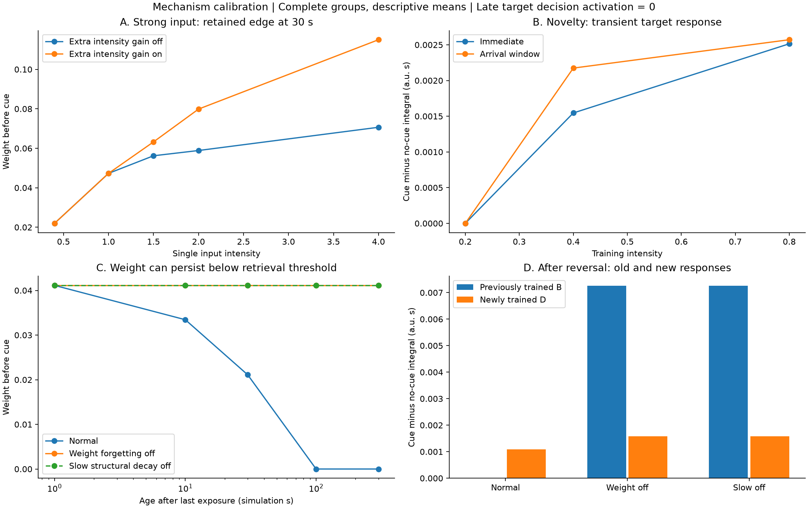

# 强刺激、新颖性与 300 秒遗忘：校准结果

[English](report.en.md) · 2026-09-29 · 独立项目：`2026-09-29 强刺激、新颖性与遗忘校准`

## 先说结果

**强刺激机制没有丢失，而且确实能让新连接更强、保持更久。** 以前把强度 1 当作“强刺激”，没有触发额外增益项；该项计算的是超过 1 的部分。本轮单次强度 4 在 30 秒后仍能让提示引起目标的短暂激活，额外增益关闭时明显较弱。

**新颖性公式也没有丢失，但立即连边会错过稍后才到达的联想。** 新版本给刚出生的连接一个局部等待窗口，用真实到达的联想量结算原有增益。在训练强度 0.4 下，目标短暂响应比立即计算增加 **40.66%**；0.8 下增加 **2.26%**，0.2 下两者都没有可测目标响应。没有给内核添加“内容重要”“答案正确”这样的判断。

**300 秒的问题已经拆开：正常遗忘确实删掉了弱连接；关闭权重遗忘能留住它，但弱提示仍可能激不活它。** 提示从 0.5 增到 1 后，保存下来的连接又有短暂目标响应。因此，“读不出来”不能一概当成“结构里什么都没了”。

本轮这些目标响应都发生得较早，**目标未进入后续响应模式收敛窗口的主要排名**。这是主要读出与次要轨迹观察的区别。新读出器现在会把模式是否稳定、幅度是否下降、是否周期活动、是否结束分别报告；不能把整网比例趋稳直接当成目标配对长期保持。



## 怎样比较

共 **786 个有效平台实例**：强刺激 288、新颖性 216（含补齐的 72 个无提示副本）、遗忘 240、适应 42；另有 12 个旧源码小型见证。两个种子为 9293201、9293202，三种新颖性相位为 70、110、170 ms。匿名通道有明确的外部实验标记，标记不进入动力学。每个测试副本从同一父状态独立分出，测试不回写父本。

遗忘与强刺激试验用原先的 `continuous-memory/1` 及原始父状态。新颖性用新 `continuous-memory/2`，分别选择立即计算和延迟触达模式；旧内核没有被升级覆盖。背景是先前记录的真实宿主机遥测，强度 0.2、原映射不变，重放周期和哈希入证据。没有调用 AI 决定行为。

保留抑制、自身短时反应减弱、局部耗竭与恢复、易化、持续可塑性；只改变本组登记的量。外部供应器每模拟秒最多提供 10 单位、总量不限，连接仍消耗能量。全部实例未满足能量需求为 **0**；这不是关闭耗能或强行补满局部资源。既有维护费用仍与缺能损伤选项相连，本轮不把该账本称为完整生物代谢模型。

主要指标是响应模式收敛判定窗口末尾的实际节点激活排序。另保存原活动稳态判定。次要的“目标响应”为 5 秒轨迹中每 100 ms 采样的激活积分，减去同源无提示副本；它包含先升后降的短暂响应。下面的连接权重取**提示之前**，避免把探测本身引起的巩固算成保持。所有条件都报告，不挑正结果。

两个编码／接线种子用于复核方向；不把它们当成大样本生物实验，不报告由这种小样本制造的显著性。新颖性每格是两个种子 × 三个相位的描述均值。

## 强刺激：原公式有效，不需要再编一个增益

额外项是 `intensity_gain × max(0, intensity − 1)`，默认系数 0.075；直接激活仍经过接收响应和软饱和，并不无限增长。输入强度 0.4、1 的增益开关对照完全一致；1.5、2、4 随强度显示额外结构巩固。下表均为训练后 30 秒、同样 0.5 提示。

|强度 / Intensity|增益关闭：30 秒权重 / Gain off|增益开启：30 秒权重 / Gain on|关闭：目标响应 / Off response|开启：目标响应 / On response|
|---|---:|---:|---:|---:|
|0.4|0.021986|0.021986|0.000000|0.000000|
|1|0.047307|0.047307|0.000000|0.000000|
|1.5|0.056216|0.063251|0.000000|0.000000|
|2|0.058882|0.079865|0.000000|0.000247|
|4|0.070655|0.115014|0.000222|0.001835|


单次强度 4 与 0.4×10 的总名义输入相同，但时间分布不同，不能要求效果相同。集中重复在 119～128 秒每秒一次；稀疏重复在 0、1、2、4、8、16、32、64、96、128 秒。所有组最后一次输入均为 128 秒，单次组也在这一时刻输入。当前遗忘速度下，集中重复的近期目标响应强于这一组越来越稀疏的重复；它**没有支持“越稀疏越好”**。单次强刺激的 30 秒保持最好，但正常遗忘下到 300 秒这些新连接仍已被修剪。训练间隔应与连接能保持多久一起校准。

本轮不修改强刺激公式或默认遗忘速度；修正参数说明，让研究者知道强度 1 不触发额外项。普通 UI 刺激的数值和映射不被悄悄放大。

## 新颖性：保留旧模式，新增局部触达窗口

先输入 AB，再输入共享 A 的 AC。新模式只看出生前是否已有邻域以及端点真正收到的非零联想。窗口截至出生时已排定的下一传播时刻加传播延迟，结算同刻已到达的信号；只结算一次。无邻域、无联想、增益为零均不会获得奖励。断连撤销该出生记录，重建连接有新身份；快照保存未结算窗口。

首个观察窗口内，增益开启组的立即计算是 **72 次生边中 8 次获得增益**；延迟触达是 **72 次中 24 次**。相同增益关闭时两种模式的目标轨迹一致，排除了“仅仅多了一次调度就凭空增强”的解释。

|训练强度 / Training dose|立即计算 / Immediate|延迟触达结算 / Arrival window|相对增加 / Increase|
|---|---:|---:|---:|
|0.2|0.00000000|0.00000000|两者为零 / Both zero|
|0.4|0.00154551|0.00217394|40.66%|
|0.8|0.00251444|0.00257131|2.26%|


0.8 组立即模式本来就能触发部分增益，所以新模式相对旧模式仅增加 2.26%；相对两者共同的无增益对照则增加约 8.18%。不能把两个比较混写。

冻结 Git `97d8592` 的旧操作顺序也进行了 3 个同幅度、9 个交叉幅度见证：这组最简单的 AB→AC 样例**同样没有触发旧新颖性奖励**。传播可能到达 B，但新连接端点是 A、C；旧传播还受目标响应与饱和影响。所以不是“旧源码只要传播在前就一定有效”，也不能把所有零结果都归于迁移遗漏。代码恢复见证与自然输入触发是两项不同验证。

结论：采用 `continuous-memory/2` 的延迟触达模式作为**新建意识的默认方案**，因为它保留原有局部条件，并在不改变感官映射的情况下得到可重复的触发与响应增益。已有意识／协议保持原内核，`continuous-memory/1` 和立即模式均可选择。该决定针对当前校准任务，并不声称它已解决持久收敛、语言理解或所有新颖性问题。界面标明研究版本，下一轮应观察真实新经验而非语义评分。

## 300 秒：结构遗忘和提示门槛同时存在

直接使用上一轮“无训练／逐渐稀疏重复”的原状态，分别经过 1、10、30、100、300 秒。`normal` 原参数；`weight_off` 仅 `forgetting_rate=0`；`slow_off` 再关闭稳定度和支持度衰减。激活、抑制、痕迹及资格迹仍正常变化，学习仍开启。

|遗忘条件 / Condition|300 秒时权重 / Weight at 300 s|提示 0.5：目标响应 / Cue 0.5|提示 1：目标响应 / Cue 1|
|---|---:|---:|---:|
|normal|0.000000|0.00000000|0.00000000|
|weight_off|0.041132|0.00000000|0.00041646|
|slow_off|0.041132|0.00000000|0.00041646|


正常组 300 秒时新 A→D 连接确实不在了。两种关闭遗忘组都保留约 0.041 的连接；0.5 提示依然没有 D 响应，1 提示能引起约 0.000416 的短暂净响应。只关权重遗忘已足以保留本例的弱记忆；不需要为了这个结果把所有衰减都关掉。旧 B 的响应与新 D 分开保存，不能把旧反射当成新记忆成功。

**300 模拟秒不能诚实地换算成人的几小时或几天。** 模型有多种时间尺度，没有经过人类行为数据标定。作为内部参照：激活时间常数约 0.304 秒、抑制约 0.232 秒、局部恢复 0.8 秒、易化 1 秒、快痕迹 2 秒；稳定度与支持度的名义尺度约 667 秒。弱连接还受经过历史、资格迹和修剪阈值 0.008 共同作用。这次实际观察到正常弱连接消失，而关闭权重遗忘后保留，已把因果来源缩小到遗忘路径，不能仅凭“300”这个数字断言它符合或违背人类记忆。

## 关闭遗忘会不会失去适应能力

在 300 秒后的独立副本中先训练 AB，再训练 AD，各 10 次 0.4、间隔 1 秒，分别测试。新 AD 仍能建立；没有看到关闭遗忘让它完全学不会。第二阶段结果：

|条件 / Condition|新提示引起的旧 B 响应 / Old B|新 D 响应 / New D|
|---|---:|---:|
|normal|0.00000000|0.00108271|
|weight_off|0.00725644|0.00158781|
|slow_off|0.00725644|0.00158781|


关闭遗忘后旧 B 与新 D 都响应；正常组此时旧 B 响应为零。这说明较强的旧响应得以保留，**还不能仅凭并存就判定“压过新经验”或适应变差**，需要明确的相冲突任务和行为目标再评估。本轮测试窗口结束时各组饱和比例均为 0；所有采样的最大比例为 0.0000，没有观察到持续全网饱和。短时、两个种子的反转试验不等于长期不会饱和。

## 新读出与科学结论的边界

300 个有提示副本分别留下旧、新读出各一份。新工具都检测到一个比例趋稳的窗口；这批目标 D 在该主要排名中的激活为零，目标短暂变化在完整轨迹里。240 个无提示副本没有伪造输入信封来触发“提示响应”，但保存了同样的 5 秒全节点轨迹用于控制。旧算法的分类原样保留。

“模式收敛”回答的是观测节点比例是否稳定；“幅度变化”另答总体是否下降。开启真实遥测时，稳定背景也可能主导排名。读出器如实报告该状态，研究分析再用无提示对照分辨任务相关部分，不能删掉不符合期待的原始激活。新读出不是在本轮后重新设定自主意识标准。

先前 `autonomy-criteria/1` 四项操作标准的通过结论不改写，本轮没有重跑它，也没有宣称检测到了主观体验。以前完成的是消融、恢复、出生副本对照；区域移植仍待做。学术指标收集与相关独立实验属于下一阶段。

## 完整性、限制与下一步

- 786 份最终快照逐一从数据库解码，与本地规范化模型哈希和内容一致；六份历史父状态核对未变。有效实验没有预算中断、没有供能缺口。
- 累计模拟墙钟 15.83 分钟，上限 120 分钟；最大网络 49 节点、1500 连接。归档前新增本地＋数据库约 1.287 GiB；最终含归档用量见交付验证，上限 4 GiB。
- 共享账户用量由 57% 到 58%；不能把全部变化归因于本任务。已停止扩展实验。
- 两个工具错误透明保留：首个空实例因配置对象类型错误在输入前中断，记为 blocked，不计有效样本；随后一个探测调用参数重复在创建探测前失败，修正后复用已完成训练。都没有修改 Core 或删除失败记录。72 个无提示补充在独立登记后执行。
- 现阶段更值得做的是匹配刺激间隔与保持时间、检验有因果干预的反转任务、判断哪些短暂联想能转成稳定行为；不靠强行降低读出标准获得好看的回答，也不因为目标未留到末尾就抹掉已测到的短暂增益。

完整案例表、快照、输入信封、全节点探测轨迹、两个读出、旧源码见证、执行修订和本报告生成脚本均归档到该项目；报告与四项实验记录可以从“记录与报告”查看。

## 交付补充（2026-09-30）

本节在实验结束、证据归档后追加，不重算或替换原始实验数据。平台报告保存为第二版，第一版及原始归档继续保留。

**新颖性的 40.66% 增益有明确条件。** 两种结算模式都使用 1 秒的短时易化时间常数、相同的刺激和其余参数；40.66% 是强度 0.4 组目标短暂净响应积分的比较。新建意识的易化默认值仍是 0，即关闭额外易化，没有为放大结果而改掉。该百分比不是新建默认配置、最终收敛排名或任意训练任务的统一提升幅度。完整参数随每个实例保存。

新建意识默认采用 `threemind.continuous-memory/2` 的延迟触达新颖性方案。`causal/9`、`continuous/1`、`continuous-memory/1`、`lif/1` 均保留；新版也能选择出生时立即计算。旧快照按保存的身份恢复，省略内核身份的历史协议仍解释为原始基线，已有项目默认值不覆盖。强刺激公式、遗忘默认速度和感官映射保持不变。

时序活动读出器已接通界面、CLI、API、导出和报告来源。活动稳态判定保留；响应模式收敛、幅度变化、周期活动、响应结束可分别开启。主要排名使用判定窗口末尾的激活，完整轨迹、峰值和积分保留。稳定背景占据排名、目标只在早期短暂出现的事实都按原样展示。

交付验证：

- 内核、配置、读出、部署及相关集成测试一组 **153 项通过**。
- 五类内核跨 Python/Rust、LIF 和构建相关测试 **45 项通过**；当时未开启的真实编译项随后单独开启验证，构建套件 **2 项通过**。
- 默认切换相关 API、生态运行、时序报告与探针测试 **27 项通过**；Rust 核心 **5 项通过**。
- 独立 Runtime wheel 在没有 Lab、FastAPI、PostgreSQL 客户端的隔离 Python 中，五类内核保存／恢复／继续演化一致；独立 Rust 构造程序真实编译并验证可塑性与版本拒绝。
- 前端生产构建通过；1440 和 390 像素浏览器实际验证读出、聊天去重、新内核默认值、图形与 JSON 双向同步，并检查无页面横向溢出。
- 外部沙箱的 Docker Compose 配置校验通过；**尚未构建和运行沙箱镜像**，不把配置校验写成容器运行验收。

本机 Runtime 与 Lab 已更新至 2.1.0，原生扩展与前端已重建。旧 `.venv` 依赖已卸载的 Anaconda；已有独立 Python 环境可以启动，无需重新安装 Anaconda。在项目根目录执行：

```powershell
.\scripts\start-lab.ps1 -Python .\.work\kernel-venv\Scripts\python.exe
```

后续学术意识指标的收集与验证、复杂环境演化、联想区域移植不属于本轮。本轮不改变既有 `autonomy-criteria/1` 的标准与通过结论。
