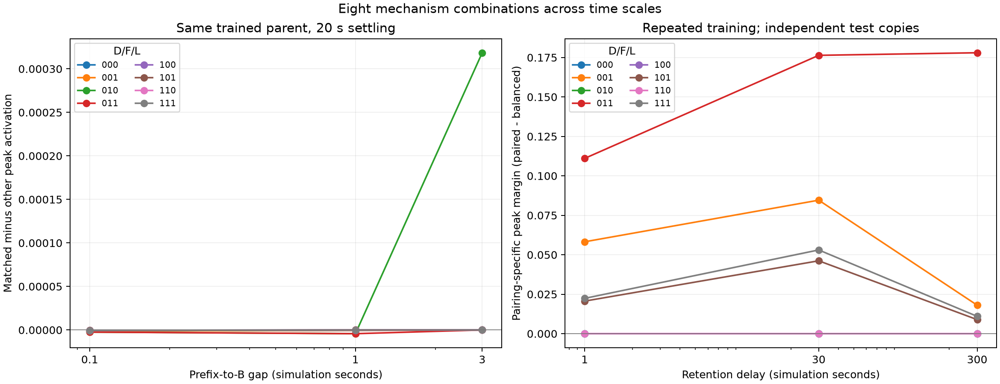
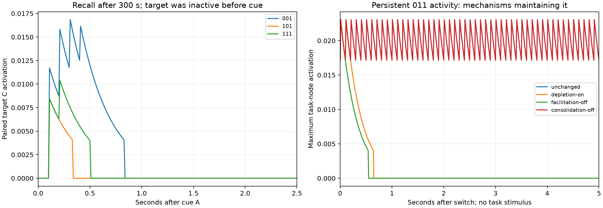

# Depletion, facilitation and consolidation: experiment results

> **Revision r2 · 2026-10-10**
> Revision reason: Verified original-file relocation; append location-resolution guidance and preserve the experiment conclusions.
> Original: [report.en.md](report.en.md); parent r1: [report.en.md](report.en.md)

[中文](report.zh.md)

2026-09-29. **598 whole-network instances completed; existing kernels and evidence preserved.** The [original design](design.en.md) is retained as preregistration. This report adds execution results and amendments.

## Findings in plain language

1. **Consolidation preserved associations that could be recalled.** All four L-on configurations showed target-specific responses after 30 and 300 simulated seconds in both swapped curricula. All four L-off configurations had zero target response at these delays under the chosen cue. Forgetting remained enabled. L-off still permits edge birth and node learning.
2. **Facilitation contributed measurable gain and changed the activity regime.** With depletion and consolidation retained, facilitation increased the pairing-specific response at 300 seconds by **23.2%**. With depletion disabled, facilitation plus consolidation instead supported persistent low-amplitude activity.
3. **The persistent activity has identified maintenance requirements.** Task activity remained around 0.01715–0.02306 after 300 seconds without task input. Restoring depletion silenced it by 0.65 seconds; disabling facilitation by 0.55 seconds. Disabling only subsequent consolidation left the next 15 seconds of activity unchanged. Both swapped curricula reproduced this result.
4. **The earlier prefix effect is real but strongly dependent on recent history.** After a one-second post-training wait, A→B and D→B favored their respective learned endings. After three seconds, both favored the same ending; twenty seconds did not restore the distinction. This is a state-dependent effect, not established robust sequence learning.
5. **The preregistered converged temporal-output criterion was not met.** All 452 cued formal and extension tests were classified as residual decay. The observations above concern preserved activity trajectories and explicitly secondary mechanistic metrics. The 58 no-task-cue controls intentionally had no carrier window.

## Controls and implementation

D = depletion, F = short-term facilitation, L = positive consolidation of existing-edge weight/stability; 1 on, 0 off. F is not the fast trace named F in the previous study.

The independent research kernel is `threemind.continuous-memory/1`, state `threemind.continuous-memory-state/1`, hypothesis `threemind.hypotheses/continuous-memory1`. Existing continuous/1 and causal/9 remain available. The new default 101 reproduces continuous/1 and does not replace the platform default kernel.

D-off clamps available resources to x=1 while retaining U=0.5 and utilization history: an explicit **unlimited-supply control**, not a physiological default. F-on uses the existing facilitation rule with a 1-second constant; recovery remains 0.8 seconds and active-resource decay 0.003 seconds. L-off blocks only positive changes of existing-edge weight/stability; birth, eligibility, touches, node support, plasticity, fast trace, forgetting and pruning remain active. Inhibition, self-inhibition, decay, local context, thresholds, encoding and other parameters were not casually disabled. Python/Rust equivalence and persistence tests cover all eight combinations.

Anonymous channels were labelled A/B/C/D/E outside the kernel. The short-timescale curriculum used `[A]→[A,B]→[B,C]` and the alternative ending, in 20/10/5 repetitions. Retention used `[A,C]` and `[D,E]`, in 20/10/10 repetitions. Balanced training used all four cross-pairings in 10/5/5 repetitions, matching frame count and channel dose. Two blocks swap C/E; these are paired controls, not independent random training seeds. Training intensity was 1, intervals one simulated second; cue intensity was 0.5. Retention starts at actual delivery of the last training frame.

All formal cases replay the same real host recording at intensity 0.2, with its measured **300.413474-second** period and original sampling jitter. Recorded background channels do not overlap task channels; no cross-edge occurs in any saved endpoint. Background keeps the overall consciousness alive without necessarily maintaining task activation.

## Retention across eight combinations

Each cell is the matching-target minus alternative-target peak, minus the corresponding balanced-curriculum margin, averaged over A/D cues in the two swapped blocks (four copies). Targets receive no direct test stimulus.

|D/F/L|1 s|30 s|300 s|
|---|---:|---:|---:|
|000|0.00000000|0.00000000|0.00000000|
|001|0.05822256|0.08459115|0.01805997|
|010|0.00000000|0.00000000|0.00000000|
|011|0.11106704|0.17636636|0.17800115|
|100|0.00000000|0.00000000|0.00000000|
|101|0.02063809|0.04618024|0.00891491|
|110|0.00000000|0.00000000|0.00000000|
|111|0.02237953|0.05305689|0.01098643|

At 30 and 300 seconds, task nodes in 001, 101 and 111 were inactive before the cue and reactivated afterward. Configuration 011 retained activity throughout; its larger margin is a different regime, not a directly comparable improvement in silent memory.

At 300 seconds, paired edge-weight advantages were approximately 0.1818, 0.1311 and 0.1314 for 001, 101 and 111; 011 retained 1. L-off groups still had weight advantages around 0.0137–0.0197 at 30 seconds, insufficient to activate targets under this cue, and zero advantage at 300 seconds. Structural residue, usable recall and persistent activity are distinct outcomes.

The one-second measurements include residual training activity. Thirty-two additional uncued controls and 64 matched comparisons are retained in `residual_controls`; residual activation must not be called a newly elicited answer. The cleaner quiescent-recall evidence is at 30/300 seconds in 001/101/111.

## Existing memory versus learning during the test

L remained on during training and waiting; only immediately before testing was it switched off through public reconfiguration. Balanced curricula received the same intervention. The table shows paired-curriculum matching peak margins:

|D/F/L|30 s: L on → off|300 s: L on → off|
|---|---:|---:|
|001|0.08510451 → 0.08505522|0.01778980 → 0.01777949|
|011|0.17640818 → 0.17640818|0.17801100 → 0.17801100|
|101|0.04620416 → 0.04619394|0.00891887 → 0.00891887|
|111|0.05308294 → 0.05306808|0.01098913 → 0.01098603|

Every paired test retained the correct target advantage with test-time consolidation disabled; the smallest retained fraction was **99.942%**. Existing structure supplies the response, while positive consolidation during the test contributes only small changes. Forgetting and other learning-related state were not globally disabled.

## Persistent activity

After 300 seconds without task input, separate copies of the same 011 state received no task cue:

|Intervention at observation start|Result|
|---|---|
|None|Activity continued between about 0.01715 and 0.02306 for the full 15 seconds|
|Enable depletion|Last nonzero sample 0.64 s; zero at 0.65 s|
|Disable facilitation|Last nonzero sample 0.54 s; zero at 0.55 s|
|Both changes|Zero at 0.55 s|
|Disable further positive consolidation|Same activity trajectory as unchanged control|

Both swapped blocks agree. The model exhibits recall from quiescent structure and sustained local feedback. Depletion both carries recent history and limits positive feedback; facilitation can amplify transient responses or support persistent activity through strong connections. Their effects do not simply add. D-off remains an unlimited-supply intervention, so this is not a recommendation to remove depletion. Oscillations follow the existing 100-ms propagation cadence; no new autonomous clock was introduced.

## Scope of the prefix effect

After the common 20-second wait, all sixteen preparation states had resource, utilization and fast-trace residuals below 1e−6. Mean matched peak margins follow. Zero average may mean both cues prefer the same target rather than no activation.

|D/F/L|0.1 s|1 s|3 s|
|---|---:|---:|---:|
|000|-0.000001170|-0.000000554|-0.000000001|
|001|-0.000001172|-0.000000564|-0.000000009|
|010|-0.000002458|-0.000004218|0.000318500|
|011|-0.000002467|-0.000004286|-0.000000036|
|100|-0.000000434|0.000000000|0.000000000|
|101|-0.000000434|0.000000000|0.000000000|
|110|-0.000000630|-0.000000117|0.000000000|
|111|-0.000000630|-0.000000117|0.000000000|

010 at the three-second gap has a measurable 0.0003185 amplitude margin, yet both prefixes within a block still favor the same ending. Enabling L removes this amplitude effect. It is a nonlinear interaction worth retaining, not a successful target-selection result.

Additional copies started directly from training endpoints with F off and L on:

|D|Post-training wait|A→B matched margin|D→B matched margin|
|---:|---:|---:|---:|
|On|1 s|+0.000977870|+0.002735633|
|On|3 s|+0.000970302|−0.000970324|
|Off|1 s|+0.002353496|−0.002354272|
|Off|3 s|+0.002315407|−0.002316217|

The swapped block reproduces these values. Depletion participates in the one-second distinction, which does not survive the three- or twenty-second waits. Waiting also changes inhibition, trace and stability; elapsed-time effects cannot all be assigned to one recovery constant. All pairwise and three-way interaction contrasts, including effects within each fixed-factor background, are preserved in `analysis.json/interactions`.

## Readout and next decisions

The primary criterion remained **end activation ranked within a qualifying converged temporal window**. Full windows, end-value rankings, classifications and raw curves are retained. All 452 cued tests were residual_decay; the 58 uncued controls were no_window. Every formal cue frame was delivered and formal consciousnesses remained alive. Four deaths occurred only in no-background reproduction of the earlier study.

The readout retains its 0.055 activation threshold and other settings; only the preregistered common sequence horizon is 15 seconds (12 seconds for old-result reproduction). At 300 seconds, target peaks in 101/111 are about 0.009–0.011, below that readout threshold. The larger 011 response is still classified as decay. Thus the chosen primary criterion failed while association-specific responses and persistent activity remain directly observable. A future separate study can examine whether residual-decay classification fully captures the intended end of natural competition. This experiment did not alter classification to obtain success.

**Retain consolidation and prioritize the resource-constrained D+F+L regime.** The evidence identifies stored usable structure, facilitation gain and depletion's suppression of persistent feedback. Keep 011 as a mechanistic control for sustained activity. Associations between inputs that never co-occur remain a separate next problem; simultaneous pair training here does not establish that capability.

No additional vocabulary, independent seed sweep, AB/BA generalization, low-U layer or unbounded parameter search was attempted. The scope is these anonymous channels, two swapped blocks and stated intensities. The [previous report appendix](../2026-09-29-continuous-mechanisms/report.en.md) preserves the discussion and seven primary references; this study separates their instantiated roles in ThreeMind.

## Evidence, validation and limits

- 6 reproduction, 210 short-stage and 224 retention-stage instances, plus 158 preregistered follow-up instances: 598 total below the 650 limit. There are 510 formal/extension test copies, including 58 uncued controls.
- Exact old-training state reproduction and default-candidate equivalence; four public-observer copies ended with the exact same kernel hash as their counterparts. All 598 database checkpoints were decoded and matched against local hashes, without failures.
- Python: 95 passed, 1 skipped. Rust core: 5 passed. UI build passed. Browser end-to-end tests were not run in this study.
- Single CPU worker, **25.09 minutes** summed instance compute. Before publication: **570.3 MiB** local evidence and **802.0 MiB** database net growth. Total new-storage cap 2 GiB. The verified ZIP is assembled in memory and stored in the database without another local archive copy. Final accounting is in the delivery record.
- Shared account usage was 41% at design registration and 43% at experiment completion; the coarse shared figure is not exact attribution. The 44% soft stop remains. No paid model, cloud compute or GPU was used.
- `execution-manifest.json` freezes configurations and inputs; extension registrations record rationale and full control sets. A storage-only amendment reduced redundant high-frequency background-node recording in retention, preserving task curves, complete readouts and endpoint states. No stimulus or kernel rule changed.
- Previous evidence ZIP remains `fa2bb67d86b8aaceb9bbb386e31b5b5bef4c1fe2c5fdaed48ddc8feb823c0e18`. Old data, original design notes and report revisions were neither migrated, deleted nor overwritten.

See [README](README.md) for entry points. Evidence includes configurations, envelopes, checkpoints, 10-ms task trajectories, readout states, local diagnostics and complete factorial effects, downloadable from the platform report attachment.

---

## Discussion addendum: energy, persistent activity and the next experiment (2026-09-29)

This is post-experiment interpretation and planning, not new experimental evidence. The original report, 598 instances, data, evidence archive and first published revision remain preserved.

### Use “energy” and explain the mechanism plainly

The researcher points out that earlier documents already use energy, while phrases such as short-term resources and restore depletion made the discussion harder to follow. We accept this correction. Prefer **energy consumption, replenishment, finite supply and unlimited supply** in ordinary discussion; define variables precisely in papers and parameter documentation. The policy is now in the [glossary](../../../docs/en/terminology.md).

The D switch controls energy consumption at connections: transmission consumes the available fraction, which subsequently recovers; disabling D replenishes that fraction before each release. Facilitation still determines utilization. This is implemented separately from the earlier whole-model energy account. A shared everyday word must not merge the controls or equations. Whole-model energy accounting was not enabled in this study.

“Restore depletion” therefore means **re-enable connection energy consumption**, not replenish the model's energy. Unlimited supply does not disable inhibition, forgetting or activation decay, and does not mean unlimited activation.

### Why persistent internal activity merits further investigation

Connections formed by training maintained activity after task input stopped, including at 300 simulated seconds. Re-enabling consumption extinguished task activity after approximately 0.65 seconds; disabling facilitation did so after 0.55 seconds; disabling only further consolidation did not. These are observable conditions for formation and maintenance, not a visualization replaying an animation.

The researcher interprets this as approaching autonomous consciousness-like activity and matching the project's predictions. The next discriminating question is: **can this activity retain experience, change with new input, switch between patterns, and influence how the model acts on its environment?** Together these would advance the study from indefinite circulation to persistent, changeable activity that affects the system's own circumstances.

One gap requires an explicit control. Earlier task input stopped, but recorded host-telemetry background continued. Saved endpoint states had no task/background cross-edges; that does not establish absence of influence at every intervening time. A new branch should stop all sensory input, drain already accepted sensory deliveries, and observe ongoing internal transmission. Externally driven and internally maintained activity must remain distinguishable.

### Sufficient supply while consumption and recovery remain

The earlier recommendation to prioritize finite supply remains historical. Discussion briefly proposed D=0 as the next unlimited-supply main condition. **The researcher then clarified that external supply is unlimited while connections still consume and recover energy and nodes retain refractoriness. That proposal is withdrawn; no new experiment used it.** Future conditions must preserve local consumption and recovery. D=0 remains only the earlier depletion-removal / instantaneous-refill control.

An inexhaustible supply of bread does not mean a person can stop eating or digest without limits. Supply rate, internal capacity and local recovery speed remain finite. Continuous self-inhibition and LIF's explicit refractory interval/adaptation current differ; neither was removed by the earlier D=0 setting, and neither is to be modified now.

Finite simulated energy is optional, not a prerequisite for a digital consciousness model. Real host computation still consumes electricity and has memory and processing limits; unlimited simulated supply does not remove experiment budgets. Supply conditions alone neither establish nor rule out consciousness.

Compare goal-consistent and goal-opposing stimulation without assuming that stronger activation means liking, or inhibition/death means dislike. Familiarity, surprise and conflict may also produce different responses. Record which nodes respond, their timing, recovery and switching, actions that change subsequent input, and dependence on training history. Task-subnetwork silence is not whole-consciousness death. Calling a death command when a stimulus opposes the goal would manufacture the proposed finding.

The [next discussion plan](../../../docs/en/plans/autonomous-activity.md) first compares second-scale and millisecond-scale input intervals independently. Results then guide persistence/switching, action feedback and opposite tendencies shaped by environmental selection. It has not been executed. It tests observable autonomous activity without treating a single score as a test of subjective experience.

### First check whether stimuli miss the relevant time window

The researcher proposes that one-second input intervals allow short-lived states to disappear before the next input, potentially explaining earlier membrane-kernel failures. Verified code uses a 20-ms LIF membrane constant, 5-ms input-current constant and 20-ms learning traces. The continuous kernel propagates every 100 ms with a 10-ms numerical step. The earlier one-second value was **external stimulus spacing**, not the kernel's entire update rate. This makes the hypothesis worth testing before further environmental experiments, but does not establish it as the sole cause of earlier failures.

Keep intensity, total input count, curriculum, energy mechanisms and internal clocks fixed; compare 1000, 100, 20, 5 and 1 ms between inputs and verify the candidate result with a held-out seed. More total activation alone is not improved learning. Measure target specificity, retained connections, pattern differentiation, inhibition and refractoriness. Denser input increases dose per second and shorter training gives forgetting less elapsed time; report both and add age/duration-and-dose comparisons if needed. Faster input is not automatically faster internal transmission, so do not change both together.

### Researcher's original Chinese wording

The following verbatim remarks preserve the researcher's interpretation and proposed direction; they are not additional measured results.

> 我理解了，耗竭后内部循环消失，这很符合预期。目前都在我的意识假设的预言范围内。刚刚我误解了恢复耗竭的含义，其实这里不就是说的是模拟能量吗，是否耗竭是说能量有限供应（会耗竭）与无限供应。我的理解没错吧。仅回复。

> 我们在描述的时候尽量用现实中有的概念，能直观理解的，即使不精确，我们可以在之后的论文中去规定能量在论文内的定义，宁可这样（而且理应这样），也不要生造新词去引发理解困难。如果你阅读了以前的docs，会发现你说得“恢复耗竭”一直被称为能量。把我们的讨论追加到报告中。并将术语贴近现实、用已有词汇、尽量不生造新词的原则整理为适当表述后写入docs的适当位置。我认为ThreeMind摸到了自主意识活动的边儿，方向是对的。现在我们来讨论，设计一个怎样的实验，来观察和证明这种活动有点像自主的、有点儿像意识活动。我们永远无法确认模型是否具有自我意识，因为主观体验无法由客观验证，但我们可以设置一些模拟实验来观察，为模型接入模拟环境和虚拟感官适配器（可以是一些刺激模拟，不必完全对应四肢和五官），经过一定时间的刺激、特定的环境（环境本身有目标和倾向）塑造后，它会形成一种模式或倾向，自然而然符合环境设定的目标、倾向。此时施加一些符合目标倾向的，观察是否有某些激烈的激活表现；然后施加一些与目标相反的，看是否有另一种不同的激活或某种抑制乃至死亡出现。上述实验可用无限能量（因为有限能量在计算机世界没有物理依据）。如果需要先指定实验plan的化，可以告诉我，我会切计划模式。

> 补充：此外帧率我认为应该加大，当前1秒不符合人脑的神经信号传播速度，人脑的神经脉冲传播是毫秒级的（这也解释了为何此前的膜电位为何无法形成稳定连接，因为刺激间隔太久）。增减帧率这一点可以先独立验证。也就是先把刺激的帧率增加到模拟毫秒级（尽量贴近生物信号传播速度），如果发现有增益，则后续对上述环境选择、正负向刺激的实验在帧率增加的基础上进行。无增益则帧率保持现状。

> 注意：无限功能不意味着连接不需要消耗能量，也不意味着节点没有不应期（也就是受到刺激后需要时间恢复才能再接受刺激，此前受到的刺激越强烈这个恢复时间越久，这个机制此前本来就有，无需修改，这里只是解释我在说什么），别把能量无限供应误解为关闭连接能量消耗和不应期。以人举例，无限供应馒头的疑似只是这个人不会因为没馒头吃而饿死，不是说他活着不需要吃馒头或者吃撑了还能无限吃。

> **Storage-location revision · 2026-10-10**
> This edition adds the verified move of the selected originals to `E:\ThreeMindData`. Stable scientific identities and hashes, experiment dates, measurements and conclusions remain unchanged. Paths in the preserved body describe historical sources; use the registered evidence resolver for current locations. Repository documents and frozen fixtures remain in place, and source copies are retained. Structured query data and running checkpoints remain in the database. This annotation does not assert that missing historical evidence was recovered.
