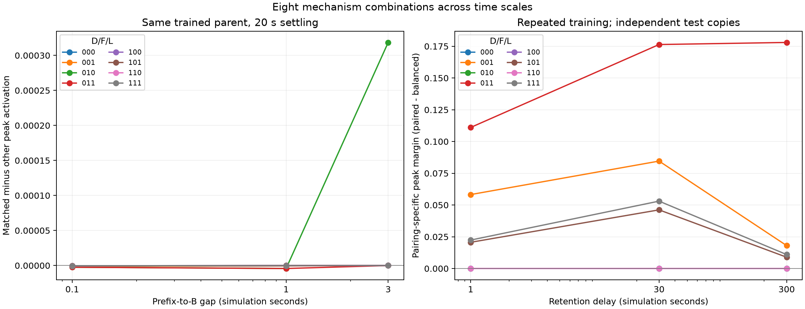
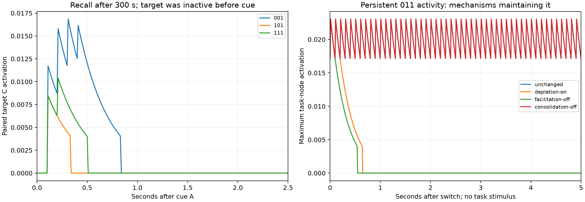

# 耗竭、易化与连接巩固：实验结果

[English](report.en.md)

2026-09-29。**已完成 598 个整网实例；旧数据和旧内核保留。** [原设计](design.zh.md)按实施前状态冻结；本报告追加实际结果和执行修订。

## 先说发现

1. **连接巩固确实把重复经历变成了能再次唤起的配对。** 四个 L 开启组，在两个交换教材的区组里，等待 30、300 模拟秒后，只给提示，都能让对应目标比另一个目标激活得更强。四个 L 关闭组在这两个时点的目标响应都是 0。遗忘一直开启。这里确认的是当前训练和强度下的可用差别；L 关闭仍有初次生边、节点学习等机制。
2. **易化有实际增益，而且会与资源约束共同改变活动形态。** 保留耗竭和巩固时，加入易化让 300 秒处的配对特异响应提高约 **23.2%**。关闭耗竭后，易化与巩固一起作用，形成了另一种持续低幅内部活动。
3. **那种持续活动的维持条件已经查明。** 训练结束后 300 秒仍有约 0.01715—0.02306 的任务节点激活；恢复耗竭，约 0.65 秒归零；关闭易化，约 0.55 秒归零；只关闭后续巩固，额外观察 15 秒仍持续。两套交换教材都如此。巩固形成的结构可以支持循环，循环的即时维持依靠足够的释放和易化。
4. **上一轮的短时前缀效果是真的，但有效条件比“学会序列”窄。** 训练末态等待 1 秒时，A→B 和 D→B 分别偏向各自结尾；等待 3 秒便都偏向同一结尾，20 秒后也没有恢复。它依赖当时的历史状态，不能直接当作已经形成稳健序列规则。
5. **约定的合格时序收敛输出仍未出现。** 452 个有任务提示的正式及扩展测试都被既有读出器归为“残余衰减”，0 个为合格收敛。上面描述的是完整活动曲线中的事实，峰值是单独登记的机制指标。58 个无任务提示对照没有载体窗口，属于预定设计。

## 八组比较了什么

D 为资源耗竭，F 为短时易化，L 为既有连接的正向权重／稳定度巩固。1 开、0 关。F 不是此前报告中的 fast 快痕迹。

新增独立研究内核 `threemind.continuous-memory/1`，状态 `threemind.continuous-memory-state/1`，假说标识 `threemind.hypotheses/continuous-memory1`。`continuous/1` 与 `causal/9` 保留；新版本默认 D/F/L=101 精确复现原连续版，不替换原默认内核。

- D 关是**无限补给的研究对照**：每次释放使用 x=1，保留基础利用率 U=0.5 和 u 的历史。它不是更高生物真实性的默认方案。
- F 开使用既有易化公式，恢复时间常数 1 秒；关时利用率固定为 U。资源恢复仍为 0.8 秒，活跃态 0.003 秒。
- L 关只拦截既有边的正向权重和稳定度增加；初次生边、资格迹、触达历史、节点支持与可塑性、快痕迹、遗忘、修剪均继续。
- 抑制、自身抑制、激活和痕迹衰减、上下文、门槛、映射等均未随意关闭。完整配置只出现已登记的差异。独立控制经 Python／Rust 八组合和保存恢复验证。

训练采用匿名通道，用 A/B/C/D/E 表示，标签未进入内核。短时任务为 `[A]→[A,B]→[B,C]` 与另一对应，分 20、10、5 次重复；保持任务为 `[A,C]`、`[D,E]`，分 20、10、10 次重复。另有四种交叉配对各 10、5、5 次的平衡教材，总帧数与各通道剂量相等。两个区组交换 C/E；不是独立随机种子的大样本。

每帧间隔 1 模拟秒、强度 1；提示强度 0.5。保持时间从最后训练帧实际递送时刻计起。所有正式条件回放相同宿主机记录，强度 0.2，周期 **300.413474 秒**，保留原始采样抖动。记录哈希见审计文件。映射后背景与任务通道无重叠；全部保存末态没有两者之间的交叉边。背景维持整体存活，不自动把任务子网一直激活。

## 较长时间的配对保持

表中数值为“匹配目标峰值−另一目标峰值”，再减去平衡教材的相同指标；每格含两个交换区组的 A、D 提示，共 4 个副本。绝对量不做百分制包装。目标没有直接获得测试刺激。

|D/F/L|1 s|30 s|300 s|
|---|---:|---:|---:|
|000|0.00000000|0.00000000|0.00000000|
|001|0.05822256|0.08459115|0.01805997|
|010|0.00000000|0.00000000|0.00000000|
|011|0.11106704|0.17636636|0.17800115|
|100|0.00000000|0.00000000|0.00000000|
|101|0.02063809|0.04618024|0.00891491|
|110|0.00000000|0.00000000|0.00000000|
|111|0.02237953|0.05305689|0.01098643|

30 和 300 秒处，001、101、111 的任务节点在提示前激活为零，收到提示后才重新激活；011 则保持内部活动，属于另一种状态。011 的较大数值不能直接当作比其他组更好的同类静默记忆。

在 300 秒处，001、101、111 的配对边权重优势分别约为 0.1818、0.1311、0.1314；011 为 1。L 关闭的四组在 30 秒还剩约 0.0137—0.0197 的权重优势，但不足以在本次提示下触发目标；到 300 秒该优势为零。**结构残留、可唤起响应、持续活动是三个不同结果。**

1 秒条件仍有上一条训练输入留下的活动。追加的 32 个无提示对照及 64 次对应比较保留在 `residual_controls`，不能把训练残留当作新提示的回答。更干净的安静后唤起证据来自 30、300 秒的 001、101、111。

## 是已有记忆，还是测试时重新学出来的

先保留 L 开启完成训练和等待，在提示之前才用公开配置接口关掉 L。其他参数不变，平衡教材也做同样对照。表中为配对教材的匹配峰值差均值：

|D/F/L|30 s: L on → off|300 s: L on → off|
|---|---:|---:|
|001|0.08510451 → 0.08505522|0.01778980 → 0.01777949|
|011|0.17640818 → 0.17640818|0.17801100 → 0.17801100|
|101|0.04620416 → 0.04619394|0.00891887 → 0.00891887|
|111|0.05308294 → 0.05306808|0.01098913 → 0.01098603|

全部配对副本关闭测试时巩固后仍保持正确目标优势；最少保留原差值的 **99.942%**。因此，当前响应主要由已有结构产生，测试过程中新增的正向巩固只贡献很小变化。该结论不依赖把整个学习或遗忘关掉。

## 持续内部活动的来源

011 组完成训练后，两个配对子网都在没有新任务刺激的情况下继续循环激活。300 秒时，在同一状态上分支：

|只在观察开始时改变|结果|
|---|---|
|不改参数|继续在约 0.01715—0.02306 之间波动，15 秒观察结束仍活跃|
|恢复资源耗竭|最后非零样本为 0.64 秒，0.65 秒归零|
|关闭易化|最后非零样本为 0.54 秒，0.55 秒归零|
|同时恢复耗竭、关闭易化|0.55 秒归零|
|只关闭后续正向巩固|与不改参数的活动轨迹一致，继续循环|

两套交换教材结果一致。这说明当前模型已经具有**安静结构中的可唤起记忆**和**由局部反馈维持的持续活动**两种状态。耗竭在这里既能携带近期历史，也能限制正反馈；易化既能放大短时响应，也能帮助强连接进入持续活动。三机制不是简单相加。

这里的 D=0 仍是无限补给干预，不能据此推荐删除耗竭。波动遵循现有 100 ms 传播节律；本轮没有新增自主时钟。没有加入内容评分、指定答案或目标偏好。

## 短时前缀效果的适用范围

共同等待 20 秒后，16 个准备状态的资源、易化和快痕迹残余均低于 1e−6。八组的平均匹配峰值差如下；平均为零可能是两次都偏向同一结尾，并非完全没有激活：

|D/F/L|0.1 s|1 s|3 s|
|---|---:|---:|---:|
|000|-0.000001170|-0.000000554|-0.000000001|
|001|-0.000001172|-0.000000564|-0.000000009|
|010|-0.000002458|-0.000004218|0.000318500|
|011|-0.000002467|-0.000004286|-0.000000036|
|100|-0.000000434|0.000000000|0.000000000|
|101|-0.000000434|0.000000000|0.000000000|
|110|-0.000000630|-0.000000117|0.000000000|
|111|-0.000000630|-0.000000117|0.000000000|

010 在 3 秒间隔下出现 0.0003185 的平均幅度差，但每个教材内 A→B、D→B 仍偏向同一结尾；开启 L 后这项幅度差消失。它是值得保留的非线性组合现象，尚不能叫正确序列选择。

从训练末态另取副本，保持 F 关、L 开，只比较 D：

|D|训练后等待|A→B 匹配差|D→B 匹配差|
|---:|---:|---:|---:|
|开|1 s|+0.000977870|+0.002735633|
|开|3 s|+0.000970302|−0.000970324|
|关|1 s|+0.002353496|−0.002354272|
|关|3 s|+0.002315407|−0.002316217|

交换教材复现同样模式。资源耗竭参与了 1 秒条件的路径区别；3 秒与 20 秒条件没有保持这种区别。等待也会改变抑制、快痕迹、稳定度等状态，不能把所有时间变化归给单一资源常数。完整两两及三阶交互、不同固定背景下的效应均存于 `analysis.json/interactions`，不只报告一个总均值。

## 读出与下一步判断

主要标准始终是**合格收敛窗口结束时的激活强度排序**。完整窗口、末值排序、终止原因与原始曲线全部保存。本轮有提示的 452 个窗口都是 residual_decay；58 个无提示对照为 no_window。所有正式提示完整递送，正式意识均存活；4 个死亡实例来自无背景的旧结果复现。

读出器保留原有 0.055 激活筛选阈值等设置，仅按设计将共同序列上限设为 15 秒；原结果复现仍用 12 秒。300 秒处 101/111 的目标峰值约 0.009—0.011，低于该筛选值；011 的响应更大，但仍被归为衰减。因此，约定主指标尚未通过，同时存在可直接核查的配对响应和持续活动。后续可独立审查“残余衰减／自然竞争结束”的读出定义；本轮没有为过关改变分类或替换主指标。

**建议继续保留 L；优先研究有资源约束的 D+F+L。** 本轮已经确认巩固保留可用结构、易化增益，以及耗竭限制循环的具体作用。011 适合当作持续活动的机制对照。下一步若研究跨时关联，应保持这轮基线，并另测未同时触达的输入如何形成连接；本轮同帧配对不能替它作答。

没有继续扩大词表、寻找“最好”参数或训练规模；未做新的独立种子、AB/BA 泛化或低 U 层。结论范围是本次匿名通道、两个交换区组和指定强度。相关生物机制及七篇原始文献已追加在[前轮报告末尾](../2026-09-29-continuous-mechanisms/report.zh.md)，本轮的价值是把各机制在 ThreeMind 中的作用进一步分开。

## 证据、实现与预算

- 6 个复现实例、210 个短时阶段实例、224 个保持阶段实例；另有 158 个预先登记的有限核查，总计 598，低于 650。正式及扩展测试副本共 510，其中 58 个为无任务提示对照。
- 原连续版训练末态哈希精确复现；新研究内核的默认配置与其行为一致。四个额外公开观察器副本与原对应副本的最终内核哈希相同。598 个数据库检查点均实际解码并与本地哈希核对，无失败。
- Python 检查 95 通过、1 跳过；Rust 核心测试 5 通过；前端构建通过。此次未运行浏览器端到端测试，不把构建当作交互验收。
- 单 CPU worker，合计模拟实例计算 **25.09 分钟**。发布前本地证据约 **570.3 MiB**，数据库净增长约 **802.0 MiB**。总新增预算 2 GiB；压缩包在内存生成、逐成员校验后存入数据库，避免额外落地一份大包。最终账目另见交付记录。
- 账户用量从设计基线 41% 到实验结束核查 43%，是共享账户的粗粒度读数，不能精确归因；44% 软停止线保留。未调用付费模型、云算力或 GPU。
- `execution-manifest.json` 冻结八配置与输入；三份扩展登记说明理由和全组合范围。保持阶段仅减少背景节点的重复高频存储，任务曲线、完整时序读出和首尾状态保留；变更记录在 `execution-amendment-1.json`，没有更改输入或内核。
- 原证据包 SHA-256 仍为 `fa2bb67d86b8aaceb9bbb386e31b5b5bef4c1fe2c5fdaed48ddc8feb823c0e18`。旧数据未迁移、清理或覆盖。原设计笔记及报告历史版本保留。

入口与复现方式见 [README](README_CN.md)。数据中包含完整配置、输入信封、检查点、10 ms 任务轨迹、读出器状态、局部诊断和所有交互效应。原始证据包通过平台项目中的报告附件下载。

---

## 讨论补记：能量、持续活动与下一步实验（2026-09-29）

这是实验完成后的解释与研究方向补记，不是新增实验结果。原报告、598 个实例、原始数据、证据包和第一次发布版本均保留。

### 沿用“能量”，把事情说明白

研究者指出，旧文档一直使用“能量”，此前“短时资源”“恢复耗竭”等表达增加了理解负担。这一意见接受：日常讨论优先说**能量消耗、能量恢复、有限供能、无限供能**；论文和参数说明再定义具体变量。规范已加入[术语表](../../../docs/zh/terminology.md)。

本轮 D 开关控制连接上的能量消耗：开启后，传递会消耗可用份额，随后逐渐恢复；关闭后，每次释放前补满。易化仍影响每次释放比例。它与旧的整个模型能量记账是两个独立实现，不能因统一采用“能量”一词而合并参数或改动方程。本轮默认未开启整个模型的能量记账。

报告中的“恢复耗竭”应读作“**重新开启连接的能量消耗**”，并非“给模型补充能量”。无限供能不等于取消抑制、遗忘或激活衰减，也不等于无限激活。

### 持续内部活动为什么值得追下去

目前已经观察到：训练形成的连接能在停止任务输入后继续维持活动，300 模拟秒后仍在循环；重新开启能量消耗后约 0.65 秒停止，关闭易化后约 0.55 秒停止，只关闭后续巩固则继续。这说明这种活动有明确、可检验的形成与维持条件，不是显示器播放了一段动画。

研究者认为这触及了自主意识活动的边缘，符合其意识假设的预期。下一步可以把这个判断变成更有辨别力的问题：**内部活动能否保留经历、随新刺激改变、在不同模式间切换，并影响模型怎样作用于环境？** 如果这些能力一起出现，研究就从“能一直循环”推进到了“能持续、能改变、能影响自身处境的活动”。

仍需补上一个明确缺口：此前停止的是任务输入，宿主遥测背景仍在。保存末态未发现背景与任务通道之间的交叉边，但这不等于已验证全部时间内均无影响。下一轮应有停止全部感官输入、等已接收输入递送完毕的分支，记录内部传播继续发生的情况。不能把外部背景驱动与完全无新输入的内部维持混为一谈。

### 供给充足，同时保留消耗和恢复

原报告建议优先研究有限供能，保留为当时建议。讨论中曾建议把 D=0 当作后续“无限供能”主条件；**研究者随后明确纠正：无限的是外部供应，连接仍要消耗、恢复，节点仍有不应期。该建议撤回，尚未据此执行新实验。** 后续采用供应充足、局部消耗与恢复照常的条件。D=0 只保留为“取消局部耗竭／每次瞬时补满”的旧对照。

馒头一直有，不等于人不需要吃、不需要消化，也不等于吃撑后还能无限吃。这一比喻成为后续术语约定。供应速率、内部储量和局部恢复速度仍有限；不因外部总量不限而取消它们。当前连续核依靠自身抑制表达短时反应减弱，LIF 另有显式不应期和适应电流；原实验均未因 D=0 关闭这些机制，后续也不修改。

有限模拟能量并非数字意识的必备假设，可以作为一种可选约束。实际宿主机仍消耗电力且受算力、内存限制，因此无限模拟供能不取消实验预算。供能是否有限与是否存在意识不能互相推出。

目标符合／目标相反的刺激值得比较，但不能预设“喜欢就激活更强、讨厌就抑制或死亡”。惊讶、冲突和熟悉都可能产生不同强度。应同时观察哪些节点活动、变化先后、能否恢复或切换、是否主动改变接收到的刺激，以及这些差别是否来自训练经历。任务子网停止不能冒充整个意识死亡，更不能在遇到不符合目标的刺激时直接调用死亡接口来制造结论。

下一轮[讨论方案](../../../docs/zh/plans/autonomous-activity.md)首先独立比较秒级和毫秒级输入间隔，再按结果安排持续与切换、动作反馈、相反环境倾向和规则反转。当前仅完成方案，尚未执行。它研究自主活动的可观察性质，不以单个分数替代对主观体验的判断。

### 先核查刺激间隔是否错过了作用时间

研究者补充提出，1 秒的输入间隔可能让短时状态在下一次输入前已经消退，这可能解释此前膜电位核未形成有效连接。当前代码的 LIF 膜时间常数为 20 ms、输入电流为 5 ms、学习迹为 20 ms；连续核内部传播间隔为 100 ms，数值步长为 10 ms。此前的 1 秒是**实验的外部输入间隔**，不是整个内核每秒才计算一次。这些已核对的事实使该解释值得优先验证，但尚不能把过去的失败全部归因于此。

先固定每次强度、总输入次数、教材、能量机制和内部时钟，比较 1000、100、20、5、1 ms 的刺激间隔，再用未参与筛选的种子复核。只有总激活增加不算已经改善学习；还要看目标相对响应、连接保持、模式差别和抑制／不应期有没有导致新的拥塞。更密集的输入意味着单位时间输入更多，较短训练也意味着较少时间发生遗忘，必须在报告中列明，必要时增加等观察年龄或等时长、等剂量对照。输入变快不等于内部传播也变快；不把两项设置一起改掉。

### 研究者原话

> 我理解了，耗竭后内部循环消失，这很符合预期。目前都在我的意识假设的预言范围内。刚刚我误解了恢复耗竭的含义，其实这里不就是说的是模拟能量吗，是否耗竭是说能量有限供应（会耗竭）与无限供应。我的理解没错吧。仅回复。

> 我们在描述的时候尽量用现实中有的概念，能直观理解的，即使不精确，我们可以在之后的论文中去规定能量在论文内的定义，宁可这样（而且理应这样），也不要生造新词去引发理解困难。如果你阅读了以前的docs，会发现你说得“恢复耗竭”一直被称为能量。把我们的讨论追加到报告中。并将术语贴近现实、用已有词汇、尽量不生造新词的原则整理为适当表述后写入docs的适当位置。我认为ThreeMind摸到了自主意识活动的边儿，方向是对的。现在我们来讨论，设计一个怎样的实验，来观察和证明这种活动有点像自主的、有点儿像意识活动。我们永远无法确认模型是否具有自我意识，因为主观体验无法由客观验证，但我们可以设置一些模拟实验来观察，为模型接入模拟环境和虚拟感官适配器（可以是一些刺激模拟，不必完全对应四肢和五官），经过一定时间的刺激、特定的环境（环境本身有目标和倾向）塑造后，它会形成一种模式或倾向，自然而然符合环境设定的目标、倾向。此时施加一些符合目标倾向的，观察是否有某些激烈的激活表现；然后施加一些与目标相反的，看是否有另一种不同的激活或某种抑制乃至死亡出现。上述实验可用无限能量（因为有限能量在计算机世界没有物理依据）。如果需要先指定实验plan的化，可以告诉我，我会切计划模式。

> 补充：此外帧率我认为应该加大，当前1秒不符合人脑的神经信号传播速度，人脑的神经脉冲传播是毫秒级的（这也解释了为何此前的膜电位为何无法形成稳定连接，因为刺激间隔太久）。增减帧率这一点可以先独立验证。也就是先把刺激的帧率增加到模拟毫秒级（尽量贴近生物信号传播速度），如果发现有增益，则后续对上述环境选择、正负向刺激的实验在帧率增加的基础上进行。无增益则帧率保持现状。

> 注意：无限功能不意味着连接不需要消耗能量，也不意味着节点没有不应期（也就是受到刺激后需要时间恢复才能再接受刺激，此前受到的刺激越强烈这个恢复时间越久，这个机制此前本来就有，无需修改，这里只是解释我在说什么），别把能量无限供应误解为关闭连接能量消耗和不应期。以人举例，无限供应馒头的疑似只是这个人不会因为没馒头吃而饿死，不是说他活着不需要吃馒头或者吃撑了还能无限吃。
