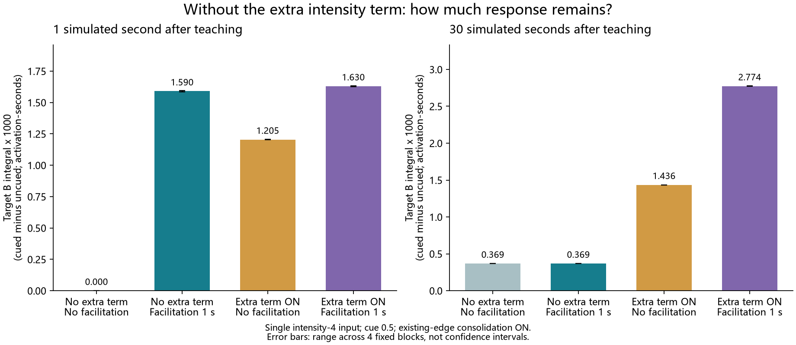
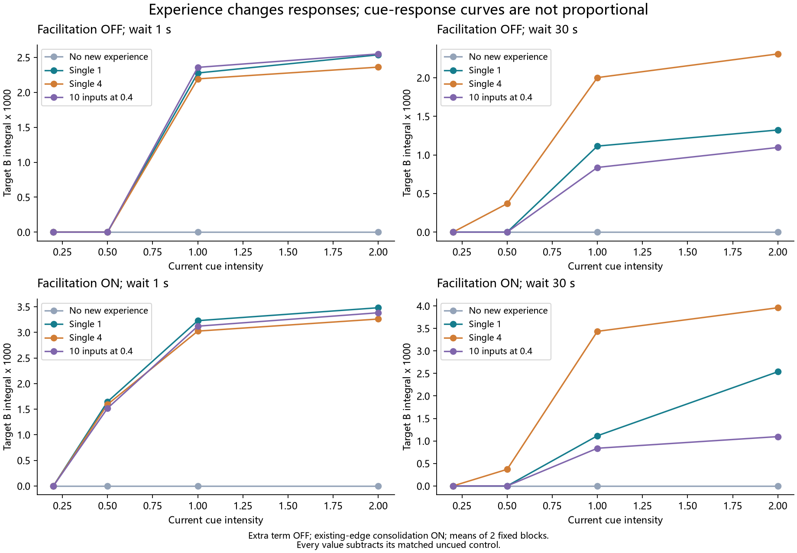
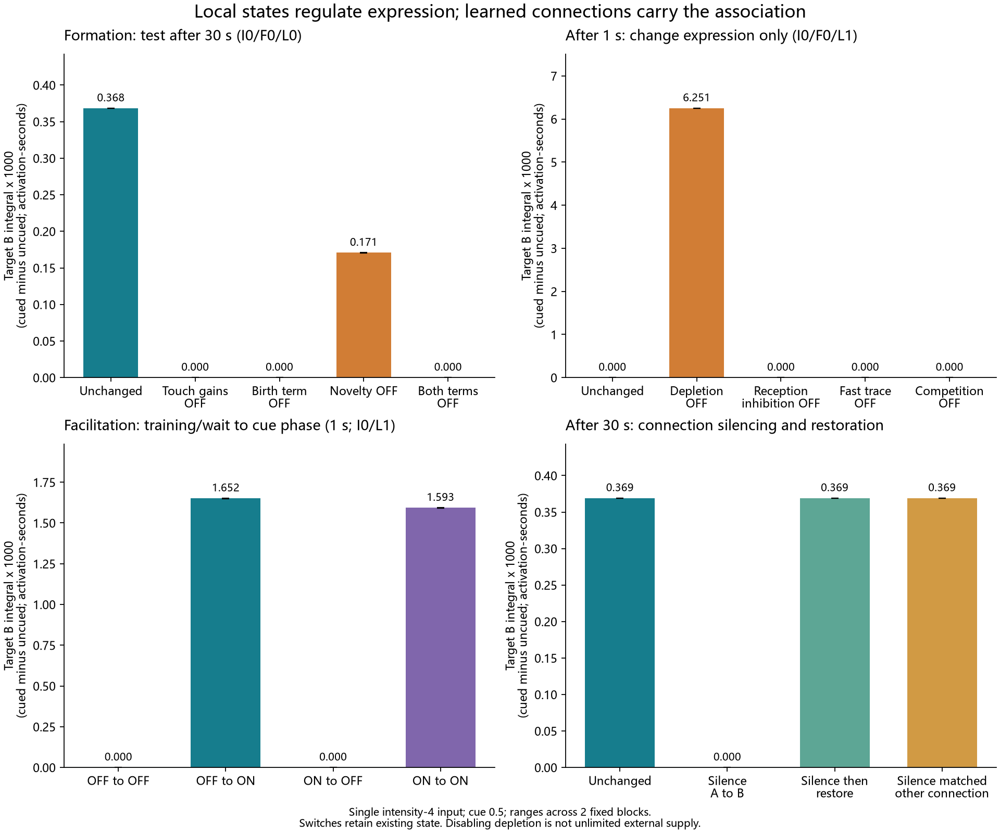

# Intensity mechanism substitution and history dependent sensitivity

[中文](report.zh.md) · [Prospective design](design.en.md) · [Ablation extension](extension.en.md) · [Phase extension](phase-extension.en.md)

Registered 2026-09-30. Platform project **2026-09-30 强刺激机制替代与经历敏感性**, ID `91dfc963-f441-49b7-8dc6-65dba73ab2cb`. Completed 1,246 new stored instances and four observation-free replays. Historical data, Core formulas and ordinary defaults remain unchanged.

## Main findings

**A separate detector for “strong input” is not required for all strong-input advantages.** With the extra consolidation term reading `max(0, intensity−1)` disabled, strong experience still produced cue-accessible traces absent after ordinary experience. Coactivation at connection birth, ordinary touch consolidation and local novelty contributed to this effect; ablations located their roles.

**The current extra term is nevertheless not functionally redundant.** Removing it and using one-second facilitation exceeded the ordinary configuration's early weak-cue response, but retained only about 25.7% at 30 seconds. Similar functional direction is not equivalent performance across time.

**Facilitation mainly improved expression in this study, not durable storage.** Disabling it immediately before a cue removed the early improvement even when it had been enabled during training. Temporary failure to respond was not necessarily loss of the learned connection.

**Local energy depletion and recovery explained a specific temporary expression failure.** Some copies failed to respond at one second but responded at 30 seconds. Removing depletion only during the probe restored the early response; removing reception inhibition did not. Silencing the learned A→B connection eliminated the later response; restoring it reproduced the complete original activation trajectory.

**Experience and current state jointly shape sensitivity.** Without new AB experience, even a cue of intensity 2 produced no net B response. After strong experience, a 0.5 cue could do so. Conversely, holding history and state fixed, increasing current cue intensity was nondecreasing in these tests. The study did not establish an inverse current-input response curve.

## Design

The Rust backend ran `threemind.continuous-memory/2`; Python reference implementation supplied mechanism witnesses. Implementation baseline: Git `2d23297`. Source files and process-start tool revisions were frozen and bound to case evidence.

A/B/C/D were anonymous channels with external observer labels, plus independent maintenance channel K. Four fixed blocks—930401/930402 for discovery and 930411/930412 for prospectively specified validation—combined prior amplitude 0.3/0.4 and interval 0.5/1 second. Encoding seeds are not independent ecological worlds, and cloned branches are not independent statistical samples.

Each parent received AC and BD, 12 consecutive presentations per pair, then waited five seconds. Identical parents forked into no new AB experience, one AB input at intensity 1, one at 4, or ten at 0.4 separated by 0.5 seconds. Last teaching time matched; single 4 and ten 0.4 matched nominal total quantity, not temporal distribution.

| Factor | OFF | ON | Scope |
| --- | --- | --- | --- |
| I: extra intensity term | `intensity_gain=0` | 0.075 | Additional consolidation reading intensity above 1 |
| F: facilitation | tau 0 | tau 1 second | History-dependent local release utilization |
| L: existing-edge consolidation | false | true | Positive updates to existing weights/stability; OFF retains birth, node history and forgetting |

The complete I×F×L matrix retained ordinary first/repeat consolidation, forgetting, novelty, inhibition, local depletion/recovery, fast trace and local input competition, except named ablations. The ordinary global energy ledger was disabled; local resources still depleted and recovered. Removing local depletion is a research intervention, not unlimited external food supply.

At 1/30/300 simulated seconds, independent A-cue 0.5 and uncued copies were observed for five seconds. K received 0.2 every 0.5 seconds, separately from task frames; this was disclosed synthetic maintenance, not host telemetry. Extensions added cues 0.2/1/2 and facilitation constants 0.1/0.3/3 seconds. Each extension was registered before its branches ran.

The primary mechanistic measure was the fixed-window B activation integral minus the matched uncued integral, in activation-seconds. Original steady-state classification and V2 decision-time activation rankings were retained alongside it. Means and ranges describe fixed blocks; no false independent-sample significance is reported.

## Replacement result

Single intensity-4 teaching, cue 0.5, existing-edge consolidation ON; four-block means. Values below are multiplied by 1000 for readability.

| Configuration | After 1 s | After 30 s | After 300 s |
| --- | ---: | ---: | ---: |
| No extra term, no facilitation | 0 | 0.368592 | 0 |
| No extra term, facilitation 1 s | 1.590184 | 0.368689 | 0 |
| Extra term, no facilitation—ordinary configuration | 1.204764 | 1.435612 | 0 |
| Extra term and facilitation 1 s | 1.630138 | 2.774065 | 0 |

Without the extra term, facilitation retained approximately 132.0% of the ordinary configuration's response at one second and 25.7% at 30 seconds. Against the reference with facilitation also ON, the corresponding figures were 97.5% and 13.3%. All blocks gave the same direction. The prospectively specified 80% engineering approximation held early but not later; it is not a biological criterion.

All main-matrix AB edges had disappeared by 300 seconds, with zero net target response. Zero versus zero does not establish equivalence. This short teaching protocol does not overturn the preceding study's 300-second recall after more extensive training.

## Local origins of the remaining strong-input effect

In block 930401 with I0/F0, ordinary intensity 1 produced immediate endpoint activations of 0.9; intensity 4 produced 1.0. New AB weights were 0.091435 versus 0.122639, and stabilities 0.034915 versus 0.139661, without the extra term.

The birth coactivation contribution changed from `0.065×(0.5+0.9×0.9)=0.08515` to `0.065×(0.5+1×1)=0.0975`. Ordinary touch consolidation also scaled with incident quantity and local plasticity. Saturation did not erase already-arrived influence. Both endpoints already had experience, so the first-touch bonus was not the main contributor here.

Thus continuous local rules supplied part of the function without a separate strong-input classification threshold. It was not an effect appearing without any amplitude-dependent rule at all.

Two-block formation ablations, I0/F0/L0, cue 0.5 after 30 seconds:

| Change during new experience | Mean AB weight | Net B integral ×1000 |
| --- | ---: | ---: |
| Unchanged | 0.076949 | 0.368264 |
| Ordinary first/repeat consolidation OFF | 0.057760 | 0 |
| Birth weight term OFF | 0.013691 | 0 |
| Novelty OFF | 0.066953 | 0.170725 |
| Ordinary consolidation and birth term OFF | 0 | 0 |

Removing novelty reduced this response by **53.6%**, rather than eliminating it. Ordinary-consolidation or birth-term ablation left weaker connections that this weak cue could not activate detectably. Repeating those two ablations under I0/F1/L1 did not restore the 30-second weak-cue response. This is conditional necessity for this measurement, not proof of no memory at every possible cue strength. A small L effect in a single new-edge task does not make existing-edge consolidation dispensable.

Equal incident quantity represented as `(value=1,intensity=1)` or `(value=0.25,intensity=4)` yielded identical full Core hashes when the extra term was disabled, both in Python/Rust witnesses and platform instances. With the extra term enabled, hashes differed. The existing extra term therefore depends on parameter factorization in addition to physical incident quantity.

## Facilitation and default recommendation

Facilitation temporarily raises a connection's release utilization after transmission. It is distinct from long-term strengthening; limited available energy can still reduce actual transmission.

I0/L1, single intensity 4, cue 0.5, two fixed blocks:

| Facilitation constant | Net B integral ×1000 at 1 s | At 30 s |
| --- | ---: | ---: |
| OFF | 0 | 0.369069 |
| 0.1 s | 0 | 0.369108 |
| 0.3 s | 1.243081 | 0.369145 |
| 1 s | 1.593365 | 0.369165 |
| 3 s | 1.732694 | 0.369192 |

One second was effective early. Three seconds added about 8.7% relative to one second, with almost no extra benefit for the later weak cue. At 0.1 seconds the early response remained absent.

Phase switching showed: facilitation OFF during training/wait and ON just before the one-second probe gave 0.001652; ON during training/wait and OFF before probing gave zero; continuously ON gave 0.001593. Expression, rather than substantially stronger long-term storage, accounted for the main improvement here.

An implementation boundary matters: reconfiguration first settles existing utilization with the old parameters and retains it. OFF mode retains basal utilization 0.5, whereas continuously facilitated but inactive connections can decay toward zero. Turning facilitation ON at runtime is therefore not equivalent to enabling it from birth. Larger 30-second switch-on responses must not be advertised as continuously enabled performance. This boundary is now a separate research item; no historical transition rule was changed.

**Recommend one-second facilitation for subsequent associative-recall research, while keeping the ordinary creation default OFF for now.** Retain basal utilization 0.5, recovery 0.8 seconds, active-state tau 0.003 seconds, depletion, inhibition and forgetting. From-birth interference and environmental-adaptation comparisons should precede a universal default change. The preceding study also did not show universal motor improvement.

Mechanism reference: [Markram, Wang and Tsodyks, 1998](https://web.stanford.edu/class/cs379c/archive/2016/class_messages_listing/articles/MarkrametalPNAS-98.pdf). It supports activity-dependent release and interactions between facilitation and depletion, not the optimality of ThreeMind's particular parameters.

## Experience and present state

At the same cue intensity 0.5, no new AB experience gave no net B response, while strong experience could be recalled after 30 seconds. Increasing the no-experience cue to 2 still gave no B response: experience changed the effective sensitivity of this pathway.

Under I0/F1/L1, with identical cue intensity 1:

| Experience | Net B integral at 1 s | At 30 s |
| --- | ---: | ---: |
| No new experience | 0 | 0 |
| Single ordinary 1 | 0.00322912 | 0.00111479 |
| Single strong 4 | 0.00302533 | 0.00343535 |
| Ten inputs at 0.4 | 0.00312155 | 0.00083764 |

Strong experience produced about 6.3% less early response than ordinary experience but about 3.08 times as much later. Stronger formation, stronger stored connections and stronger current expression are different quantities.

With the trained I0/F0/L1 state held fixed, intervene only immediately before probing:

| Expression intervention | Net response at 1 s | At 30 s |
| --- | ---: | ---: |
| None | 0 | 0.000369069 |
| Depletion OFF | 0.006250918 | 0.000369069 |
| Reception inhibition OFF | 0 | 0.000369069 |
| Fast trace OFF | 0 | 0.000369069; difference about 3.7×10⁻¹³ |
| Local input competition OFF | 0 | 0.000369069 |
| Further existing-edge consolidation OFF | 0 | 0.000369069 |

In the first block, available AB resources were about 0.304 at one second and approximately 1 at 30 seconds. Target inhibition fell from about 0.0119 to nearly zero. Removing inhibition alone did not restore the early response; removing depletion did. This localized the temporary expression failure primarily to local depletion/recovery in this condition. Depletion removal is diagnostic, not a recommended normal setting.

Operator states are recovered lazily. Analysis projected stored energy and fast-trace states from their timestamps to the observation time without modifying Core. Fast trace was very small here; local competition had no target effect. The material did not adequately engage simultaneous conflicting inputs, so their separate multi-source experiments remain open. History, cue intensity and energy have now been separated; inhibition's independent importance in other tasks remains to be tested.

## Connection causality

I0/F0/L1, strong experience, 30-second wait; both fixed blocks:

| Intervention | Net B integral |
| --- | ---: |
| Unchanged | 0.000369069 |
| Silence A→B | 0 |
| Silence then restore | 0.000369069 |
| Silence a weight/stability-matched connection not outgoing from A | 0.000369069 |

All four restored cued/uncued trajectories matched every sampled node activation of the original branches exactly, with maximum difference zero. Matching choices and errors are preserved in `matching-*.json`. The learned connection carried the observed effect.

The lower-left phase comparison is at one second; the lower-right connection comparison is at 30 seconds.

## Readouts and scope

There were 1,068 observation branches: 582 cued and 486 uncued. V2 detected a stable proportional pattern in all branches, but **B was absent or zero at every decision-time ranking**; sustained K activity generally remained. V1 classified all 582 cued windows as unresolved. Uncued branches did not fabricate cue envelopes.

Of the cued branches, 172 had positive net B process integrals and none negative. Because this includes deliberately disabled and blank controls, 172/582 is not an accuracy score. Maximum trajectory sampling gap was 20 ms; paired windows shared absolute timestamps and the full five-second duration.

These are transient associative responses, not successful final stable answers. Conversely, absence from the final ranking does not erase the recorded preceding activity. All nodes and background activity were preserved without semantic cropping.

No persistent node saturation was observed in the main matrix. With intensity-2 probes included, the highest mean fraction of saturated nodes over recorded samples was approximately 0.000791, corresponding to transient receptor saturation rather than a sustained network-wide plateau.

## Decisions and next work

1. Preserve the ordinary extra term and historical protocols. Existing `intensity_gain=0` already supplies the candidate without it; no Core rewrite is needed for further comparison. The current result supports exploration, not lossless replacement.
2. Prefer one-second facilitation for subsequent associative mechanism studies, with OFF controls. Retain depletion/recovery, inhibition and forgetting; do not change ordinary creation defaults in this study.
3. Investigate retention and interference through birth, ordinary touch consolidation and novelty—the local sources located here—before adding another strong-event detector.
4. Separate retained-state hot switching, zero-initialized facilitation and continuous from-birth facilitation. Any future transition change needs versioned handling.
5. Complete dedicated multi-source competition/fast-trace tests and the distinct explanation of the earlier inertial-sensory reversal. This experiment does not answer those tasks by proxy.
6. Maintain the distinction between storage, formation, retention and expression. History/state-dependent sensitivity and partial replacement are supported; universal historical dominance and complete replacement are not established.

The research method is documented in [the discussion](../../../docs/en/plans/mechanism-discovery-and-intensity.md); unresolved items are in [the backlog](../../../docs/en/plans/research-backlog.md). A useful artificial control demonstrates task utility, not that nature must implement the same switch.

## Verification and resources

- All 1,246 database checkpoints matched local saved models. All 194,072 envelopes and deliveries were verified, without filtering, undelivered frames or changed Core inputs.
- Six bilingual registration notes matched their source files; four process-start tool bundles passed hash verification. Core implementation provenance was unchanged.
- Four observation-free replays reproduced the full Core state hashes of observed runs.
- Five mechanism/protocol checks and 20 kernel-registry regressions passed. One registry test initially failed during Windows temporary-directory setup and passed after execution approval; dynamics were not altered.
- Aggregate case execution and recording wall time: 2,673.34 seconds, approximately 44.6 minutes. One worker; guards enforced RSS≤4 GiB and system/disk reserves.
- At audit, local evidence occupied about 211 MiB and conservative whole-database growth about 2.18 GiB. Shared account usage rose from 73% to 75%; final archive-inclusive totals are recorded at delivery.
- Registered caps were 2,048 cases, two hours aggregate execution, 6 GiB expansion stop/8 GiB hard storage cap, and account +6/+10 percentage-point stops. A STOP file now ends new simulations. No historical data was deleted.

The platform archive includes input JSONL, models, full trajectories, interventions, registrations, tools and summaries. Reported decimals are rounded; `analysis-final.json` and `summary-final.json` retain machine-readable results.
