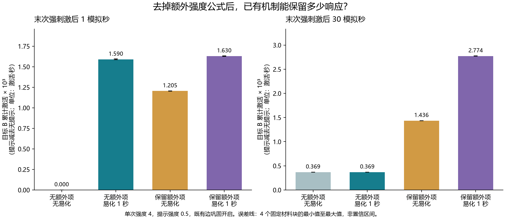
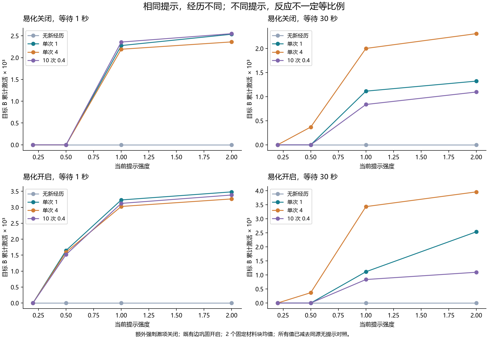
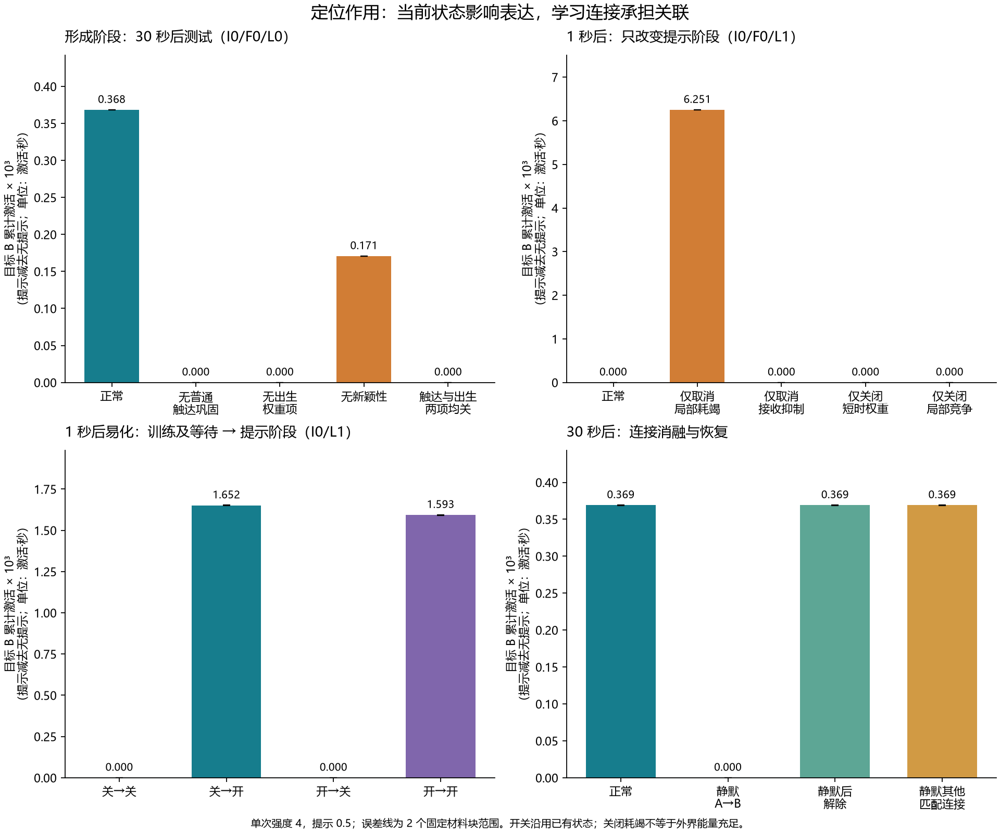

# 强刺激机制替代与经历敏感性：实验结果

[English](report.en.md) · [事前设计](design.zh.md) · [追加消融](extension.zh.md) · [易化阶段对照](phase-extension.zh.md)

2026-09-30 登记。平台研究项目：**2026-09-30 强刺激机制替代与经历敏感性**，ID `91dfc963-f441-49b7-8dc6-65dba73ab2cb`。完成 1,246 个新实例，另做 4 个只读复演。旧数据、Core 公式及普通默认均未修改。

## 先用直白的话说结果

**“强刺激不一定需要一个专门识别强刺激的开关”得到了支持。** 关闭 `强度超过 1` 的额外巩固项后，强经历仍能留下普通经历没有表现出来的可唤起痕迹。成边时的共同激活、普通触达巩固和局部新颖性已经可以共同产生这种差别。消融也找到了这些组成部分的实际作用。

**但现在还不能把额外项当作完全无用的代码删掉。** 不用额外项、改用 1 秒易化，在学习后 1 秒的弱提示测试中比当前普通配置响应更大；到 30 秒，只保留其约 25.7% 的目标响应。功能方向相似，跨时间的效果并不等价。

**易化这次主要帮助“把已有痕迹唤起来”，没有明显把连接存得更牢。** 只在提示前关闭易化，早期增益就消失；只在训练期使用易化，并不能保住这个增益。不能把唤起改善全部记成长期记忆增强。

**“眼下没反应”确实可能只是暂时表达不出来。** 一组实例在 1 秒后没有目标净响应，30 秒后又有了。单独取消局部能量耗竭能让早期响应恢复；只取消接收抑制做不到。连接静默／恢复进一步确认，唤起经过的是学到的连接，而非把提示残余误当成联想。

**同一刺激的反应受经历和当前状态共同决定。** 没有 AB 经历的副本，即使提示强度为 2，也没有 B 的净响应；有过强经历的副本，0.5 提示即可唤起 B。另一方面，在固定经历与状态下，本轮增加当前提示强度仍是非递减的，没有观察到“同一状态下提示越强，B 反而越弱”。这两点应同时保留。

## 怎样测试

使用 `threemind.continuous-memory/2` 的 Rust 后端，Python 参考实现用于机制见证。实现基线 Git `2d23297`；完整源文件和执行工具在实验时冻结，逐实例绑定实现摘要。

材料为 A、B、C、D 四个匿名通道及独立维持通道 K。字母只是研究者标记，不进入 Core。四个固定材料块 930401、930402、930411、930412，分别搭配先前刺激幅度 0.3／0.4、间隔 0.5／1 秒；后两块用于预先指定的复验。它们不是四种独立生态世界，不把副本数量当作统计独立样本量。

各块先共同输入 AC、BD 各连续 12 次，等待 5 秒，再从相同父状态分叉。新的 AB 经历有四类：没有新经历、单次强度 1、单次强度 4、10 次强度 0.4。末次教学时间相同；重复间隔 0.5 秒。单次 4 与十次 0.4 的名义输入总量相同，时间分布不同。

主矩阵为三项开关的八种组合：

| 简记 | 关闭 | 开启 | 实际影响 |
| --- | --- | --- | --- |
| I：额外强刺激项 | `intensity_gain=0` | `0.075` | 单独读取 `max(0, intensity−1)` 的额外巩固 |
| F：易化 | 时间常数 0 | 1 秒 | 局部释放利用率随近期传递变化 |
| L：已有边巩固 | false | true | 已有边正向增重与稳定；关闭后仍有生边、节点历史和遗忘 |

普通首次／重复巩固、遗忘、新颖性、抑制、局部耗竭与恢复、快痕迹和局部竞争保持默认，只有相应消融分支改变其指定量。普通默认的整体能量账本未开启，局部可用能量仍会消耗和恢复；“取消局部耗竭”的研究分支不代表无限外部食物供应。

等待 1、30、300 模拟秒后，用 A 的 0.5 提示与同源无提示副本比较，观察 5 秒。K 每 0.5 秒输入 0.2，只用于维持活动；它不与任务合帧，不伪称宿主遥测。补充提示量为 0.2、1、2；补充易化时间常数为 0.1、0.3、3 秒。所有追加内容在相应分支执行前登记。

本轮机制主指标是 B 的完整过程累计激活减去同源无提示累计激活，单位为“激活·模拟秒”；保留原稳态判定及 V2 模式收敛时的激活排序。表中的数值均为固定材料块的算术均值，未报告虚假的独立样本显著性。

## 额外项能否被替代

以下均为单次强度 4 教学、提示 0.5、已有边巩固开启，四块均值。为方便阅读，累计激活乘了 1000；例如 0.369 对应真实积分约 0.000369。

| 配置 | 1 秒后 | 30 秒后 | 300 秒后 |
| --- | ---: | ---: | ---: |
| 无额外项、无易化 | 0 | 0.368592 | 0 |
| 无额外项、易化 1 秒 | 1.590184 | 0.368689 | 0 |
| 保留额外项、无易化（普通配置） | 1.204764 | 1.435612 | 0 |
| 保留额外项、易化 1 秒 | 1.630138 | 2.774065 | 0 |

无额外项＋易化相对普通配置，在 1 秒为约 132.0%，30 秒为约 25.7%。如果对照也开启易化，对应约 97.5% 和 13.3%。四块分别给出相同方向，不能挑早期一个时刻宣称完全替代。事前约定的 80% 工程近似条件，在早期达到，在较晚时刻没有达到。

300 秒时，主矩阵全部 AB 边已经消失，所有目标净响应为零；全零不能作为等价证据。这是这套较短教学材料的结果，不推翻上一轮更充分训练后仍有 300 秒唤起的结果。

## 强刺激优势来自哪些旧机制

以 930401 的即时训练状态举例：关闭额外项、未开易化时，普通输入 1 令两节点激活为 0.9，强输入 4 令其为 1。新 AB 边权分别为 0.091435、0.122639，稳定度分别为 0.034915、0.139661。后者更强，并没有使用“超过 1”的额外项。

这里有两条明确的局部来源：

- 出生公式中的共同激活部分，从 `0.065×(0.5+0.9×0.9)=0.08515` 变为 `0.065×(0.5+1×1)=0.0975`。
- 普通触达巩固仍依赖实际入射量和局部可塑性。强输入增加该巩固量，饱和不撤销已经到达的作用。本例两个节点均已有经历，首次增益不是主要来源。

因此，这不是“彻底没有任何幅度规律却凭空出现强刺激效应”，而是**不需要独立的强度分类门槛，连续的局部规则已能承担一部分功能**。

两块追加消融在 I0/F0/L0 下进行，保持其余机制，30 秒后提示 0.5：

| 新经历阶段的改动 | AB 平均边权 | B 净累计激活 ×1000 |
| --- | ---: | ---: |
| 保持原机制 | 0.076949 | 0.368264 |
| 关闭普通首次／重复触达巩固 | 0.057760 | 0 |
| 关闭出生权重项 | 0.013691 | 0 |
| 关闭新颖性 | 0.066953 | 0.170725 |
| 普通触达巩固和出生权重项都关 | 0 | 0 |

关闭新颖性使此条件的目标响应下降 **53.6%**，没有完全消失。只关普通触达巩固或出生权重项，已有的较弱连接还在，却不能被这个弱提示唤起。I0/F1/L1 下重复这两项消融，也没有恢复 30 秒弱提示响应。

这定位了当前参数下的作用，不能扩张为“去掉任一项在所有提示量下都完全没有记忆”。已有边巩固 L 的作用与出生、普通触达巩固不同，不能因为单次新生边条件下 L 的差别较小就取消它。

另一个干净的校验是相同入射量的两种写法：`value=1,intensity=1` 和 `value=0.25,intensity=4`。关闭额外项时，Python／Rust 见证以及两个平台实例的最终完整 Core 哈希均一致；保留额外项则不同。这确认了现有额外项确实额外依赖参数拆分，而不只依赖入射量。

## 易化的收益和合适默认值

易化是“连接刚传过信号，短时间内更容易再次释放”。它提高释放利用率，不直接等同于长期连接加固；可用能量不足仍能使实际传递减弱。

I0/L1、单次强度 4、提示 0.5，两个材料块：

| 易化时间常数 | 1 秒后 B 净累计激活 ×1000 | 30 秒后 |
| --- | ---: | ---: |
| 关闭 | 0 | 0.369069 |
| 0.1 秒 | 0 | 0.369108 |
| 0.3 秒 | 1.243081 | 0.369145 |
| 1 秒 | 1.593365 | 0.369165 |
| 3 秒 | 1.732694 | 0.369192 |

1 秒在这组早期唤起中有效；3 秒比 1 秒增加约 8.7%，但在较晚的弱提示中几乎没有额外收益。0.1 秒未恢复早期响应。

阶段切换更清楚：保持 I0/L1，在强经历后 1 秒进行测试，训练及等待期间关闭易化、提示前开启时，响应为 0.001652；训练及等待期间开启、提示前关闭时为 0；始终开启为 0.001593。**这里改善的主要是表达，不是长期储存量。**

有一个必须保留的实现细节：运行中从关闭切到开启，现有 `u` 状态会沿用并按旧参数先结算。关闭模式保留基础利用率 0.5，而始终开启但长时间未传递时，动态 `u` 可以衰减到接近零。因此“临时开启”不等于“从出生一直开启”；30 秒切换组更大的响应不能当作常开易化的收益。该边界已列入待办，没有修改旧状态衔接规则。

**建议：关联唤起研究优先使用 1 秒易化；普通新建默认本轮仍保留关闭。** 保持利用率 0.5、恢复时间常数 0.8 秒、活跃态时间常数 0.003 秒，保留局部耗竭、抑制和遗忘。下一步应做从出生配置易化的干扰和环境适应对照，再决定产品默认，而不是为单项输出更亮把它普遍打开。上一轮也未发现易化普遍改善运动任务。

生物机制参照：[Markram、Wang、Tsodyks，1998](https://web.stanford.edu/class/cs379c/archive/2016/class_messages_listing/articles/MarkrametalPNAS-98.pdf)。该研究支持活动历史影响释放、易化与耗竭相互作用这类模型；不证明 ThreeMind 的具体参数已最优。

## 经历、当前能量与抑制怎样改变敏感性

同一 0.5 提示，在没有 AB 新经历时不唤起 B；有强经历且等待 30 秒时可以。没有新经历的副本即便把提示加到 2，B 仍无净响应。这给出了“经历改变了目标通路的敏感性”的直接对照。

更有意思的是时间交叉。在 I0/F1/L1 下，相同强度 1 提示：

| 先前经历 | 1 秒后 B 净累计激活 | 30 秒后 |
| --- | ---: | ---: |
| 无新经历 | 0 | 0 |
| 单次普通 1 | 0.00322912 | 0.00111479 |
| 单次强刺激 4 | 0.00302533 | 0.00343535 |
| 10 次 0.4 | 0.00312155 | 0.00083764 |

强经历在较早时反而比普通经历低约 6.3%，稍后则约为 3.08 倍。**更强的形成过程、更强的连接和眼下更强的输出，不是同一件事。**

固定 I0/F0/L1 的强经历，只在提示前改变单项机制：

| 提示阶段的干预 | 1 秒后净响应 | 30 秒后净响应 |
| --- | ---: | ---: |
| 无干预 | 0 | 0.000369069 |
| 取消局部耗竭 | 0.006250918 | 0.000369069 |
| 取消接收抑制响应 | 0 | 0.000369069 |
| 关闭快痕迹 | 0 | 0.000369069（差约 3.7×10⁻¹³） |
| 关闭局部输入竞争 | 0 | 0.000369069 |
| 关闭已有边进一步巩固 | 0 | 0.000369069 |

在首块中，1 秒后的 AB 局部可用能量比例约 0.304，30 秒后接近 1；目标抑制从约 0.0119 降至近零。单独取消抑制没能救回早期响应，取消耗竭能，因此已把这组暂时无法表达的主要原因定位到局部耗竭／恢复。取消耗竭是诊断干预，不是推荐修改正常内核。

局部能量和快痕迹按需恢复，状态文件保存的是上次更新时间的值；分析工具已按各自时间常数换算到观察时刻。没有直接改写 Core 状态。

本轮快痕迹影响很小，局部竞争没有目标效应；这里没有足够的同时多路冲突，不能据此认定这些机制无用。③所需的独立多源汇合与竞争实验仍未结。④的经历、提示量和局部能量已有拆分证据，抑制在其他任务中的独立作用仍需另测。

## 确认是连接起作用

I0/F0/L1、单次强经历、等待 30 秒，两个材料块均得到：

| 干预 | B 净累计激活 |
| --- | ---: |
| 正常 | 0.000369069 |
| 静默 A→B | 0 |
| 静默后解除 | 0.000369069 |
| 静默另一条按权重／稳定度匹配的非 A 传出边 | 0.000369069 |

解除静默的有提示、无提示共 4 条完整轨迹，在每个记录时刻、每个节点上与原分支一致，最大差值为 0。匹配方法、实际连接和误差均保存于 `matching-*.json`。这是本轮局部通路的因果验证，不以固定接线代替学习形成。

图左下的易化阶段切换比较为学习后 1 秒；右下的连接静默比较为 30 秒。

## 读出结果及边界

共 1,068 个观察副本：582 个有提示，486 个无提示。V2 都检测到比例趋稳的窗口；**目标 B 在该判定时刻的排名中全部为零／缺席**，主要剩下持续的 K 活动。V1 对 582 个提示窗口均给出 unresolved；无提示副本不伪造提示窗口。

582 个有提示副本中，172 个有正的 B 净过程积分，0 个为负。这里包含刻意关闭机制和空白对照，172/582 不是模型准确率。过程最大采样间隔 20 ms，使用相同绝对时间、相同五秒长度的无提示副本扣除残余。

结论是确实存在短暂联想响应，不能把它改名为“最终稳定输出成功”；同样不能因为稳定排名没包含它，就说内部没有这段活动。所有节点及 K 的原始活动都保留，没有按语义裁掉背景。

主矩阵未见节点持续封顶。加入强度 2 的提示后，最大记录样本平均封顶比例约 0.000791，是瞬时受体饱和，未观察到持续全网络饱和。

## 决策与后续

1. **保留普通基线中的额外项及旧协议。** 现有证据支持探索取消，不支持宣称无损等价。无额外项的候选可直接用现有参数 `intensity_gain=0`，无需先改 Core。
2. **后续关联机制研究首选 1 秒易化。** 同时保留 0 秒对照；不取消局部耗能、恢复、抑制或遗忘。暂不修改普通新建默认。
3. **优先调普通局部机制的时间尺度和保持量。** 以本轮确定的出生、普通触达巩固、新颖性为候选，观察能否在不加额外分类门槛的情况下延长可唤起时间；同时测干扰，不能只追求留得更久。
4. **单列热切换状态的研究。** 明确“保持已有释放状态”“新易化机制从零开始”“一直启用”三者，版本化处理任何未来修改。它们不能混作同一个默认值实验。
5. **保留短时变化／局部竞争的专门实验。** 同时多源输入、冲突历史与间隔扫描尚未完成；惯性感官反向对应的原因也不能由本轮代答。
6. **继续区分存在、形成、保持与表达。** 本轮支持“经历与状态共同塑造敏感性”及“额外强刺激门槛不是产生该方向效果的必要条件”。尚未量化在任意环境中是否“主要”由经历决定，也没有证明所有强刺激效果已被完全替代。

人工功能对照的方法已收入 [讨论与方法](../../../docs/zh/plans/mechanism-discovery-and-intensity.md)，未结工作汇总于 [研究待办](../../../docs/zh/plans/research-backlog.md)。人工规则有用说明其任务功能值得研究，不等于自然界必有同一个开关。

## 完整性与资源

- 1,246 个数据库检查点与本地模型逐一校验；194,072 个输入信封及 194,072 次递送逐一核对，无过滤、未递送或原始输入不一致。
- 六篇设计／追加登记笔记与对应文件一致；四套运行工具源码包均验证摘要。Core 实现摘要保持不变。
- 四个关闭全部观察工具的复演，与原带工具运行的完整 Core 状态哈希一致。
- 5 项机制／协议校验和 20 项版本注册回归通过；其中一个回归因 Windows 临时目录权限先失败于 setup，获执行权限后通过。没有修改动力学来通过测试。
- 各实例运行与记录累计墙钟 2,673.34 秒，约 44.6 分钟。单 worker；守护检查限制 RSS 4 GiB，保留至少 2 GiB 可用内存及 C／E 盘余量。
- 审核时本地证据约 211 MiB，数据库总体增长保守计入约 2.18 GiB；账户已用量从 73% 到 75%，包含共享账户变化。归档后的准确占用与回读校验见交付记录。
- 资源上限为 2,048 实例、2 小时累计运行、6 GiB 停止扩展／8 GiB 硬上限，账户 +6 点停止扩展／+10 点停止新模拟。已写 STOP，结束新模拟。无旧数据清理。

完整输入 JSONL、模型、轨迹、消融记录、原始设计、工具源码和汇总表随平台证据包交付。报告中小数为便于阅读的舍入，机器结果以 `analysis-final.json` 与 `summary-final.json` 为准。
