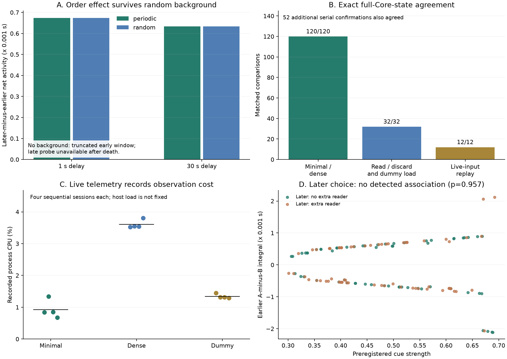

# E23: the order effect survives background replacement; distinguish readout from live feedback

[中文](report.zh.md) · [Preregistration](design.en.md) · [Execution corrections](execution-notes.md) · [Commands](README.md)

2026-10-01. Lab project **E23 Background input, observation effects and later choice**, ID `1a3e275e-4a4b-4be1-94a3-242e663e3470`. Core, historical instances, prior evidence, the additional intensity term and all product defaults remain unchanged.

## Main finding

**The established order effect survived this check. CPU telemetry feedback or additional readout did not manufacture it.** The selected E22 dense course used synthetic K every half simulated second; host, process and runtime telemetry were disabled. Stored protocols and actual inputs for 24 relevant historical cases were checked before replication.

Replacing repeated K with a different random anonymous channel on every occurrence retained the reversal of response advantage when teaching order reversed, with identical numerical results. Removing background still produced the same early target trajectory, but activity subsequently ceased and the instance died before the 30 s test. In this particular course, background can maintain survival without repeatedly reusing one background identity to encode order.

For identical inputs, extra readers, reading without saving, and synthetic computation/I/O did not change tested full Core states. Live telemetry is different: actual physical activity becomes additional input. Every final live result was reproduced exactly by replaying its recorded input tape. A separate 128-case later-choice audit found no association with already-fixed earlier results. This was not a physical quantum experiment.

## 1. Does the established effect remain?

Retain E22 configuration and mapping: twelve AX/BX or BX/AX pairs, 550 ms between pair starts, 50 ms inside each pair, 40 ms offset, teaching intensity 0.4 and cue X=0.5. Facilitation stays disabled; inhibition, forgetting and local depletion/recovery remain as before. Four anonymous identity blocks each test both teaching directions.

The primary measure remains the 5 s target activation integral minus the matched uncued integral, then later-taught minus earlier-taught. Both directions must exceed the preregistered 1e-6 activation-seconds. A process result is not relabeled as a successful terminal language answer.

| Background | Cue after 1 s | Cue after 30 s | Bidirectional criterion |
| --- | --- | --- | --- |
| Periodic K, intensity 0.2 every 0.5 s | 0.000673956059 | 0.000633961366 | 4/4 identity blocks at each delay |
| Fresh random identity, identical timing/dose | 0.000673956059 | 0.000633961366 | 4/4 at each delay; identical to periodic K |
| None | Same observed early target process, truncated by death | Dead before cue; not testable | Neither counted as failed recall nor as a complete-window pass |

Units: activation-seconds. [Final directional table](tables/background-final.csv). Only background identity is randomized, never dose. This does not generalize to all noise definitions, shared channels or common-frame grouping.

Teaching ends at simulated time 7 s. Without further input, background-free instances die at 9.16 s; with X at 8 s, they die at 10.44 s. Every actually observed A/B sample matches the corresponding periodic-background sample, including uncued controls. No zeros were imputed after death. Random-background full trajectories also match point for point: **48/48 process comparisons agree**, including 16 truncated background-free records.

Terminal A/B activity is zero in all completed periodic/random windows despite nonzero responses during the process. In the periodic example, V2 declares pattern convergence at 38.8 s, with zero A/B activation at that decision. The random-background example is `unresolved`, with no decision time and **null** decision-time activation. Their target trajectories nevertheless match point for point: global pattern convergence and the existence of target responses are distinct. The raw node table retains peaks and integrals; candidates are not all activity.

Delivery correction: the first narrative conflated these two decision states. Field-by-field report-preview verification caught it. This is an appended report/note revision; retain the original revision and main evidence archive, with a separate small correction archive. No raw readout is altered and null decisions are not filled with zeros.

## 2. Same-input observation checks

Minimal observation includes common input receipts, coarse global metrics, checkpoints and final capture. Dense observation adds existing V1/V2 readers and 20 ms complete-state recording. Neither condition is literally physically never measured.

| Check | Result |
| --- | --- |
| Dense/minimal pairs across 48 teaching and 192 probe cases | 120/120 identical complete Core hashes; pre-probe hashes also match |
| Read-and-discard and independent CPU/I/O, two repeats each | 32/32 match minimal baselines |
| Extra serial confirmations following a scheduling deviation | 52/52 match previously recorded full states |
| Original K teaching and 30 s cued/uncued cases | All 24 corresponding E22 states reproduced under both observer settings |

Canonical hashes preserve full state, clocks, queues and floating-point bits. Dummy load is not an exact cost-matched sham reader. The test concerns whether extra observation costs alter a model with fixed inputs and simulated-time advancement.

## 3. Live telemetry is a genuine input path

Final live comparison: four interleaved blocks of minimal/dense/dummy conditions, 6 s each. All three physical telemetry scopes sample every 500 ms at intensity 0.2, retaining the established measurements, smoothing and encoding. Runtime metering follows the production definition: advancement/thread CPU, excluding subsequent readout. Host/process probes still observe the total physical workload.

Raw readings, encoded stimuli and both enqueue/delivery times are retained. **12/12 live results were exactly reproduced from their corresponding tapes under minimal observation.** Live inputs and outcomes differ across sessions; different-input outcomes are not unexplained same-input observer effects.

Dense acquisition has substantial CPU/I/O cost that can enter host/process telemetry. Sequential sessions cannot fix every other host activity, cache or scheduler effect, so this small study does not precisely apportion their contributions. It does establish recorded-path reproducibility. The selected E22 result never used this live path; future live-telemetry studies need actual input tapes, not merely identical settings.

| Condition, four sessions each | Mean recorded process CPU | Mean recorded advancement-thread CPU |
| --- | --- | --- |
| Minimal | 0.927% | 0.435% |
| Dense | 3.605% | 0.416% |
| Dummy load | 1.341% | 0.418% |

These use their respective physical probe/meter definitions; subtracting the columns does not estimate other-thread utilization. Production-scope runtime metering excludes subsequent readout, while the process probe still sees it. Values are session/sample means, not CPU peaks or population causal estimates.

An initial pilot had an incorrectly broad runtime measurement boundary. Its 12 live and 12 replay cases remain preserved; the complete final comparison was rerun with corrected metering. Final figures use only that corrected comparison. This was a research-driver error, not a production Core change.

## 4. Later choice and earlier results

All 128 trials have distinct early integral values. Each freezes and flushes its early state, trajectory, scalar result and hash commitment before obtaining a fresh OS-random byte to decide whether to add dense reading during the following second. No model receives the future setting beforehand; no cases are selected by later results.

- Additional reader: 66 trials; no additional reader: 62. All commitments and recorded ordering checks pass.
- Difference in earlier mean A-minus-B integral: 0.000023465678 activation-seconds, approximately 0.030 of the overall sample standard deviation.
- Two-sided test with 9999 permutations stratified by teaching direction: **p=0.957**. No association was detected on the registered outcome.

The common early recording is already measurement. This tests a later extra-reader setting, not an unmeasured quantum state. The sample is sensitive only to relatively large effects; it does not exclude all small anomalies. No anomaly was found, so sampling stops as registered. Dose-response jumps visible in the figure concern the separate threshold-sensitivity question, not an association with the subsequent random choice.

## 5. Delivery and limits

Reusable research tooling now explicitly records real-time telemetry protocols and rejects live sampling under accelerated scheduling; existing defaults retain replay mode. An OS lock prevents two simulation workers in the same study. Tapes preserve when future events entered the queue as well as delivery times. No change enters Core dynamics.

**502 cases are retained:** 424 preregistered cases, 52 serial checks, two initial script records, and 24 measurement-scope pilot cases. These are not 502 independent statistical samples. Failures, deviations and corrections are preserved in the [execution notes](execution-notes.md); no old evidence was cleaned or overwritten.

The tested order result remains worth mechanistic investigation. Telemetry confounding provides no reason to reject it, and this software audit gives no positive reason to expand quantum claims. Other historical courses with real telemetry need their own input-specific audits. Existing autonomy criteria are not rejudged here.

## Authorization in translation

The user approved the proposed isolation of telemetry feedback, requested repetition of an established result with no background and random background, and allowed the ordinary-feedback and later-observation checks to be arranged sequentially with relaxed resource limits. The complete original Chinese authorization is preserved in the linked Chinese report.
