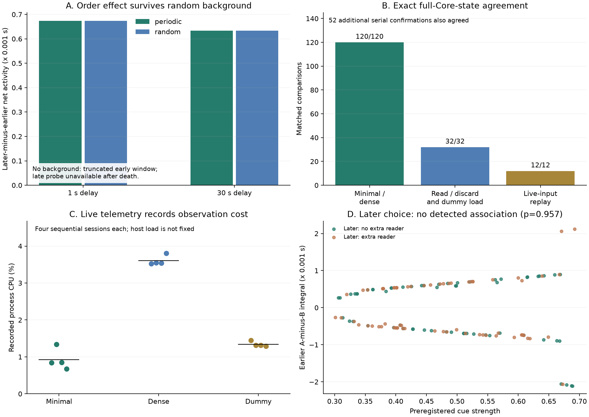

# E23：顺序效应经得住背景替换；读出负载与真实遥测须分开

> **修订 r2 · 2026-10-10**
> 修订原因：原件存储位置已迁移并核验，追加当前位置解析说明，保留原实验结论。
> 原版：[report.zh.md](report.zh.md)；父版本 r1：[report.zh.md](report.zh.md)

[English](report.en.md) · [事前设计](design.zh.md) · [执行更正](execution-notes.md) · [操作说明](README.md)

2026-10-01。研究项目：**E23 背景刺激、观察影响与延后选择**（`1a3e275e-4a4b-4be1-94a3-242e663e3470`）。Core、原意识、旧实验、强刺激额外项及全部产品默认未变。

## 最直接的答案

**这次复验保住了此前的顺序效应：它不是 CPU 遥测反馈或增加读出制造出来的结果。** 原 E22 密集教学实验使用的是每半秒一次的合成 K 背景，并没有打开宿主、进程或实例实时遥测。本次核对了相应 24 个旧实例的数据库协议与实际输入，再重新教学、探测。

把周期性重复 K 换成每次都不同的随机匿名通道后，教学顺序反转时的响应优势仍反转，数值也相同。把背景完全去掉，早期提示仍出现同样的 A/B 活动过程；随后意识因活动消失死亡，30 秒时不能再测试。**背景在本课程中可以维持存活，但不需要靠重复同一背景身份来替它记住先后。** 这句话限于本次匿名课程和背景协议。

同输入下，增加读出、只读不保存、额外计算和写盘，都没有改变受测完整 Core 状态。开启真实遥测则不同：物理负载会成为新的输入。各次实际输入带重放后，全部精确复现相应结果，说明这些普通输入已足以解释受测实时运行。

128 次先封存结果、再随机选择是否增加读出的检查，没有发现后来选择与先前结果的异常关联。它不是物理量子实验，本轮没有量子硬件，也没有得出量子效应成立或不存在的结论。

## 1. 原有顺序效应是否还在

课程、核配置、输入强度和映射沿用 E22：12 对 AX/BX 或 BX/AX，550 ms 对间隔、50 ms 对内间隔、40 ms 整体偏移；教学强度 0.4，提示 X=0.5。易化关闭，抑制、遗忘、局部能量耗竭与恢复等照旧。四个匿名材料块分别检验两个教学方向。

主量继续使用 **提示后 5 秒的目标激活积分，减同源无提示，再作“后教目标−先教目标”**。两个教学方向都超过预定的 1e-6 才通过；没有把本次过程指标冒充原先未成功的末态语言回答。

| 背景 | 教学后 1 秒提示 | 教学后 30 秒提示 | 双向通过情况 |
| --- | --- | --- | --- |
| 周期 K，每 0.5 秒强度 0.2 | 0.000673956059 | 0.000633961366 | 两个等待条件均 4/4 材料块通过 |
| 每次新随机通道，相同时间、相同 0.2 剂量 | 0.000673956059 | 0.000633961366 | 两个等待条件均 4/4 通过，与周期背景相同 |
| 无背景 | 截短窗口中仍见相同目标过程；未作为完整 5 秒通过 | 提示前已死亡，不可测试 | 不计失败，也不补成通过 |

单位为激活·秒。完整逐方向数值见 [最终比较表](tables/background-final.csv)。随机的是匿名通道身份，剂量不随机；不能把本轮扩称所有噪声类型都无影响。

无背景时，共同教学收尾发生在模拟第 7 秒。无后续提示的实例在第 9.16 秒死亡；第 8 秒给 X 的实例在第 10.44 秒死亡。实际观测到的 A/B 每一个共同时间点都与周期背景相同，包括无提示对照；没有将死后的时间补零来凑满窗口。随机背景的完整窗口与周期背景也逐点一致，总共 **48 个轨迹比较全部一致**（其中 16 个为无背景截短记录）。

周期与随机背景组在观察结束时 A/B 激活均为零。这和过程中存在明确响应不矛盾。周期背景示例中，V2 在第 38.8 秒判为模式收敛，A/B 在该时刻均为零；随机背景示例则为 `unresolved`，没有收敛判定时刻，因此“判定时刻激活”为**空值**。两者的目标轨迹却逐点相同：全局活动模式是否收敛，与目标响应是否存在必须分开。原始节点表保留峰值和积分，候选列表不是全部活动。

交付校订：首版说明将上述两种判定混写，报告预览逐字段回读时发现并更正。本版为报告／笔记的追加修订，保留初版与主证据包；另附小型校订包。不修改任何原始读出，也不把未判定补成零。

## 2. 观察本身有没有改变内核

“最小观测”仍有输入回执、低频整体指标、关键快照及统一末态保存，不宣称物理上完全没被测量。密集组另加既有 V1/V2 和每 20 ms 全状态记录。两组输入和推进边界相同。

| 检查 | 结果 |
| --- | --- |
| 48 个教学及 192 个探测中，密集／最小的成对末态 | 120/120 完整 Core 哈希相同；探测前快照也相同 |
| 读取但丢弃正文、独立计算／写盘，分别两次 | 32/32 与对应最小观测基线相同 |
| 因调度偏差追加的串行复演 | 52/52 与原保存状态相同 |
| 原周期背景的教学及 30 秒提示／无提示 | E22 全部 24 个对应状态精确复现；两种观察条件都通过 |

完整哈希包括状态、队列和时钟，使用平台既有的规范化浮点位哈希，不仅比较平均激活。独立负载不是精确匹配读出成本的假读出；本轮检验的是额外成本会不会在**固定输入、模拟时间推进**下偷偷改变模型。

## 3. 真实遥测确实是另一条输入通路

最终实时对照是四个交错区组，每组最小／密集／额外负载各一次，每次 6 秒。三路遥测每 500 ms 采样，各强度 0.2，使用既有物理量、平滑和编码。实例计量采用生产语义：推进调用期间的线程 CPU；读出在计量边界之外，宿主和进程探针照实感知整体物理负载。

各次实际输入、物理读数及排队／递送时刻均保存。**12/12 实时结果由各自输入带在最小观测副本中完整复现。** 不同会话的物理输入和最终状态确实不同；不能在输入已不同时称其为“同输入下的神秘观察效应”。

密集采集耗费明显更多计算与写盘，这些真实变化可进入进程和宿主遥测。前后运行无法保持宿主所有活动完全相同，因此本批不能精确分离读出、系统其他任务、缓冲和调度各占多少贡献；它已经完成所需的**实际通路记录及可复现性核验**。先前不使用遥测的 E22 结果不受这条解释威胁；今后使用真实遥测的实验则必须保留输入带，不能仅保存配置就宣称输入相同。

| 观察条件（各 4 次） | 进程 CPU 记录均值 | 实例推进线程 CPU 记录均值 |
| --- | --- | --- |
| 最小观测 | 0.927% | 0.435% |
| 密集观测 | 3.605% | 0.416% |
| 额外负载 | 1.341% | 0.418% |

两列使用各自物理探针／计量器的定义，不直接相减解释“其他线程占用”。特别是生产实例计量没有把随后读出的时间误称为内核耗时；进程探针仍感知到了它。表中是四次会话的采样均值，不是 CPU 峰值或总体因果效应估计。

首批实时驱动曾用不正确的计量范围，已保留为试运行并完整重做；最终表图只采用修正后的 12 次，详见执行更正。该错误属于实验驱动，生产内核未变。

## 4. 延后选择有没有与过去结果关联

128 例都有不同的早期积分。每例先保存并刷新早期状态、轨迹、指标和哈希承诺，再取新的操作系统随机字节，决定后来 1 秒是否增加密集读出。模型不提前接收选择，不按后来的输出筛选样本。

- 后来增加读出 66 例，不增加 62 例；所有早期封存与生成顺序核验通过。
- 两组早期 A−B 积分平均差：0.000023465678 激活·秒；约为全样本标准差的 0.030 倍。
- 按教学方向分层、9999 次置换的双侧 **p=0.957**，没有发现预定指标上的异常关联。

早期状态共同被记录，因此本实验比较的是后来**额外**观察选择；不是未测量量子态。样本量只针对较大效应，不证明任何微小异常不可能。没有异常，本轮便收束，不继续增样寻找一个显著值。剂量图中的响应跳变属于另一个门槛敏感性问题，与随机的后来选择没有出现关联，本轮不扩展解释。

## 5. 本轮值得保留的改进和边界

新增研究工具允许显式记录实时遥测协议，并拒绝在加速调度下启用物理采样；默认仍是原来的重放模式。单研究目录增加操作系统文件锁，防止并发启动第二个模拟 worker。真实输入带同时保留未来帧的入队时刻，避免只重放递送时间却改变队列历史。

本轮共保存 **502 个案例**：424 个正式设计案例、52 个串行核验、2 个初次脚本记录、24 个计量范围不合的实时试运行。没有把全部 502 算作独立统计样本。失败、偏差、补验经过均见 [执行更正](execution-notes.md)，原件保留。新增能力没有进入 Core 的动力学公式。

停止扩展并进行证据交付。结论支持继续研究这项顺序效应及其机制；本轮不需要为排除遥测而否定它，也没有理由仅据软件观察对照扩大投入物理量子解释。其他历史课程是否受实时遥测影响，应按各自的输入证据核查，不能用这一次验证包办。

## 原始授权

> 同意你的建议。这个混杂因素值得排除后重复此前得出结论的影响，有可能观察本身不因量子效应，而因遥测而对意识的动力学产生过了影响。因此在进行量子效应实验之前，先要重复一个此前已经找到确定结论的实验，关闭遥测背景刺激，使用无刺激、随机背景刺激分别进行实验，看此前的结论是否仍然受实验结果支持。当然，按照你给出的实验思路，排除遥测影响的实验，与观察引发量子效应实验，可在本次先后进行。由你决定和安排。资源和额度消耗可为实验需要放宽。

> **存储位置修订 · 2026-10-10**
> 本版追加已核验的原件迁移说明：本次清单中的原件迁至 `E:\ThreeMindData`，科学身份、哈希、原实验日期、测量与结论不变。保留正文中的路径表示历史来源，当前位置通过已登记的证据引用解析。仓库文档与冻结夹具留在原处，源副本保留；结构化查询数据及运行中的检查点仍存数据库。本说明不表示缺失的历史资料已恢复。
