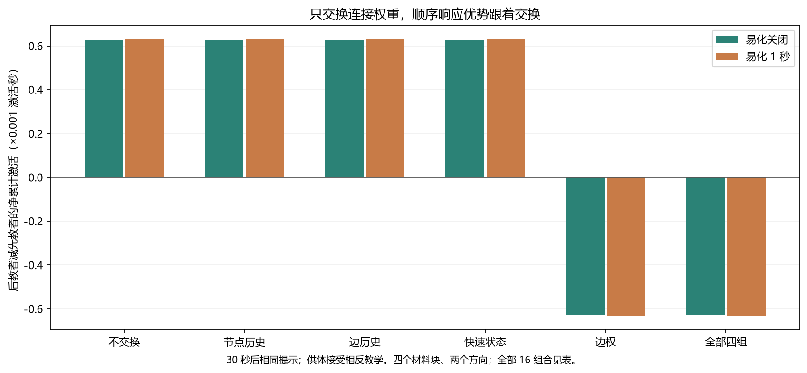
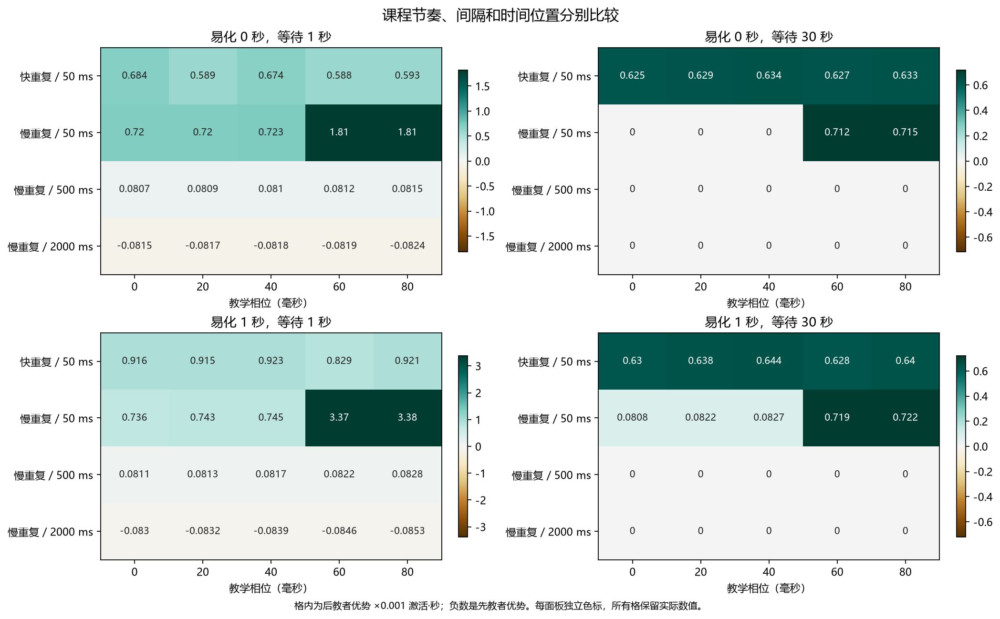
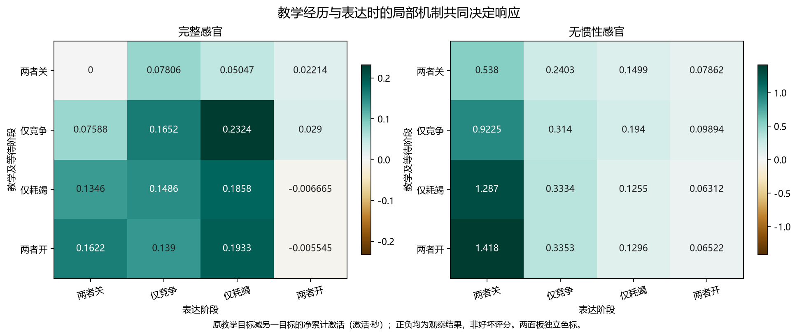

# 顺序信息保存在哪里，感官反向怎样形成

> **修订 r2 · 2026-10-10**
> 修订原因：生成证据移出 Git 并完成校验归档；追加位置登记，保留原字节与结论。
> 原版：[report.zh.md](report.zh.md)；父版本 r1：[report.zh.md](report.zh.md)

[English](report.en.md)

2026-10-01，E21。使用既有 `threemind.continuous-memory/2`。强刺激额外项保持可选、默认开启，`intensity_gain=0.075`；本轮没有继续搜索替代机制，没有修改内核动力学、产品默认或旧实验数据。

本报告由事前固定的[主设计](design.zh.md)及时间实验开始前的[补充登记](timing-addendum.zh.md)产生。后者增加重复节奏对照，并不根据时间扫描的结果挑选条件。原问题和暂缓决定见[执行计划](../../../docs/zh/plans/mechanism-localization-20261001.md)。

本轮三个主要收获：**顺序信息的表达载体定位到了连接权重；密集重复的顺序表达覆盖了全部五个教学时机；感官反向进一步定位到学习阶段的耗竭历史，以及表达阶段耗竭与竞争的共同作用。** 2,880 个登记实例全部完成，没有为得到这些结果修改内核。

## 已定位的顺序信息：交换连接权重，响应方向跟着交换

这一项要回答的是：先后经历留下的差别，究竟存在哪里？我们取上一轮分别经历 AX→BX、BX→AX 的实例，等到 30 秒，按匿名通道对应，把它们的部分状态互换。A、B 是不同匿名刺激，X 是共同参照，字母只是观察者的标签，没有把“先后”答案输入内核。

交换分成四组：连接权重；连接的稳定度、资格迹和触达历史；节点的支持度、稳定度、可塑性和触达历史；活动、抑制、短时能量及其他快速状态。把四组开／关的全部 16 种组合都测过，每个组合又有提示与无提示副本，共 512 个新实例。供体接受相反顺序的教学，其余配置、模拟时刻和连接拓扑相同。

**结果非常整齐：只要交换了连接权重，响应优势就反转；没有交换权重，无论其他三组怎样组合，都不反转。** 有提示的 256 个条件中，128 个不交换权重的条件全部保持原顺序优势，128 个交换权重的条件全部随供体反转。四个材料块、两种教学方向、易化关闭和 1 秒两种条件均如此。

下表用原接收实例的“后教者净响应 − 先教者净响应”表示方向，单位为 **×10⁻³ 激活·秒**。正数表示原先后教的刺激较强，负数表示优势已经交换。

| 交换内容 | 易化关闭 | 易化 1 秒 |
| --- | ---: | ---: |
| 不交换 | +0.626764 | +0.631792 |
| 只交换节点历史 | +0.626764 | +0.631792 |
| 只交换连接历史 | +0.626764 | +0.631792 |
| 只交换快速状态 | +0.626764 | +0.631792 |
| 只交换连接权重 | −0.626764 | −0.631792 |
| 四组全部交换 | −0.626764 | −0.631792 |

这比“权重不同，同时响应也不同”更进一步：这里直接改变权重而保留其他组，响应随之改变。**在这些 30 秒后的样例中，连接权重承担了能左右响应方向的顺序信息。** 提示前的任务节点 A、B、X 已无激活，整个实例仍由维护输入维持存活；这不是把死亡实例复活，也不需要让 A、B 一直亮着才能保存顺序。

这项因果定位针对当前的表达阶段。节点历史和连接稳定度可能参与最初学习、后续保持或未来遗忘，不能因为此刻交换它们未翻转方向就宣布无用。人工交换也是明确登记的研究干预，不冒充自然学习或自然遗传；自然教学形成原先差异的事实与干预定位其载体的事实分开保存。

## 时间位置会改变顺序差别的表达

这一批把每对教学的开始时间固定为相隔 2.5 秒，只改变对内间隔和整套教学相对现有时钟的位置。共 12 对，各条件使用相同数量、相同总量的刺激；均在 32.2 秒给相同的独立收尾输入，再等 1 或 30 秒。整个课程、维护输入和探测时刻一致。所谓相位，就是把所有任务输入整体挪后 0、20、40、60 或 80 毫秒，不是改变模型的时间规则。

| 对内间隔、易化 | 等待 1 秒 | 等待 30 秒 |
| --- | --- | --- |
| 50 ms，易化关 | 五个相位均为后教者优势 | 0／20／40 ms 无目标过程响应；60／80 ms 有后教者优势 |
| 50 ms，易化 1 秒 | 五个相位均为后教者优势 | 五个相位均有后教者优势，60／80 ms 明显较大 |
| 500 ms，易化关或开 | 五个相位均有较小的后教者优势 | 均无目标过程响应 |
| 2,000 ms，易化关或开 | 五个相位均有较小的先教者优势 | 均无目标过程响应 |

每格结论在四个材料块、两种教学方向上均一致。240 个 AB／BA 配对比较中，148 个达到事前双向判断线；10⁻⁹ 与 10⁻⁶ 的计数相同。这里标为无响应的 184 个有提示条件，两个目标的原始过程积分和净过程积分都为 0，不是两者同样强而相减成零。

50 ms、易化关闭、30 秒等待时，整体挪后 40 ms 的课程没有目标过程响应；挪后 60 ms 后，“后教者减先教者”为 **0.000712167 激活·秒**。开 1 秒易化时，这两个数为 **0.000082656 与 0.000718752**。不是只能在最细的数值噪声里看出差别：在这个条件下，输入相对现有节律的时机会影响能不能重新唤起，以及唤起多少。

时间位置同时改变输入与传播、维护刺激、抑制和局部恢复历程的关系。本轮没有分别移动维护刺激或改变传播周期，因而不能直接断言全部来自某一条时钟实现，也不能直接判为 BUG。跨对内间隔时，固定了课程结束和提示时刻，但最后一个目标距课程结束的时间仍随对内间隔变化；这也是协议的实际组成，不能冒称所有可能时间变量均已隔离。

### 密集重复让顺序表达覆盖全部五个时机

把每对开始的间隔改回 550 ms，保留对内 50 ms、12 对、相同剂量，统一在 7 秒结束课程，随后等 1 或 30 秒。**全部五个相位、两种易化配置、四个材料块，都有随教学次序反转的后教者优势。** 80 个 AB／BA 配对比较全部达到登记判断线，原来的顺序效应并非只能在某个偶然的输入时刻出现。

| 等待 30 秒，后教者优势（×10⁻³ 激活·秒） | 0 ms | 20 ms | 40 ms | 60 ms | 80 ms |
| --- | ---: | ---: | ---: | ---: | ---: |
| 易化关闭 | 0.624919 | 0.628796 | 0.633961 | 0.627369 | 0.632549 |
| 易化 1 秒 | 0.629956 | 0.637946 | 0.643744 | 0.628351 | 0.640475 |

这是值得继续利用的条件：**密集重复后，30 秒的顺序表达对这五个教学时机都能保持。** 它不要求额外开启易化。稀疏课程在部分相位读不出，也不能据此抹掉密集课程的结果。

密集与稀疏课程的总长度、维护刺激总次数和中途遗忘机会不同，因此这里确认的是整套重复节奏的作用，不宣称只改变了某一个局部机理。尚未做连续随机时机、随机间隔或更多任务的覆盖测试；本轮没有为扩大阳性而继续调参。

### 总量相同，独立参照没有读出同样效应

在稀疏课程的相位 0／40 ms 中，把 AX、BX 改成 AX、BZ，保持刺激元素总数和总入射量，分别用 X、Z 探测。224 个登记实例完成；64 个双向比较均未达标。128 个有提示条件中，两个目标的原始与净过程积分均为 0，既没有顺序优势，也没有在该窗口读出普通的目标响应。

这个结果说明，原有课程里的参照安排对可唤起的结构有实际作用；不能把它简化成输入只要总量相同就完全等价。但 X 从被用 24 次变为 12 次，另 12 次分给 Z，连接拓扑也不同。**共享关系与单个参照的重复次数还没有彻底分离。** 本批不证明“没有共同参照就不可能有顺序记忆”，也不证明这些实例完全没留下结构痕迹。

## 感官反向：学习时的耗竭历史与表达时的两种机制共同参与

这一批复用旧物理采样、映射和 0.3 强度，先在四种配置中分别完成相同的 32 段教学、等待 1 秒，再把每个所得状态分成四种表达配置，每种都给两个物理方向及各自的无物理输入对照。耗竭和局部输入竞争之外的遗忘、抑制、新颖性等保持原值。32 个教学加 512 个观察，共 544 个实例。

下表是“原教学对应目标 − 另一目标”的净累计活动，单位直接为**激活·秒**，没有乘前面顺序表的 10³。行是教学及等待时的配置，列是表达时的配置。正数为原对应方向，负数为反向。

完整感官：

| 教学／表达 | 两者关 | 仅竞争 | 仅耗竭 | 两者开 |
| --- | ---: | ---: | ---: | ---: |
| 两者关 | 0 | +0.078060 | +0.050475 | +0.022140 |
| 仅竞争 | +0.075883 | +0.165168 | +0.232407 | +0.029002 |
| 仅耗竭 | +0.134604 | +0.148562 | +0.185755 | **−0.006665** |
| 两者开 | +0.162232 | +0.138986 | +0.193257 | **−0.005545** |

无惯性感官：

| 教学／表达 | 两者关 | 仅竞争 | 仅耗竭 | 两者开 |
| --- | ---: | ---: | ---: | ---: |
| 两者关 | +0.538015 | +0.240311 | +0.149861 | +0.078615 |
| 仅竞争 | +0.922539 | +0.313976 | +0.194039 | +0.098936 |
| 仅耗竭 | +1.287001 | +0.333433 | +0.125534 | +0.063123 |
| 两者开 | +1.417660 | +0.335326 | +0.129583 | +0.065222 |

每格为四个材料块、两个方向，共八个有提示条件的均值。每个非零格的八例符号一致；完整感官左上角八例均为零，不是正负互相抵消。

**这次把原来的“耗竭与竞争共同导致反向”拆成了更具体的因果条件：**

1. 完整感官下，只有教学时保留耗竭、测试时同时保留耗竭与竞争，才出现反向。
2. 教学时关闭竞争并不会消除反向，因此“教学竞争必不可少”不成立；测试时的竞争仍是本批反向所需。
3. 如果教学时关闭耗竭，即使测试时把两项都打开，也保持原向。当前输入和测试参数相同，之前的状态形成过程仍能改变响应方向。
4. 无惯性感官的 16 种组合全部保持原向。

这不是预先把原向设为正确，也没有为了消除反向修改默认。它说明**既要看经历留下的状态，也要看当前局部机制怎样处理输入**。此处的形成状态包括连接和短时状态；只等待 1 秒，尚未把连接变化与能量／抑制等短时遗留进一步拆开，不能提前把全部形成作用归给长期连接。开关使用既有运行时的状态衔接语义，运行中开启不能冒称等于从出生常开。

完整／无惯性感官的总输入量也不同；同一种感官配置内部的机制对照使用相同输入。这组是机制定位，不是单独排除了剂量因素的惯性感官优劣评比。旧 E18、E20 的剂量对照与本轮各自保留原范围。

### 零差异不一定是没活动

完整感官、教学和表达都关闭耗竭与竞争时，两个目标保持很强的活动：各自 5.6 秒积分约 **4.772294**，峰值约 **0.967683**，结束时仍约 **0.744045**。有、无本次物理输入时，这些数值完全相同，故净响应及目标差异都是 0。这里的零是“没有测到这次输入带来的目标差别”，不是节点没活动。

维护输入仍然存在，因此这也不能写成“停止所有输入仍自主持续”的新证据。它给工具和调参提供了实际提醒：活动很强、维持很久，不自动意味着能分辨当前的不同输入。所有原始活动仍保存，不因缺少本任务的净差异而删去。

## 怎样读这些数值

主量是在完整观察窗口里累计的节点激活，减去同源无提示副本，再比较两个目标。它回答的是“相同提示在整个响应过程中，让哪个目标多活动了多少”。单位是激活·秒，不是准确率，也不是人类意义上的好坏分数。

顺序实验观察 5 秒；物理感官实验从 0.6 秒输入段开始，再观察 5 秒，共 5.6 秒。每 20 ms 保存一次真实状态，保留全部节点，不因背景或语义标签裁掉活动。原始读出窗口、判定时刻的强度与排序、峰值、累计活动和末态分别保留。过程中的差异不冒称最终收敛时仍有差异。

事前方向判断线为 10⁻⁶ 激活·秒，也检查 10⁻⁹。顺序的双向检验要求反转教学顺序后 A−B 的方向跟着反转，不能只凭其中一次有响应。四个材料块主要改变匿名身份；它们不是四种独立生态环境，更不能把大量克隆副本当成相同数量的独立人群样本。

原读出器也没有被报告绕过。固定例 `swap/100121/f0/AB/none/cue0.5` 中，活动过程读出器的 A、B 积分分别约为 0.0000832915、0.000710056；两者活动均在窗口结束前消退，最终判定激活都是 0。稳定模式中留下的是维护输入节点。积分之差正是本批的 0.000626764；原始窗口保留 A、B 的活动记录，只看最终候选或稳定排名会漏掉这次短暂响应。记录页同时列判定值、峰值和积分，不用另一种名字把旧末态零结果改写为成功。

## 复用工具与证据边界

新增开发态工具 `lab.tools.state_exchange`，按匿名通道和有向通道对交换状态，保留接收实例的节点 ID。它拒绝配置、时钟、拓扑不一致或仍有未决事件的状态，拒绝覆盖已有输出，保存来源、供体和结果哈希以及逐字段干预收据。空交换及同源交换必须不改变完整状态。该操作不进入生产 Runtime 的默认动力学。

工具通过 CLI 可由人或 Agent 调用，说明见 [README](README.md)。本轮没有新增状态交换的图形表单；平台能够查看本批实验记录、报告和原始证据。不能把这些已有展示能力说成已经提供了新的图形干预操作。

旧 E20、E18 来源只读，新输入、状态及观察均进入独立研究项目“2026-10-01 顺序信息与感官机制定位”。没有清理旧数据，没有关闭遗忘来换取更长记忆，没有因反向不合观察者心意而改产品默认。本轮也不重新裁定或撤销已有 `autonomy-criteria/1` 通过结论。

## 工程验收与资源

| 核对项目 | 结果 |
| --- | --- |
| 已登记实例 | 2,880／2,880：交换 512、等时长课程 1,200、密集课程 400、独立参照 224、感官机制 544 |
| 实例性质 | 384 个新教学实例，2,496 个观察／克隆对照；不是 2,880 个独立生态样本 |
| 输入信封与实际递送帧 | 各 126,640 个，逐项核对，待递送 0；当前批次无元数据表示差异 |
| 数据库与文件状态 | 所有完成案例的完整 Core 哈希一致 |
| 状态交换 | 512 份收据重新构造核对；32 个无交换案例完整复现旧 E20 对应结果 |
| 时间课程 | 352 个教学的输入数量、时间、强度、通道及结束时刻核对通过 |
| 旧物理基线 | 16／16 完整 Core 哈希复现旧 E18 |
| 观察是否改变模型 | 7 个代表案例关闭观察工具重新执行，完整 Core 哈希全部一致 |
| 源码与来源 | 内核及所选旧证据未变；原始设计及补充登记与数据库笔记一致 |
| 工具验证 | 状态交换与输入核对相关测试 9 项通过；Python／Rust 恢复及全部 16 组合在工具测试中覆盖 |

累计案例执行墙钟 **2,011.12 秒，约 33.52 分钟**，含输入处理、观察和保存，不是整个研究任务的总耗时，也不是纯 Core 速度基准。归档前新增本地及数据库证据约 **1.79 GiB**；归档后占用在交付收据单列。账户用量从 86% 到验收时 88%，增加 2 个百分点，共享账户的其他消耗也计入。均未触发已登记的预算上限，模拟已经关闭，不继续扩展。

准备阶段曾因平台笔记不接受相对 Markdown 链接而拒绝写入；当时尚未启动模拟。仅将笔记链接转换为已有文档入口，保留原登记内容与失败说明后继续。模拟案例无失败、无被覆盖重跑；该准备问题不写成动力学问题。

逐例表为 `tables/windows.csv`，分组结果为 `tables/summary.csv`，双向比较为 `tables/paired-orders.csv`。原始输入、状态、交换收据、轨迹、读出、冻结源码与审计结果在完整证据包内。平台选择上述项目后，在“实验笔记”查看设计与报告，在“记录与报告”查看双语报告和五个原始时序窗口示例。表格示例使用真实读出数据；报告里的净响应额外减去了对应的无提示副本，二者不可直接混作同一列。

## 本机在此阶段收束，后续问题分别登记

| 优先级 | 下一步问题 | 有明确目标的验证方法 |
| --- | --- | --- |
| P1 | 教学耗竭留下的感官反向，具体由连接还是短时状态保存？ | 同输入、同表达参数下延长恢复等待，再对可严格对齐的状态做分组交换；保留热开关语义对照 |
| P1 | 稀疏课程的时间敏感性来自何处？ | 独立改变教学与维护输入的相对位置，观察传播前后状态和接收量；另测事前固定的随机时机，不先改传播规则 |
| P1 | 共享参照与参照重复次数各占多少？ | 匹配每通道曝光与总量，保留不同组合拓扑，分别测结构保持和提示表达 |
| P2 | 遗忘、旧课程 60 秒唤起、冲突适应和新颖模板 | 按既有待办保留原材料，独立登记；不能用本轮替代此前未完成问题 |
| 暂缓 | 强刺激额外项的替代 | 按用户决定，等待新的明确思路；不继续盲目搜索 |

本轮的进展是把已经看到的现象拆成可验证的原因。参数和内核保持原样，下一轮可以直接从这些已定位的条件出发，不必重做全部历史实验。[完整研究待办](../../../docs/zh/plans/research-backlog.md)

## 数据位置修订

选定的生成证据已逐字节校验归档。原报告、评判标准、结论及数据内 source_commit 均保留。以下逻辑下载需要当前主机管理员身份，数据目录未整体公开。

`data/experiments/2026-10-01-order-mechanisms/`

[Location and hash index / 位置及哈希登记](../../artifact-index/2026-10-09-relocations.json)

- [tables/paired-orders.csv](/api/v2/storage/research-artifacts/research-artifact:a7969cfdaca691aeabc89c03/content) — 98613 B; SHA-256 `f14ca4415bb4d615a174d84a1919ea3dbf058b3af59cc8f0eb9b0edd67071fc1`.
- [tables/windows.csv](/api/v2/storage/research-artifacts/research-artifact:ca8aecdc89a80b90f140d885/content) — 884551 B; SHA-256 `db9ecb635c3681d0d05556beacf93b915414724a46ff9a87c49b6235cd9be45f`.
