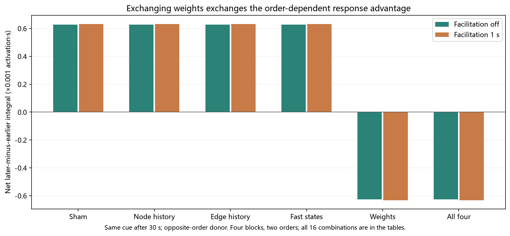
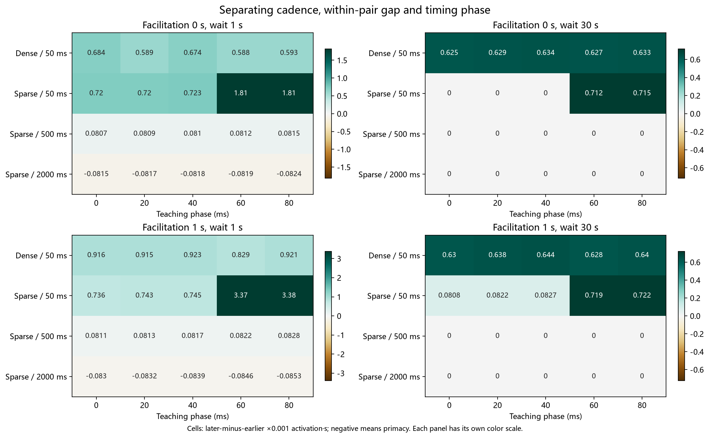
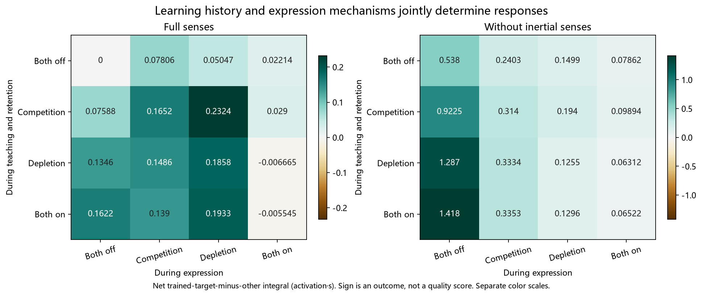

# Where order information is retained, and how sensory reversal develops

> **Revision r3 · 2026-10-10**
> Revision reason: Verified original-file relocation; append location-resolution guidance and preserve the experiment conclusions.
> Original: [report.en.md](report.en.md); parent r2: [report.r2.en.md](report.r2.en.md)

> **Revision r2 · 2026-10-10**
> Revision reason: Relocate generated evidence out of Git; preserve original bytes and conclusions.
> Original: [report.en.md](report.en.md); parent r1: [report.en.md](report.en.md)

[简体中文](report.zh.md)

2026-10-01, E21. The study uses the existing `threemind.continuous-memory/2`. The extra intensity term remains optional and on by default, with `intensity_gain=0.075`. This round did not continue replacement searches or change Core dynamics, product defaults or previous evidence.

The [main design](design.en.md) was fixed before execution. A [cadence addendum](timing-addendum.en.md) was registered before timing experiments began, rather than chosen after inspecting their outcomes. The research decision and deferred work are in the [execution plan](../../../docs/en/plans/mechanism-localization-20261001.md).

The three main results are **localization of order expression to edge weights; dense-repetition order expression across all five tested teaching phases; and a more specific account of sensory reversal involving depletion during learning and depletion plus competition during expression.** All 2,880 registered instances completed without changing Core to produce these outcomes.

## Localizing order information: exchanging weights exchanges the response direction

The question was where the difference left by opposite teaching orders is retained. We took instances previously taught AX→BX or BX→AX and exchanged selected state components after 30 seconds, aligning by anonymous channels. A and B are different stimuli and X is a shared reference. These letters are observer labels; Core receives no answer about order.

Four groups were crossed in all 16 combinations: edge weights; edge stability, eligibility and contact history; node support, stability, plasticity and contact history; and activity, inhibition, short-term availability and other fast states. Each combination had cued and uncued copies, totaling 512 new instances. Donors received the opposite teaching order but shared configuration, simulation time and topology.

**Every exchange containing weights reversed the response advantage. No exchange without weights did so, regardless of the other three groups.** Across 256 cued conditions, all 128 without a weight exchange retained the recipient's original recency advantage; all 128 with a weight exchange followed the donor. This held across four blocks, both teaching orders, and facilitation off or at 1 second.

Values below are the recipient's originally later-taught target minus the earlier-taught target, after subtraction of matched uncued responses, in **×10⁻³ activation·seconds**. Positive means the recipient's original later target is stronger; negative means the advantage has exchanged.

| Exchanged state | Facilitation off | Facilitation 1 s |
| --- | ---: | ---: |
| None | +0.626764 | +0.631792 |
| Node history only | +0.626764 | +0.631792 |
| Edge history only | +0.626764 | +0.631792 |
| Fast states only | +0.626764 | +0.631792 |
| Weights only | −0.626764 | −0.631792 |
| All four groups | −0.626764 | −0.631792 |

This goes beyond observing that weights and responses differ together: changing weights while retaining other groups changes the response. **In these 30-second cases, edge weights carry order information capable of determining the response direction.** Task nodes A, B and X were inactive before the cue, while maintenance input kept the instance alive. This neither revives a dead instance nor requires A and B to remain active throughout retention.

The intervention localizes expression at this time. Node history and edge stability may still participate in formation, retention and future forgetting; an ineffective exchange now does not make them generally irrelevant. Exchanges are explicit artificial research interventions, not natural learning or inheritance. Natural teaching produced the original state differences; the interventions identify their causal carrier.

## Timing position changes the expression of order differences

This batch fixes pair starts 2.5 seconds apart, varying only the within-pair interval and the position of the task schedule relative to existing clocks. Each course contains 12 pairs with identical task counts and total dose. All receive the same independent final input at 32.2 seconds, followed by a 1- or 30-second wait. Course duration, maintenance input and probe times are matched. Phase means shifting the task schedule by 0, 20, 40, 60 or 80 ms; it does not change the kernel's time rules.

| Within-pair gap and facilitation | Wait 1 s | Wait 30 s |
| --- | --- | --- |
| 50 ms, facilitation off | Recency advantage at all five phases | No target process response at 0/20/40 ms; recency at 60/80 ms |
| 50 ms, facilitation 1 s | Recency at all five phases | Recency at all five phases, substantially larger at 60/80 ms |
| 500 ms, either facilitation condition | Small recency advantage at all phases | No target process response |
| 2,000 ms, either facilitation condition | Small primacy advantage at all phases | No target process response |

Each classification holds across four blocks and both teaching orders. Of 240 paired AB/BA comparisons, 148 cross the registered bidirectional threshold, identically at 10⁻⁹ and 10⁻⁶. In the 184 cued conditions classified as unresponsive, both raw and net target integrals are zero; these are not equal nonzero responses that cancel in subtraction.

With a 50 ms gap, no facilitation and a 30-second wait, shifting the schedule by 40 ms yields no target process response. At 60 ms the later-minus-earlier integral is **0.000712167 activation·seconds**. With 1-second facilitation, these values are **0.000082656 and 0.000718752**, respectively. This is not merely a difference at the smallest numerical scale: relative input timing changes whether the targets can be reactivated and by how much.

The phase shift changes the relationship to propagation, maintenance input, inhibition and local recovery. Maintenance timing and propagation intervals were not independently shifted, so the whole effect cannot yet be assigned to one clock implementation or labeled a bug. Across within-pair gaps, course end and probe times are matched, but the age of the last target event at course end still varies. That is part of the actual protocol, not complete isolation of every conceivable timing variable.

### Dense repetition preserves order expression at all five phases

Returning pair starts to 550 ms apart retains the 50 ms within-pair gap, 12 pairs and task dose, with course end fixed at 7 seconds and probes 1 or 30 seconds later. **All five phases, both facilitation settings and all four blocks show a recency advantage that reverses with teaching order.** All 80 paired AB/BA comparisons pass the registered threshold. The previous order effect is not confined to one accidental teaching phase.

| 30-second recency advantage (×10⁻³ activation·s) | 0 ms | 20 ms | 40 ms | 60 ms | 80 ms |
| --- | ---: | ---: | ---: | ---: | ---: |
| Facilitation off | 0.624919 | 0.628796 | 0.633961 | 0.627369 | 0.632549 |
| Facilitation 1 s | 0.629956 | 0.637946 | 0.643744 | 0.628351 | 0.640475 |

This is a useful experimental condition: **after dense repetition, 30-second order expression survives all five tested teaching phases, without requiring facilitation.** Null expression at some phases of the sparse course does not erase this result.

Dense and sparse courses differ in total duration, maintenance-input count and opportunities for forgetting between repetitions. The result concerns the entire repetition schedule, not one independently isolated local mechanism. Continuous timing jitter, random intervals and wider tasks remain untested; no further parameter search was added to enlarge the positive result.

### Equal total dose with separate references does not reproduce the effect

At phases 0 and 40 ms of the sparse course, AX/BX is replaced by AX/BZ with the same total element count and incident dose. X and Z are then tested separately. All 224 registered instances completed; none of 64 bidirectional comparisons pass. Both raw and net target integrals are zero in all 128 cued conditions: neither order expression nor ordinary target reactivation is detected in those windows.

The reference arrangement therefore matters to what this course can reactivate; equal total dose does not make the schedules equivalent. However, X exposure drops from 24 to 12 uses, with the other 12 assigned to Z, and topology changes. **Shared relationships and repetition of each reference are not fully isolated.** This batch neither proves that order memory always requires a shared reference nor establishes that no structural trace remains in these instances.

## Sensory reversal depends on depletion history and two expression mechanisms

The batch reuses the original physical samples, mapping and intensity 0.3. Four configurations each undergo the same 32 teaching episodes and a 1-second wait. Each resulting state is then crossed with four expression configurations, two physical directions and matched controls without the physical probe. Forgetting, inhibition, novelty and other parameters remain unchanged. There are 32 training and 512 observation instances, totaling 544.

Values below are net trained-target-minus-other integrals, directly in **activation·seconds**, without the 10³ scaling of the order tables. Rows identify teaching-and-retention configuration; columns identify expression configuration. Positive denotes the original association and negative a reversal.

Full senses:

| Teaching / expression | Both off | Competition only | Depletion only | Both on |
| --- | ---: | ---: | ---: | ---: |
| Both off | 0 | +0.078060 | +0.050475 | +0.022140 |
| Competition only | +0.075883 | +0.165168 | +0.232407 | +0.029002 |
| Depletion only | +0.134604 | +0.148562 | +0.185755 | **−0.006665** |
| Both on | +0.162232 | +0.138986 | +0.193257 | **−0.005545** |

Without inertial senses:

| Teaching / expression | Both off | Competition only | Depletion only | Both on |
| --- | ---: | ---: | ---: | ---: |
| Both off | +0.538015 | +0.240311 | +0.149861 | +0.078615 |
| Competition only | +0.922539 | +0.313976 | +0.194039 | +0.098936 |
| Depletion only | +1.287001 | +0.333433 | +0.125534 | +0.063123 |
| Both on | +1.417660 | +0.335326 | +0.129583 | +0.065222 |

Each cell averages eight cued conditions: four blocks and two directions. All eight cases agree in sign within each nonzero cell. All eight full-senses/both-off cases are zero rather than canceling positive and negative outcomes.

**The earlier statement that depletion and competition jointly produce reversal now has more specific causal conditions:**

1. In full senses, reversal requires depletion during teaching, plus both depletion and competition during expression, within this tested grid.
2. Disabling competition during teaching does not prevent reversal. Teaching competition is therefore not necessary here; expression competition remains necessary.
3. If depletion is absent during teaching, subsequently enabling both mechanisms preserves the original direction. Prior state formation changes the outcome despite identical current input and expression parameters.
4. All 16 configurations without inertial senses retain the original direction.

Original direction was not defined as the desirable answer, and defaults were not changed to remove reversal. The result shows contributions from both **state left by experience and current local input processing**. Formation state includes connections and fast states. With only a 1-second wait, connection changes have not been separated from residual availability or inhibition; assigning all formation effects to long-term connections would be premature. Switches retain existing Runtime transition semantics, and enabling a mechanism later is not equivalent to enabling it from birth.

Full and no-inertial inputs also differ in total dose. Within a sensory mode, mechanism comparisons use the same inputs. This is causal localization, not a dose-isolated ranking of whether inertial senses are beneficial. Earlier E18/E20 controls retain their own scope.

### A zero difference need not mean inactivity

With full senses and both mechanisms disabled during both teaching and expression, the two targets remain strongly active: each has a 5.6-second integral of approximately **4.772294**, a peak of **0.967683**, and terminal activation of **0.744045**. These values are identical with and without the physical probe, so both the net response and target difference are zero. The null means no detected target difference attributable to this input, not inactive nodes.

Maintenance input continues, so this is not new evidence of persistence after removing all input. It is a practical observation for measurement and tuning: strong, sustained activity does not automatically distinguish current inputs. All raw activity remains in the evidence rather than being discarded for lacking this task's net difference.

## Reading the measurements

The primary quantity integrates target activation over the observation window, subtracts an uncued copy from the same source, and compares the two targets. It measures how much additional activity each target expresses throughout the response to the same cue. Activation·seconds are neither accuracy nor an observer's quality score.

Order experiments observe 5 seconds. Physical experiments include 0.6 seconds of sensory input followed by 5 seconds, totaling 5.6 seconds. Real state is sampled every 20 ms, retaining all nodes without semantic or background-based filtering. Original readout windows, decision-time activation and rank, peaks, integrals and terminal values remain separate. A process difference is not relabeled as a surviving terminal difference.

The registered direction threshold is 10⁻⁶ activation·seconds, with a 10⁻⁹ sensitivity check. Bidirectional order expression requires the A−B sign to reverse with teaching order, rather than accepting a response from just one order. Four blocks mainly vary anonymous identities: they are not four independent ecological environments, and cloned conditions do not constitute an equally large population sample.

The original readout is not bypassed. In `swap/100121/f0/AB/none/cue0.5`, the activity readout records A and B integrals of approximately 0.0000832915 and 0.000710056. Both activities end before the window closes and have zero decision-time activation. Only the maintenance node remains in the stable pattern. Their integral difference is the reported 0.000626764. The raw window retains the transient target activity; looking only at final candidates or stable rankings would miss it. Record pages retain decision values, peaks and integrals together without renaming a terminal null as a success.

## Reusable tool and evidence boundaries

The new development tool `lab.tools.state_exchange` aligns state by anonymous channels and directed channel pairs while retaining recipient node IDs. It rejects incompatible configurations, clocks or topologies, unsettled events and existing output paths. Source, donor and result hashes accompany field-level intervention receipts. Empty and same-source exchanges must preserve the complete state. The tool does not become part of default production Runtime dynamics.

Humans and agents can invoke the CLI described in the [README](README.md). This round did not add a graphical state-exchange form. Existing platform pages display the study records, reports and evidence; those display capabilities must not be described as a new graphical intervention interface.

Selected E20 and E18 sources remain read-only. New inputs, states and observations belong to the dedicated project “2026-10-01 顺序信息与感官机制定位”. No old data was deleted, forgetting was not disabled to prolong memory, and product defaults were not changed to favor an observer-preferred response direction. This study neither redefines nor revokes the existing `autonomy-criteria/1` pass.

## Verification and resources

| Check | Result |
| --- | --- |
| Registered instances | 2,880/2,880: exchange 512, matched-duration course 1,200, dense course 400, separate references 224, sensory mechanisms 544 |
| Nature of instances | 384 new training instances and 2,496 observation/cloned controls, not 2,880 independent ecological samples |
| Input envelopes and delivered frames | 126,640 each, individually checked; zero pending and no metadata representation differences in this batch |
| Database and file states | Complete Core hashes match for every completed case |
| State exchange | All 512 receipts reconstructed; 32 sham cases exactly reproduce their E20 Core hashes |
| Timing courses | Counts, timestamps, intensities, channels and end times verified for all 352 training courses |
| Historical physical baseline | All 16 corresponding complete Core hashes reproduce E18 |
| Observer effects | Seven representative replays without observation tools preserve the complete Core hash |
| Sources and registration | Core and selected old evidence unchanged; original designs and addendum match the database notes |
| Tool checks | Nine related state-exchange/input-audit tests pass, including Python/Rust restoration and all 16 exchange combinations |

Cumulative case execution is **2,011.12 seconds, approximately 33.52 minutes**, including input handling, observation and persistence. This is neither total research-task time nor a pure Core benchmark. New local and database evidence before archives occupies approximately **1.79 GiB**; final archived storage is listed separately in the delivery receipt. Shared-account usage increased from 86% to 88% at audit, a 2-percentage-point increase including other account activity. No registered resource limit was reached. Simulation is closed without further expansion.

Preparation encountered a notebook validation rejection for relative Markdown links before simulation began. Only notebook links were converted to existing documentation routes, retaining the original registration and a recovery record. No simulation case failed or was overwritten for a rerun; the preparation issue was not a dynamics defect.

Case-level values are in `tables/windows.csv`, grouped results in `tables/summary.csv`, and paired orders in `tables/paired-orders.csv`. The evidence archive retains inputs, states, exchange receipts, trajectories, readouts, frozen sources and audits. Select the dedicated project in the platform: “Research notes” contains designs and reports; “Records & reports” contains bilingual reports and five raw temporal-window examples. Those tables show actual readouts, while net report quantities additionally subtract matched uncued copies; they are not interchangeable columns.

## Local stopping point and separately registered follow-up questions

| Priority | Question | Targeted next test |
| --- | --- | --- |
| P1 | Is the sensory effect left by teaching depletion retained in connections or fast states? | Extend recovery with identical input and expression parameters, then exchange strictly alignable groups; retain hot-switch transition controls |
| P1 | What causes sparse-course timing sensitivity? | Independently shift teaching relative to maintenance input, inspect state and reception around propagation, then test fixed timing jitter without first changing propagation rules |
| P1 | How much comes from shared references versus their repetition count? | Match per-channel exposure and total dose while retaining different group topology; measure structural retention and cue expression separately |
| P2 | Forgetting, older 60-second retrieval, conflicting adaptation and novelty templates | Preserve original materials and separately register existing backlog items; this study does not complete them by substitution |
| Deferred | Replacement of the extra strong-input term | Await a clearer idea as requested; no further unguided search |

This round turns observations into more specific, testable causes. Defaults and Core remain unchanged. Further work can start from these localized conditions without rerunning the whole history. [Complete research backlog](../../../docs/en/plans/research-backlog.md)

## Data location revision

Selected generated evidence has been archived and verified byte for byte. Original reports, criteria, conclusions and embedded source_commit values are preserved. The logical downloads below require the current host administrator. The data directory is not public.

`data/experiments/2026-10-01-order-mechanisms/`

[Location and hash index / 位置及哈希登记](../../artifact-index/2026-10-09-relocations.json)

- [tables/paired-orders.csv](/api/v2/storage/research-artifacts/research-artifact:a7969cfdaca691aeabc89c03/content) — 98613 B; SHA-256 `f14ca4415bb4d615a174d84a1919ea3dbf058b3af59cc8f0eb9b0edd67071fc1`.
- [tables/windows.csv](/api/v2/storage/research-artifacts/research-artifact:ca8aecdc89a80b90f140d885/content) — 884551 B; SHA-256 `db9ecb635c3681d0d05556beacf93b915414724a46ff9a87c49b6235cd9be45f`.

> **Storage-location revision · 2026-10-10**
> This edition adds the verified move of the selected originals to `E:\ThreeMindData`. Stable scientific identities and hashes, experiment dates, measurements and conclusions remain unchanged. Paths in the preserved body describe historical sources; use the registered evidence resolver for current locations. Repository documents and frozen fixtures remain in place, and source copies are retained. Structured query data and running checkpoints remain in the database. This annotation does not assert that missing historical evidence was recovered.
