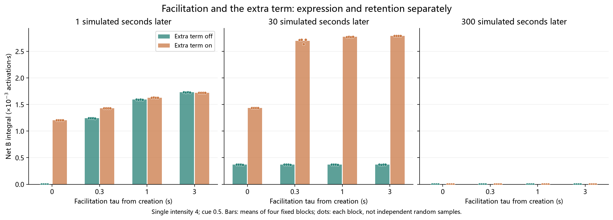
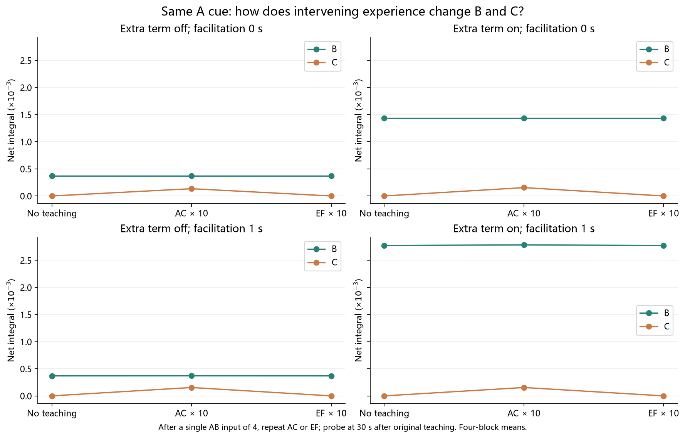
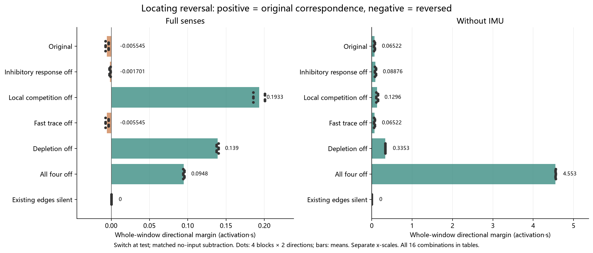
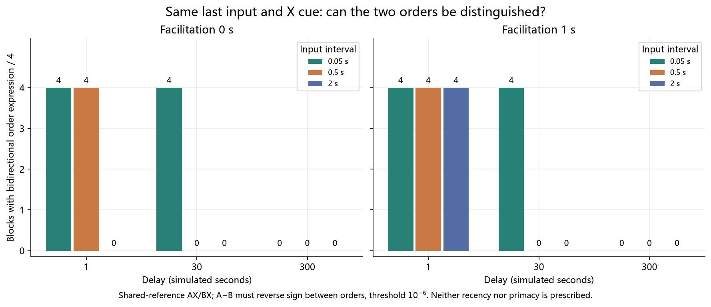
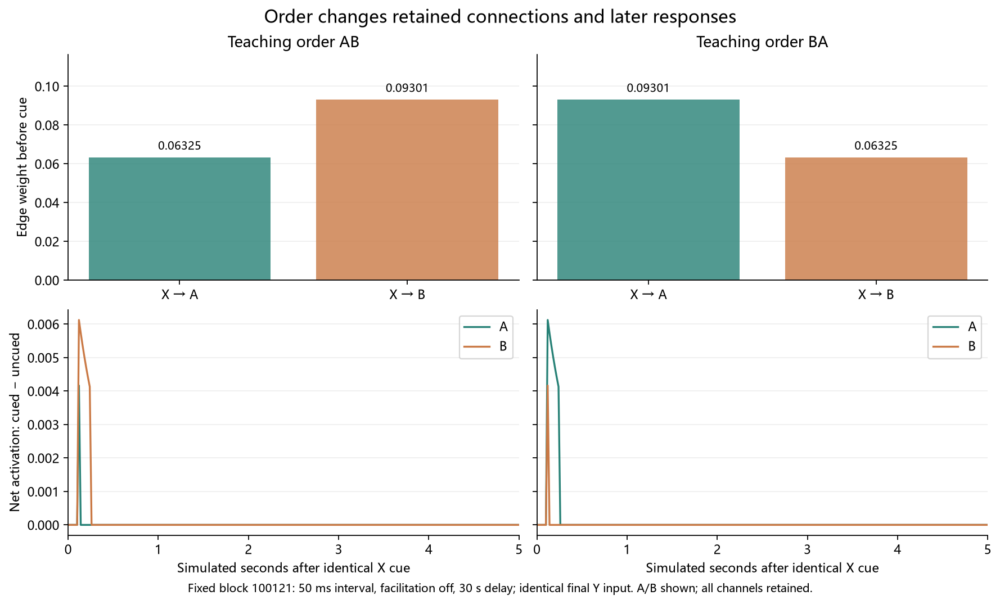

# Priority tests: intensity, facilitation, sensory responses and order

[简体中文](report.zh.md) · [Execution](README.md) · [First preregistration](design.en.md)

2026-10-01. All three registered simulation batches completed: 2,808 new experimental instances, many of them matched descendants. Three findings stand out: the extra intensity term retains an incompletely replaced retention effect; sensory reversal jointly depends on competition and depletion; and 50 ms teaching with a common reference expresses order differences after 30 seconds. Conditions, negative results and final evidence checks are below.

## The extra strong-input term is not yet fully replaceable

**Facilitation has a clear effect, and stronger ordinary consolidation helps, but the tested candidates do not replace the extra term at the longer retention interval.** The optional term remains enabled by default: `intensity_gain=0.075` enables it and `0` disables it. The user will decide any future default change. This study changes no Core formula, numerical product default or historical instance.

Facilitation is configured from creation, rather than enabled after training. Four fixed material blocks first receive AC and BD experience, then AB teaching. An identical A cue tests B response. Each cued case is paired with an uncued copy from the same parent over the same absolute simulated interval. Values below are **five-second B activation integrals minus the uncued integral**, in ×10⁻³ activation·seconds. They describe a process, not final activation.

| Configuration; new experience is a single intensity-4 input | After 1 s | After 30 s | After 300 s |
| --- | ---: | ---: | ---: |
| Ordinary default: extra on, facilitation off | 1.204 | 1.436 | 0 |
| Extra off, facilitation off | 0 | 0.369 | 0 |
| Extra off, facilitation 0.3 s | 1.242 | 0.369 | 0 |
| Extra off, facilitation 1 s | 1.592 | 0.369 | 0 |
| Extra off, facilitation 3 s | 1.730 | 0.368 | 0 |
| Extra off, facilitation 1 s, doubled ordinary contact gains | 1.845 | 0.847 | 0 |
| Extra off, facilitation 1 s, doubled stability gain | 1.592 | 0.369 | 0 |
| Extra on, facilitation 1 s | 1.630 | 2.772 | 0 |

These are means of four prespecified blocks; every block appears in the exported tables. Cloned conditions are not treated as independent training samples, and no population-level significance is claimed.

- Extra off plus 1-second facilitation produces **132.2%** of ordinary-default response at 1 second, but only **25.7%** at 30 seconds. The gap persists with facilitation configured from creation; it cannot be attributed solely to the previous study's hot-switch state transition.
- Doubling ordinary contact gains raises the 30-second response to **59.0%** of the ordinary default. That is an improvement, but below the preregistered 80% engineering approximation threshold.
- Keeping the extra term and adding facilitation yields **193.1%** of the ordinary default at 30 seconds. Facilitation and stronger retained connections can cooperate rather than merely substitute for each other.
- At 300 seconds, new AB edges are absent in all corresponding conditions in this batch. All-zero outcomes do not count as successful replacement. Other curricula previously retained responses at 300 seconds; forgetting here is not automatically a defect.

## Facilitation did not become a long-term store

In the fixed `100101` example, after 30 seconds with facilitation tau 1 second, available connection resources have recovered to approximately 1 and utilization has decayed to roughly 2×10⁻¹³. Yet AB weights are approximately 0.127 with the extra term and 0.077 without it; stability is approximately 0.392 versus 0.112.

A stronger response after 30 seconds therefore does not mean the facilitation state itself stored the experience for 30 seconds. Retained connection differences and short-term mechanisms **operating again when the cue arrives** jointly determine expression. Likewise, no measurable response at 1 second followed by a response at 30 seconds in the extra-off/facilitation-off condition does not imply new AB learning during the wait. Formation, retention and current accessibility are distinct.

The small single-event effect of doubling `stability_gain` also has a concrete implementation boundary. The parameter contributes to node, existing-edge and post-propagation growth; new-edge initial stability also depends on the birth consolidation impulse. It does not uniformly double every new edge's stability. Both first-contact and repeat gains were doubled in the other candidate, but A and B already had prior experience, so its relevant improvement cannot primarily be credited to the first-contact branch. See `src/threemind_core/restoration.py`; this study inspected, not edited, those formulas.

## Equal total input does not make single and repeated experience equivalent

Single intensity 4, ten massed inputs of 0.4 and ten increasingly spaced inputs of 0.4 have the same sum of intensities and the same final teaching time. With extra off, facilitation 1 second and ordinary parameters, the 1-second responses are **1.592, 1.516 and 1.350**, respectively. At 30 seconds they are **0.369, 0 and 0**.

After doubling ordinary contact gains, the massed course produces a smaller 30-second response of **0.0814**; the spaced course still produces none. This particular dose and schedule did not make repetition superior to a single event. It does not establish that repetition or progressively spaced rehearsal is generally ineffective. Equal total input does not equalize receiver state, transmission, consolidation or forgetting history.

Another retained observation: with extra off and facilitation 1 second, teaching once at intensity 1 yields approximately **1.647** after 1 second, slightly more than **1.592** after teaching at intensity 4. This compares **different teaching histories followed by the same cue**, not stronger versus weaker immediate input into one fixed state. Stronger experience need not produce a larger response at every subsequent time.

## Later experience can add a correspondence without erasing the old one

After AB teaching, cases receive AC×10, equal-dose EF×10, or neither. All receive the same A cue 30 seconds after original teaching. The table uses single AB=4, four-block means, and the same ×10⁻³ activation·seconds unit.

| Configuration | Intervening experience | B response | C response |
| --- | --- | ---: | ---: |
| Extra on, facilitation off | None | 1.436 | 0 |
| Same | AC×10 | 1.436 | 0.154 |
| Same | EF×10 | 1.436 | 0 |
| Extra on, facilitation 1 s | None | 2.772 | 0 |
| Same | AC×10 | 2.783 | 0.154 |
| Same | EF×10 | 2.772 | 0 |

This condition showed neither automatic erasure of B by new experience nor complete prevention of C expression by the old association. Reinforcing AC made C responsive while B remained responsive. EF, which shared no channels, did not have that effect. AC already existed in the prior curriculum: this is renewed reinforcement, not first creation of a previously nonexistent C.

This is not universal resistance to interference. The doubled-contact-gain candidate did not receive a separate interference matrix, so ordinary-parameter results cannot be assigned to it. Actual environmental reversal and survival selection were not performed here.

## What exactly does the switch change?

In the fixed example, two channels each have element value 1 and frame intensity 4: the raw product sum is 8. The existing receiver rule `min(1, element_value * intensity * direct_gain)` gives a total request of 2. With the extra term on or off, both received amount and immediate activation increment equal 2. The switch does not rewrite the sent stimulus.

New-edge weight/stability differ: approximately **0.12264/0.13966** with the term off and **0.17310/0.42** with it on. That is the term's role in this formula: extra consolidation, not rewritten input content. Across 192 paired controls whose teaching intensities never exceed 1, switching the term produces zero difference in net B response.

Removing `intensity_gain * max(0, intensity−1)` does not stop ordinary consolidation from reading actual drive. The ordinary impulse still multiplies `element_value * intensity`. Thus the result supports intensity-dependent traces without that particular extra term, not complete emergence of all strong-input effects from mechanisms independent of input amplitude. The receiver request cap and raw product must not be conflated as one physical quantity.

## Readout calibration: process activity is not retroactive terminal success

A read-only audit of 1,068 E19 windows found 582 comparable cued conditions and 172 positive net B process responses. The stricter 10⁻⁶ threshold still gives 172. Terminal target response was zero; 120 untrained conditions and two existing silenced conditions had no corresponding process positives. No historical training was rerun and source hashes remained unchanged.

In the current memory batch, 184 of 648 paired cued conditions have net B process response above 10⁻⁹. Terminal target response remains zero; 96 untrained conditions have no positive response. Both findings stand: the target did become active during the process, and the earlier endpoint requiring target activation at the final decision time was not achieved.

Actual nodes, edges, inhibition, short-term state and transport are retained every 20 ms. Background K remains in the raw data. Integrals use matched-copy subtraction; no language model supplies answers and no semantic filter trims activity. At this sampling rate, the probe windows contain no nodes reaching the 0.999 saturation criterion. The separate fact that intensity-4 teaching immediately saturates directly stimulated nodes is retained.

## Sensory reversal: local competition and depletion jointly determine direction

The second batch reuses E18 parents, physical samples and encoding without regenerating the world. All **16/16 untreated replays match the historical final complete Core state hash** before the four-factor experiment proceeds. Each condition has four blocks and two movement directions, paired with and without physical input: 544 new instances. See the [separate registration](reversal-design.en.md).

The table shows the 5.6-second integral of the original trained target minus the other target, after matched no-input subtraction, in activation·seconds: **not the ×10³ scale of the preceding tables**. Positive is original correspondence and negative is reversal, with neither direction designated inherently good or bad.

| Change only at test | Full senses | Without inertial senses | Full-senses direction count |
| --- | ---: | ---: | --- |
| Original configuration | −0.005545 | 0.065222 | 8/8 reversed |
| Inhibitory response off | −0.001701 | 0.088764 | 8/8 reversed |
| Local input competition off | 0.193257 | 0.129583 | 8/8 original |
| Fast trace off | −0.005545 | 0.065222 | 8/8 reversed |
| Local depletion disabled | 0.138986 | 0.335326 | 8/8 original |
| All four off | 0.094800 | 4.553263 | 8/8 original |
| Existing edges silenced | 0 | 0 | 8/8 no directional response |

**With full sensory input in this batch, reversal occurs when both local depletion and local competition remain enabled. Disabling either restores the original direction.** All 16 factorial combinations support this relationship; it is not based on two selected traces. Without inertial input, all 16 combinations retain the original direction. Silencing produces no new unsilenced edges and removes both targets' corresponding responses, establishing that these responses require inter-node transmission.

This qualifies the earlier null effect: local competition barely affected the simple AB target but determines expression direction when multiple physical sensory routes converge. **Identical learned structure and identical current external input can produce opposite responses when internal local processing changes.** This is a causally controlled mechanism result.

Fast trace is distinct from the release facilitation tested in the first batch. It does not change the directional relationship here. Its effect near the original configuration is small, but other combinations show amplitude effects, with a maximum single-case margin difference near 0.00233; it is not universally useless. Inhibition changes response magnitude and temporal distribution, even though disabling its response alone does not eliminate whole-window reversal.

Time-resolved observation matters: with inhibitory response off, all eight input segments remain reversed; in the subsequent five seconds, four are original and four reversed. Reporting only their positive average would conceal this split. Phase and per-material results are retained.

These are **expression-stage** interventions, not proof that the same switches determine how the earlier correspondence formed. Neither competition nor depletion should be disabled by default merely to make an output look correct. Reversal is a reproducible phenomenon whose local convergence and recovery mechanisms deserve further study.

## Order leaves a trace that can be expressed after activity subsides

**The existing kernel now shows bidirectional order expression, even without additional facilitation.** Teach AX→BX or BX→AX for 12 pairs, give both directions the same final independent Y input, wait, and apply the identical X cue. Compare net integrated A and B responses. X is a shared stimulus element; all letters denote anonymous channels. Core receives neither “before/after” labels nor the desired answer. See the [order registration](sequence-design.en.md).

At the stricter 10⁻⁶ observation threshold, each cell counts four fixed material blocks. “Recency” means B wins after AX→BX and A wins after BX→AX; “primacy” means the reverse.

| Facilitation tau | Within-pair interval | Delay 1 s | Delay 30 s | Delay 300 s |
| --- | --- | --- | --- | --- |
| Off | 50 ms | 4/4, recency | 4/4, recency | 0/4 |
| Off | 0.5 s | 4/4, small primacy | 0/4 | 0/4 |
| Off | 2 s | 0/4 | 0/4 | 0/4 |
| 1 s | 50 ms | 4/4, recency | 4/4, recency | 0/4 |
| 1 s | 0.5 s | 4/4, small primacy | 0/4 | 0/4 |
| 1 s | 2 s | 4/4, primacy | 0/4 | 0/4 |

Across all shared/unshared conditions, 28 of 144 bidirectional comparisons pass; the 10⁻⁹ and 10⁻⁶ thresholds yield the same count. A response in only one direction is not success, and no single block substitutes for the complete matrix. These blocks chiefly change anonymous identities, not worlds and tasks.

At 50 ms with facilitation off, the 30-second recency margin is approximately **0.00062676 activation·seconds**, versus **0.00063179** with 1-second facilitation. At the 0.5-second teaching interval, the 1-second margins are much smaller: approximately −0.00000335 and −0.00000710. With facilitation and a 2-second interval, the margin is about −0.00008548. Negative means primacy, not an erroneous test; interval can change response direction.

### What state persists?

In all 16 corresponding states at 50 ms (four blocks × two directions × two facilitation settings), **A, B and X activation is zero before the 30-second cue**. The later directional response therefore is not simply A or B remaining active. In the fixed first block with facilitation off:

| Teaching order | Pre-cue X→A weight | Pre-cue X→B weight |
| --- | ---: | ---: |
| AX→BX | 0.06325 | 0.09301 |
| BX→AX | 0.09301 | 0.06325 |

Stability also differs by correspondence and availability has recovered. No dedicated cross-time A→B edge-formation rule was added. **Order changes the retained local structure, and the same later cue expresses the difference in history.** This supports further work on order information formed by a shared reference and local mechanisms.

Node support, stability and local plasticity differ too and have not been selectively removed. The weights shown above therefore cannot yet claim all causal credit. Next separate edge and node-history contributions. The example figure includes the entire five-second response, neither removing the later zero nor denying earlier activity because the final state is zero.

### Three distinct meanings of an absent order response

- **Formed and expressed:** the shared-reference 50 ms course produces opposite directional biases after 30 seconds in all four blocks.
- **Structure still differs but this cue does not express it:** with facilitation off and a 0.5-second interval, the first block retains a maximum corresponding weight difference of about 0.00123 at 30 seconds without bidirectional probe response. No output does not imply identical structure.
- **The relevant connection differences have faded:** by 300 seconds this course no longer retains the relevant connections and all conditions lack bidirectional response. This does not call for abolishing forgetting.

The unshared group never learned X and produces no net A/B response to X. It controls the absence of the corresponding cue route; **it does not establish that all order information requires a shared reference**. Shared and unshared courses are not equal in total input dose.

Within each interval, both orders have equal dose and duration. Across intervals, course durations are 6.8, 12.2 and 30.2 seconds, and inputs occupy different positions relative to the propagation rhythm. These results do not establish 50 ms as universally optimal or isolate duration, recovery and scheduling phase. The preregistered task measures a distinguishable order trace, not a semantic answer about chronology, kinship reasoning or subjective time.

All 576 order observation windows have zero A/B activation at five seconds. Their positive process-level bidirectional responses are not positive final-activation outcomes.

## Methods, evidence and reproducibility boundaries

- The existing `threemind.continuous-memory/2`, Core and Rust implementation, propagation threshold and time architecture remain unchanged. Numerical step is 10 ms and propagation interval 100 ms. Teaching at 50 ms does not change propagation to 50 ms.
- Product defaults still enable the extra term and disable additional facilitation. Experimental copies do not modify historical instances or product defaults. Forgetting, novelty, learning and other mechanisms remain as registered except for the explicitly varied factors.
- Maintenance input is an independent K channel, intensity 0.2 every 0.5 simulated seconds: a replayable synthetic control, **not live host telemetry**. The physical-sense batch replays actual samples from the earlier simulated world. No external language model supplies answers.
- The memory batch has two prior intensities and two prior intervals. The four order blocks principally vary anonymous channel identities under the same course. They check material and numbering dependence, not four distinct worlds or an independent population. Most instances are matched descendants; their count is not independent sample size.
- The principal process measure integrates cued-minus-uncued activation over the complete window. Terminal activation, peaks, full trajectories and phase-specific direction are retained separately. Observation thresholds of 10⁻⁹ and 10⁻⁶ do not modify the propagation threshold. Historical terminal failure is not retroactively relabeled success.
- A separate project retains designs, configurations, original carriers, delivered frames, checkpoints and observations. Historical source hashes are rechecked. The archive includes explicitly selected old parents and physical replay material, not the old database; nothing historical is cleared or overwritten.

Eight CSV tables are provided in this directory's `tables/` and in the complete evidence archive:

| Table | Contents |
| --- | --- |
| `memory-windows.csv`, `memory-summary.csv` | Every memory window and condition summary |
| `replacement-comparisons.csv` | Candidate-to-baseline ratios, without counting all-zero outcomes as equivalence |
| `reversal-windows.csv`, `reversal-factorial.csv` | All four-factor combinations, direction counts and phase measures |
| `sequence-windows.csv`, `sequence-state-pairs.csv` | Every order window and channel-aligned node/edge differences |
| `sequence-summary.csv` | Four-block results by interval, delay, reference and facilitation |

See the [README](README.md) for execution, recovery and reusable tools. Platform example records contain individual raw windows; net responses in this report additionally subtract matched uncued windows. Their quantities have different meanings. Both language editions and their figures use the same evidence.

## Verification and resources

- **2,808 new instances** completed: 1,592 memory/interference, 544 sensory factorial, 672 order. **Zero** registered case failures.
- **430,384 envelopes and 430,384 delivered frames** were checked, with no pending frames, input filtering or delivered-stimulus mismatch. This batch has zero metadata-normalization differences; the reusable audit still detects and retains JSONB negative-zero representation differences, as its counterexample tests verify.
- All 2,808 database checkpoints match local state/result hashes. Six preregistration notes and four actual execution-source bundles were verified. Sixteen old physical replays and four observer-disabled replays match complete state hashes.
- All **nine input-evidence/protocol tests passed**, as did static code checks. Bilingual figures were visually inspected. Observation-free replay covers four representative cases, not a claim to have rerun every instance twice.
- Cumulative case execution wall time was **106.54 minutes**, including input/evidence processing rather than a pure Core benchmark; verification added approximately 0.010 Core seconds. Added evidence before archiving was **5.673 GiB** against a 10 GiB simulation-stop and 12 GiB archive-inclusive hard limit.
- Shared account usage at audit rose from **80% to 85%**, **five percentage points**, including other conversations. Memory/disk guards remained in force; the latest resource sample showed approximately 10.05 GiB available RAM, 10.11 GiB on C and 114.05 GiB on E, above the reserves.

Simulation extension is closed; only reporting, archiving and readback remain. Data belong to the separate project **2026-10-01 优先验证：强刺激保持与从出生易化** (`242ff8e9-f7d5-4d89-8964-cff06ca8fdf0`). Platform reports attach the downloadable evidence archive; final archive size and report identifiers are recorded separately in the delivery sheet. Historical instances, mappings, data and running user services remain intact.

## Most useful next experiments

1. **Locate the formation and retention of order information.** Separate node history from weights/stability and vary input phase relative to the 100 ms propagation clock. Retain matched final input and probe timing, and add equal-dose controls with different shared relations to establish whether the 50 ms result survives across phases.
2. **Separate learning and expression of sensory reversal.** Competition and depletion have a joint expression-stage role here. Next ablate them during teaching, following sensory routes, recovery and converging inputs to test formation-stage effects.
3. **Seek a better intensity substitute without premature deletion.** Enhanced ordinary consolidation shows a measurable gain. Future tests must jointly assess retention, actual conflicting experience and adaptation. Facilitation remains a research preset; the extra term stays enabled by user decision.

These are separately registered questions for a subsequent batch. This round does not expand to complex ecology, language relations or new consciousness criteria. The previous `autonomy-criteria/1` pass retains its original meaning. The new evidence concerns local mechanisms, historical effects and measurable responses; it neither revokes old conclusions by posing new questions nor claims unperformed broader tests are complete.
