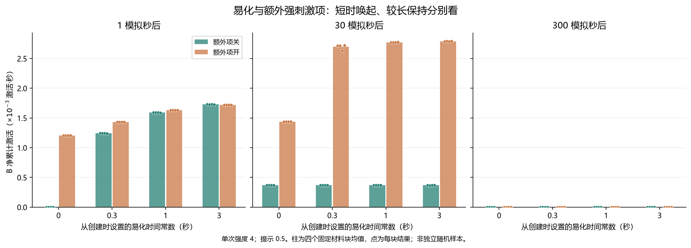
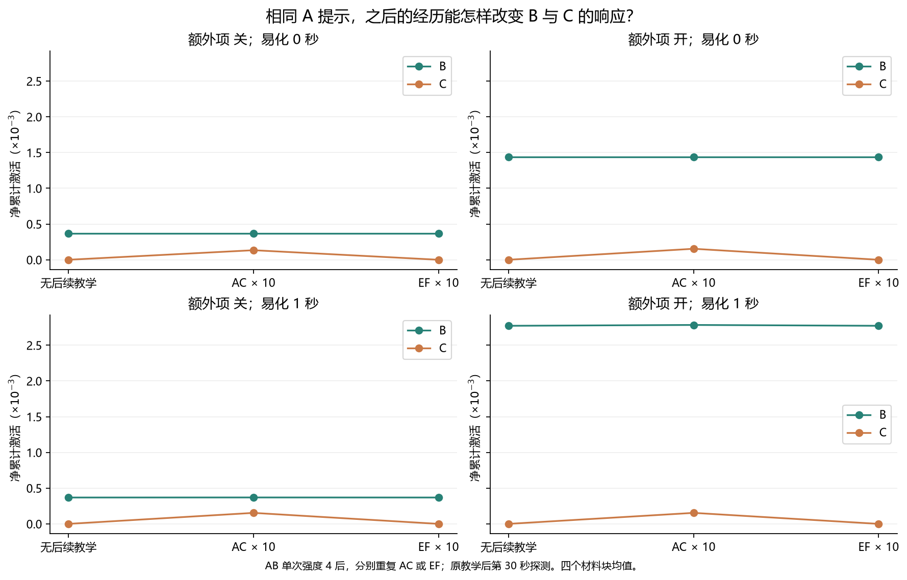
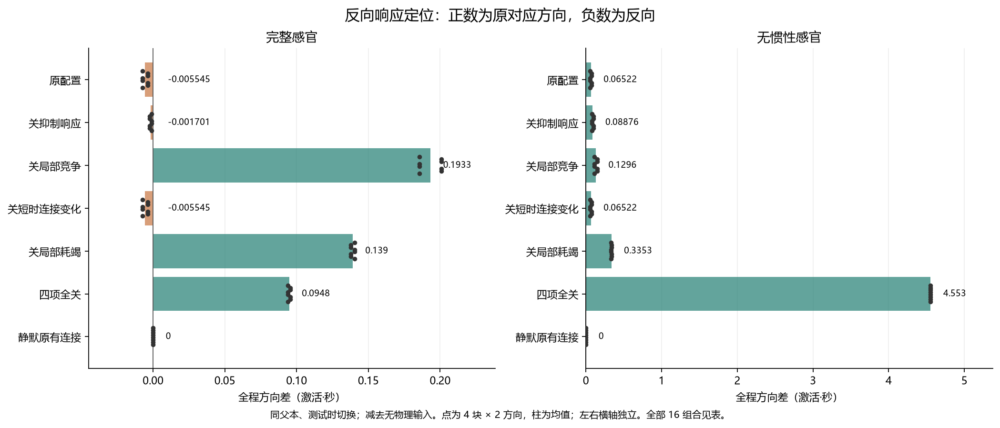
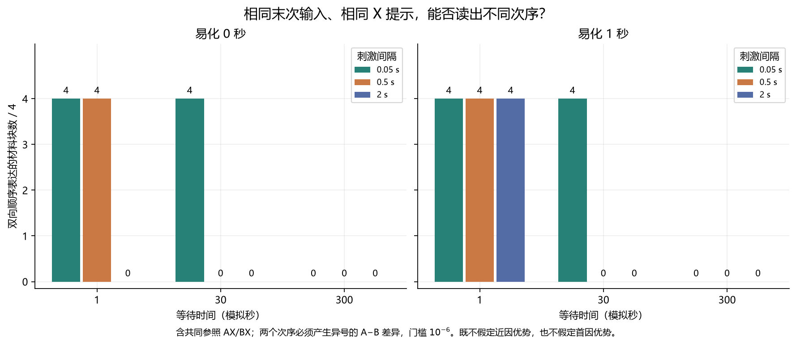
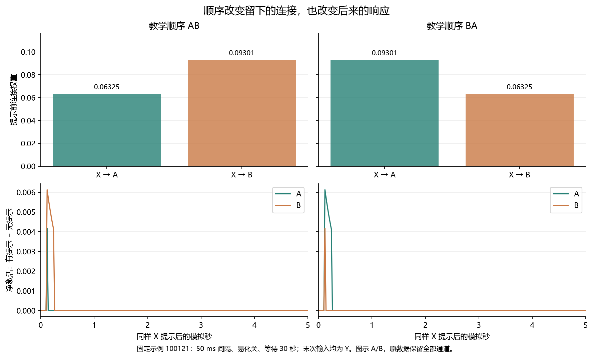

# 强刺激、易化、感官响应与顺序：优先验证

[English](report.en.md) · [执行入口](README.md) · [第一批事前设计](design.zh.md)

2026-10-01。三批登记模拟共 2,808 个新实验实例全部完成，包含大量同源对照副本。最值得保留的三个结果是：额外强刺激项仍有尚未完整替代的保持作用；感官反向由局部竞争与耗竭共同决定；共同参照下的 50 ms 教学，能在 30 秒后表达先后差别。具体条件、阴性结果和最终证据核验见下文。

## 已能回答：额外强刺激项暂时不能完整替代

**易化有明确效果，普通巩固增强也有帮助，但本轮候选尚不能在较长保持上替代额外强刺激项。** 保留可选参数、默认开启的决定继续成立。`intensity_gain=0.075` 开启，`0` 关闭；用户以后根据证据决定默认值。本轮没有改变内核公式、产品数值默认或旧意识。

这次从创建时就设置易化，不再用临时热开启代替“从出生常开”。四个材料块先经历 AC、BD，再学习 AB；之后用相同 A 提示，看 B 是否响应。每个提示都减去同父本、同一段模拟时间的无提示副本。表中的量是 **5 秒内 B 激活强度的累计面积差**，单位为 ×10⁻³ 激活·秒；它衡量一段响应，不等于最后一刻的激活。

| 配置；新经历为单次强度 4 | 等待 1 秒 | 等待 30 秒 | 等待 300 秒 |
| --- | ---: | ---: | ---: |
| 普通默认：额外项开，易化关 | 1.204 | 1.436 | 0 |
| 额外项关，易化关 | 0 | 0.369 | 0 |
| 额外项关，易化 0.3 秒 | 1.242 | 0.369 | 0 |
| 额外项关，易化 1 秒 | 1.592 | 0.369 | 0 |
| 额外项关，易化 3 秒 | 1.730 | 0.368 | 0 |
| 额外项关，易化 1 秒，普通触达增益翻倍 | 1.845 | 0.847 | 0 |
| 额外项关，易化 1 秒，稳定度增益翻倍 | 1.592 | 0.369 | 0 |
| 额外项开，易化 1 秒 | 1.630 | 2.772 | 0 |

数值为四个预先固定材料块均值，全部块在导出表中。没有把克隆副本数量当成独立样本量，也没有据此计算人群式显著性。

含义很直接：

- 无额外项＋1 秒易化，1 秒后达到普通默认响应的 **132.2%**，30 秒后只有 **25.7%**。这个差距在从创建时配置的条件下仍然存在，不能只归因于上一轮的热开关状态衔接。
- 普通触达增益翻倍把 30 秒响应提高至普通默认的 **59.0%**，方向有效，仍未达到事前设定的 80% 工程近似线。没有把未达到写成无价值，也没有把改善写成完全替代。
- 保留额外项再加易化，30 秒响应达到普通默认的 **193.1%**。易化与较强的既有连接可以共同提高唤起，不必是非此即彼的替代关系。
- 300 秒时，本批的新 AB 边在所有对应条件中都已消失；全零不算“替代成功”。这与此前另一课程在 300 秒仍可响应的结果并不冲突，也不把遗忘自动当故障。

## 易化没有偷偷变成长期储存器

在固定示例 `100101` 中，等待 30 秒、易化 1 秒的两组，连接可用量已恢复到约 1，易化利用率已降到约 2×10⁻¹³。此时额外项开／关的 AB 权重分别约 0.127／0.077，稳定度约 0.392／0.112。

因此，30 秒后更强的响应不能解释成“易化状态把经历保存了 30 秒”。连接留下的差异与**提示到来后重新运行的**短时机制共同决定响应。类似地，无额外项、无易化时，1 秒无可测响应、30 秒又能响应，不等于后者重新学会了 AB；形成、保持与当时能否唤起是不同问题。

“稳定度增益翻倍”对本次单次新生边效果很小，也有具体实现原因：`stability_gain` 参与节点、已有边与传播后的增长；新边初始稳定度还取决于出生时的巩固冲量。改这个参数不是把全部初始稳定度统一乘二。普通首次／重复增益虽然一起翻倍，本任务的 A、B 已经历过前置教学，相关改善主要不能归给“首次”分支。公式依据见 `src/threemind_core/restoration.py`，本轮仅核查，没有修改。

## 同样的总量，单次与重复不等价

单次 4、十次 0.4 密集重复、十次 0.4 逐渐拉开间隔，输入强度总和均为 4，最后一次教学时刻相同。以额外项关、易化 1 秒、普通参数为例，1 秒后的累计响应依次为 **1.592、1.516、1.350**；30 秒后依次为 **0.369、0、0**。

普通触达增益翻倍后，密集重复在 30 秒有 **0.0814** 的较小响应，间隔重复仍无响应。这个固定剂量和间隔方案没有让重复组胜过单次组；不能据此说重复学习或者逐渐稀疏的复习普遍无效。总量相等不保证每次接收状态、传递、巩固与遗忘历程相同。

另一个值得保留的现象：无额外项、1 秒易化时，单次教学强度 1 在 1 秒后反而有约 **1.647** 的响应，略高于单次 4 的 **1.592**。这里比较的是**不同教学经历后再给相同提示**，不是证明同一个固定状态下，输入越强即时激活反而越弱。较强经历不保证所有后续时点的响应更大。

## 后续经历可以增加一个对应，而不抹掉原对应

学习 AB 后，再给 AC×10，或给等量的 EF×10。均在原 AB 教学结束 30 秒时给同样的 A 提示。下面仍为 ×10⁻³ 激活·秒，取单次 AB=4 的四块均值。

| 配置 | 后续经历 | B 响应 | C 响应 |
| --- | --- | ---: | ---: |
| 额外项开，易化关 | 无 | 1.436 | 0 |
| 同上 | AC×10 | 1.436 | 0.154 |
| 同上 | EF×10 | 1.436 | 0 |
| 额外项开，易化 1 秒 | 无 | 2.772 | 0 |
| 同上 | AC×10 | 2.783 | 0.154 |
| 同上 | EF×10 | 2.772 | 0 |

本条件中，没有出现所担心的“新经历一来就冲掉旧 B”，也没有出现“旧 B 完全阻止新 C 被学到”。共享 A 的后续经历让 C 能响应，B 同时保留；不共享通道的 EF 没有产生同样的 C 响应。原先已有 AC 前置经历，这里是再次强化 AC，不是凭空创建从未存在过的 C。

这不是所有环境下都不会干扰的证明。普通触达翻倍候选没有另外进行本批干扰矩阵，不能把普通参数的抗干扰结果直接算到候选头上。本轮也未实施真实环境反转或生存选择。

## 开关到底改了什么

固定示例中，两通道各元素值为 1、帧强度为 4，原始乘积总量为 8。既有接收规则 `min(1, 元素值 × 强度 × direct_gain)` 产生的请求总量为 2；额外项开与关，两组接收量和即时激活增量均为 2。开关没有改发送的刺激。

但新边出生的权重／稳定度发生了差异：关闭时约 **0.12264／0.13966**，开启时约 **0.17310／0.42**。这就是额外项的实际工作：在既有公式中额外增加巩固，不是重写输入内容。192 组未超过强度 1 的对应对照，开／关后的 B 净响应差异均为 0。

还须保留一个边界：去掉 `intensity_gain × max(0, intensity−1)`，不等于普通巩固不再读取实际驱动量。现有普通冲量仍乘 `元素值 × 强度`。因此本轮支持“无需那个额外项也能形成强度相关的痕迹”，不能把它改写成“已经完全通过与输入幅度无关的机制自然产生了全部强刺激效应”。接收上限和原始乘积也不能混称为同一个物理量。

## 读出校准：过程存在，不冒充末态成功

只读复核 E19 的 1,068 个旧窗口，其中 582 个有可比较的提示条件，172 个 B 净过程响应为正；换成较严格的 10⁻⁶ 门槛仍为 172 个。旧末态目标响应为 0；120 个未训练条件与两个已有屏蔽条件均没有相应过程阳性。没有启动旧训练，来源哈希保持不变。

本批记忆实验的 648 个配对提示条件中，184 个 B 净过程响应超过 10⁻⁹，末态目标响应仍为 0，96 个未训练条件没有阳性。保留两种结果：目标确实在过程中活动过；原来要求最终判定时刻仍有目标激活的指标并未达成。不能为迎合任一方向而丢掉其中一个。

每 20 ms 保留实际节点、连接、抑制、短时状态和传输轨迹；背景 K 保留在原始数据中。积分以配对副本相减，既不调用语言模型补答案，也不按人类语义裁掉活动。本批探测窗口按这一采样未检出节点达到 0.999 的饱和状态；单次强度 4 教学当下直接节点达到上限的事实另行保留。

## 感官反向响应：局部竞争与能量耗竭共同决定方向

第二批直接复用 E18 的父本、物理采样和编码，不重新生成世界。16 个不干预案例的最终完整内核哈希 **16/16 与旧记录一致**，再进行四因素全组合。每组取四个材料块、两个摆动方向，配对有／无物理输入，共 544 个新实例。设计见[独立登记](reversal-design.zh.md)。

下表是全程 5.6 秒的“原教学对应目标净累计激活 − 另一目标净累计激活”，单位为激活·秒，**没有乘前面表中的 10³**。正数为原对应方向，负数为反向；不把其中一个方向预先称为好或坏。

| 只在探测阶段改变 | 完整感官 | 不含惯性感官 | 完整感官方向计数 |
| --- | ---: | ---: | --- |
| 原配置 | −0.005545 | 0.065222 | 8/8 反向 |
| 关抑制响应 | −0.001701 | 0.088764 | 8/8 反向 |
| 关局部输入竞争 | 0.193257 | 0.129583 | 8/8 原向 |
| 关短时连接变化 | −0.005545 | 0.065222 | 8/8 反向 |
| 解除局部能量耗竭 | 0.138986 | 0.335326 | 8/8 原向 |
| 四项全关 | 0.094800 | 4.553263 | 8/8 原向 |
| 静默原有连接 | 0 | 0 | 8/8 无方向响应 |

**本批完整感官的反向响应，出现在局部耗竭与局部竞争同时保留的组合中；关闭任意一个便转回原向。** 四因素的全部 16 个组合均支持这条关系，不是只比较两条挑选过的曲线。无惯性感官在全部 16 组合中都保持原向。静默后没有新生的未静默边，两目标的相应响应均为零，说明这些回应需要节点间连接传播。

这使此前的零效应有了边界：简单 AB 材料中，局部输入竞争几乎没显示目标作用；多路物理感官汇合时，它成为决定表达方向的因素。**同样的学习结构和同样的当前外界输入，因内部局部状态的处理方式不同，可以给出相反的响应。** 这是一项有因果对照的机制结果。

“短时连接变化”指 fast trace，不是第一批有显著效果的释放易化。它不改变本批的方向关系；默认配置附近影响很小，但在别的组合中仍可改变幅度，最大单例方向量差约 0.00233，不能据此宣布它完全无用。抑制也不能判为无作用：它改变响应大小和时间分布，只是单独关闭不足以消除本批整体反向。

过程观察还发现：关闭抑制响应后，输入段 8/8 仍反向；只看随后 5 秒，则 4 个原向、4 个反向。把它们只平均成一个正数会遮住差别，完整阶段统计已保留。这是需要过程读出、分段及逐材料结果的实际理由。

这些干预在**表达阶段**才实施，没有证明同样的开关也决定原先如何学会对应。也不建议为了让结果“看起来正确”默认关闭竞争或耗竭：反向本身是可重复的现象，进一步应解释输入汇合与局部恢复怎样共同造成选择。

## 顺序可以留下痕迹，并在活动消退后重新表达

**这次在原内核里得到了双向顺序表达，而且不要求额外易化开启。** 先反复输入 AX→BX，或交换为 BX→AX，均为 12 对；两个方向最后都输入同样的独立 Y。等待后给予完全相同的 X 提示，观察 A、B 谁的净累计响应更强。X 是共同参照刺激元，A、B、X、Y 都只是匿名通道，没有向 Core 输入“先”“后”或正确答案。设计见[顺序批次登记](sequence-design.zh.md)。

采用较严格的 10⁻⁶ 观测门槛，结果如下；每格为四个固定材料块的计数。所谓“后者优势”，是 AX→BX 后 B 较强、BX→AX 后 A 较强；“前者优势”则相反。

| 易化时间常数 | 每对刺激间隔 | 等待 1 秒 | 等待 30 秒 | 等待 300 秒 |
| --- | --- | --- | --- | --- |
| 关 | 50 ms | 4/4，后者优势 | 4/4，后者优势 | 0/4 |
| 关 | 0.5 秒 | 4/4，较小的前者优势 | 0/4 | 0/4 |
| 关 | 2 秒 | 0/4 | 0/4 | 0/4 |
| 1 秒 | 50 ms | 4/4，后者优势 | 4/4，后者优势 | 0/4 |
| 1 秒 | 0.5 秒 | 4/4，较小的前者优势 | 0/4 | 0/4 |
| 1 秒 | 2 秒 | 4/4，前者优势 | 0/4 | 0/4 |

全部有／无参照条件共 144 个双向比较，28 个达标；10⁻⁹ 和 10⁻⁶ 两种门槛的达标数相同。不是让某一个方向碰巧响应就算成功，也没有挑选一个材料块代替全体。四块主要改变匿名身份，不能把一致性扩大成不同世界和任务的泛化。

50 ms、易化关闭时，30 秒后的“后者减前者”约为 **0.00062676 激活·秒**；易化 1 秒时约 **0.00063179**。相比之下，0.5 秒间隔的 1 秒效应约为 −0.00000335／−0.00000710，明显更小。2 秒间隔开启易化时约为 −0.00008548。负号是前者更强，不是实验出错；间隔可以改变响应方向。

### 留下的是怎样的状态？

50 ms 条件的 16 个对应状态（四块 × 两方向 × 两种易化），在 30 秒提示前 **A、B、X 的激活均为 0**。因此随后出现的方向差，不能归结为 A 或 B 一直亮着。固定首块、易化关闭的示例中：

| 教学方向 | 提示前 X→A 权重 | 提示前 X→B 权重 |
| --- | ---: | ---: |
| AX→BX | 0.06325 | 0.09301 |
| BX→AX | 0.09301 | 0.06325 |

稳定度也随对应方向不同，可用能量已恢复；并未加入 A→B 的专门跨时生边规则。**先后次序改变了留下的局部结构，之后相同提示可以把这段经历的差别重新表现出来。** 这条结果支持继续研究“共同参照＋局部机制”如何形成可读的顺序信息。

节点支持度、稳定度和局部可塑性也有差别，尚未选择性清除它们。因此不能把全部因果贡献仅归给表中的边权，下一步应分别消融连接与节点历史。图中展示固定首块的整个 5 秒窗口，既不截掉后面的归零，也不因末态为零而否认前面的响应。

### 这轮把“没有顺序”拆成了三个不同问题

- **已形成且能表达：** 50 ms 共同参照条件在 30 秒仍有双向差别，四块一致。
- **仍有结构差别但此提示读不出：** 例如易化关闭、0.5 秒间隔，首块在 30 秒仍有约 0.00123 的最大对应边权差，但本探测没有双向响应。不能只凭这个无输出就说结构完全一样。
- **本批连接差别已消退：** 300 秒时本课程的相关连接不再保留，所有条件无双向响应；本结果不要求把遗忘取消。

无共同参照组未学过 X，在同样 X 提示下没有 A／B 净响应。这是提示缺少相应入口的边界对照，**不能单独证明没有共同参照就绝不可能保存任何顺序信息**；有无参照之间也不是等总输入量。

每个间隔内，两个方向的剂量和课程时长相同；跨间隔比较时，课程总时长分别为 6.8、12.2、30.2 秒，且输入相对传播节律的位置不同。故不能把这一结果扩大为“50 ms 普遍最优”，也不能排除课程时长、局部恢复或调度相位的贡献。预先登记的课程没有在人类语义上询问谁先谁后；它测到了可由响应区分的顺序痕迹，不等于家系推理或主观时间体验已经通过。

全部 576 个顺序观察窗在第 5 秒的 A／B 激活均为 0。此处的阳性属于完整过程的双向表达，未冒充最终时刻仍激活的阳性。

## 方法、证据和复现边界

- 使用既有 `threemind.continuous-memory/2`，未修改 Core、Rust 实现、传播门槛或时间架构。数值步长 10 ms、传播周期 100 ms 沿用原配置；教学的 50 ms 间隔不是把传播周期改成 50 ms。
- 普通默认仍保留额外强刺激项，额外易化仍默认关闭。实验副本中的参数切换不改旧意识，也不自动修改产品默认；遗忘、新颖性、学习与其他机制按登记保留，只有明列的变量改变。
- 维护输入为独立 K 通道，每 0.5 模拟秒一次、强度 0.2，是可重放的合成对照，**不是本机实时硬件遥测**。物理感官批次重放的是旧模拟世界的真实采样；没有调用外部大模型替意识生成回答。
- 记忆实验四块有两种前置强度和两种前置间隔；顺序实验四块主要改变匿名通道身份，课程相同。它们用于检查材料和编号依赖，不能算四种不同世界或独立人群。大量实例是同源分叉，不据其数量夸大独立样本量。
- 主要过程量取完整观察窗的配对净激活积分；末态激活、峰值、完整轨迹及分段方向同时保留。10⁻⁹ 与 10⁻⁶ 两个数值门槛是观测判据，不改变内核传播门槛。本轮不是把先前“末态目标未达成”改写成旧实验成功。
- 新项目独立保存设计、实际配置、原始载荷、递送帧、检查点和完整观察结果。只读使用的旧来源重新核对哈希；归档包含明确选择的旧父本与物理重放材料，不包含旧数据库，也没有清理或覆盖旧数据。

可直接分析的八张 CSV 表放在本目录 `tables/`，完整证据归档也包含同一份：

| 表 | 内容 |
| --- | --- |
| `memory-windows.csv`、`memory-summary.csv` | 每个窗口及记忆条件汇总 |
| `replacement-comparisons.csv` | 各候选相对普通默认的比值，避免把全零算等价 |
| `reversal-windows.csv`、`reversal-factorial.csv` | 全部四因素组合、原向／反向计数及分段量 |
| `sequence-windows.csv`、`sequence-state-pairs.csv` | 全部顺序窗口、按匿名通道对齐的节点与连接差异 |
| `sequence-summary.csv` | 各间隔、等待时长、参照和易化条件的四块结果 |

执行命令、恢复规则及可复用工具见 [README](README.md)。平台中的示例记录是单个原始窗口；报告表格的净响应还减去了配对无提示窗口，二者数值含义不同。中文、英文报告与图表均由同一批证据生成。

## 验收与资源

- 三批共 **2,808 个新实例**：记忆及干扰 1,592，感官全组合 544，顺序 672；登记案例失败 **0**。
- 核对 **430,384 个信封与 430,384 个递送帧**，没有待递送帧、输入过滤或实际刺激不一致。本批元数据规范化差异为 0；通用审计仍能识别并保留 JSONB 的负零表示差异，相关反例测试通过。
- 2,808 个数据库检查点与本地状态、结果哈希一致；六篇事前设计笔记及四个实际执行源码包通过核对。16 次旧物理重放完整哈希相同；四个不启用观察工具的复演也全部匹配。
- 输入证据与实验协议的 **9 项测试通过**；代码静态检查通过。中英文图表经目视检查。只有代表性四例做了关闭观察工具复演，并非声称全部实例都另跑一遍。
- 累计案例执行墙钟 **106.54 分钟**（包含输入和证据处理，不是纯 Core 基准）；核验用 Core 复演另约 0.010 秒。归档前新增证据约 **5.673 GiB**，预算为 10 GiB 停止新模拟、含归档 12 GiB 硬上限。
- 审计时共享账户已用量从 **80% 到 85%**，增加 **5 个百分点**，包含其他会话的消耗。各阶段按进程内存和磁盘余量保护执行；最近一次资源抽查可用内存约 10.05 GiB，C 盘约 10.11 GiB、E 盘约 114.05 GiB，均高于预留。

完整模拟已关闭扩展入口，仅做报告、归档和回读验证。数据进入独立项目 **2026-10-01 优先验证：强刺激保持与从出生易化**（`242ff8e9-f7d5-4d89-8964-cff06ca8fdf0`）。平台中的报告附可下载证据包；最终归档大小和报告标识另记交付单。旧意识、旧映射、旧数据和运行中的用户服务保持原状。

## 接下来最值得做什么

1. **定位顺序信息的形成与保持。** 分开检验节点历史和连接权重／稳定度，并扫输入相对 100 ms 传播时钟的相位。保留末次输入和探测时间匹配，增加等总量、不同共享关系的参照对照，查明 50 ms 条件能否跨节律成立。
2. **拆开感官反向的学习与表达。** 本轮已查明表达时竞争与耗竭的共同作用；下一步在教学时分别消融，并沿感官通路观察能量恢复与输入汇合，检验是否仍产生同样方向。
3. **寻找更好的强刺激替代，而非急于删除。** 普通巩固增强已有实测增益，下一轮要同时检验保持、真实新旧冲突和适应。易化保留为研究预设，额外项维持用户指定的默认开启。

上述是下一批应独立登记的问题。本轮没有进一步扩展至复杂生态、语言关系组合或新的意识指标；项目此前固定标准 `autonomy-criteria/1` 的通过结论保持原义。这里新增的是局部机制、历史影响和可读响应的证据，不以新问题撤销旧结论，也不把尚未做的更广验证写成已经完成。
