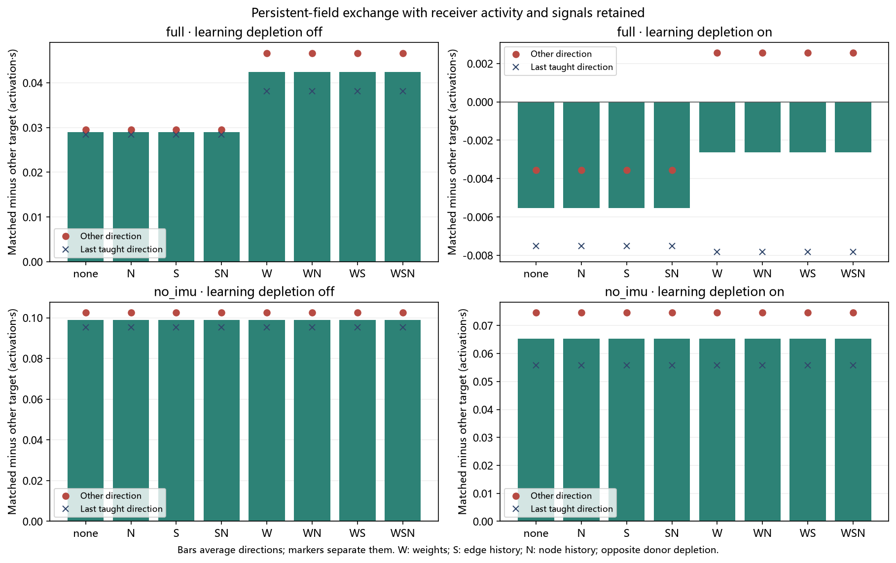
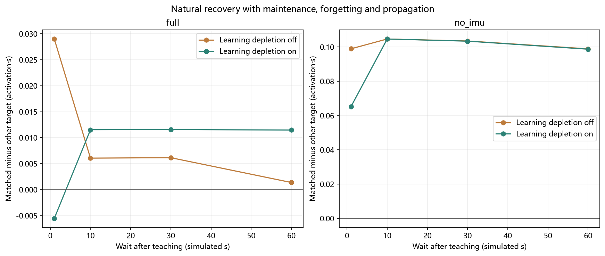
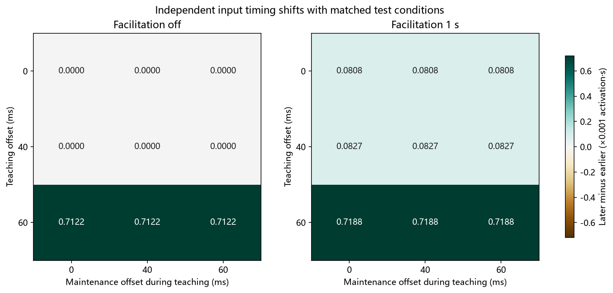
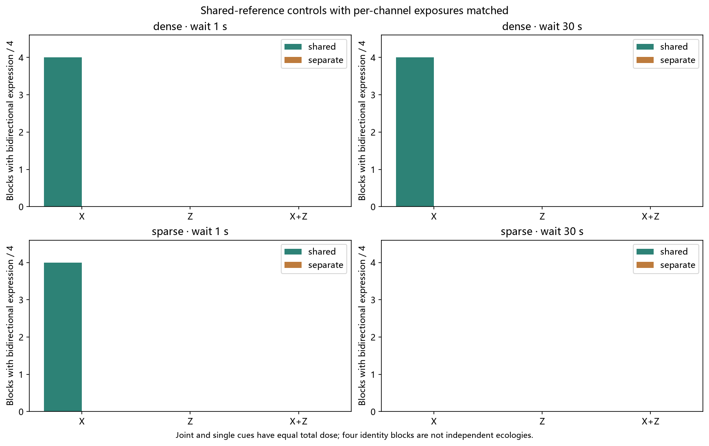

# Sensory reversal recovers; how timing affects order expression

> **Revision r2 · 2026-10-10**
> Revision reason: Relocate generated evidence out of Git; preserve original bytes and conclusions.
> Original: [report.en.md](report.en.md); parent r1: [report.en.md](report.en.md)

[简体中文](report.zh.md) · [Preregistered design](design.en.md) · [Execution plan](../../../docs/en/plans/recovery-reference-20261001.md)

2026-10-01, E22, following E21. The kernel remains `threemind.continuous-memory/2`. The optional extra intensity term remains enabled by default at `intensity_gain=0.075`; its replacement search is deferred. Core dynamics, product defaults, sensory mappings and historical experiments are unchanged.

## What has been established

**The earlier sensory reversal was not a permanent reversal of the learned correspondence.** Reversed expression at one second after teaching returned to the original correspondence by ten seconds and remained there at thirty and sixty seconds. Exchanging weights affected expression but did not transfer the whole reversal: ongoing recipient state also mattered.

**The tested maintenance-input timings do not explain sparse teaching's timing sensitivity.** Moving teaching still mattered; independently moving the input that kept the instance active did not change target responses. Recorded states identify whether the two teaching frames straddled a propagation event as a specific next factor to isolate.

**Dense teaching does not require every pair to land at precisely the same phase.** A preregistered millisecond jitter sequence retained bidirectional order expression after thirty seconds, with approximately 99.91% of the fixed-timing margin.

**The shared-reference effect is not merely more exposures of that channel.** With per-channel counts and dose matched, a shared reference still supported responses that reversed with teaching order. Early separate-reference responses predominantly followed paired identity, without the same bidirectional order expression. All 1,520 registered cases completed.

## 1. Sensory reversal: persistent structure versus ongoing state

We reused E21 physical samples and teaching checkpoints. Each source received the same thirty-two teaching clips, pairing two physical directions with anonymous targets A and B. Letters are observer annotations, not semantic inputs. Full sensation includes inertial measurements; the other condition removes them. The actual physical probe intensity is **0.3**.

Local input competition was enabled during both teaching conditions; local resource depletion was either enabled or disabled. At one second after teaching, all expression configurations had depletion and competition enabled. This retains E21's actual hot-switch semantics: switching on later is not represented as enabling from birth. The global supply-limiting energy simulation was disabled. Depletion here concerns the locally releasable resource at connections.

### Persistent-field exchange did not transfer the complete reversal

All eight combinations of weights, edge history and node history were exchanged. Recipient activation, inhibition, short-term resources, fast traces, in-flight events, already transmitted signals, clocks and counters remained unchanged. Sources still had in-flight events, so the old empty-queue exchange protocol was retained and a separate explicit research operation introduced. These are artificial interventions, not natural learning or production-kernel rules.

The following full-sensation results are net cumulative activity of the originally paired target minus the other target, in activation·seconds. Positive means the original correspondence; negative means reversal. The donor had the opposite teaching-depletion setting.

| Recipient teaching depletion | Exchange | Eight physical probes | Mean difference |
| --- | --- | --- | ---: |
| Off | None | 8 original-direction responses | +0.029001631 |
| Off | Weights only | 8 original-direction responses | +0.042393795 |
| Off | All three groups | 8 original-direction responses | +0.042393829 |
| On | None | 8 reversed responses | −0.005544684 |
| On | Weights only | 4 original, 4 reversed | −0.002622741 |
| On | All three groups | 4 original, 4 reversed | −0.002622761 |

Exchanging only node or edge history changed full-sensation values at approximately the 10⁻⁸ scale without changing direction. Small expression effects at this stage do not establish that these fields are unimportant for learning or forgetting. Without inertial sensation, all eight exchange combinations gave exactly the same target responses as their respective shams.

A descriptive split by teaching order revealed that, in depletion-trained recipients after weight exchange, **the last-taught physical direction remained reversed; the other direction returned to its original correspondence**. This held in all four material blocks, rather than favoring a fixed physical sign. This stratified interpretation was found during analysis; the preregistered eight-combination comparison was unchanged.

For example, block 930101 ended teaching with the negative physical direction. Weight exchange yielded +0.002571203 for the positive direction and −0.007816637 for the negative direction. Reporting only the overall mean of −0.002622741 would conceal that half the probes had changed direction.

**This differs from E21's thirty-second order-memory exchange.** There, task targets were already inactive and weights alone transferred the entire response advantage. Here, at only one second, activity and signals remained; even all three registered persistent groups were insufficient to reproduce donor expression. Experience-dependent responses need not all use the same storage and expression process.

### Letting the same sources recover naturally

Copies of the same one-second states were advanced to ten, thirty or sixty seconds after teaching. Maintenance input, forgetting, learning and propagation continued normally. Every physical probe had a matched no-physical-input copy.

| Sensation and teaching condition | 1 s | 10 s | 30 s | 60 s |
| --- | ---: | ---: | ---: | ---: |
| Full, depletion off | +0.029002 | +0.006064 | +0.006146 | +0.001367 |
| Full, depletion on | **−0.005545** | **+0.011524** | **+0.011544** | **+0.011479** |
| No inertia, depletion off | +0.098936 | +0.104655 | +0.103494 | +0.098911 |
| No inertia, depletion on | +0.065222 | +0.104638 | +0.103387 | +0.098706 |

Each cell averages four material blocks and two directions, with all eight sharing its sign. The full-sensation reversal disappeared by ten seconds and did not recur at the later registered observations. At sixty seconds the depletion-trained full-sensation margin was about **8.39 times** the non-depletion-trained margin. This is a response gain for this course and cue, not an 8.39-fold improvement in general memory ability.

Stronger average connections did not automatically produce better discrimination. At sixty seconds in block 930101, the mean weight was about 0.698 after teaching with depletion and 0.933 without depletion; the former nevertheless distinguished the targets more strongly. Whole-network average strength cannot replace a task-specific expression measure.

At ten seconds, target activity had reached zero and the event queue was empty, yet physical input could reactivate the original correspondence. The targets did not have to remain continuously active. Nor were dead instances revived: another input maintained overall activity throughout.

Waiting includes local recovery, activity clearance, propagation and forgetting. The evidence **supports an ongoing-state contribution to early reversal, but does not isolate inhibition, local resources or in-flight history as its sole cause**. That is a narrower mechanism question, not a denial of the observed effect.

## 2. Separating teaching timing from maintenance timing

Four anonymous material blocks received twelve AX/BX pairs, 50 ms within each pair and 2.5 seconds between pair starts, at intensity 0.4. AB and BA orders, teaching offsets of 0/40/60 ms, maintenance-K offsets of 0/40/60 ms and facilitation off/on at one second were fully crossed. Input counts, dose, course end and probe time were matched. After teaching, every condition used the same K schedule.

After thirty seconds, X=0.5 was probed for five seconds and compared with a matched uncued copy. Values are later-taught minus earlier-taught net cumulative activity.

| Facilitation, teaching offset | K offset 0 ms | K offset 40 ms | K offset 60 ms |
| --- | ---: | ---: | ---: |
| Off, 0 ms | 0 | 0 | 0 |
| Off, 40 ms | 0 | 0 | 0 |
| Off, 60 ms | 0.000712167 | 0.000712167 | 0.000712167 |
| 1 s, 0 ms | 0.000080845 | 0.000080845 | 0.000080845 |
| 1 s, 40 ms | 0.000082656 | 0.000082656 | 0.000082656 |
| 1 s, 60 ms | 0.000718752 | 0.000718752 | 0.000718752 |

Across 48 sets matched for material, facilitation, teaching offset and order, raw target integrals, net integrals, order margins and pre-probe mean weights were **exactly identical** at the three K timings. Of 72 AB/BA comparisons, 48 passed. The 24 nonpassing comparisons had facilitation off and teaching offset 0 or 40 ms, with zero raw target process activity.

Recorded states give a more specific lead. For block 100121 without facilitation, the last pair at offset 40 ms arrived at 27.54 and 27.59 seconds, before propagation at 27.60. At offset 60 ms the pair arrived at 27.56 and 27.61, straddling that propagation. Immediately after the second frame, X→B weights were approximately 0.102862 and 0.157459 respectively.

**The tested maintenance offsets can be excluded as the explanation for these target differences.** This does not show that all background input is irrelevant, or uniquely prove that propagation timing alone explains the result. An independent propagation-rhythm contrast, with doses, pair intervals and probing held fixed, is the next direct test. Neither Core modification nor a premature BUG verdict is required by this result.

### Dense teaching retained its advantage under fixed timing jitter

For twelve pairs starting 550 ms apart and still separated internally by 50 ms, fixed offset 40 ms was compared with a preregistered per-pair sequence of 12, 52, 48, 30, 43, 67, 7, 10, 28, 11, 38 and 10 ms. Facilitation was off; probing occurred after thirty seconds.

The fixed-timing margin was **0.000633961**; the jittered margin was **0.000633380**, or approximately **99.91%** of it. All four blocks and both teaching orders retained a later-taught advantage. This extends the earlier fixed-phase checks to this particular predetermined jitter sequence; it does not claim coverage of all random timing patterns.

## 3. Shared references and per-channel exposure

E21 changed AX/BX to AX/BZ at equal total dose, but halved the number of X exposures. E22 resolves that confound with four stimuli per round: shared AX, BX, CZ, DZ versus separate AX, BZ, CZ, DX. Over twelve rounds, A/B/C/D each appear twelve times and X/Z each twenty-four times. Every frame has two elements at intensity 0.4. AB/BA swaps the first two objects' teaching order, with references following the layout's object rule.

Dense rounds start 1.1 seconds apart, with slots 0/50/550/600 ms. Sparse rounds start five seconds apart, with slots 0/50/2500/2550 ms. After one or thirty seconds, X, Z or an equal-total-dose joint XZ cue is applied.

| Course, wait and cue | Shared reference | Separate references |
| --- | --- | --- |
| Dense, 1 s, X | Later-taught margin 0.000724985; 4/4 blocks bidirectional | X favors A regardless of order; 0/4 bidirectional |
| Dense, 30 s, X | Later-taught margin 0.000461412; 4/4 bidirectional | Zero A/B process activity |
| Sparse, 1 s, X | Later-taught margin 0.000172005; 4/4 bidirectional | Zero A/B process activity |
| Sparse, 30 s, X | Zero A/B process activity | Zero A/B process activity |
| Dense, 1 s, Z | Zero A/B process activity | Z favors B regardless of order; 0/4 bidirectional |
| Other single-Z; every joint-XZ condition | Zero A/B process activity | Zero A/B process activity |

The separate-reference dense course did show ordinary paired recall at one second. For example, the X-cued A−B difference was +0.000174020 after AB and +0.000172796 after BA: both favored A rather than reversing with order. Z favored B in both orders. These responses are useful evidence and must not become “nothing was remembered” merely because they fail the order criterion.

Twelve of 96 AB/BA comparisons passed, all from the three shared-X cells above. This **further excludes exposure count alone as the explanation**, supporting a role for shared stimulus relationships and their timing in cueable order differences. No earlier/later answer labels were inserted into Core. Combination topology and each reference's actual temporal pattern still differ, so the result does not establish shared elements as necessary for every possible order memory.

The joint cue has total incident dose 0.5, split into 0.25 for X and 0.25 for Z; a single cue provides 0.5 to one channel. All joint conditions had zero raw A/B activity throughout the recorded trajectory. This was neither subtraction cancellation nor a readout omission of existing target activity. The experiment does not separately isolate reduced per-channel dose, competition and propagation thresholds. **An unexpressed joint response does not establish absence of the corresponding structure.** A separately registered dose-allocation contrast can address it later; no extra dose was added post hoc to obtain positives.

## 4. Reading the evidence

The primary measure follows E21: record actual state every twenty milliseconds, integrate target activity, subtract the matched uncued response and compare targets. Order expression must reverse under AB/BA teaching; a single A-over-B response is insufficient. The threshold is 10⁻⁶ activation·seconds with a 10⁻⁹ check. This is neither accuracy nor a consciousness score.

Original temporal windows, convergence-decision values, peaks, integrals and terminal states remain separate. A process difference is not relabeled as a nonzero converged endpoint. Every node's original activity is retained, without removal based on background or semantic labels. Baseline subtraction answers what this particular input changed; it does not replace raw activity.

All 1,280 observation copies had zero A/B activation at the observation endpoint. Across the three order batches, 68 of 176 AB/BA comparisons passed: 48 timing, 8 jitter and 12 exposure-matched reference comparisons. Counts were identical at 10⁻⁶ and 10⁻⁹. These are repeatable process differences, not a claim that the converged endpoint still outputs A or B. All 1,984 original activity-process windows are retained.

The four blocks mainly vary anonymous identity; sensory material also alternates teaching direction. They are not four independent ecologies, and many cloned controls do not constitute an equally large independent population. E22 localizes mechanisms; it does not rerun, revoke or change the established `autonomy-criteria/1` conclusion.

## 5. Tools, verification and delivery

The new development CLI `lab.tools.state_exchange_cut` coexists with the older strict exchange tool. Anonymous channels and directed channel pairs provide alignment. It rejects different configurations, times, lifecycle states, topology or unfinished novelty. Sources remain read-only; new states and field-level receipts are stored separately. Recipient node identities and all already transmitted events are preserved.

Fourteen targeted tests passed across the new and old tools and input auditing. They cover all eight groups, shams, invalid-state rejection and identical Python/Rust continuation after exchanging states with in-flight events. No production Runtime intervention rule or new graphical exchange form was added. Humans and agents can use the same CLI; the platform displays designs, reports and original readouts.

| Verification | Result |
| --- | --- |
| Registered and completed | 1,520/1,520: exchange 512, natural recovery 240, crossed timing 432, jitter 48, matched references 288 |
| Instance roles | 192 new teaching, 48 holding and 1,280 observation/clone controls; not 1,520 independent ecologies |
| Inputs | 68,640 envelopes and 68,640 frames checked individually; zero pending |
| States | Every database/local full Core hash matched; all 512 intervention receipts reconstructed |
| Courses | All 192 teaching schedules, intensities, channels, doses and frame-adjacent states verified |
| Historical replication | Exact full Core hashes for 64 sensory shams and 144 original timing conditions |
| Observer effects | Nine representative observer-disabled replays matched full Core hashes |
| Sources and versions | All 258 frozen sources unchanged; five stage runner bundles archived; bilingual registrations match database notes |
| Failures and retries | No failed simulation cases, overwritten reruns or historical evidence cleanup |

Aggregate case execution wall time was **1,844.44 seconds, approximately 30.74 minutes**, including simulation, observation, input handling and persistence. It is neither a pure Core benchmark nor total task duration. New evidence at audit was approximately **1.142 GiB**, before the final archive; archive-inclusive usage is recorded in the delivery receipt. Shared-account usage rose from 88% at registration to 90% at audit, counting other conversations. The simulation STOP marker is written and this batch will not expand. Historical data is preserved; Git is not pushed.

The dedicated platform project is **“2026-10-01 感官恢复、维护时机与共同参照”**, ID `5e4f46e7-5d55-44de-a2b6-9707e2057387`. Designs, bilingual reports, eight fixed original-readout examples, figures and complete evidence are published through Lab services, with read-back verification recorded in a separate delivery receipt. Net report responses remain distinct from the raw windows in record tables. Per-case values are in `tables/windows.csv`, groups in `tables/summary.csv`, and bidirectional comparisons in `tables/paired-orders.csv`.

## 6. Next questions remain specific

1. Separate activation, inhibition, local resources and in-flight history in early sensory reversal, retaining these exchanges and natural recovery as controls. Clearing everything at once would not isolate one cause.
2. Isolate propagation rhythm from input timing. The verified dense-teaching condition provides a robust comparison.
3. Let the exposure-matched reference results determine the next reference experiment; equal total dose is not equivalent to equal per-channel experience.
4. Facilitation hot-switch semantics, forgetting and conflict adaptation, novelty templates, background correlation, broader transplantation and software-testable consciousness criteria remain in the [research backlog](../../../docs/en/plans/research-backlog.md). Extra-intensity replacement stays deferred.

## Data location revision

Selected generated evidence has been archived and verified byte for byte. Original reports, criteria, conclusions and embedded source_commit values are preserved. The logical downloads below require the current host administrator. The data directory is not public.

`data/experiments/2026-10-01-recovery-reference/`

[Location and hash index / 位置及哈希登记](../../artifact-index/2026-10-09-relocations.json)

- [tables/paired-orders.csv](/api/v2/storage/research-artifacts/research-artifact:9cf56ab15ca1d9d52df3f25d/content) — 34911 B; SHA-256 `471bc71f86b6c410df0038fccb0e4e481bb6d5a1d75476964a3f40dde48dde97`.
- [tables/windows.csv](/api/v2/storage/research-artifacts/research-artifact:76406547c776efe9791582ed/content) — 625234 B; SHA-256 `a77a01e3a8b64744949f14683de1811e5d9b5d958c48e67ab67b452384d0e07a`.
