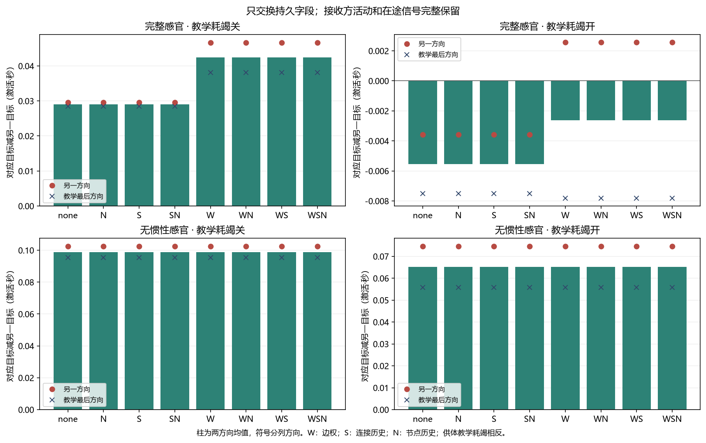
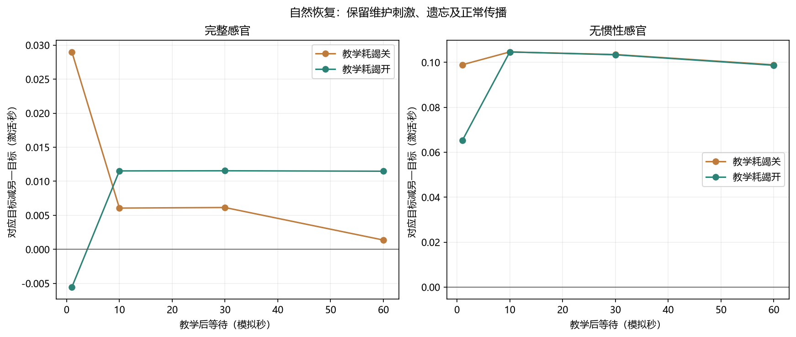
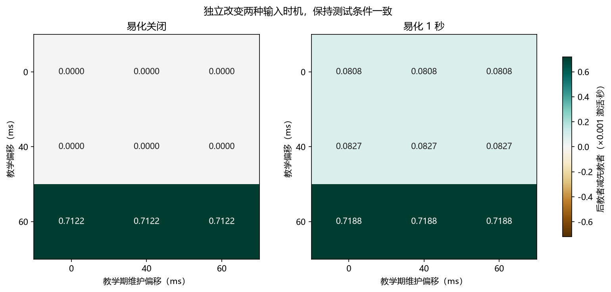
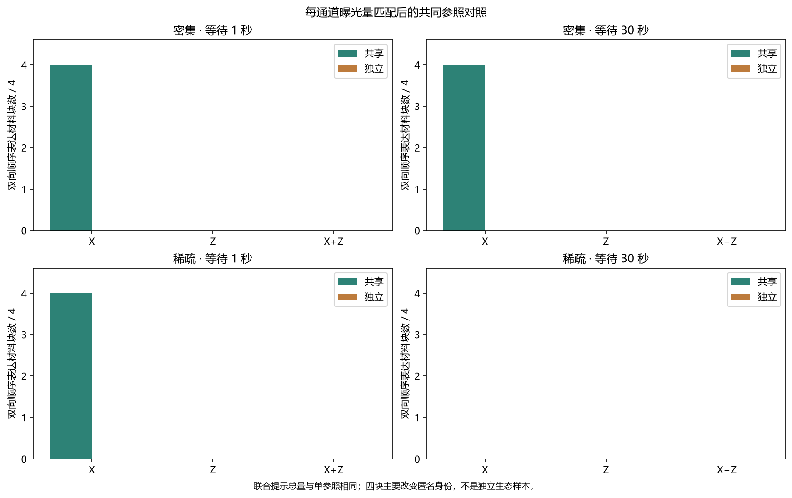

# 感官反向会恢复，顺序表达怎样受时间影响

> **修订 r2 · 2026-10-10**
> 修订原因：生成证据移出 Git 并完成校验归档；追加位置登记，保留原字节与结论。
> 原版：[report.zh.md](report.zh.md)；父版本 r1：[report.zh.md](report.zh.md)

[English](report.en.md) · [事前设计](design.zh.md) · [执行计划](../../../docs/zh/plans/recovery-reference-20261001.md)

2026-10-01，E22，承接 E21。内核仍是 `threemind.continuous-memory/2`；强刺激额外项保持可选、默认开启，`intensity_gain=0.075`。没有修改内核动力学、产品默认、感官映射或旧实验。强刺激替代探索继续暂缓。

## 先说已经查明的事

**此前的感官反向不是一个固定不变的“学反了”的结果。** 教学后 1 秒出现的反向，在 10 秒时恢复为原对应方向，30 秒和 60 秒仍然如此。交换连接权重会改变它，但不能完整搬走它；当时仍在运行的状态也参与表达。

**稀疏教学的时间敏感性，不能用本次测试的背景输入时机解释。** 教学整体挪动仍有影响，独立挪动维持活动的输入没有改变目标响应。记录显示，两次教学是否跨过一次传播，是下一步值得隔离验证的因素。

**密集教学不要求每一次刺激都精确卡在同一个时刻。** 按事前固定序列把每对教学的起点作毫秒级扰动，30 秒后仍保持随教学顺序反转的响应优势，幅度保留约 99.91%。

**共同参照的作用不只是“那个通道被多刺激了几次”。** 匹配每个通道的刺激次数和剂量后，共享参照仍保留随教学次序换向的响应；独立参照的早期响应主要跟随配对对象，没有同样的双向顺序表达。1,520 个登记案例全部完成。

## 一、感官反向：先分清结构和当时的状态

复用 E21 的物理采样与教学快照。每个来源经历相同的 32 段教学，两个物理方向分别与匿名目标 A、B 配对；字母只是研究者标签，不进入内核。完整感官包含惯性测量，另一条件去掉惯性感官。当前物理探测的实际强度为 **0.3**。

两个教学条件都开局部输入竞争，只改变教学时是否开启局部能量耗竭。到教学后 1 秒，全部统一为耗竭、竞争均开的表达配置。这沿用 E21 的实际热切换语义，不冒称关闭后再开启等同从出生常开。全局能量供应限制没有启用；这里的耗竭是连接局部可释放量的消耗与恢复。

### 交换持久字段，反向没有整体随供体搬走

分别交换连接权重、连接历史、节点历史的全部八种组合。接收方活动、抑制、局部能量、快迹、在途信号、已发生的传输、时钟及计数器原样保留。来源有在途事件，不能使用旧的空队列交换器，因此另设明确的研究操作；这不是自然学习，也没有改变生产内核的规则。

下表为完整感官的净响应差：原教学对应目标减另一目标，单位为激活·秒。正数表示原对应方向，负数表示反向。供体的教学耗竭状态与接收方相反。

| 接收方教学耗竭 | 交换内容 | 八个物理探测结果 | 平均差值 |
| --- | --- | --- | ---: |
| 关闭 | 无交换 | 8 个原向 | +0.029001631 |
| 关闭 | 仅连接权重 | 8 个原向 | +0.042393795 |
| 关闭 | 三组全部交换 | 8 个原向 | +0.042393829 |
| 开启 | 无交换 | 8 个反向 | −0.005544684 |
| 开启 | 仅连接权重 | 4 个原向、4 个反向 | −0.002622741 |
| 开启 | 三组全部交换 | 4 个原向、4 个反向 | −0.002622761 |

只换节点或连接历史，对完整感官的数值影响约在 10⁻⁸ 量级，没有改变方向；不能把这个阶段作用小推成它们在学习和遗忘中无用。无惯性感官的八种交换组合，则与各自不交换的目标响应完全相同。

进一步按原教学次序拆开看，开启耗竭的接收方只换权重后，**恢复原向的都是另一方向，仍反向的都是教学最后出现的方向**。四个材料块均如此；不是固定的物理正方向或负方向。这个按教学末次方向分层的解释是在汇总中发现的线索，原八组合主比较没有改变。

例如材料 930101 的最后教学方向为负方向。只换权重后，正方向的净差为 +0.002571203，负方向为 −0.007816637。若只报平均值 −0.002622741，就会漏掉其中一半已经换向的事实。

**这和 E21 的 30 秒顺序交换结果不同。** E21 在任务节点已经静息的样例中，只换权重便完整翻转顺序优势；这里才过 1 秒，仍有活动与在途信号，三组持久字段都换掉也不能完整复现供体。这说明不能把所有“经历影响以后响应”的现象都归成同一种存储和表达过程。

### 不再干预，让相同实例自然等待

从同一组 1 秒快照分别继续推进到教学后 10、30、60 秒。维持活动的输入、遗忘、学习与传播照常；每个探测均有同源无物理输入副本。

| 感官与教学条件 | 1 秒 | 10 秒 | 30 秒 | 60 秒 |
| --- | ---: | ---: | ---: | ---: |
| 完整感官，教学耗竭关 | +0.029002 | +0.006064 | +0.006146 | +0.001367 |
| 完整感官，教学耗竭开 | **−0.005545** | **+0.011524** | **+0.011544** | **+0.011479** |
| 无惯性感官，教学耗竭关 | +0.098936 | +0.104655 | +0.103494 | +0.098911 |
| 无惯性感官，教学耗竭开 | +0.065222 | +0.104638 | +0.103387 | +0.098706 |

每格是四个材料块、两个方向的均值；每格八例符号一致。完整感官在教学后 1 秒反向，之后三个时点全部原向。60 秒时，教学耗竭开启组的对应差值约为关闭组的 **8.39 倍**。这是这套课程和提示下的响应增益，不是全部记忆能力提高 8.39 倍。

这也不只是“整个网络越强，记得越好”。材料 930101 在 60 秒时，开启教学耗竭组的平均边权约 0.698，关闭组约 0.933；前者的目标区分反而更强。全网平均连接强度不能替代具体的记忆表达指标。

到 10 秒，所测目标节点已无激活，信号队列为空；再给物理材料仍能唤起原对应。它不是依靠目标节点一直亮着来假装保持，也没有复活死亡实例——实例仍由另一路输入维持活动。

自然等待同时发生了局部恢复、残余活动消散、传播和遗忘。本轮**支持早期反向依赖即时状态，尚不能从中单独指定抑制、能量或在途信号谁是唯一原因**。这是已经缩小的机制问题，不是现象不存在。

## 二、顺序表达：教学时机与背景时机分开

沿用四个匿名材料块，12 对 AX/BX，内部相隔 50 ms，每对起点相隔 2.5 秒，强度 0.4。AB、BA 两种次序；教学整体偏移 0/40/60 ms，教学期间维持活动的 K 输入独立偏移 0/40/60 ms，易化关或 1 秒。各组输入数、剂量、课程结束和测试时刻相同，课程结束后恢复同一 K 节律。

在等待 30 秒后用 X=0.5 探测，观察 5 秒，并减同源无提示。数值是后教者减先教者的净累计活动。

| 易化、教学偏移 | K 偏移 0 ms | K 偏移 40 ms | K 偏移 60 ms |
| --- | ---: | ---: | ---: |
| 关，0 ms | 0 | 0 | 0 |
| 关，40 ms | 0 | 0 | 0 |
| 关，60 ms | 0.000712167 | 0.000712167 | 0.000712167 |
| 1 秒，0 ms | 0.000080845 | 0.000080845 | 0.000080845 |
| 1 秒，40 ms | 0.000082656 | 0.000082656 | 0.000082656 |
| 1 秒，60 ms | 0.000718752 | 0.000718752 | 0.000718752 |

48 组同材料、同易化、同教学偏移及次序的三时机比较中，目标原始积分、净积分、顺序差和提示前平均边权在三个 K 时机下**完全相同**。72 个 AB/BA 双向比较中，48 个达标；没有达标的 24 个，属于易化关闭、教学偏移 0 或 40 ms，目标原始过程活动均为零。

传播前后的状态给出进一步线索。例如材料 100121、易化关闭，最后一对教学整体偏移 40 ms 时，两帧在 27.54、27.59 秒，下一次传播为 27.60 秒；偏移 60 ms 时，两帧在 27.56、27.61 秒，中间跨过 27.60 秒的传播。第二帧之后 X→B 的权重分别约 0.102862 与 0.157459。

**可以排除的是本次 0/40/60 ms 维护输入偏移造成目标差异的解释；不能据此宣布所有背景都无影响，也不能仅凭上述对应就把全部差异唯一归因于传播时钟。** 后续可以单独改变传播节律，保留剂量、对内间隔和探测条件，以区分调度边界、局部抑制与恢复。不把现象提前判为 BUG，也不在本轮改内核。

### 密集教学在固定时间扰动后仍保持优势

12 对教学改为每对起点相隔 550 ms，一对内部仍相隔 50 ms。比较固定偏移 40 ms，与事前固定的逐对偏移序列 12、52、48、30、43、67、7、10、28、11、38、10 ms。易化关闭，30 秒后同样探测。

固定条件净顺序差为 **0.000633961**，扰动条件为 **0.000633380**，后者约为前者的 **99.91%**。四块材料、AB/BA 两方向均保持后教者优势。它说明此前密集课程的顺序表达不要求每一对精确卡在相同相位；这里只覆盖这一条事前固定扰动序列，不冒称所有随机节奏都已验证。

## 三、共享参照与每通道曝光量

上一轮将 AX/BX 改成 AX/BZ，虽然总量相同，却把 X 的重复次数减半。这次把对照补齐：每轮四组刺激，共享条件为 AX、BX、CZ、DZ；独立条件为 AX、BZ、CZ、DX。各做 12 轮。A/B/C/D 均各出现 12 次，X/Z 各 24 次，每帧两元素、强度 0.4。AB/BA 只交换前两个对象的教学次序，参照按各自规则跟随对象。

密集课程每轮 1.1 秒，四帧相对时刻为 0/50/550/600 ms；稀疏课程每轮 5 秒，时刻为 0/50/2500/2550 ms。课程结束后等待 1 或 30 秒，再给单 X、单 Z，或者等总入射量的联合 XZ。

| 课程、等待及提示 | 共享参照 | 独立参照 |
| --- | --- | --- |
| 密集，1 秒，X | 后教者优势 0.000724985，4/4 块双向成立 | X 固定偏向 A，0/4 块双向成立 |
| 密集，30 秒，X | 后教者优势 0.000461412，4/4 块双向成立 | A、B 均无过程响应 |
| 稀疏，1 秒，X | 后教者优势 0.000172005，4/4 块双向成立 | A、B 均无过程响应 |
| 稀疏，30 秒，X | A、B 均无过程响应 | A、B 均无过程响应 |
| 密集，1 秒，Z | A、B 均无过程响应 | Z 固定偏向 B，0/4 块双向成立 |
| 其余单 Z；全部联合 XZ | A、B 均无过程响应 | A、B 均无过程响应 |

独立参照的密集课程在 1 秒时确有普通配对唤起。例如 X 提示的 A−B，AB 教学为 +0.000174020，BA 教学为 +0.000172796：两次都偏 A，并未跟教学顺序翻转。Z 则两次都偏 B。这些响应有价值，不能因为未达到顺序判据便写成“模型什么也没记住”。

本批 96 个 AB/BA 配对比较，12 个达标，均来自共享 X 的上述三格。这里**进一步排除了单通道重复次数多寡这一解释**，支持共同刺激关系及其时间安排参与可唤起的顺序差异；不是向内核写入“哪个先、哪个后”的答案。组合拓扑和每个参照实际出现的时间仍不同，不能据此宣称共享元素是所有顺序记忆的必要条件。

联合提示保持总入射量 0.5，但 X/Z 各只占 0.25；单提示则一个通道占 0.5。全部联合条件中，完整轨迹的 A、B 原始活动都为零，不是正负相减造成的零，也不是读出器漏报已有目标活动。当前结果无法单独区分每路量减半、竞争和传播门槛的贡献。**不能把等总量联合提示无响应当成对应结构不存在。** 下一步可用明确登记的剂量分配对照验证，不在本轮临时加量追求阳性。

## 四、如何阅读证据

主量沿用 E21 的完整过程：每 20 ms 保存真实状态，累计目标活动，减去同源无提示，再比较目标。顺序必须在 AB/BA 反向教学下双向换向，不能只凭一次 A 比 B 强；判断线为 10⁻⁶ 激活·秒，附 10⁻⁹ 核查。这个单位不是准确率，也不是意识得分。

原始时序窗口、收敛判定值、峰值、积分及观察末态全部保留；过程差异不冒称最终收敛仍有差异。所有节点的原始活动均保存，不因“背景”或语义标签而裁掉。净响应是回答本次输入造成什么变化的对照量，不替代原始活动。

1,280 个观察副本在观察结束时，A、B 均为零。顺序三批共 176 个 AB/BA 比较，68 个达到双向判据：时间交叉 48、密集扰动 8、等曝光参照 12；10⁻⁶ 与 10⁻⁹ 两条判断线的计数相同。这些是过程中可重复的响应差异，不能变成“最终收敛仍输出 A 或 B”的结论。1,984 个原始活动过程窗口随证据保留。

四个材料块主要改变匿名身份；感官材料还轮换教学方向。它们不是四种独立生态群体，大量克隆也不等于大量独立生物个体。本轮定位既有机制和现象，不重新裁定或撤销已有 `autonomy-criteria/1` 的通过结论，不更换意识判定标准。

## 五、工具、核验与交付

新增开发态 CLI `lab.tools.state_exchange_cut`，与旧严格交换工具并存。它按匿名通道和有向通道对对应，拒绝不同配置、时刻、生命周期、拓扑或未结算新颖性；原文件只读，新状态及逐字段收据另存。在途传输不撤回、不改投，接收方节点身份保留。

相关 14 项测试通过，包括新旧工具、输入核查、全部八组合、空交换、拒绝条件，以及交换后在途事件在 Python/Rust 中继续执行的全态一致性。没有添加生产 Runtime 干预规则，也没有新增图形交换表单；人和 Agent 可用相同 CLI，平台展示设计、报告和原始读出。

| 核验项目 | 结果 |
| --- | --- |
| 登记及完成 | 1,520/1,520：字段交换 512、自然等待 240、时间交叉 432、密集扰动 48、等曝光参照 288 |
| 实例性质 | 192 个新教学、48 个保持、1,280 个观察／克隆对照；不是 1,520 个独立生态样本 |
| 输入 | 68,640 个信封、68,640 帧逐项核对一致，待递送 0 |
| 状态 | 全部数据库／本地完整 Core 哈希一致；512 份交换收据重新构造一致 |
| 课程 | 192 个教学的时刻、强度、通道、剂量和教学前后状态核对通过 |
| 旧结果复现 | 64 个感官无交换条件、144 个原时间条件，完整 Core 哈希一致 |
| 观察工具是否扰动 | 9 个代表案例关闭观察工具重演，全态哈希一致 |
| 历史与版本 | 258 个固定来源未变；五阶段执行源码归档；事前中英文设计与数据库笔记一致 |
| 失败与重跑 | 模拟案例无失败，没有覆盖重跑或清理旧证据 |

累计案例执行墙钟 **1,844.44 秒，约 30.74 分钟**，包含模拟、观察、输入处理和保存，不是纯 Core 性能基准，也不是整个任务耗时。验收时新增证据约 **1.142 GiB**，尚未计最终归档；归档后占用另存交付收据。共享账户从登记时 88% 到验收时 90%，其他会话的消耗也计入。已写入停止标志，本批不再扩展；旧数据不清理，不推送 Git。

平台独立项目为 **“2026-10-01 感官恢复、维护时机与共同参照”**，ID 为 `5e4f46e7-5d55-44de-a2b6-9707e2057387`。设计、双语报告、八个固定原始读出示例、图表与完整证据按平台服务发布，并在单独交付收据核对回读结果。报告净响应与记录页原始窗口值分列。所有逐例值见 `tables/windows.csv`，分组值见 `tables/summary.csv`，双向比较见 `tables/paired-orders.csv`。

## 六、下一步只追踪已缩小的问题

1. 对早期感官反向，分别隔离活动、抑制、局部能量及在途历史；保留当前八组合和自然等待作为基线，不能粗暴清空全部快速状态后把结果归给一个机制。
2. 对时间敏感性，隔离传播节律与输入时间的关系；密集教学的已验证优势可作为稳健对照。
3. 共同参照后续方向以本轮等曝光结果为准；不再用总量相同冒充每通道经历相同。
4. 易化热开关、遗忘与冲突适应、新颖模板、背景相关性、一般移植及软件可检验的意识指标，仍按[研究待办](../../../docs/zh/plans/research-backlog.md)另行登记；强刺激替代保持暂缓。

## 数据位置修订

选定的生成证据已逐字节校验归档。原报告、评判标准、结论及数据内 source_commit 均保留。以下逻辑下载需要当前主机管理员身份，数据目录未整体公开。

`data/experiments/2026-10-01-recovery-reference/`

[Location and hash index / 位置及哈希登记](../../artifact-index/2026-10-09-relocations.json)

- [tables/paired-orders.csv](/api/v2/storage/research-artifacts/research-artifact:9cf56ab15ca1d9d52df3f25d/content) — 34911 B; SHA-256 `471bc71f86b6c410df0038fccb0e4e481bb6d5a1d75476964a3f40dde48dde97`.
- [tables/windows.csv](/api/v2/storage/research-artifacts/research-artifact:76406547c776efe9791582ed/content) — 625234 B; SHA-256 `a77a01e3a8b64744949f14683de1811e5d9b5d958c48e67ab67b452384d0e07a`.
