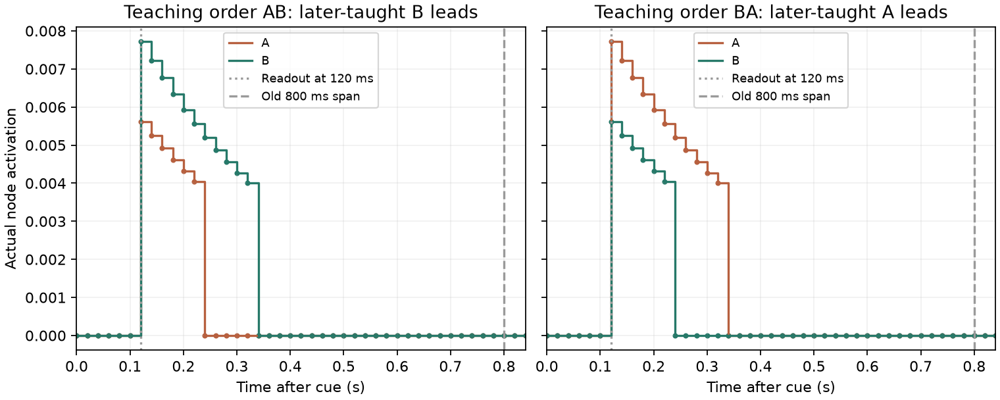

# E25: a brief response is still a response

> **Revision r2 · 2026-10-10**
> Revision reason: Verified original-file relocation; append location-resolution guidance and preserve the experiment conclusions.
> Original: [report.en.md](report.en.md); parent r1: [report.en.md](report.en.md)

2026-10-02. Calibration on saved trajectories, without retraining.

**All 94 target responses excluded by the old 800 ms local-stability requirement now produce direct, simultaneous activation rankings.** Models, stimuli and historical evidence remain unchanged. This is an improvement in measurement, not newly created model capability.

## Results

We checked 228 E23/E24 condition records. Of these, 188 contain analyzable complete activation vectors. The other 40 have no window: 32 models died before the scheduled probe and eight live records did not save that activity window. These are not zero responses. Some available windows are also boundary/death-truncated; complete vectors do not imply a complete five-second observation.

| Archived material | Windows | Target responses | Old 800 ms local stability |
| --- | ---: | ---: | ---: |
| E23 backgrounds | 80 | 40 | 0 |
| E24 main backgrounds | 80 | 40 | 0 |
| E24 background replacement only at testing | 12 | 6 | 0 |
| E24 replay of measured live inputs | 16 | 8 | 0 |
| Total | 188 | 94 | 0 |

The sampled spans of these responses range from **120 to 400 ms**, below the old requirement. None of the 94 uncued windows acquired a fabricated A/B response. Among the 94 responsive windows, original global classifications are 35 unresolved, 18 censored and 41 pattern-converged; all are preserved.

The detector identified 102 observed rise/fall crests. Multiple peaks within one episode are not independent replications. No real episode here consists of only one sample; retention of single-point responses is verified by synthetic tests, not presented as a new natural observation.

## A concrete example

With real telemetry, seed 100121 and testing one second after teaching, the ranking **120 ms after the cue** is:

| Teaching order | A activation | B activation | Leader |
| --- | ---: | ---: | --- |
| A then B | 0.0056118211 | 0.0077173062 | B |
| B then A | 0.0077173062 | 0.0056118211 | A |

The later-taught target leads in both. This episode has active samples from 120 to 320 ms; by 340 ms target activity is zero. It cannot satisfy 800 ms of continuous stability. **That failure does not negate a brief directional response.** Values come from a common instant, not independent per-node peaks. This example illustrates the existing order effect; it adds no independent replication.

## Operation

Open a complete temporal record in “Stimuli and outputs”. **Response readout** is now the default detailed analysis. Leave target IDs empty to read all nodes or enter preregistered targets. It shows simultaneous rankings and a list of entries, peaks and changes of leaders. The initial detail is the window's greatest total-activation response, earliest on a tie; this is not a semantic correctness score.

**Sustained stability (legacy)** retains the original algorithm and parameters. Export full JSON with original global classifications, gaps and censoring. UI, API, CLI and the operation catalog share the same pure analysis implementation. [Usage and reproduction](README.md)

One observed point remains readable; unknown duration or between-sample activity is explicitly labeled. Recognizing a response does not require first proving a specific competitive mechanism, nor does a peak automatically prove one. Unrecorded activity cannot be reconstructed after the fact.

## Correction and verification

Earlier report/history wording defended retaining 800 ms as necessary rigor. That interpretation does not fit the requested brief-response measurement and is explicitly corrected here, with the originals retained. Sustained stability and response occurrence answer different questions. The provenance and remaining uncertainty concerning the original eight-cycle choice are in the [decision record](../../../docs/en/plans/response-readout.md).

57 affected readout, API, CLI and Python/Rust regression tests passed. Browser checks at 1440/390 pixels and the frontend build passed. All 48 kernel-related source files and the native binary match E24; all 684 accessed historical files retained their hashes. Two offline passes took about seven seconds each, with no simulations. Verified derived files were approximately 426 KiB before archive copies. The initial summary misclassified a legacy string cue flag; original outputs and an explicit [execution correction](execution-notes.md) are retained separately.

The conclusion is improved readout of existing short-lived responses. It does not retroactively change fixed experimental criteria or establish new claims about consciousness or long-term memory.

> **Storage-location revision · 2026-10-10**
> This edition adds the verified move of the selected originals to `E:\ThreeMindData`. Stable scientific identities and hashes, experiment dates, measurements and conclusions remain unchanged. Paths in the preserved body describe historical sources; use the registered evidence resolver for current locations. Repository documents and frozen fixtures remain in place, and source copies are retained. Structured query data and running checkpoints remain in the database. This annotation does not assert that missing historical evidence was recovered.
