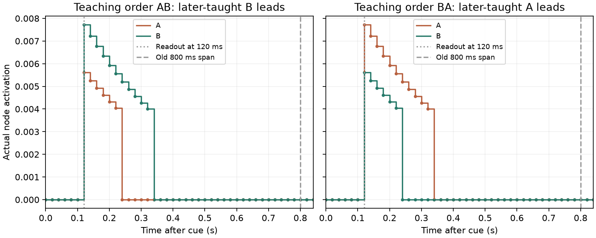

# E25：响应短暂，不等于没有响应

> **修订 r2 · 2026-10-10**
> 修订原因：原件存储位置已迁移并核验，追加当前位置解析说明，保留原实验结论。
> 原版：[report.zh.md](report.zh.md)；父版本 r1：[report.zh.md](report.zh.md)

2026-10-02；对既有轨迹的读出校准，不是新一轮训练。

**本次改进有明确效果：过去被 800 毫秒局部稳定条件挡住的 94 个目标响应，现在都能直接给出当时的激活排序。** 模型、刺激和旧数据没有改变。改善的是测量方法，不是凭空增加了模型能力。

## 看到了什么

检查 E23/E24 共 228 条条件记录，其中 188 条有可分析的完整采样向量。另 40 条没有窗口：32 条因原模型在预定检验前死亡，8 条现场记录未保存该活动窗口；它们不算“零响应”。部分已有窗口也被死亡/观察边界截短，完整向量不意味着完整五秒观察。

| 既有材料 | 有窗口 | 读出目标响应 | 满足旧 800 ms 局部稳定 |
| --- | ---: | ---: | ---: |
| E23 背景对照 | 80 | 40 | 0 |
| E24 主背景对照 | 80 | 40 | 0 |
| E24 仅检验期换背景 | 12 | 6 | 0 |
| E24 实测输入重放 | 16 | 8 | 0 |
| 合计 | 188 | 94 | 0 |

这些目标响应覆盖的采样跨度为 **120～400 ms**，明显短于旧条件。94 个无提示窗口均未读出 A/B 活动，没有因放弃持续时间要求就把它们编成响应。94 个有响应窗口中，35 个原全局判定为未定，18 个为截短，41 个为模式收敛；这些原判定原样保留。

新工具在这些轨迹中标出了 102 个先升后降的峰值。一个响应段可以有多个峰值，不能把峰值数当作独立实验次数。这里没有仅单个采样点的真实响应段；单点能力由合成测试验证，不能声称是本轮新观察到的自然现象。

## 一个直观例子

真实遥测背景、种子 100121、教学后一秒的检验：提示后 **120 ms**，A/B 已经有清楚差别。同一时刻：

| 教学顺序 | A 激活 | B 激活 | 领先者 |
| --- | ---: | ---: | --- |
| 先 A 后 B | 0.0056118211 | 0.0077173062 | B |
| 先 B 后 A | 0.0077173062 | 0.0056118211 | A |

两次都是后教者领先。此响应段从提示后 120 ms 采样到 320 ms，340 ms 时已无目标活动，当然不可能连续稳定 800 ms。**它是短暂而有方向的回应，旧条件不通过不能用来否定它。** 这里比较的是同一时刻的实际强度，不是把不同时间的各节点峰值拼在一起。该例帮助展示旧顺序效应，没有新增独立重复证据。

## 工具怎么用

在“刺激与输出”中打开完整时序记录，下方默认显示 **响应读出**：目标 ID 留空读全部节点，也可指定 A/B 等事先确定的目标；直接显示当前激活排序，并列出其他响应出现、峰值和领先变化时刻。默认详情取窗内总激活最大的响应时刻，平局取最早。这不是“最正确答案”的打分规则。

旁边 **持续稳定（旧版）** 保留原参数与算法，适合单独研究保持和稳态。完整 JSON 可下载，原全局判定、缺口与截短信息保留。UI、API、CLI 和操作目录使用同一个纯读出实现，AI 不需要另写私有实验脚本才能取得这些结果。[操作与复算](README.md)

采样到一个点也允许读出；持续时间和中间过程未知就明确标注。新工具并不要求证明某个竞争过程才肯承认响应，也不把纯粹幅度峰值自动解释为特定竞争机制。真正没有被保存的活动，仍不能倒推补写。

## 更正、验证与边界

旧报告及史书曾将“不降低 800 ms 条件”表述成保护严谨性。这不适合用户要观察的短暂响应；本轮明确更正这一解释，保留原件以便追溯。新旧测量回答不同问题，应并列使用，不能将“未持续稳定”写成“未出现响应”。800 ms 的工程来源及原始八周期理由未查明的边界，见 [决策记录](../../../docs/zh/plans/response-readout.md)。

57 项读出、API、CLI 与相关 Python/Rust 回归测试通过；1440/390 像素浏览器验收均通过，前端构建通过。48 份内核相关源码和原生二进制与 E24 相同；684 份读取的旧源文件前后哈希一致。两次离线扫描各约 7 秒，无新模拟；正式派生数据约 426 KiB（原证据归档副本另计）。首次汇总的旧字符串无提示标志曾归类错误，已保留初稿并单列修正，[执行记录](execution-notes.md)给出详情。

本次结论是**读出能力得到修复，已有短暂响应能直接呈现**。不据此更改以往固定判据下的实验结论，不宣称重新证明了意识或长期记忆。

> **存储位置修订 · 2026-10-10**
> 本版追加已核验的原件迁移说明：本次清单中的原件迁至 `E:\ThreeMindData`，科学身份、哈希、原实验日期、测量与结论不变。保留正文中的路径表示历史来源，当前位置通过已登记的证据引用解析。仓库文档与冻结夹具留在原处，源副本保留；结构化查询数据及运行中的检查点仍存数据库。本说明不表示缺失的历史资料已恢复。
