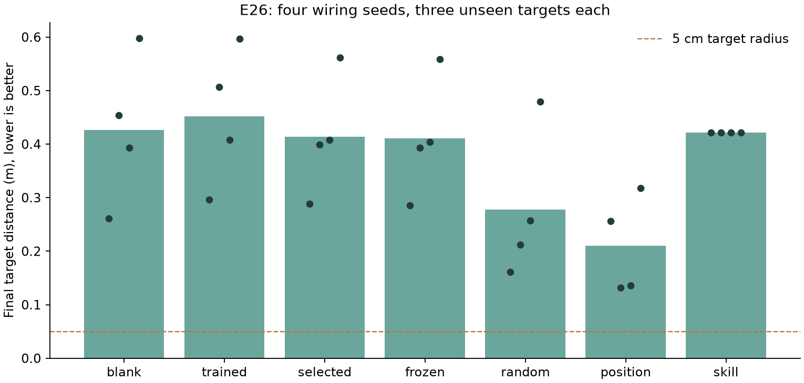

# E26: robot control and activity-to-language work; practical learning has not passed

> **Revision r2 · 2026-10-10**
> Revision reason: Verified original-file relocation; append location-resolution guidance and preserve the experiment conclusions.
> Original: [report.en.md](report.en.md); parent r1: [report.en.md](report.en.md)

[中文](report.zh.md) · [Preregistration](design.en.md) · [Execution notes](execution-notes.md)

2026-10-02. Project **E26 机械臂实用性与语言外设归因**, ID `0a246d2f-1f83-44c0-a179-9e617dd06bfb`. Core remains `threemind.continuous-memory/2`; dynamics, historical instances, mappings and prior experiments were not changed.

## Findings

Two concrete engineering gains are established, but reliable task learning is not.

1. ThreeMind controls a simulated arm through ordinary sensory and output interfaces, with mass, gravity, contact and joint limits. Experience and selection change subsequent actions. Selected candidates finish 1.25 cm closer than blank instances on average (41.41 versus 42.66 cm), but only two of four wiring seeds improve. Random action and position servos remain closer to the target. This short course did not establish useful learned control.
2. **A Transformer initialized entirely from random weights can, after external calibration, translate Core activity back to all four calibration words.** Both the existing text sensor and a frozen random Transformer input route pass. Qwen knowledge is absent from this study.
3. With the converter frozen before teaching new name–object pairs, answers do not track the new assignments reliably. The text route scores 0/4 and the random-Transformer route 1/4, against 1/4 for blank Core controls. Changed experience, exchanged activity and shuffled features change some outputs. Core influences language output, but influence is not successful expression of a learned relation.

The next bottlenecks are useful motor output/selection curricula and decoding the activity produced by experience. Merely attaching a Transformer does not solve them. The failed language test does not establish absence of Core memory, nor does calibration establish natural conversation.

## Arm experiment

The custom three-joint arm plus one-degree gripper uses raw torque, 2 ms physics and 10 ms sensory/action intervals, without changing Core propagation. Declared joint, inertial and contact sensors are accompanied by an ideal target beacon in body coordinates. This measurable reference is not reward; it has no visual occlusion model. Fixed anonymous output projection is explicitly engineering wiring, not an emergent motor region.

For each wiring seed, two candidates develop for six simulated seconds in different target environments. Independently born copies inherit structure and clear activity; they are evaluated in two selection environments for four seconds each. Mean final distance selects a parent, without evaluation writes to that parent. Three held-out target environments then test seven conditions for four seconds.

Four wiring seeds produce 108 episodes: eight developmental, sixteen selection and eighty-four final tests. Twelve final episodes per condition share trained parents; they are not twelve independent learning samples. The fixed external sweep repeats the same physical trajectory across wiring seeds, so these repetitions cannot increase statistical confidence. Results are descriptive.

| Condition | Mean final distance cm ↓ | Improvement from start cm ↑ | Ever within 5 cm | Within 5 cm at end | Mean work J |
| --- | ---: | ---: | ---: | ---: | ---: |
| Blank, raw torque | 42.66 | -18.02 | 1/12 | 0/12 | 0.195 |
| First trained candidate | 45.20 | -20.56 | 1/12 | 0/12 | 0.229 |
| Selected candidate | 41.41 | -16.77 | 1/12 | 0/12 | 0.139 |
| Selected, plasticity disabled | 41.04 | -16.40 | 1/12 | 0/12 | 0.135 |
| Random action | 27.76 | -3.13 | 2/12 | 1/12 | 16.980 |
| Core-driven position servo | 21.03 | +3.61 | 0/12 | 0/12 | 16.890 |
| Fixed external sweep | 42.21 | -17.57 | 8/12 | 0/12 | 18.556 |

Bars show aggregate means; points show each wiring seed's mean across three held-out targets. Controller references have different action authority and energy costs.

Selection beats blank in eight of twelve matched target comparisons, but only two of four seed averages. Ordinary development is worse overall. Freezing plasticity does not collapse performance during this four-second test; this is not evidence that long-term plasticity is useless.

The fixed sweep's apparently high success count is transient passage, averaging only 0.153 seconds inside the target and ending outside every time. Time inside is a post-execution descriptive check, not a replacement primary endpoint. It does not demonstrate target holding, grasping or learning.

A concrete next check is motor scale: selected candidates do roughly 1/122 of random-action mechanical work. This is not an equal-energy comparison. Before larger selection studies, register fixed adapter gains, uncontrolled passive dynamics and action- or work-matched random references. This study did not change gain or Core rules to chase success.

## Language experiment

Routes are text sensor → Core → scratch output Transformer, and frozen random Transformer sensor → Core → scratch output Transformer. Output uses width 64, two layers, four heads and UTF-8 byte tokens; no pretrained semantic weights. Product settings permit other sizes, so this is a small configured test rather than the entire capability envelope.

Calibration uses Core activity for 松子 (pine nut), 铃铛 (bell), 陶杯 (pottery cup), 柳叶 (willow leaf), at intensities 0.5 and 1: eight rows, 300 training steps for the output model and projection head. Four new Core instances at intensity 0.8 yield 4/4 correct on both routes. This validates four known words at another intensity, not unseen-word generalization.

Converters are then frozen before assignments are taught. Ordinary pairs are 甲是松子, 乙是铃铛, 丁是陶杯, 戊是柳叶; another history reverses noun assignments. Each sentence is repeated twelve consecutive times, followed by two shuffled reviews: fourteen exposures per sentence, fifty-six per history, intensity 1. Default text normalization/framing remains. A 500 ms observation follows the final frame of each sentence, for approximately 28 simulated seconds per course. No additional telemetry background is used. Each name cue is tested at intensity 0.5 on a copy of the same training endpoint.

Strict decoding sees only an anonymous process projection, never the question, lessons or answer. Four time bins with sixty-four fixed anonymous buckets form converter features; complete trajectories and existing temporal readouts are retained separately. Transformer-only controls explicitly receive the cue with zero Core features, and are not strict-route observations.

| Four-item test | Text input → Core | Random Transformer input → Core |
| --- | ---: | ---: |
| Known-word calibration | 4/4 | 4/4 |
| Ordinary assignments | 0/4 | 1/4 |
| Reversed assignments | 1/4 | 1/4 |
| Blank Core | 1/4 | 1/4 |
| Exchanged activity | 2/4 | 1/4 |
| Shuffled features | 1/4 | 1/4 |
| Constant mean calibration features | 1/4 | 1/4 |
| Transformer alone | 0/4 | 0/4 |

For example, ordinary cue 甲 produces 陶杯 through text input and 铃铛 through random Transformer input, neither the expected 松子. Reversing experience changes three of four decoded text-route answers and one random-input answer. Exchanging or shuffling activity changes two answers on each route. All four raw process vectors change with experience, but many different states decode to the same noun.

Calibration covers isolated nouns; learned cue responses include residual activity, inhibition, propagation and history outside that calibration distribution. This study does not locate failure specifically in Core learning, process projection or decoder generalization. There are no residual-clearing, long-term connection-ablation or teaching-order balancing controls, so history dependence is not by itself localized long-term relational memory.

Next, use a fixed Core association with an already measurable response, checking complete activity, projection and decoded text separately. Calibrate across relevant activity states without supplying the new assignment answers. Input Transformers may also be trained on declared material and then frozen for comparison. Larger corpora, joint training and open conversation remain future work.

## Integrity, resources and access

There are 160 Core instances: 108 robot episodes and, per language route, twelve calibration/validation instances, two teaching instances and twelve cue copies. Robot episode computation totals about 151 seconds; CPU converter training takes approximately twelve seconds per route, with output computation additional. Calibration-training child process trees peak around 0.713 GiB. Scientific runs use CPU; actual Qwen CUDA and CPU-fallback checks are separate engineering evidence.

Registered limits are four hours, 256 instances, one computation, 8 GiB process memory, and 8/10 GiB evidence expansion/hard stops. Pre-archive evidence occupies about 261 MiB; publication and closing resource measurements are in the delivery record. Inputs/actions, physical observations, initial/final models, adapter context, vocabulary activity, weights, probe processes, source/version hashes and runner revisions are retained. No historical evidence is removed or replaced. `analyze.py` generates tables; the archive contains `analysis/summary.json`.

Design and reports are available in the named Lab project's notebooks and records/reports. Full evidence contains standalone `device.sqlite` states, and language devices additionally have `.tmlanguage` bundles importable as new dialogue branches. Copy snapshots before continuing; do not advance original evidence in place.

API/CLI, wide/narrow UI and complete state transfer were engineering-tested. Official Playground task adaptation and Linux/JAX validation remain incomplete: local WSL contains only stopped `docker-desktop`, and Docker reports it cannot start. No user service was restarted. Custom tasks are not official benchmarks, and no physical robot was connected.

The pilot stops with its registered comparisons complete. Unified research tools and trainable language peripherals are available; reliable motor utility, new-assignment expression and open dialogue are not yet established.

> **Storage-location revision · 2026-10-10**
> This edition adds the verified move of the selected originals to `E:\ThreeMindData`. Stable scientific identities and hashes, experiment dates, measurements and conclusions remain unchanged. Paths in the preserved body describe historical sources; use the registered evidence resolver for current locations. Repository documents and frozen fixtures remain in place, and source copies are retained. Structured query data and running checkpoints remain in the database. This annotation does not assert that missing historical evidence was recovered.
