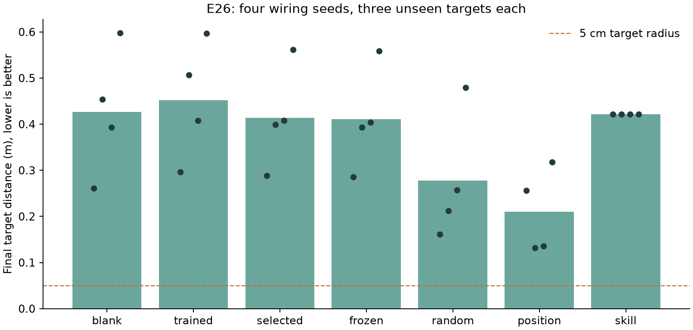

# E26：机器人能动了，语言能译了，实用学习还没有通过

[English](report.en.md) · [执行前登记](design.zh.md) · [执行附记](execution-notes.md)

2026-10-02。独立研究项目：**E26 机械臂实用性与语言外设归因**，ID `0a246d2f-1f83-44c0-a179-9e617dd06bfb`。本轮使用 `threemind.continuous-memory/2`，没有改内核动力学、旧实例、旧映射或历史实验。

## 先说结果

**有两个明确的工程进展，但还没有取得稳定的任务学习成果。**

1. ThreeMind 已能通过普通输入、输出接口控制具有质量、重力、碰撞和关节限位的机械臂。经历和环境选择确实会改变之后的动作，但这轮很短的训练没有让它稳定地靠近目标。选择后的平均最终距离从空白组的 42.66 cm 变为 41.41 cm，仅改善 1.25 cm；四个接线种子中两个改善、两个变差。随机动作和位置伺服仍更接近目标。
2. **完全从随机权重开始的 Transformer，经过外部校准后，可以把四个词的 Core 活动译回原词，四个都对。**输入用原文本感官或随机 Transformer，两条路线都通过这个小范围校准；没有使用 Qwen 的语言知识。
3. 冻结转换器后再教新对应，尚未得到正确的配对回答。普通对应四题中，原文本感官答对 0 题，随机 Transformer 感官答对 1 题；空白组也是 1 题。改变经历、交换或打乱 Core 活动，输出会改变，因此文字并非完全绕过 Core 生成；但**“受 Core 影响”与“正确表达 Core 学到的关系”相差很远**，本轮只确认了前者。

这不是证明模型没有记忆，也不是已经会自然语言交流。它把下一步的问题缩小了：机械臂需要解决有效动作与选择课程；语言需要解决经历形成的活动能否被已校准的转换器正确表达。单纯接一个 Transformer 并不会自动补齐这些能力。

## 机械臂做了什么

自定义三关节臂加单自由度夹爪，默认原始力矩。物理步长 2 ms、感官和动作周期 10 ms；没有改变 Core 传播周期。感官包括已声明的关节、本体和触觉，以及身体坐标下的**理想目标光学信标**。信标是可观测目标参照，不是任务奖励；此实现不模拟视觉遮挡，不能据此声称机器人视觉已经解决。输出采用协议声明的固定匿名投影，不称为自然长出的运动脑区。

每个接线种子有两个候选，各在不同目标环境经历 6 模拟秒。结构遗传、清空活动的独立副本在两个筛选环境各测试 4 秒，选平均最终距离较小者。筛选过程不写回候选父本。最终三个目标环境不参与训练或筛选，每次测试 4 秒。

共四个接线种子、108 回合：8 个发育回合、16 个筛选回合、84 个最终测试回合。每个条件含 12 个最终测试回合。相同种子的三个环境不能当成三个完全独立训练样本；固定外部扫动在不同接线种子下是重复的物理轨迹，更不能把这类重复扩大成显著性证据。本轮仅报告描述性比较。

| 条件 | 最终平均距离 cm ↓ | 相对起点改善 cm ↑ | 曾进入 5 cm 范围 | 最终仍在范围内 | 平均机械功 J |
| --- | ---: | ---: | ---: | ---: | ---: |
| 空白意识，原始力矩 | 42.66 | -18.02 | 1/12 | 0/12 | 0.195 |
| 固定第一个受训候选 | 45.20 | -20.56 | 1/12 | 0/12 | 0.229 |
| 环境选择后的候选 | 41.41 | -16.77 | 1/12 | 0/12 | 0.139 |
| 同一选择候选，关闭可塑性 | 41.04 | -16.40 | 1/12 | 0/12 | 0.135 |
| 随机动作 | 27.76 | -3.13 | 2/12 | 1/12 | 16.980 |
| Core 输出经位置伺服 | 21.03 | +3.61 | 0/12 | 0/12 | 16.890 |
| 固定外部扫动 | 42.21 | -17.57 | 8/12 | 0/12 | 18.556 |

柱为全部回合均值，点为每个接线种子在三个未见目标上的均值。控制器参照的动作能力与成本不同，不是同等能量对照。

选择组在 12 对同种子、同目标比较中有 8 对比空白组近，但整体提升小，按接线种子汇总只有 2/4 改善。普通受训组反而更差。冻结可塑性并没有使这四秒内的结果崩溃；这不表示长期可塑性无用，只说明本任务还未显示在线学习的优势。

固定扫动的“成功率”看似很高，实际只是经过目标：平均仅在范围内停留 0.153 秒，结束时全部离开。这个停留时长是执行后的描述性补充，不替换事前登记的最终距离与到达指标。不能用 8/12 的曾经到达宣布学会了保持、抓取或目标控制。

值得检查的具体问题是**动作尺度**：选择组机械功只有随机组的约 1/122。随机组不是公平的同等动作预算对照，但这个数量级差异说明需要先校准接口输出能否克服当前躯体负载。下一轮可在外设侧登记几档固定增益、无控制的被动下落、等机械功或等动作幅度的随机参照，再进行更多代的选择；不得据目标答案直接写 Core 接线。本轮没有临时加增益或修改模型追求成功。

## 语言做了什么

两条路线：原文本感官 → Core → 从零训练的输出 Transformer；随机权重 Transformer 感官 → Core → 从零训练的输出 Transformer。输入感官冻结；输出转换器宽度 64、两层、四个注意力头、UTF-8 字节词表。没有预训练语义。普通产品默认可选更大的配置，不能把本实验参数当成全部可用能力。

先以「松子、铃铛、陶杯、柳叶」在新建 Core 上产生的活动进行输出校准：各用强度 0.5 和 1，共八个样本，训练输出模型与映射头 300 步。再用四个新建实例、强度 0.8 验证，两条路线均 4/4 正确。**这是已知四词在另一强度下的校准，不是未见词的语言泛化测试。**

随后冻结输出转换器，才建立两套对应。普通组为「甲是松子、乙是铃铛、丁是陶杯、戊是柳叶」，另一组反转名词对应。每句连续 12 次，再以固定随机顺序复习两轮，每句合计 14 次、每套 56 次，强度 1。保留默认规范化和分帧。每句末尾后观察 500 ms，整套教学约 28 模拟秒；没有额外背景遥测。以「甲、乙、丁、戊」分别从同一教学终态副本提示，强度 0.5。

严格解码进程只收到匿名活动过程的投影，不收到原问题、教学句子或答案。四个时间段、每段 64 个固定匿名桶用于输出转换；完整活动轨迹与现有时序读出另外保存，投影不是全部内核状态。Transformer 单独参照明确收到提示、Core 特征置零，属于外部模型对照，不能混入严格组。

| 测试（每项四题） | 原文本感官 → Core | 随机 Transformer 感官 → Core |
| --- | ---: | ---: |
| 四词校准 | 4/4 | 4/4 |
| 普通对应正确回答 | 0/4 | 1/4 |
| 反转对应正确回答 | 1/4 | 1/4 |
| 空白 Core 对照 | 1/4 | 1/4 |
| 交换 Core 活动 | 2/4 | 1/4 |
| 打乱活动特征 | 1/4 | 1/4 |
| 固定为校准样本平均活动 | 1/4 | 1/4 |
| Transformer 单独 | 0/4 | 0/4 |

例如普通组询问「甲」，原文本路线输出「陶杯」，随机感官路线输出「铃铛」，均非预期「松子」。反转经历使原文本路线四题中三题的输出变化，随机感官路线变化一题；交换或打乱活动，两条路线均各有两题发生变化。原始过程特征在所有四个提示上都随经历改变。这确认了实际信息通路，也同时显示大量不同状态会被译成同一个词。

不能把字面输出的失败直接定位成 Core 关联失败：校准只覆盖单独词输入，而学习后的提示包含残留活动、抑制、网络传播及不同历史。过程特征是否保留所需信息、转换器是否能处理这类活动，本轮没有单独解决。也没有设置等候清除残余活动、消融长期连接及平衡教学先后等对照，所以“经历改变活动”包含近期状态作用，不等于已经定位了长期关系记忆。

下一步应先固定已知可测到的 Core 关联样例，核对完整活动、投影与解码在哪一步丢失关系，再做不含新对应答案的多状态校准。随机 Transformer 输入也可先以明确材料训练成感官，固定权重后单独比较。扩大语料、长时间联合训练和开放聊天留作后续，不能用本次四词校准宣称已经可行。

## 完整性、资源与操作

- 本轮 160 个 Core 实例：108 个机器人回合，语言两条路线各 12 个校准/验证实例、2 个教学实例、12 个提示副本。机器人累计实际计算约 151 秒，单任务顺序执行；语言 CPU 训练每条路线约 12 秒，输出计算另计。
- 语言校准训练子进程树峰值约 0.713 GiB；正式试验没有使用 GPU。预算为累计 4 小时、256 实例、8 GiB 进程内存、证据 8/10 GiB；本轮没有触及停止阈值。正式证据归档前约 261 MiB，资源收尾和数据库归档大小见交付核查。
- 输入、动作、物理观察、初末态、设备上下文、词活动、训练权重、探针过程、版本摘要和源代码均保留。既有实验未清理或覆盖。正文表格来自 `analyze.py`，机器可读汇总在证据包 `analysis/summary.json`。
- 报告和设计在上述研究项目的「实验笔记」「记录与报告」查阅；完整证据包保留独立 Runtime 的 `device.sqlite`，语言另有 `.tmlanguage` 包，可经对话实验界面导入为新分支。续跑请复制快照或导入新身份，原证据不要原地推进。
- 接口、命令行、宽窄屏、完整导出恢复已经工程验证。Qwen 的实际 CUDA 输入/训练/解码及失败后 CPU 回退属于另一次工程验收，不能算成本实验的语言结果。
- Playground 官方任务适配和 Linux/JAX 验收仍未完成。核查时本机 WSL 仅有停止的 `docker-desktop`，Docker 返回无法启动；未擅自恢复用户服务。本报告的自定义场景不是官方公开任务，真实机器人没有接入。

不因剩余预算继续追加训练。当前可用的是统一的机器人研究工具和可训练语言外设；稳定机器人实用性、可靠新对应表达以及开放对话仍是需要后续解决的问题。
