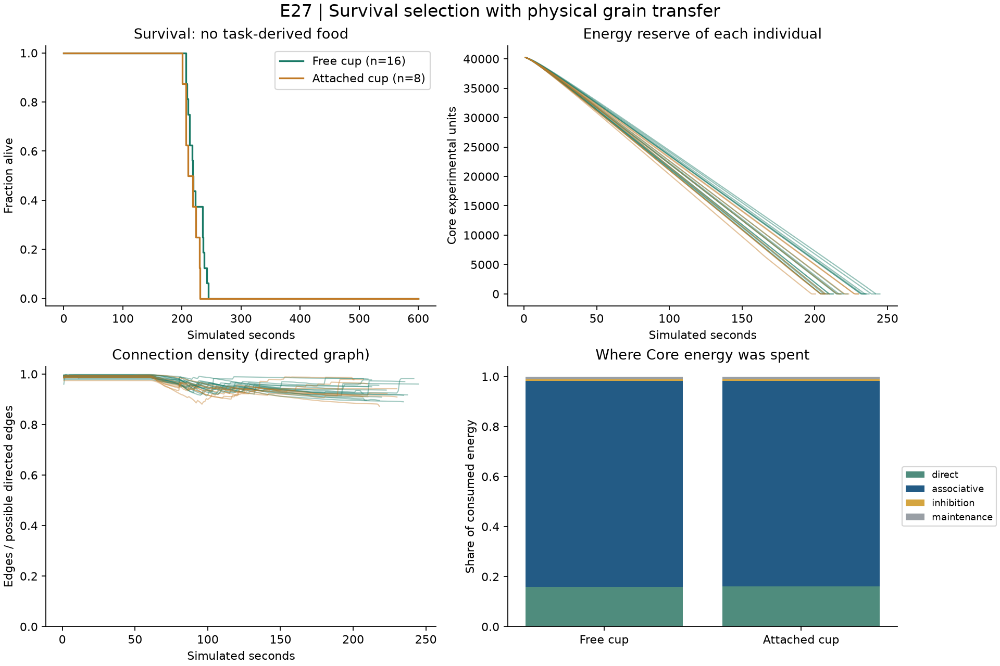
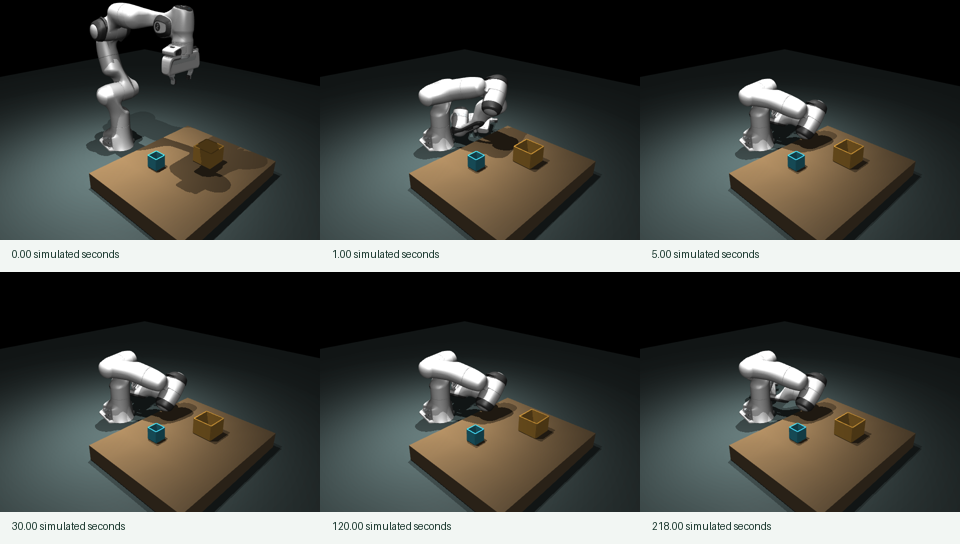
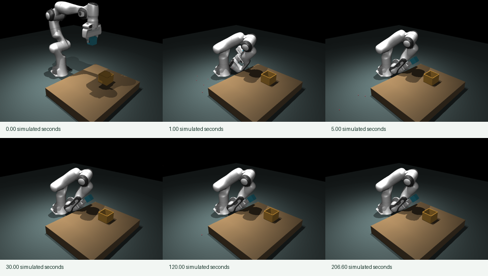

# E27: survival selection works as a process; these individuals did not learn grasping or pouring

> **Revision r2 · 2026-10-10**
> Revision reason: Verified original-file relocation; append location-resolution guidance and preserve the experiment conclusions.
> Original: [report.en.md](report.en.md); parent r1: [report.en.md](report.en.md)

Completed 2026-10-03. See the [registration](design.en.md), [execution amendment](execution-amendment.en.md), and [tools and boundaries](../../../docs/en/plans/robot-survival-selection.md). Core remains `continuous-memory/2`; no dynamics, historical individuals or evidence were changed.

## Main result

The primary task required independently grasping a free cup and transferring grains. Only after failure did the authorized attached-cup control run. **All 16 free-cup and all 8 attached-cup individuals earned no food and died through energy exhaustion and the existing activity lifecycle. There were no surviving parents and no invented second generation.**

| Task | Individuals | Lifetime minimum / mean / maximum, simulated seconds | Independent grasp | Qualified grains | Alive at 600 s |
| --- | ---: | --- | --- | ---: | ---: |
| Free cup | 16 | 206.80 / 222.78 / 244.80 | 0 | 0 | 0 |
| Attached cup | 8 | 200.50 / 215.68 / 230.10 | Requirement removed | 0 | 0 |

Lifetimes increased from seconds in E26 to minutes. The 600-second study horizon is not a new default consciousness lifetime; every individual died before it, with no rank-based killing. All 24 formal cases completed, without technical or budget censoring. **No useful grasping/pouring controller or pretrained model was obtained.** Removing grasping alone was insufficient in this setup; the failure cannot be assigned solely to grasp difficulty.

## Process findings

At one simulated second, 221–238 nodes already occupied 96.0%–99.7% of possible directed edges. Whole-image/body co-observation invokes existing joint-arrival connection rules; no forced-connection mechanism was added. Associative propagation accounted for 82.2% of all consumed Core energy. This identifies expenditure, not a judgement that internal activity is intrinsically useless.

The prespecified number-000 visualization shows a persistent movement bias and limited posture range, without task coordination. Other joints can keep moving; the sample does not establish that every individual was motionless, nor that stationary preferences are abnormal. Full per-individual motor statistics remain available. With no surviving parent, cross-generation improvement was not tested: zero descendants is the scientific result, even though birth/selection tools passed engineering checks.

These overview images are for researchers. Core received actual 16×12 luminance images, joint position/velocity, contacts, acceleration, angular velocity and reserve fraction. It received neither overview images, object labels, correct actions, inverse kinematics nor scripts. The observer renderer uses an independent physics-data copy.

## Methods and boundaries

Pinned MuJoCo 3.14.0 and Menagerie Panda assets; seven arm joints and coupled gripper; raw torque, gravity, inertia, friction and contacts. Twelve colliding rigid grains are not liquid, and glass fracture is not modeled. Physics uses 2 ms; action/nonvisual sensing 20 ms; vision 100 ms. Core timing remains unchanged; no live host telemetry is injected.

Initial reserve 40300 experimental units, capacity 161200, 10100 per qualified grain, settled each second. Values were frozen from a 30-second engineering cost calibration, not tuned to candidate success. Free-cup qualification requires physical bilateral grasp, lifting, and 200 ms grain residence in the receiver. Grasp/lift alone earns no food. Attached trials waive grasp/lift requirements. Every 30 seconds the external environment resets vessels and restocks material, without resetting the arm or Core; this also limits continuity of unfinished attempts and merits a separate longer-restock comparison.

Core energy and measured actuator work in joules are separate ledgers. Depletion does not directly clear activation. Existing affordability, decay and lifecycle determine death. Horizon survivors would be ranked by remaining energy; living nonparents would remain saved. Existing `birth/1` would preserve structure and clear immediate activity. Both recorded lineages are extinct with zero children.

## Apparatus feasibility is not learning

A privileged engineering controller using object positions, IK/PD and an action sequence transferred 9/12 grains with a free cup and 3/12 with an attached cup. These are **not ThreeMind scores or demonstrations to candidates**. Earlier failed engineering runs exposed a control-period problem and a receiver-floor measurement bound that excluded settled grains. Both fixes preceded formal trials; failed records remain.

That controller used 2 ms feedback versus 20 ms candidate actions. It is a feasibility check, not an equal-resource algorithm comparison, and does not prove that low-resolution vision plus the fixed anonymous activation-to-torque projection is sufficient to learn this task. Emergent motor specialization was not established.

## Reproduction and evidence

The 24 cases retain 264,494 full input/action records, initial/final Core artifacts, physical states, second-by-second trajectories, events, seeds and implementation identities. Free-cup 000 and attached-cup 000 were re-executed from the **recorded stimuli and food**; every recorded pre-action activation and complete final Core hash matched. Original cases were not overwritten.

Attached-cup 000 physical replay reproduced all physical measurements, task events and final physical state, while 15 luminance values across 4 frames differed by 1/255. Strict validation first failed. An explicit physical-replay mode then disclosed the differences; it was not reported as exact sensory reproduction. A subsequent strict free-cup replay passed completely. Seeds and rerendering do not replace original stimulus evidence. The image-rendering/brightness-conversion cause remains unresolved and these differences are not proven irrelevant to all tasks. The first failed free-cup replay lacked a detailed mismatch receipt; its cause is not invented afterward.

Eighteen relevant tests passed; three PostgreSQL integration cases were skipped because the isolated cluster was not running. The final five-tool-test rerun passed, including energy accounting, invalid-parent rejection, extraction equivalence, continuation, replay isolation and explicit pixel-difference disclosure. Database archive/report readback is verified separately.

## Recommended next work, not unannounced experiments

The immediate challenge is to make the environment yield selectable differences. None of these individuals reached its first task-derived meal; success cannot accumulate across generations without a survivor. Compare whole-frame input against physically motivated local/change sensing, keeping the original mapping and avoiding object-answer leakage. Separately consider an easier physical survival environment with fewer degrees of freedom and a wider feeding opportunity, then progressively harder approach, grasp, lift and transfer tasks. Explicit environmental food rules can shape selection without putting correct actions into Core; stage achievements must not be mislabeled as pouring.

Also compare initial reserve, restock period and motor projection gain under independent registrations. Increasing population/time may help, but first establishing occasional food acquisition would make expansion more informative. These are hypotheses about training and peripheral representation, not ablation-proven Core defects or a rejection of environmental selection. Existing intensity, novelty, forgetting, inhibition and facilitation defaults were preserved.

## Resources and delivery

Formal trials total 88.16 simulated minutes and 3.57 summed process-wall hours, below the four-hour budget. Expansion from 16 to 32 free-cup founders was conditional; the remaining budget instead funded the preregistered eight attached-cup controls. Calibration, replay and tool tests are separately recorded and are not independent learning samples.

Reusable Python/CLI tools cover food accounting, survivor selection, protocol validation, snapshots, continuation, birth and replay. [Commands](../../../docs/en/plans/robot-survival-selection.md). Full graphical cohort launch for this new granular task is still pending; existing notebook/report UI presents this study and evidence. Final database identifiers, storage and archive verification are in the delivery receipt. Historical data were not removed or overwritten. No push was performed.

## 2026-10-03 delivery clarification: illustrative case selection

The phrase “prespecified number-000 visualization” means that case 000 was chosen by its identifier as an illustration, **not a preregistered sampling endpoint**. It carries no population-level inference; numerical summaries include all 24 cases without image-based exclusions. Report revision 1 and its archive remain; revision 2 only appends this clarification. [Delivery receipt](delivery.en.md).

> **Storage-location revision · 2026-10-10**
> This edition adds the verified move of the selected originals to `E:\ThreeMindData`. Stable scientific identities and hashes, experiment dates, measurements and conclusions remain unchanged. Paths in the preserved body describe historical sources; use the registered evidence resolver for current locations. Repository documents and frozen fixtures remain in place, and source copies are retained. Structured query data and running checkpoints remain in the database. This annotation does not assert that missing historical evidence was recovered.
