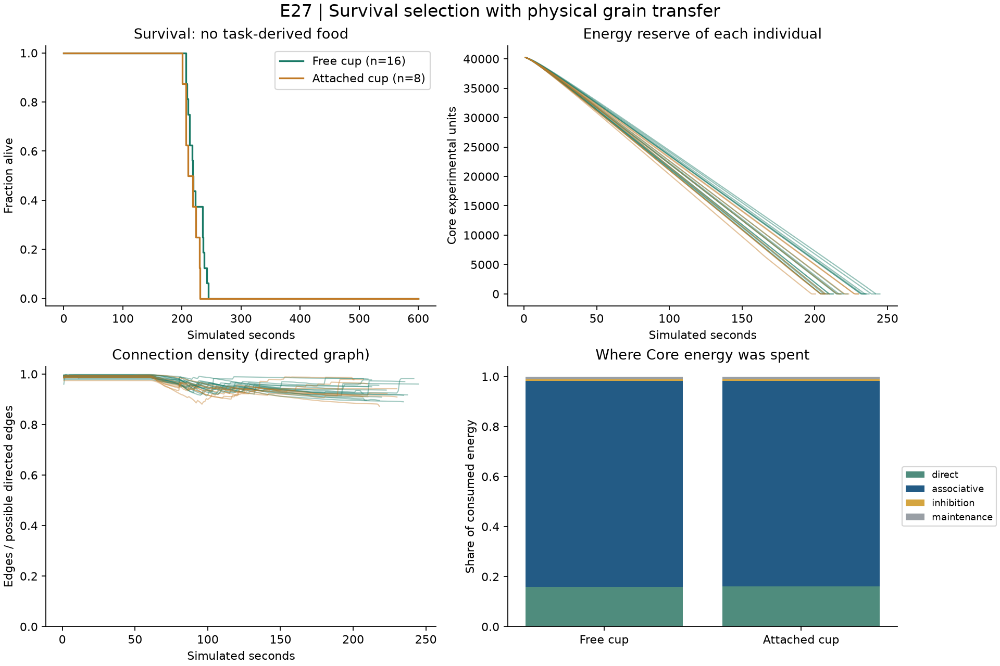
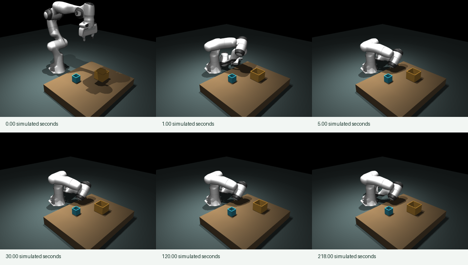
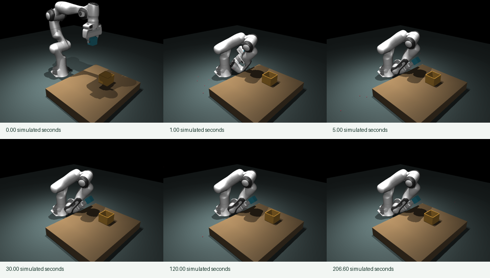

# E27：运行中生存淘汰已接通，但这批意识没有学会抓杯或倾倒

2026-10-03 完成。对应[事前设计](design.zh.md)、[并行执行补记](execution-amendment.zh.md)与[工具及规则](../../../docs/zh/plans/robot-survival-selection.md)。本轮保留 `continuous-memory/2`，没有修改内核公式、旧意识或旧实验。

## 最直接的结果

按照用户要求，先让意识自己抓自由杯，再转移颗粒；没有效果后才进行固定杯子对照。**16 个自由杯候选和 8 个固定杯候选都没获得任务食物，最终因能量耗尽、活动消失而死亡。没有幸存父本，所以没有伪造第二代。**

| 条件 | 个体数 | 生存时间：最短／平均／最长（模拟秒） | 自行抓杯 | 合格颗粒转移 | 存活到600秒 |
| --- | ---: | --- | --- | ---: | ---: |
| 自由杯主实验 | 16 | 206.80／222.78／244.80 | 0个 | 0颗 | 0 |
| 固定杯子对照 | 8 | 200.50／215.68／230.10 | 不适用，抓握要求被移除 | 0颗 | 0 |

活动时间由上一轮数秒延长到了数分钟。600秒是本次研究的观察上限，不是新加给普通意识的运行期限；本轮个体都在此之前由原有动力学死亡，没有一个因为到时或排名被程序杀死。全部24例完成，没有正式样本因异常或计算超时被截断。

**本轮没有证明具备实用的机械臂能力，也没有产生可用的预训练模型。** 生存筛选流程跑通与学会任务是两件事。固定杯对照仍无转移，说明单独拿掉抓握要求，在当前条件下还不够；不能只把失败归结为“抓杯太难”。

## 观察到了什么

1. **视觉与身体输入很快形成了非常稠密的网络。** 第1模拟秒，221～238个节点之间，连接占可用有向连接的96.0%～99.7%。此感官把一次图像及身体共同采样中的非零分量一同提交，已有共同触达规则会大量生边；这不是本轮新增的强制接网代码。
2. **大部分能量用于内部传播。** 两组总消耗中，联想传播占82.2%。这并不把内部活动叫作“无效”或“错误”，但它说明本次食物储备主要供给了什么。能量账目逐个闭合，原始记录分别保存直接输入、联想、抑制和维持消耗。
3. **存在持续的运动偏向，但没有变成这项任务所需的协调动作。** 预先选取编号000作为可视化样例，可以看到自由杯个体很快把机械臂弯向桌面一侧，长时间停留在有限姿态范围。完整关节与力矩数据保存，不能把这个样例夸大成24个体都完全不动；局部关节仍有运动，也不能把偏好本身定义为异常。
4. **全灭导致本轮没有发生跨代改进。** 我们没有用死者中“相对好一点”的个体充当幸存父本。出生和选择工具已验证可用，科学实验中的繁殖样本数则明确为0。

高分辨率画面只给研究者看。意识接收的是实际16×12灰度视觉，以及关节位置/速度、接触力、加速度、角速度与能量储备；不是这些全景图，也没有对象名称、目标答案、逆运动学或动作脚本。全景相机使用独立物理数据副本。

## 实验到底做了什么

- 固定的 MuJoCo 3.14.0、Menagerie Panda 资产，7轴机械臂和夹爪；原始力矩，重力、惯性、摩擦与接触。12颗可碰撞刚性颗粒，**不是液体**，未模拟玻璃断裂。
- 物理步长2ms，动作及非视觉感官20ms，视觉100ms。未改 Core 传播节律。没有宿主或CPU遥测输入。
- 出生40300单位，容量161200。每颗合格转移提供10100单位，每1秒结算；每批每颗只结算一次。数值来自事前30秒工程耗能校准，不是看候选结果后调出来的。
- 自由杯需物理双指夹持、提起后，颗粒在接收杯内停留200ms。抓握/提起本身不供能；固定杯组明确取消此要求。每30秒环境重新放置杯和补料，机械臂、连接、活动都不复位。这项外部安排也限制了单次未完成尝试的连续时间，后续应单独检验更长补料周期。
- Core 能量是实验单位；机械功另以焦耳记录，没有冒充同一个物理账本。外部供能没有清空或修改节点活动，死亡仍由已有能量与生命周期机制发生。
- 到时的幸存者才按剩余能量选择繁殖；活着却不入选的应暂停保存。工具使用既有 `birth/1`，不复活死亡个体。本轮两组谱系记录均为灭绝、0子代。

## 不是装置根本无法完成，但校准不等于学习

独立工程控制器通过读取物体位置、IK/PD及预设动作，曾在自由杯完成9/12颗转移，固定杯完成3/12颗。它证明这套物理装置可完成任务，**不是 ThreeMind 的成绩，没有向候选示教**。自由杯早期两次校准分别暴露控制步长问题，以及计量下界排除了静置颗粒的问题；修正都在正式候选前完成，失败记录保留。

工程控制器使用2ms反馈控制，意识动作是20ms，不把它当作同资源的算法优劣比较。它也没有证明当前低分辨率感官和哈希运动投影已经足够学会该任务。当前输出仍是固定的匿名活动→正负力矩投影；不能说自然运动分工已被验证。

## 复现核查与失败留档

24例共保存264,494条完整输入/动作记录，以及初末Core模型、物理状态、每秒轨迹、任务事件、种子、供能和实现摘要。自由杯000和固定杯000按**实际记录的刺激与供能**重新执行，逐次动作前的激活和完整最终Core哈希都与原件一致。原始文件没有被复算覆盖。

固定杯000的物理回放中，全部物理测量、任务事件和最终物理状态一致，但4帧内共15个亮度值相差1/255。严格检查先报错，后来明确启用“披露像素差异的物理回放”，没有把它标成感官精确复现。自由杯一次后续严格回放全部通过。**种子与重新渲染不能替代原始刺激留证**；像素差异的具体底层原因尚未定位，也没有证明它在所有任务中都无影响。最初失败回放没有留全差异细节，因此不补造原因。

18项相关测试通过，3项因隔离PostgreSQL测试库未启动而跳过。新增工具最后5项复测通过，包含账目、非法繁殖拒绝、提炼前后等价、恢复、只读回放与像素差异披露。数据库报告/证据写入另有读回哈希核验，不用单元测试代替它。

## 这次失败暴露的下一步重点

**当前最需要解决的是怎样让生存选择开始产生差异，而不是再盲目扩大相同任务。** 这批个体都没碰到第一次有效供能，选择无法积累“成功完成任务”的代际优势。以下是建议，未作为本轮偷偷加入的新实验：

1. 比较完整图像共同输入与有物理依据的局部/变化感官编码，检查静态背景、共同生边和运动投影的关系。保留原映射作对照，不用物体答案替代视觉，也不先修改内核来稀疏化。
2. 将环境难度分阶段：先在更少自由度、较宽的可摄入区域中允许简单动作获得能量；幸存谱系再进入接近、抓握、提升、转移等更难环境。供能由显式物理结果决定，仍不往Core写正确动作。每个阶段的产出单独报告，不能把接触就叫作会倒水。
3. 单独比较出生储备、补料周期与运动接线增益，查明个体是否有机会完成较长动作链。更多时间/个体也有价值，但应先出现偶发食物摄入，否则成本随种群增大而结论未必变清楚。

这是对本轮训练设计与外设表示的诊断，**不是已经通过消融定位的内核缺陷，也不能据此否定环境选择路线**。原始假设、额外强刺激默认、易化预设、遗忘和抑制均未被改动。

## 资源、交付和边界

正式24例累计88.16模拟分钟，各进程计算墙钟相加3.57小时，低于4小时预算。原计划32个自由杯仅为条件扩展；在16个自由杯全灭后，把剩余预算用于事先允许的8个固定杯对照，没有耗尽机器或继续无目标扩展。工程校准、回放和工具测试另记，不充当新的独立学习样本。

供能结算、生存筛选、配置校验、保存/继续、`birth/1`出生及回放已提炼为Python/CLI工具。完整启动参数与命令见[工具文档](../../../docs/zh/plans/robot-survival-selection.md)。**该新颗粒任务尚没有完整UI群体编排**；现有实验笔记、记录与报告用于查看本次设计、图表、报告及证据包。最终数据库编号、存储量及归档校验见交付记录；旧数据不清理、不覆盖。本轮没有推送。

## 2026-10-03 交付校注：图例选择

上文“预先选取编号000”指按编号取000作为可视化示例，**不是事前登记的抽样指标**；它不承担总体统计推断。全体数值来自24个完整样本，未按图像好坏排除候选。原报告第一版及归档原件保留，数据库第二版只追加此校注。[交付与证据编号](delivery.zh.md)。
