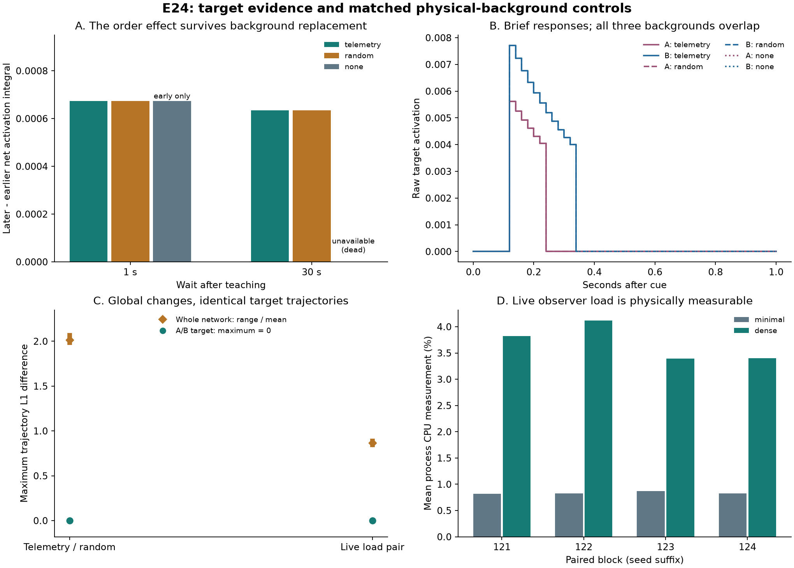

# E24: background changes activity while the tested target response remains intact

> **Revision r3 · 2026-10-10**
> Revision reason: Verified original-file relocation; append location-resolution guidance and preserve the experiment conclusions.
> Original: [report.en.md](report.en.md); parent r2: [report.r2.en.md](report.r2.en.md)

> **Revision r2 · 2026-10-10**
> Revision reason: Relocate generated evidence out of Git; preserve original bytes and conclusions.
> Original: [report.en.md](report.en.md); parent r1: [report.en.md](report.en.md)

2026-10-02. A read-only target-analysis tool and 160 new matched-background cases follow E23. Project: **E24 目标响应与遥测背景对照**. The kernel remains `threemind.continuous-memory/2`; dynamics, production sensory mappings and defaults were not changed.

## Main findings

**The previously reproduced order effect survives both recorded physical telemetry and matched randomized background.** Reversing AX/BX teaching reverses which target responds more strongly to the subsequent X cue. This holds after 1 and 30 seconds, with the background changed throughout teaching, retention and testing. The sampled A/B activation trajectories are exactly identical between these backgrounds, although the rest of the network is not.

**Observer workload can return through telemetry without invalidating the task result.** Minimal and dense live observation produce different final states; replaying each actual input tape exactly reproduces its own live state. A/B responses remain identical across the two loads. This is compatible with the user's point that feedback from a system's own physical consumption can influence activity without changing a target outcome. It does not equate telemetry with biological hunger.

**An unresolved global classification is not an absence of target response.** Identical target activity receives different global classifications under telemetry and randomized background. The new tool exposes this activity directly. It also reports that these brief responses do not meet the preregistered 800 ms local stability condition; they are not relabeled as steady states.

Panel A shows later-taught minus earlier-taught net activation integral. The no-background 1 s condition uses only the common pre-death interval. B shows the first registered block, AB teaching, 1 s cue: all three backgrounds overlap. C reports a sum of absolute differences across nodes, not a normalized single-node activation; its magnitude alone cannot be called a small perturbation. D shows measured process CPU fraction, not Core-thread CPU fraction.

## Design and matched quantities

The [design](design.en.md) was frozen before simulation. Four new 44 s tapes record actual host, process and runtime telemetry, each scope sampled every 500 ms with intensity 0.2. The tapes contain 261, 258, 258 and 258 frames. A maintenance K input keeps each recording instance alive but is excluded from the main background materials.

Within each source scope, the randomized counterpart preserves every frame's delivery time, grouping, channel count, amplitude multiset and intensity. Values are assigned randomly without replacement to the channels seen for that scope during acquisition. Actual incident quantity is matched, rather than just the intensity coefficient. **The time-varying total dose is retained; this is not independent white noise.** The third condition supplies no background and intentionally differs in total dose.

The task uses 12 AX/BX teaching pairs, a 50 ms within-pair interval, 550 ms between pair starts, a 40 ms offset and intensity 0.4. A common Y=0.2 closes teaching at 7 s. Both AB and BA orders are tested after 1 or 30 s with X=0.5 or no cue in separate clones. Forgetting, inhibition, depletion, fast connections and local input competition remain configured as in E23; facilitation remains off. Four blocks vary anonymous identities and physical tapes, **not four distinct architectures or tasks**.

A/B targets were defined from teaching channels in advance. The primary contrast is sampled activation integral with cue minus the matched uncued value, followed by later-taught minus earlier-taught. The directional threshold remains 1e-6. The reusable tool uses left-held integration; E23 trapezoidal values were computed separately and are identical for these records. Historical global convergence, decision-time ranking and terminal ranking remain available, without rewriting older primary criteria.

## Full-course background matrix

| Background | Wait | Available / registered contrasts | Complete 5 s comparisons | Later-taught advantage | Net integral margin |
| --- | --- | --- | --- | --- | --- |
| Physical telemetry replay | 1 s | 8/8 | 8/8 | 8/8 | 0.000673956059 |
| Matched randomized | 1 s | 8/8 | 8/8 | 8/8 | 0.000673956059 |
| None | 1 s | 8/8, early only | 0/8 | 8/8, early only | 0.000673956059 |
| Physical telemetry replay | 30 s | 8/8 | 8/8 | 8/8 | 0.000633961366 |
| Matched randomized | 30 s | 8/8 | 8/8 | 8/8 | 0.000633961366 |
| None | 30 s | 0/8 | 0/8 | Unavailable | Not zero-filled |

Eight conditions per row mean four identity/tape blocks and two orders, not eight tasks. See [directional matrix](tables/matrix.csv) and [32 matched trajectory comparisons](/api/v2/storage/research-artifacts/research-artifact:2e3f372ff348227b41526ee5/content).

All 32 telemetry/random trajectory comparisons, including cued and uncued records, both waits and both orders, have maximum sampled A/B difference zero. Whole-network maximum L1 differences range from 1.983572 to 2.065009. **Background reaches and changes the network while the selected response is invariant.** Whole-state hashes are not being claimed identical.

In the no-background 1 s condition, cued and uncued clones share an observable interval ending at simulation time 9.16 s. That interval contains the target transient; its margin is unchanged. Instances are not revived. By 30 s no test window can open. This is lifecycle-mediated unavailability, not measured zero memory or a completed five-second observation.

A separate expression-only arm restores one E23 trained block in both orders and changes only the subsequent background. Twelve clones yield six cued/uncued contrasts with identical early margins. Telemetry and randomized conditions complete both five-second comparisons; no-background records are truncated by death. This separately checks whether test-time background masks an already formed response in these conditions. See [expression-only results](tables/expression.csv).

## Live observation and physical feedback

Four blocks each use two clones of the same historical parent, with AB/BA balanced. A common K and identical X cue remain; each live instance runs for six actual seconds. Dense observation serializes and compresses the full state every 20 ms; minimal observation keeps the common base recording. Each of eight live tapes is replayed exactly and once with X removed: 24 cases. Process measurements and Core-advance thread measurements are separate.

| Check | Result |
| --- | --- |
| Live versus exact-input replay, full Core hash | 8/8 identical |
| Minimal versus dense final live states | 4/4 pairs different |
| Maximum A/B trajectory difference between loads | Zero in all four pairs |
| Later-taught margin under each load | 0.002102838860 in every case |
| Whole-network maximum L1 difference between loads | 0.843839–0.889401 |
| Mean measured process CPU under minimal observation | 0.819%–0.870% |
| Mean measured process CPU under dense observation | 3.391%–4.115% |

Actual load, input and network states differ while the target result remains intact. Recorded input is sufficient to reproduce each live result; no additional hidden observer intervention is required to explain it. See [live details](/api/v2/storage/research-artifacts/research-artifact:f14bc1dafc1f94bb53131425/content) and [paired comparisons](/api/v2/storage/research-artifacts/research-artifact:b5ab3620a5ad56b91cef2cfc/content).

**Order limitation:** the fixed preregistered random permutation happened to place minimal before dense in all four blocks. The intended interleaving in the prose was therefore not achieved. Seeds were not redrawn and cases were not added afterward. Temporal drift can contribute to host differences, so all changes cannot be assigned exclusively to observer load. Exact replay and target invariance for the eight actual tapes are established. A precise future workload estimate should preregister forced order balance.

This live arm retains common K, with separately frozen parent and enqueue arrangements. Its absolute margin must not be subtracted from the main matrix and called telemetry enhancement. Removing X while freezing the recorded background is an offline intervention; an actually uncued closed loop need not generate the same background tape.

## What the new tool adds

`threemind.target-observation/1` analyzes complete saved trajectories. It reports per-target peaks, integrals, episodes, change, terminal activation, local pattern stability, local amplitude stability and actual activation rankings at first decisions. Unknown IDs are errors, not zero responses. Sampling gaps cannot establish continuous stability.

Local pattern stability requires 800 ms of target activity above 1e-8 and normalized-distribution total variation at most 0.08. Local steady activity additionally requires the total-amplitude range to be no more than 0.12 of its window maximum. Stable proportions during decay are distinct from amplitude stability; zero activity is not a stable active pattern. Configurable analysis retains its exact parameter values.

Read-only calibration used 96 E23 registered conditions: 80 actual windows, 40 with target activity, including 16 whose original global classification was unresolved. Activity is now visible directly, but none of the A/B windows meets the 800 ms local condition. E24 similarly has 80 main-matrix windows: 32 globally pattern-converged, 32 unresolved and 16 censored; no A/B local stability decisions and all terminal A/B activations zero.

**A clear transient does not require loosening the meaning of convergence. It requires its own visible measurement.** UI, API, CLI and the operation catalog share the implementation; see [usage and reproduction](README.md). The tool cannot reconstruct unrecorded samples or infer causation without appropriate controls.

## Verification, resources and scope

All 160 cases completed: 4 acquisitions, 120 main-matrix cases, 12 expression cases and 24 live/replay cases, with no failed simulation cases. Aggregate case execution wall time was 404.40 s, including real acquisition waits and case persistence, not total development time. Audits verify 11,781 frames and envelopes, 84 deliberately pending frames at observation boundaries, and all 160 database final states against files. Pending frames are preserved.

304 historical source files, 48 kernel source files and the native kernel binary remain unchanged. All 47 affected Python/Rust and CLI/API checks passed. The UI build and browser checks at 1440/390 pixels passed. Evidence and bilingual reports are published through existing services in a separate project. Final storage and shared-account readings are recorded in the delivery receipt; the 160-case and 2 GiB limits were not expanded.

The conclusion is concrete: **the existing order response withstands the tested background changes, the overall network responds to background, and target activity must be distinguished from global stability.** This strengthens replication and measurement capability; it is not a new Core mechanism or universal telemetry immunity. Strong-stimulus replacement remains paused, existing autonomy criteria are unchanged, and this experiment is not relabeled as a new consciousness or quantum proof.

To investigate background-dependent behavior next, choose a task with actual interaction between background and task channels and balance workload order beforehand. The present target effect does not require another large replication just because the whole network changes.

## Data location revision

Selected generated evidence has been archived and verified byte for byte. Original reports, criteria, conclusions and embedded source_commit values are preserved. The logical downloads below require the current host administrator. The data directory is not public.

`data/experiments/2026-10-02-target-background/`

[Location and hash index / 位置及哈希登记](../../artifact-index/2026-10-09-relocations.json)

- [tables/background-trajectories.csv](/api/v2/storage/research-artifacts/research-artifact:2e3f372ff348227b41526ee5/content) — 1290 B; SHA-256 `d381097a3ba8817b310f78bbaa6c6215428f92d38f5f8956eec6d8d483d7ad76`.
- [tables/live-pairs.csv](/api/v2/storage/research-artifacts/research-artifact:b5ab3620a5ad56b91cef2cfc/content) — 458 B; SHA-256 `9f7960ddcee64f20b1a5c08ea44aeff9709cd689176ddda6c279960c32bb273f`.
- [tables/live.csv](/api/v2/storage/research-artifacts/research-artifact:f14bc1dafc1f94bb53131425/content) — 3606 B; SHA-256 `7ba14891856ca63440e6dd87afb7dc1d7e76b700b1f48a9e26855d1239130221`.

> **Storage-location revision · 2026-10-10**
> This edition adds the verified move of the selected originals to `E:\ThreeMindData`. Stable scientific identities and hashes, experiment dates, measurements and conclusions remain unchanged. Paths in the preserved body describe historical sources; use the registered evidence resolver for current locations. Repository documents and frozen fixtures remain in place, and source copies are retained. Structured query data and running checkpoints remain in the database. This annotation does not assert that missing historical evidence was recovered.
