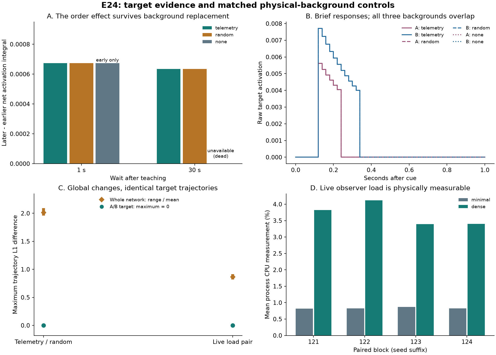

# E24：背景会改变活动，但本轮目标响应保持不变

> **修订 r3 · 2026-10-10**
> 修订原因：原件存储位置已迁移并核验，追加当前位置解析说明，保留原实验结论。
> 原版：[report.zh.md](report.zh.md)；父版本 r2：[report.r2.zh.md](report.r2.zh.md)

> **修订 r2 · 2026-10-10**
> 修订原因：生成证据移出 Git 并完成校验归档；追加位置登记，保留原字节与结论。
> 原版：[report.zh.md](report.zh.md)；父版本 r1：[report.zh.md](report.zh.md)

2026-10-02。承接 E23，完成只读目标分析工具及 160 个新实例的配平背景对照。实验项目：**E24 目标响应与遥测背景对照**。内核仍是 `threemind.continuous-memory/2`，没有改动力学、感官映射或默认参数。

## 先说结果

**此前“教学顺序反过来，随后提示引出的响应优势也反过来”的现象，在真实遥测背景和配平随机背景下都保留了。** 训练、等待、检验全程更换背景，1 秒和 30 秒时都如此。本批不只保住了优势方向：两种背景下，A/B 的采样激活轨迹逐点相同，网络其他部分则明显不同。

**观察负载可能经遥测成为新的环境输入，这不会自动使实验失效。** 轻量与密集观察的现场最终状态不同，实际录下的每条输入带又能完整复现各自现场状态；目标响应在两种负载下仍完全相同。这与用户补充的“自身消耗的反馈可以改变活动，而不必改变任务结果”相容。不是要求遥测毫无影响，也不是把不同状态直接归为故障。

**“未收敛”和“没有响应”确实必须分开。** 同样的目标活动，在遥测背景下常被原全局工具判作模式收敛，在随机背景下判作窗内未定。新工具直接显示目标过程；也如实指出，这些短暂响应没有维持 800 毫秒，不能改叫局部稳态。

图 A 为后教减先教的净激活积分；无背景 1 秒条件只比较死亡前的共同区间。图 B 为首个登记区组、AB 教学、1 秒提示后的原始 A/B 活动，三背景重叠。图 C 的全网差是各节点差异绝对值的和，不是单节点的归一化强度，也不能仅凭此称变化“微小”。图 D 是实测进程 CPU 比例；它不等于内核推进的 CPU 比例。

## 这次怎样比较

原始设计在模拟前冻结，见 [事前登记](design.zh.md)。先以宿主、进程、实例三路实际遥测采集四条 44 秒背景带，每路 500 ms、强度参数 0.2。它们分别含 261、258、258、258 帧。录制实例的公共维持输入 K 不进入后续背景材料。

随机对照逐帧保持时刻、来源、共同观测、通道数、幅度多重集和强度参数，仅在该来源的已观测通道池内随机分配幅度。因此实际总入射量配平，不是只把强度滑条设为一样。**它保留总量随时间的起伏，不是独立白噪声。** 三种背景中第三种完全不供背景，其量当然不与前两种相等。

任务沿用已经重复验证的匿名 AX/BX 教学：12 对、对内 50 ms、每对开始相隔 550 ms、偏移 40 ms、教学强度 0.4；7 秒共同 Y=0.2 收尾。比较 AB、BA 两个顺序，等待 1 或 30 秒后，在独立副本施加 X=0.5 或不施提示。原遗忘、抑制、耗竭、快速连接、局部竞争等保留，易化仍关闭。四个区组改变匿名身份与背景材料，**不是四种不同的内核架构或任务**。

目标 A/B 由教学通道事先指定，不按结果选赢家。主指标是完整采样过程的激活积分：有提示减同源无提示，再算后教减先教；超过 1e-6 判为后教优势。通用工具用左值积分，另算 E23 的梯形积分，本批两者数值相同。原来的全局收敛、判定时刻排序和窗末排序继续保存，没有用新指标改写旧实验的主判据。

## 三背景主矩阵

| 背景 | 等待 | 可比较条件 / 登记条件 | 完整五秒比较 | 后教优势 | 净积分优势 |
| --- | --- | --- | --- | --- | --- |
| 真实遥测重放 | 1 秒 | 8/8 | 8/8 | 8/8 | 0.000673956059 |
| 配平随机 | 1 秒 | 8/8 | 8/8 | 8/8 | 0.000673956059 |
| 无背景 | 1 秒 | 8/8，仅早期 | 0/8 | 8/8，仅早期 | 0.000673956059 |
| 真实遥测重放 | 30 秒 | 8/8 | 8/8 | 8/8 | 0.000633961366 |
| 配平随机 | 30 秒 | 8/8 | 8/8 | 8/8 | 0.000633961366 |
| 无背景 | 30 秒 | 0/8 | 0/8 | 不可测 | 不补零 |

每行的 8 条件是四区组×两顺序；不是 8 个不同任务。详表：[全部方向与生命周期](tables/matrix.csv)、[32 组真实／随机轨迹比较](/api/v2/storage/research-artifacts/research-artifact:2e3f372ff348227b41526ee5/content)。

32 组真实／随机比较，包括有提示和无提示、两个等待期、两个教学方向，目标 A/B 的最大逐点差均为 0。全网轨迹最大 L1 差为 1.983572–2.065009。**背景确实进入网络，改变了整体活动；选定任务响应却保持不变。** 这不是没有接入背景造成的假阴性，也不是全网哈希相同。

无背景的 1 秒检验，有提示与无提示的共同可观察区间到模拟时间 9.16 秒为止；未强行复活。共同区间已经覆盖本次目标短响应，故早期优势相同。到 30 秒不能再开启测试，报告为死亡造成的不可测，而不是“遗忘为零”或“完整五秒通过”。

再固定 E23 同一个已训练区组，只在检验时换背景，12 个副本形成 6 组有／无提示比较，均保留相同早期优势。遥测与随机各两个方向完成五秒；无背景两个方向仍死亡截短。这使“检验时背景掩盖既有结构的响应”在本条件下也得到单独排查。[仅表达阶段对照](tables/expression.csv)

## 实时观察负载与遥测反馈

四区组各用相同历史父本的两个副本，AB/BA 均衡；保持共同 K 与同一 X 提示，现场实际运行 6 秒。轻量条件保留基础记录；密集条件每 20 ms 序列化并压缩完整状态，8 个现场实例各再做完整输入重放、去 X 提示重放，共 24 例。进程计量与内核推进线程计量分开。

| 核查项 | 结果 |
| --- | --- |
| 现场 → 实际输入重放的完整 Core 哈希 | 8/8 完全一致 |
| 轻量与密集观察的现场最终状态 | 4/4 对不同 |
| 同区组两负载下 A/B 激活轨迹最大差 | 4/4 为 0 |
| 两负载下后教优势 | 每例都是 0.002102838860 |
| 两负载下全网轨迹最大 L1 差 | 0.843839–0.889401 |
| 轻量条件实测进程 CPU 均值 | 0.819%–0.870% |
| 密集条件实测进程 CPU 均值 | 3.391%–4.115% |

这些值说明实际负载、实际输入和全网状态有差别，而目标结论保持。输入带足以重现各自现场结果，没有发现必须用额外观测干预来解释的状态差异。[现场详情](/api/v2/storage/research-artifacts/research-artifact:f14bc1dafc1f94bb53131425/content) [区组比较](/api/v2/storage/research-artifacts/research-artifact:b5ab3620a5ad56b91cef2cfc/content)

**执行顺序的限制必须保留：** 事前固定的随机排列恰好让四个区组全部先轻量、后密集，并没有得到设计文字预期的交错顺序。没有事后换种子或追加样本。故不能把全部宿主变化严格归因于密集观察，时间漂移仍可能混入；能确认的是这八条实际输入的重放充分性与目标不变。后续若要精确估计负载效应，应事先强制平衡先后。

这组现场协议保留共同 K，父本与输入入队安排也单独冻结；其优势数值不能直接与主矩阵相减而叫“遥测增强”。去提示重放固定的是已录制的背景，属于离线干预，不等于现场无提示时环境必然产生同一背景。

## 新工具到底解决了什么

新增 `threemind.target-observation/1`。直接读取保存的完整节点轨迹，分别给出峰值、积分、活动次数、变化量、末态、局部模式稳定、局部幅度稳定及首次判定时的实际强度排序。未知节点报错，不伪装为零。有采样缺口时不跨缺口证明持续稳定。

局部模式条件是连续 800 ms 目标总量高于 1e-8，归一化分布的总变差不超过 0.08；局部稳态还要求总幅度跨度不超过窗口最大值的 0.12。比例稳定但持续衰减只算模式稳定；活动归零不算稳定的活动。参数可调，调整后的结果保留其具体配置。

先只读重分析 E23 的 96 个登记条件：80 个实际窗口，40 个含目标活动，其中 16 个原全局判为未定。新增分析显示这些目标活动；但 A/B 没有任何一例满足本次 800 ms 的局部稳定条件。E24 主矩阵同样有 80 个实际窗口：32 个全局模式收敛、32 个全局未定、16 个删失，A/B 局部稳定均未达到，窗末均归零。

**因此没有必要为得到漂亮判定而放宽“收敛”的含义。需要的是把短暂但明确的响应作为独立事实呈现。** 工具已接 UI、API、CLI 与操作目录，使用方法见 [操作与复核](README.md)。它不能凭空恢复没有记录的采样，也不自动证明因果，净效应仍需有／无提示对照。

## 验收、资源与结论边界

160 例全部完成：4 采集、120 主矩阵、12 表达、24 现场及重放，无失败实例。累计实例执行墙钟 404.40 秒，包含真实采样等待及实例持久化，不是整个开发任务耗时。证据逐一核查 11,781 帧和信封、84 个观测边界上仍在途的帧，160 个数据库最终状态与文件完全对应。未决帧保留，不静默丢弃。

304 份旧来源文件、48 个内核源码文件和原生内核二进制均与基线一致。相关 Python/Rust、CLI/API 回归 47 项通过；前端构建通过，1440/390 像素浏览器验收均通过。证据、图表、全部失败检查记录与双语报告通过现有服务进入独立项目，不覆盖旧记录。交付空间与账户实测见单独交付凭据；预算仍是 2 GiB、160 例，本轮没有扩展模拟。

本轮确认：**既有顺序响应能抵抗这里测试的背景变化，整体网络对背景有反应；观测工具需要区分目标过程与全局稳定。** 这是复现与工具能力的实质增强，不是新增内核机制，也不说明所有任务都对遥测免疫。强刺激替代仍暂停，不改变既有自主活动标准，不把此试验改称新的意识或量子证明。

下一步若研究遥测对行为的影响，优先选择确实与背景通道有交互的任务，并提前平衡负载执行顺序；无需仅为本轮既有目标效应而再次大规模重复。

## 数据位置修订

选定的生成证据已逐字节校验归档。原报告、评判标准、结论及数据内 source_commit 均保留。以下逻辑下载需要当前主机管理员身份，数据目录未整体公开。

`data/experiments/2026-10-02-target-background/`

[Location and hash index / 位置及哈希登记](../../artifact-index/2026-10-09-relocations.json)

- [tables/background-trajectories.csv](/api/v2/storage/research-artifacts/research-artifact:2e3f372ff348227b41526ee5/content) — 1290 B; SHA-256 `d381097a3ba8817b310f78bbaa6c6215428f92d38f5f8956eec6d8d483d7ad76`.
- [tables/live-pairs.csv](/api/v2/storage/research-artifacts/research-artifact:b5ab3620a5ad56b91cef2cfc/content) — 458 B; SHA-256 `9f7960ddcee64f20b1a5c08ea44aeff9709cd689176ddda6c279960c32bb273f`.
- [tables/live.csv](/api/v2/storage/research-artifacts/research-artifact:f14bc1dafc1f94bb53131425/content) — 3606 B; SHA-256 `7ba14891856ca63440e6dd87afb7dc1d7e76b700b1f48a9e26855d1239130221`.

> **存储位置修订 · 2026-10-10**
> 本版追加已核验的原件迁移说明：本次清单中的原件迁至 `E:\ThreeMindData`，科学身份、哈希、原实验日期、测量与结论不变。保留正文中的路径表示历史来源，当前位置通过已登记的证据引用解析。仓库文档与冻结夹具留在原处，源副本保留；结构化查询数据及运行中的检查点仍存数据库。本说明不表示缺失的历史资料已恢复。
