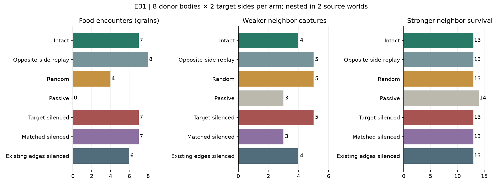
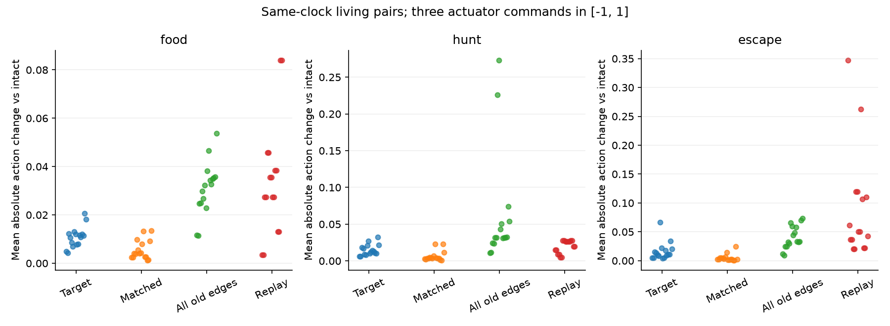
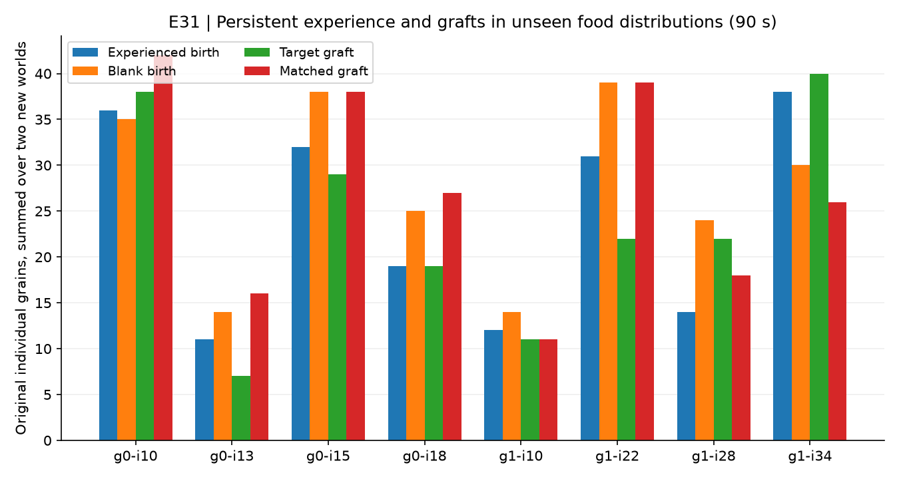

# E31: Internal activity affects action. Has it become a foraging, pursuit or escape skill?

> **Revision r2 · 2026-10-10**
> Revision reason: Verified original-file relocation; append location-resolution guidance and preserve the experiment conclusions.
> Original: [report.en.md](report.en.md); parent r1: [report.en.md](report.en.md)

2026-10-03. Independently registered after E30, using unchanged `continuous-memory/2` and Ocean/3. **No changes to Core dynamics, sensory mapping, ordinary parameters or Core action cadence.** [Design](design.en.md) · [Natural encounter registration](natural-registration.md) · [Execution](execution-notes.md) · [Measurement corrections](measurement-corrections.md) · [Tools and video](README.md)

<!-- results:start -->
**The clearest result is that selected internal pathways contribute to ongoing activity and actions, and persistent connections can transfer part of an action pattern. Attribution of useful foraging, pursuit and escape in the original ocean remains incomplete. Removing the original ecology from the main apparatus is a design limitation that must be corrected.**

1. Target silencing reduces recent-direct-input-free target activity in48/48 local comparisons, versus4/48 for matched silencing. Mean action change is0.01391 versus0.00569 (2.44×); target effects exceed matched effects in44/48 cases. Commands range from−1 to1. This follows transmission changes through internal activity to action, rather than only counting endpoint food.
2. Across64 birth/graft comparisons, target grafts produce actions closer to experienced copies than blank copies in59 cases, and closer than matched grafts in61. This includes45/48 local and14/16 isolated-transfer comparisons against blank. Distance uses same-clock, jointly living samples. Transferring a response pattern is not automatically transferring a useful feeding skill.
3. All24 left/right comparisons change action. Yet intact local performance does not consistently exceed opposite-side action replay. Responsiveness is measurable; beneficial directed behavior is not established by these apparatus results.
4. All six prospectively selected natural encounter views show reduced target activity and changed actions under target interruption. Across18 forks, intact/target/matched have equal within-event food, capture and final-survival counts over20 seconds. Some contact/capture timings differ by20ms. Equal endpoints are not identical processes, and these short probes are not a complete ecological skill test.

### Local apparatus outcomes, with local scope only

Each column has16 trials per arm (8 donors ×2 sides).

| Condition | Food grains (initial targets) | Weaker-neighbor captures | Stronger-neighbor survivors |
| --- | ---: | ---: | ---: |
| Intact | 7 (5) | 4 | 13 |
| Target silenced | 7 (5) | 5 | 13 |
| Matched silenced | 7 (5) | 3 | 13 |
| All existing edges silenced | 6 (4) | 4 | 13 |
| Opposite-side action replay | 8 (6) | 5 | 13 |
| Random action | 4 (4) | 5 | 13 |
| Passive drift | 0 (0) | 3 | 14 |

Three more grains than random do not establish learned search: target silencing does not reduce intake and opposite-side replay eats eight. Moving neighbors can contact passive bodies, permitting passive capture. **These data do not overturn E30's feeding advantage in complete oceans.**

In90-second environments starting with one body, experienced/blank/target-grafted/matched-grafted copies eat193/219/188/217 grains. Experienced beats/ties/loses to blank in3/2/11 of16 paired conditions; target graft beats/loses5/11. This establishes no net advantage under **this isolated transfer setup**, not uselessness of experience in the original community. The missing full shaping environment also limits this transfer result.

### Natural encounters: changed action, unchanged short-window fate

| World/view | Focal→specified object | Intact/target/matched food | Captures | Focal outcome |
| --- | --- | --- | --- | --- |
|0, food |13→particle223 |1/1/1 |0/0/0 |All survive; consumed other particles |
|0, weaker neighbor |42→13 |6/6/6 |0/0/0 |All survive; specified neighbor not captured |
|0, stronger neighbor |13→42 |1/1/1 |0/0/0 |All survive |
|1, food |10→particle57 |3/3/3 |1/1/1 |All survive; consumed other particles |
|1, weaker neighbor |10→28 |3/3/3 |1/1/1 |All survive and capture28 |
|1, stronger neighbor |28→10 |0/0/0 |0/0/0 |All captured by10 |

World0 food/threat views share individual13 and time; world1 pursuit/escape views describe the same10/28 pair. They are not six independent ecological events. Intact10 captures28 at205.70s; interrupting10's target region at the earlier202s food observation point advances capture to205.68s. This is an actual process difference, not a presumed beneficial outcome.

### Approved correction for the next study

The user requests normal, ablation and graft controls in complete complex environments, retaining other individuals and random replenishment with probabilistically equal environmental opportunities. A larger habitat/population will be forked as a whole, changing only the specified consciousness. Full-world recordings become primary and focal views are overlays. Do not expand isolated assays, change Core, or predetermine that ecological complexity must produce a benefit.
<!-- results:end -->

## Separating an internal effect from a useful skill

**User correction during execution:** the main local apparatus removed other original individuals and most nutrients and reset pose/velocity. That is an environmental intervention, not an in-place comparison changing only internal connections. Local results can characterize pathways in that apparatus, but a negative result cannot reject abilities shaped by the complete habitat. Water side length remained0.8m; zoomed demonstrations further hid context. The food apparatus began with three particles rather than one, which does not resolve the substantive criticism. Natural follow-ups preserve the full habitat, but both source worlds have only9 living bodies at200s; they are not a new large-population experiment. A separately registered larger complete-community study will follow, without pooling or rewriting these data. The first three clips below are apparatus illustrations, not the main demonstration of full ecological ability.

Move food, a weaker neighbor or a stronger neighbor to the opposite side and inspect action changes. Then replay the opposite-side intact commands exactly in the current scene. Replay preserves action amplitude and continuity but cannot respond to the current target position. Failure to consistently outperform it prevents attributing every food contact to directed search. Random commands and passive drift are additional controls; normal Core commands are never cadence- or amplitude-matched to them.

A six-second discovery in a different direction selects regions from activity and connections, without choosing by later intervention success. Targets are active despite no direct input in at least one fully recorded second; select up to128 source-snapshot incoming edges. An equal-count, weight/stability-matched region is the control. In held-out left/right scenes, silence target, matched or all existing edges and inspect activity, action and physical outcome. **Selection alone cannot separate residual activation from propagation; a selective activity reduction establishes propagation involvement.** Silencing existing edges does not prohibit ordinary new connections forever.

Persistent-history comparisons reset immediate activity and give equal finite reserves to experienced, blank, target-grafted and matched-grafted births. Body, receptor identities and motor projection stay aligned. Blank copies continue normal learning, so this tests the additional benefit of prior experience, not learning versus permanent inability to learn. Grafts contain local persistent structure, not donor live activation, body or command tapes. A random controller ignores Core; the meaningful graft comparison therefore places a grafted blank Core in control of the equivalent body.

Transfer lasts90 seconds in two unseen random food layouts, with drifting particles and replenishment at new random positions. It does not reuse old fixed feeding locations or leave all depleted food absent. The original individual's intake is primary; descendants do not become independent trained sources.

## Why preserve the natural shared world as well?

Local assays standardize body pose, velocity and reserve, potentially interrupting the original closed loop. Natural follow-ups retain the complete world and all actual states, prospectively select a geometric approach using past activity, then compare intact, focal-target-silenced and focal-matched-silenced forks for20 seconds. Other individuals remain normally active.

**E30 scope clarification:** individual37 was captured by42 at220.14s in the old region fork and survived in the sham fork. That intervention, however, affected all applicable individuals. A camera following37 does not make it a37-only intervention; its fate cannot be attributed entirely to37's own region. E31 focal-only encounters narrow this question. Original evidence/reports/criteria remain intact, and this does not erase the demonstrated causal effect of internal activity.

## Records, videos and tools

Inputs/actions are recorded every20ms, activity/scenes every100ms, with separate actual contact, holding and engulfing events. Direction, target labels and scores are observer-only, never Core input. Hydrology, temperature, proprioception and contact feedback remain; live host telemetry is absent.

Five standalone MP4 clips with PNG posters are available:

| File | Content | Interpretation |
| --- | --- | --- |
| `01-food.mp4` | Approach and intake of three particles | Actual feeding; opposite-side replay also feeds, so this alone is not directed-search evidence |
| `02-capture.mp4` | Contact, holding and engulfing | Actual capture; directed pursuit requires the controls |
| `03-separation.mp4` | Movement/separation near a stronger neighbor | Actual process, not yet established directed escape |
| `04-prior-intact.mp4` | E30 individual37 intact fork | Old evidence replay, not a new E31 sample |
| `05-prior-silenced.mp4` | E30 population-region intervention and37's capture | Camera follows37; intervention was population-wide |

Local folder: `.work/ocean-behavior-20261003/media/clips-v2/`. The project's **E31 海洋：主动觅食、追捕与逃离的归因** research record contains videos, downloads, posters and bilingual captions. Exports hold actual samples without invented intermediate movements; the two E30 clips retain their one-second evidence sampling.

Screenshot/recording controls are added to the consciousness graph and physical-world preview, including narrow screens. Advanced options select title, legend, available world/generation/simulated-time metadata, fps and limit. Browser capture saves PNG/WebM; CLI/Python export PNG/MP4. Browser wall-time recording and offline simulated-time replay have distinct clocks. Recording load can feed another live host-telemetry-enabled model through that ordinary input; use saved trajectories for strict offline comparisons.

## Verification and scope

Four focused tests cover observation, exact action replay, finite energy, selection and historical counters. These are engineering checks, not biological conclusions. Production build and actual PNG/WebM downloads at1440/390 pixels passed, as did WebGL/Canvas fallback capture. Actual MP4 encoding, frame counts and frames were inspected. No repeated full-batch replay/hash exercise was performed.

Three disclosed corrections: preserve but exclude three early right-side apparatus checks with mismatched noise seeds; use physical events instead of approximate body geometry/sampling for pre-contact metrics; omit incomplete first-second input history from uncued-activity attribution. Raw inputs, states and events are unchanged. No outcome-driven parameter tuning. [Details](measurement-corrections.md)

Eight donors are nested in only two trained worlds. Sides, tasks and frames are not additional independent populations. Natural hunt/escape views can share an individual pair and event. This report addresses its preregistered behavioral attribution question, preserves existing `autonomy-criteria/1` results, and does not equate missing stable feeding benefit with absence of internal activity.

<!-- resources:start -->
Completed592 formal local/transfer conditions,24 discoveries,3 retained/excluded early apparatus checks,2 natural scouts and18 natural forks. Simulation totaled approximately103.55 process-minutes, below the6-hour ceiling. Pre-archive files occupy about2.10GiB. Shared account usage moved13%→16%, including other projects; not all usage is attributable to this study. All simulations have stopped and saved; old evidence was neither deleted nor overwritten. Archive verification uses one-pass ZIP CRC plus normal upload hashing, without redundant full readbacks. Final stored size/IDs are recorded in `delivery.json` and the delivery document.
<!-- resources:end -->

> **Storage-location revision · 2026-10-10**
> This edition adds the verified move of the selected originals to `E:\ThreeMindData`. Stable scientific identities and hashes, experiment dates, measurements and conclusions remain unchanged. Paths in the preserved body describe historical sources; use the registered evidence resolver for current locations. Repository documents and frozen fixtures remain in place, and source copies are retained. Structured query data and running checkpoints remain in the database. This annotation does not assert that missing historical evidence was recovered.
