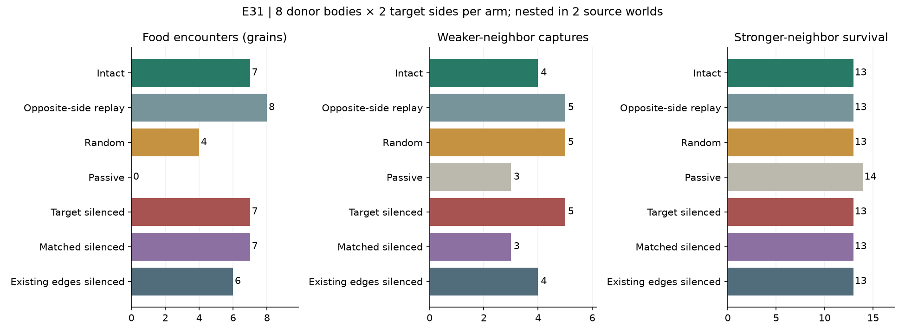
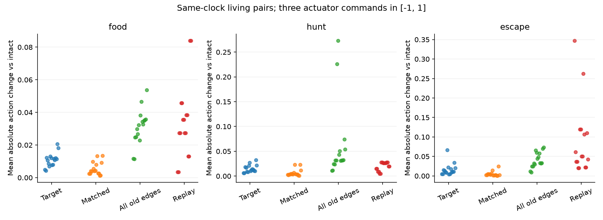
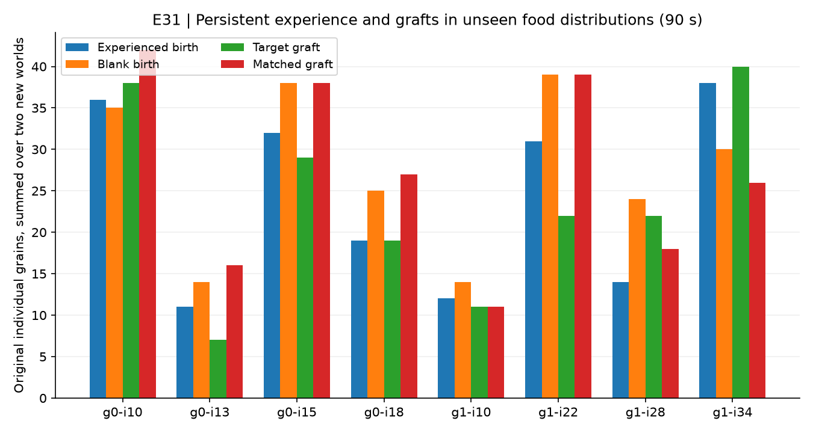

# E31：内部活动确实影响动作，是否已经成为觅食、捕猎和逃离的技能？

> **修订 r2 · 2026-10-10**
> 修订原因：原件存储位置已迁移并核验，追加当前位置解析说明，保留原实验结论。
> 原版：[report.zh.md](report.zh.md)；父版本 r1：[report.zh.md](report.zh.md)

2026-10-03。本轮继E30之后独立登记，使用原 `continuous-memory/2` 与 Ocean/3。**内核动力学、感官映射、普通参数和意识输出节律均未修改。** [设计](design.zh.md) · [原位补试登记](natural-registration.md) · [执行札记](execution-notes.md) · [测量校正](measurement-corrections.md) · [工具和录像](README.md)

<!-- results:start -->
**最明确的收获是：选出的内部通路持续参与活动和动作，而且一部分动作模式能随连接移植而转移。对于“这些活动是否帮助原海洋中的主动觅食、捕猎、逃命”，本轮仍没有完成可靠的总体归因；主批次删掉原生态这一设计缺口必须纠正。**

1. **内部活动的影响重复出现。**48组局部场景中，目标通路静默后，近期没有直接输入的目标活动48组都减弱；等量匹配静默只有4组减弱。目标阻断造成的平均动作变化为0.01391，匹配阻断为0.00569，前者约2.44倍；44/48组目标阻断的动作影响更大。动作量的范围为−1～1。这不是仅仅在终点数食物，而是直接看到了“传导变化→内部活动变化→动作变化”。
2. **连接携带可转移的响应模式。**64组出生/移植比较中，目标移植59组比空白更接近经历者的动作，61组比匹配移植更接近。其中局部场景45/48比空白更接近经历者，单体新布局迁移14/16更接近。这里的“更近”指同一记录时刻、双方都存活时的动作差，不意味着更会找到食物。
3. **对象换边会改变动作，但局部装置没有给出稳定的目标收益。**24组左右比较全部有动作差；但原意识的摄食、捕获、存活没有稳定优于原样重放另一侧动作。它会响应不同环境，尚不能由本装置断定这种响应是有用的定向策略。
4. **完整海洋中的局部作用也存在。**6个事前选定的原位事件、18个分叉中，目标阻断都减弱了相关活动并改变动作；但本轮20秒内，各事件的原样/目标/匹配分叉摄食数、捕获数及最终存活结果相同。部分接触/捕获时间相差20毫秒。不能把“终点同”写成“全过程同”，也不能把这些短窗称作充分的生态技能检验。

### 局部装置的具体结果——适用范围仅限该装置

每列各16例：8个来源×左右两侧。

| 条件 | 食物场景摄入（其中初始目标） | 较弱邻体捕获数 | 较强邻体场景存活数 |
| --- | ---: | ---: | ---: |
| 原意识 | 7（5） | 4 | 13 |
| 目标区域静默 | 7（5） | 5 | 13 |
| 匹配区域静默 | 7（5） | 3 | 13 |
| 原有全部连接静默 | 6（4） | 4 | 13 |
| 反侧动作原样重放 | 8（6） | 5 | 13 |
| 随机动作 | 4（4） | 5 | 13 |
| 被动漂移 | 0（0） | 3 | 14 |

原意识比随机多摄入三颗，不能据此说全部来自学得的寻食能力：目标阻断未减少摄食，反侧动作重放也得到八颗。被动身体会被移动邻体碰到，因此被动组的捕获并不矛盾。**这些数字不能推翻E30在完整海洋里观察到的摄食优势。**

单个体起始的90秒新布局中，经历/空白/目标移植/匹配移植分别摄入193/219/188/217颗。经历相对空白16组中3组更多、2组相同、11组更少；目标移植相对空白5组更多、11组更少。这个结果只说明旧结构在**本次隔离迁移条件**没有净收益，不能概括为原海洋中的经历无用。它同样未保留整个塑造环境，是下一轮必须修正的部分。

### 原位事件：行动变了，短窗结局没有变

| 来源/观察视角 | 焦点→指定对象 | 原样/目标/匹配的摄食数 | 捕获数 | 焦点结局 |
| --- | --- | --- | --- | --- |
| 世界0，营养 | 13→223号颗粒 | 1/1/1 | 0/0/0 | 均存活，吃到的是其他颗粒 |
| 世界0，弱邻体 | 42→13 | 6/6/6 | 0/0/0 | 均存活，未捕获指定邻体 |
| 世界0，强邻体 | 13→42 | 1/1/1 | 0/0/0 | 均存活 |
| 世界1，营养 | 10→57号颗粒 | 3/3/3 | 1/1/1 | 均存活，吃到的是其他颗粒 |
| 世界1，弱邻体 | 10→28 | 3/3/3 | 1/1/1 | 均存活且捕获28 |
| 世界1，强邻体 | 28→10 | 0/0/0 | 0/0/0 | 均被10捕获 |

世界0的营养/强邻体视角共享同一13号、同一时刻，世界1捕猎/逃离视角描述同一对10/28；它们不能算成六个独立生态事件。原样中10号于205.70秒捕获28号；在更早的202秒营养观察点阻断10号目标区后，捕获提前到205.68秒。提前不是本轮寻求的正向结论，而是确实发生的过程差异。

### 下一步已经批准的修正

用户要求在完整复杂环境中继续正常、消融与移植对照，保留其他个体和随机营养刷新，使各组的外部机会在概率上平等。下一轮增加海域与起始群体，从同一完整世界复制分叉，只干预指定意识；全景视频保留整个生态，局部跟踪仅作为叠加观察。此处不再扩展孤立装置、不改Core，也不把更复杂的环境必然产生优势当作预定结论。
<!-- results:end -->

## 怎样区分“内部影响”与“有用技能”

**本轮进行中收到的用户纠正：**主批次的局部装置删去了原海洋的其他个体与绝大部分营养，还重置了姿态和速度。这是一次环境改变，不是只改内部连接的原位对照。它可以回答局部通路和指定场景的问题，却不能凭阴性结果否定完整生境中形成的技能。原海洋边长仍为0.8米；演示还放大了局部视野，使画面更像单个体小水域。食物装置初始是三颗而不是一颗，但这不改变用户指出的实质缺陷。原位补试保留了完整环境，不过200秒处两个原世界都只剩9个活体，不能拿它冒充规模充足的新群体实验。后续另登记较大完整群体实验，保留本轮数据，不把两轮样本混算。以下影片前三段仅作为局部装置说明，不再作为完整生态能力的主要演示。

首先，把食物、较弱邻体或较强邻体放在身体的另一侧，观察动作是否改变；再把对侧场景的整段实际动作搬过来原样重放。这种重放保留了意识动作的幅度和连续性，但不能响应眼前目标的实际位置。若原意识并未稳定优于它，就不能把碰到食物直接解释成正在寻找食物。随机动作和被动漂移作为另外两个参照，正常意识不受动作节律或幅度限制。

其次，在另一方向的6秒发现窗口，只凭活动及连接选出区域，不根据哪个干预会“做出好结果”来挑。所选节点在至少1秒完整输入记录内没有直接输入、却保持活动；取最多128条源快照已有入边。另找等量、权重/稳定度相近的其他连接作匹配对照。在新左右场景静默目标、匹配或全部已有连接，分别看活动、动作和实际结果。**选区本身还不能区分残余活动与传播；干预后特定活动减少，才说明传播实际参与其中。** 全部已有连接静默也不等于此后永久禁止通信，新连接仍按原规则形成。

最后，清除即时活动、给予相同有限储备后，比较保留经历的出生副本、空白副本、目标连接移植和匹配连接移植。身体、受体身份和运动接线保持一致。空白副本在测试期间仍正常学习，因此这里检验的是“过去经历额外带来多少收益”，不是“学习与永不学习”。移植的是局部持久结构，不是把供体的活跃状态、身体或整段行为拷过去。随机控制器不读取Core，故不能给它移植一个不用的网络再期待行动改变；移植对照由空白Core接管相同身体。

迁移场景观察90秒，使用两份新的随机食物布局，营养随水流移动、按原规则在新的随机位置补充；不存在只把食物摆在旧坐标、吃完不补的设计。原个体摄入是主要结果，后代不冒充新增独立训练来源。

## 为什么还做原位补试

局部装置为可比性重置了身体位置、朝向、速度和身体储备；这可能打断原有闭环状态。原位补试保留整个海洋及每个意识的实际状态，在知道后果之前，以几何接近和过去活动选事件，分别复制原样、只阻断焦点的目标区域、只阻断焦点的匹配区域，观察20秒。其他个体正常活动。

**对E30的范围补充：**37号在旧区域分叉于220.14秒被42号捕获、在原样分叉存活的事实成立；但旧分叉对全群适用个体作过干预，视频只追踪37号，不能据此认定差别全来自37号自己的内部区域。本轮单焦点原位补试专门收窄这一归因。旧报告、判据与原始数据保留，这不是撤回内部活动具有因果作用的结果。

## 记录、视频与工具

输入和动作按20毫秒记录，活动与场景按100毫秒记录；真实接触、钳制和吞食事件另存。观察方向、目标名称和成绩仅在外部分析中使用，不传入Core。水文、温度、本体与接触反馈保留，没有实时宿主遥测输入。

五段独立MP4及PNG封面已导出；前三段为局部装置，后两段为旧原位过程：

| 文件 | 内容 | 应怎样解读 |
| --- | --- | --- |
| `01-food.mp4` | 接近营养并摄入三颗 | 真实摄食；反向动作重放也可摄入，不能单凭影片认定主动寻找 |
| `02-capture.mp4` | 接触、钳制、吞食 | 真实捕获；主动追猎须结合成组对照 |
| `03-separation.mp4` | 强邻体场景中的移动和分离 | 展示实际过程，尚不称已经确认的定向逃命 |
| `04-prior-intact.mp4` | E30中37号的原样分叉 | 旧证据重绘，不计作E31新样本 |
| `05-prior-silenced.mp4` | E30全群区域干预后37号被捕 | 摄像机只跟随37号，干预范围却不是只有37号 |

本地目录为 `.work/ocean-behavior-20261003/media/clips-v2/`；平台研究项目 **E31 海洋：主动觅食、追捕与逃离的归因** 的“记录与报告”中有影片记录、下载、封面和中英文说明。离线导出只显示实测采样，不补造中间动作；旧E30两段每秒一帧，保持显示而非插值。

截图/录屏已加入意识图和物理世界预览。高级选项包括标题、图例、可用的世界/代次/模拟时间、帧率及录制时限；窄屏可用。浏览器保存PNG/WebM，CLI/Python导出PNG/MP4。浏览器按墙钟录制，离线片段按模拟时钟重放，二者不是同一时间协议。若另一个意识接入实时宿主遥测，录屏负载可能通过该正常输入影响它；严格比较可用已存轨迹离线导出。

## 验证与结果边界

四项针对工具的测试覆盖只读观察、相同动作重放、有限能量、局部选区和历史计数处理；不把工具单测当作生物学结论。前端生产构建及1440/390宽度真实截图/录屏下载通过，WebGL与Canvas后备图像导出通过，实际MP4编码、帧数及画面已检查。没有为核验而重跑所有样本，也没有反复全量哈希。

三项公开校正：三个早期右侧装置检查原先用了不同噪声种子，保留但不计入正式左右比较；接触前指标使用物理事件代替近似外形/采样判定；判断近期未受直接刺激的活动时排除最初历史不足1秒的记录。原输入、状态和事件不改，也未为得到阳性调整参数。[完整说明](measurement-corrections.md)

八个来源只来自两个训练海洋，不能当作八个独立演化种群；左右、场景、时间帧也不是独立种群。原位同一对个体的捕猎/逃离视角可能重叠，不能重复计成独立事件。这里只判断本轮预先登记的行为归因，不修改 `autonomy-criteria/1` 的既有结论，不把缺少稳定觅食增益等同于没有内部活动。

<!-- resources:start -->
共592个正式局部/迁移条件、24个发现窗口、3个保留而排除的早期装置检查，加2次原位事件搜寻及18个原位分叉。累计模拟约103.55进程分钟，低于6进程小时上限。归档前本轮文件约2.10GiB；账户共享用量13%→16%，包含并行项目的用量，不能全部归于本实验。全批已停止并保存，旧数据未删、未覆盖。证据采用一次ZIP CRC及正常上传哈希，不再做重复全量回读。最终入库大小和标识见同目录 `delivery.json` 及交付文档。
<!-- resources:end -->

> **存储位置修订 · 2026-10-10**
> 本版追加已核验的原件迁移说明：本次清单中的原件迁至 `E:\ThreeMindData`，科学身份、哈希、原实验日期、测量与结论不变。保留正文中的路径表示历史来源，当前位置通过已登记的证据引用解析。仓库文档与冻结夹具留在原处，源副本保留；结构化查询数据及运行中的检查点仍存数据库。本说明不表示缺失的历史资料已恢复。
