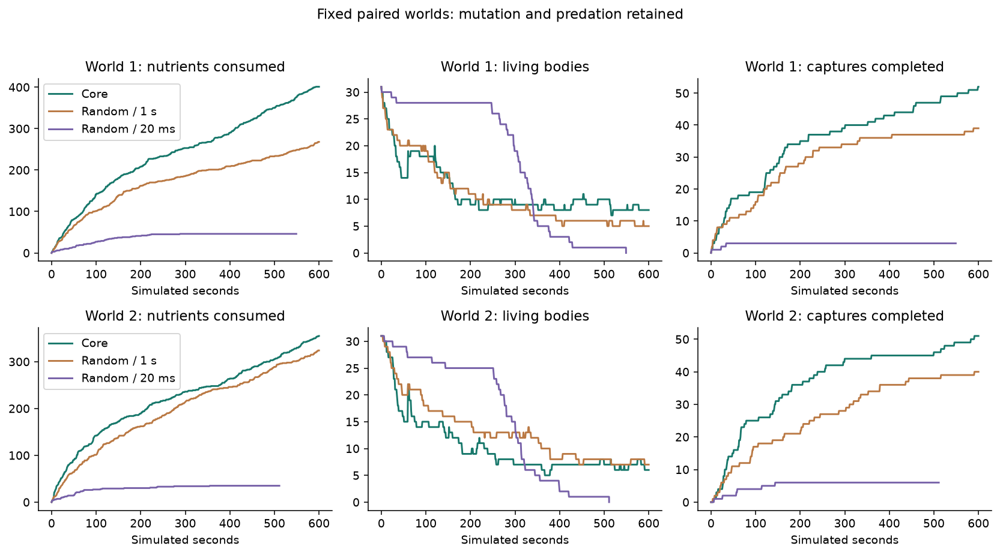
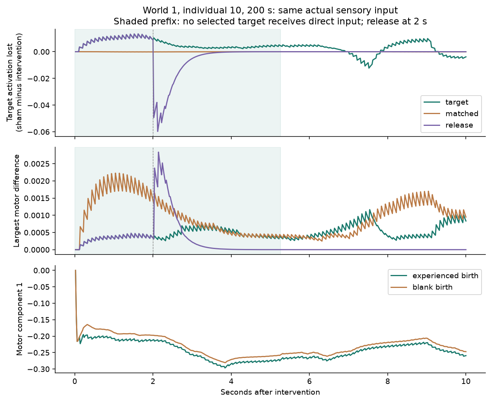
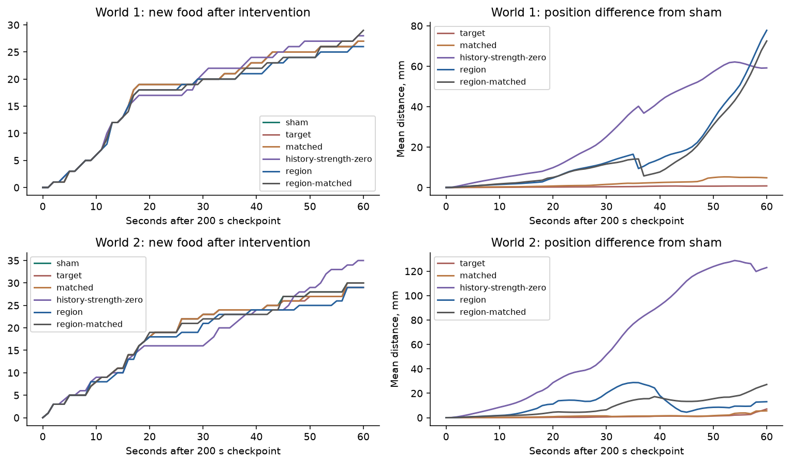

# E30: Core control improves feeding; experience and internal activity change action

> **Revision r2 · 2026-10-10**
> Revision reason: Verified original-file relocation; append location-resolution guidance and preserve the experiment conclusions.
> Original: [report.en.md](report.en.md); parent r1: [report.en.md](report.en.md)

2026-10-03 · [中文](report.zh.md) · [Preregistered design](design.en.md) · [Prospective addenda](causal-addendum.md) · [Tools](README.md)

## Answers to the two questions

**Does Core control differ from and outperform random control? Yes, for feeding in both tested worlds.** Total consumption and intake per living-body time increased, actions were more continuous, and movement more often followed increasing locally sensed nutrient concentration. No instruction to seek food, semantic food label or reward command was injected into Core.

**Do past experience and internal association cause the advantage? They demonstrably contribute to action and change particular feeding/capture events; the overall advantage is not yet fully attributed to them.** All32 paired observations showed different actions between experienced and blank births. In31, interrupting relevant connections reduced unprompted target activity and changed action before those targets received new direct input. Local grafts usually moved blank responses toward experienced responses. Awake-world interventions changed which individuals were eaten. However, resetting persistent strengths slightly increased60s food intake, so causal influence is not automatically beneficial learning.

These32 observations come from two worlds at two fixed times, including repeated individuals and related descendants. They are **not32 independent-world replications**. This batch establishes behavioral differences and partial attribution, not a complete decomposition of the population advantage.

## Apparatus and boundaries

The new exterior world is `threemind.ocean/3`; Core remains `continuous-memory/2`. Historical kernels, instances and Ocean/1-/2 are unchanged. The existing hash motor projection and actuator conversion remain. Core output receives no new timing, amplitude or expenditure constraint. Only the random comparison adds20ms resampling; the original1s random control remains.20ms is an exterior sample period, not the unchanged100ms Core propagation interval.

Each world starts with31 founders, capacity37, no lifespan limit. A0.8m periodic2D water layer starts with180 nutrient particles and adds one at a random position every2s, capacity1024. Food drifts with local flow and mixing; each particle's random movement is keyed by identity and time, so consumption does not shift other particles' random sequences. Forgetting, inhibition, finite Core/body energy and ordinary learning remain enabled. Parents pay offspring energy; offspring inherit experienced structure while current activity resets. No fusion, sharing or predefined cooperative policy.

Equal-area capsules can mutate elongation and adhesion alongside existing radius, thrust, shell and sensory traits. Capture allows enclosure or sustained contact, with finite adhesion and shell-dependent processing time/cost. Parents cannot consume their direct offspring before60s maturity. Transfer is lossy. This finite external trait family cannot invent arbitrary organs or senses.

External adapters encode local flow, temperature, relative velocity, acceleration, contact and gravity/buoyancy-related measurements into anonymous channels. The layer is horizontally constrained: this is not3D sinking/floating or full fluid simulation. Core receives no meaning such as food, pain, hunter or correct direction. The gradient calculated by the analyst is never an answer supplied to Core.

### Capture and shells were calibrated before comparing controllers

Sustained controlled contact captures shells0/0.2/0.8 after0.42/0.74/1.70s, costing0/11.41/45.65 units to process. With opposed initial tangential speeds of0.01m/s, the bare body is captured while the thick shell escapes after1.06s; at0.02m/s the intermediate shell escapes too, and at0.04m/s all escape. A60s free-motion calibration produces13 predations. These are apparatus checks, not evidence of learned hunting. The formal Core worlds subsequently produce52 and51 predations: the earlier non-triggering apparatus problem is resolved.

## Six formal worlds

Environment seeds301101/301102; wiring seeds300100/300200. Each three-controller comparison shares its initial state. The planned horizon is600 simulated seconds. The fast-random populations physically go extinct at549.10/511.04s, after which empty computation stops and intake cannot increase. Reaching an observation horizon saves/pauses; it does not kill consciousness.

| World | Control | Nutrients | Per living-body minute | Living-body seconds | Final bodies | Predations | Births |
| --- | --- | ---: | ---: | ---: | ---: | ---: | ---: |
|1|Core|401|3.497|6879.20|8|52|30|
|1|Random,1s|268|2.537|6337.44|5|39|16|
|1|Random,20ms|46|0.297|9296.38|0|3|0|
|2|Core|355|3.459|6157.04|6|51|28|
|2|Random,1s|324|2.477|7846.84|7|40|18|
|2|Random,20ms|35|0.252|8325.86|0|6|0|

Against the original random control, total feeding increases49.6%/9.6%, and intake per body-time increases37.8%/39.6%. Core world2 has less cumulative survival, so this is not universal dominance. Fast random control incurs fewer early predations and can accumulate more body-time despite eventual extinction. Endpoint survival alone misses that distinction.

The mean cosine between action and the preceding local nutrient gradient is0.180/0.164 for Core,0.016/0.011 for slow random, approximately zero for fast random. Actual relative-to-water motion has corresponding values0.149/0.161 versus0.074/0.095. The gradient uses four actual local measurements, not omniscient coordinates. Adjacent action-direction consistency is approximately0.9999,0.98 and0 for the three controllers. Rapid random reversal cancels much of the motion through body inertia; Core produces sustained action without an imposed smoothness target. Stillness/circling is not classified as inherently wrong.

These associations are descriptive. Persistence, immediate sensory processing, wiring, acquired structure and offspring selection can all contribute. Frames are not treated as independent samples for significance claims.

## Same-input interventions and transfer

All living individuals at200/600s were sampled:9+9+8+6 observations. A separate20s continuation supplies the first10s of future input for endpoint probes, without changing formal600s results. Counterfactual copies replay identical actual sensory input and supply. Sham motor output exactly reproduces source-world output.

Choose nodes active despite no direct channel input during the preceding1s. Silence12 incoming edges; compare equally many other edges matched on weight/stability. Selection uses pre-intervention state, never subsequent food. Analyze the prefix before any target receives a new direct input separately.

| Source | Observations | Unprompted activity reduced and action changed | Mean motor difference, target12 | Matched12 | Energy-corrected experience difference |
|---|---:|---:|---:|---:|---:|
|World1,200s|9|9|0.000222|0.000903|0.014758|
|World2,200s|9|8|0.000288|0.001137|0.032283|
|World1,600s|8|8|0.000333|0.001439|0.020260|
|World2,600s|6|6|0.000332|0.000908|0.039615|

Differences are10s mean absolute differences across three[-1,1] commands. **31/32 clean prefixes show internal transmission contributing to unprompted activity and action.** The remaining short prefix does not detect that effect. Changes commonly begin about140ms after interruption. Target12 cuts have smaller motor effects than matched cuts, so they are not the sole control center. Immediate silence/unsilence restores identical actions in all32. Release after2s often causes a brief rebound before approaching the original trajectory.

Experienced and blank births preserve identical receptor IDs and exterior motor wiring, clear current activity, and differ in acquired structure. Supplementary trials give both the same finite starting reserve1369.498267 units; subsequent input/supply remains identical. All32 produce different actions, beyond the initial instant.

Grafting the selected12 persistent edges into a channel-aligned blank birth, without current activity, fast state or body transfer, makes **29/32 closer to the experienced motor trace than the blank control, and28/32 closer than an equally sized matched graft**. Closeness is smaller whole-window mean absolute motor difference. This transfers part of an acquired response pattern. No full ecological rollout of graft recipients was conducted, so it is not yet transfer of feeding skill or a complete personality.

## Awake-world consequences

Fork the original200s awake worlds, preserving activity, in-flight signals, bodies, energy, food and environmental random state. Continue60s with all ordinary learning enabled. After small12-edge cuts produced small food effects, a prospective addendum broadened scope to128 incoming edges, including within the unprompted region. All18 sources supplied128 such edges from221–472 eligible edges; this is still partial coverage.

Persistent-strength reset zeros node support/stability/touch counts and edge weight/stability/eligibility/touches, with local plasticity returning to1. Topology, activity, inhibition, fast state, energy, queues and clocks remain. It is not complete memory erasure and does not prevent relearning.

| Intervention | World1 new food / final bodies | World2 new food / final bodies |
|---|---:|---:|
|Sham|27 /10|30 /7|
|Target12 silence|27 /10|29 /7|
|Matched12 silence|27 /9|30 /6|
|Persistent-strength reset|28 /10|35 /10|
|Region128 silence|26 /8|29 /7|
|Matched128 silence|29 /10|30 /7|

**A concrete event:** world2 individual37 survives through260s under sham and eats particle266 at244.05s. With region128 silenced, individual42 captures it at220.14s. The matched128 cut does not cause this capture. Target12 leaves it alive but missing that particle within the window. In world1, resetting persistent strengths prevents individual41's original218.48s capture by38, while other individuals experience new captures.

Thus internal changes alter food ownership, encounters and individual fate, not merely numerical readouts. Region cuts change presence/ownership of9/14 nutrient events; strength reset changes13/27. Mean source-individual positional differences are0.37/0.75mm for small cuts,14.66/8.87mm for regional cuts and25.21/51.23mm for strength reset, comparing only original identities alive in both copies.

However, keeping current persistent strengths does not maximize short-window feeding: reset gains1/5 particles. Regional cuts lose one particle in each source, much less than the Core/random overall gap. Internal activity and experience have real, sometimes helpful and sometimes harmful effects; the share of the aggregate advantage attributable to them remains open. Later closed-loop effects include new sensory feedback and learning, not purely stimulus-free circulation.

## Corrections, resources and evidence

The calibration recorder initially paused on exclusive progress-file recreation; atomic progress replacement allowed continuation from the saved state. Failed evidence remains. Original birth probes inherited zero starting energy in descendants: one pair stayed waiting, and another later died while the tool attempted further input. Core correctly rejected it. The tool now records death without delivering or reviving; the failed directory remains, with a separately named retry. All structural-birth comparisons have an equal-reserve supplement. Formal oceans and awake interventions are unaffected.

The inherited optional age-control branch was restored in Ocean/3; all formal protocols keep `maximum_age_us=None`. Nine targeted tests passed. Local recorded replay passed1440/390px playback, seek, body selection and layout checks. No main-frontend or Core changes were required.

Recorded simulation use is approximately103.4 process minutes, including calibration, a conservative failed-probe bound, supplements and forks, below the4h budget. Collection used about1.45GiB before archive/database copies; the6GiB total cap remains enforced. Shared account usage rose from10% to12%, below stop thresholds. Final archive sizes are in`delivery.json`. No repetitive whole-batch hashes or mass state restores were performed. Checks focused on intervention isolation, actual-input reproduction, energy, representative restoration and failure boundaries. Packaging uses one-pass ZIP CRC and the database's normal upload hash, without a second full readback.

Project:`3818e230-3515-45ce-b873-55150549bd98`. ThreeMind services store design/results notes, bilingual reports and an evidence archive. Local evidence:`.work/ocean-causality-20261003/{findings.json,cases,probes,closed-loop}`. Recorded HTML viewers:`views/g0-core.html`, `g1-core.html`, `g1-sham.html`, `g1-region.html`. Historical data remain intact.

## Recommended next distinction

The useful findings are **continuous food-directed action, locally transferable response patterns, and internal intervention changing individual fate**. A next batch should separate immediate sensory processing/wiring/persistence from acquired feeding improvement: same initial body/state with an exterior control preserving action persistence but breaking sensory feedback, or different training histories evaluated in unseen worlds with calibrated structural grafts. Only comparison copies change; do not constrain ordinary Core output or rewrite its rules for a desired winner.

These are recommendations, not automatically launched work.3D, fusion, active cooperation and material-level organ emergence remain unimplemented. The current evidence is preserved for the user's next decision.
## Delivery accounting correction (same-day append)

Final accounting includes two early calibration runs without worker receipts, totaling126.81s. Timed simulation plus the conservative failed-probe bound is approximately**105.5 process minutes**, correcting the earlier103.4-minute subtotal; short controlled calibration cases were not individually timed. The budget helper now includes those result records. Scientific results, parameters and stopping rules are unchanged. ZIP size is approximately1.02GiB; local originals, ZIP and database growth together total about**3.55GiB**, below the6GiB hard cap. The archive preserves its publication-time report, and the UI report keeps prior revisions with this correction; the large archive need not be rebuilt. See delivery.json and delivery-final.json in this directory.

> **Storage-location revision · 2026-10-10**
> This edition adds the verified move of the selected originals to `E:\ThreeMindData`. Stable scientific identities and hashes, experiment dates, measurements and conclusions remain unchanged. Paths in the preserved body describe historical sources; use the registered evidence resolver for current locations. Repository documents and frozen fixtures remain in place, and source copies are retained. Structured query data and running checkpoints remain in the database. This annotation does not assert that missing historical evidence was recovered.
