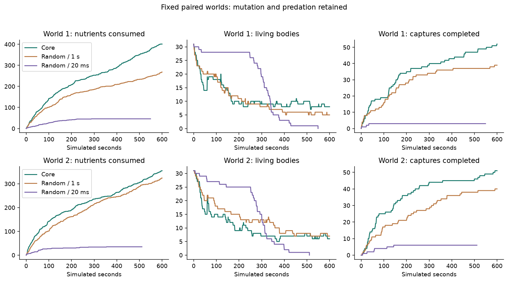
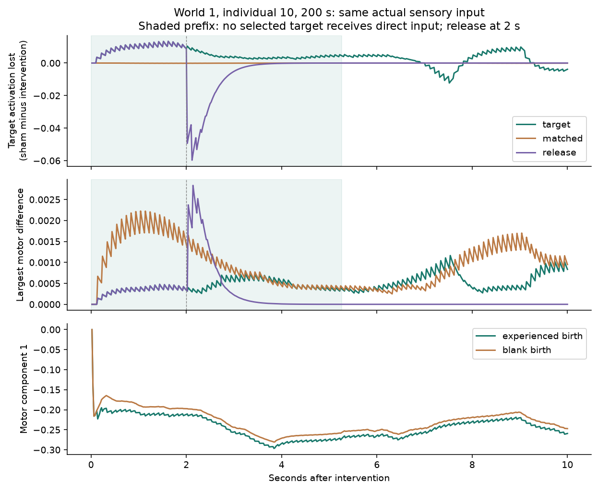
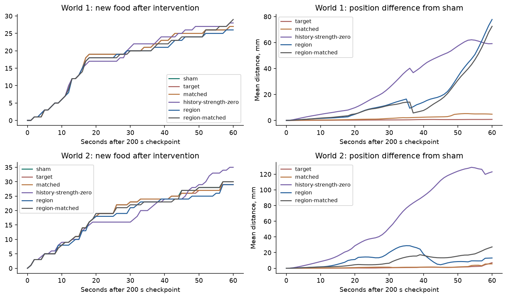

# E30：意识控制确有觅食优势，经历与内部活动确实改变行动

> **修订 r2 · 2026-10-10**
> 修订原因：原件存储位置已迁移并核验，追加当前位置解析说明，保留原实验结论。
> 原版：[report.zh.md](report.zh.md)；父版本 r1：[report.zh.md](report.zh.md)

2026-10-03 · [English](report.en.md) · [事前设计](design.zh.md) · [补充登记](causal-addendum.md) · [工具操作](README.md)

## 先回答两个问题

**① 与随机驱动相比，有没有明显差别和优势？有。** 两个海洋种子中，意识组摄食量都更多，单位活体时间摄食率也更高，动作更连贯、更倾向于沿局部营养浓度增加的方向运动。内核没有收到“朝食物走”的标签或奖励命令。这个结果已经超出“通信会耗能”的常识。

**② 优势是不是由经历与内部联想造成？它们确实参与行动，并改变了具体摄食和被捕事件；但尚不能把总体摄食优势全部归给它们。** 同样输入下，有经历和空白副本32次配对观察全部出现不同动作；31次在目标节点尚未重新受到直接刺激前，阻断相关连接使其活动减弱并改变动作。局部移植通常能把空白副本的动作推向有经历者。原位干预还改变了谁会被吃掉。与此同时，持久强度清零没有降低60秒总摄食，反而略多；因此不能把“经历有因果作用”直接换成“这些经历一定更有利”。

32次是两个世界、两个固定时点内的个体观察，包含重复个体和亲缘后代，**不是32个独立实验世界**。本轮完成了明确差别和部分原因定位，没有做总体优势的完整百分比分解。

## 装置改了什么，没有给意识加什么

外部世界版本为 `threemind.ocean/3`，内核仍为原 `continuous-memory/2`。未改原Core动力学、旧实例或Ocean/1、/2。保留原哈希运动接线和执行器转换，不给意识组加新的动作周期、幅度、能耗匹配或寻找食物的限制。“动作节律对照”只增加20ms重新抽样的随机组；原1秒随机组也保留。20ms是外设采样周期，Core传播仍为100ms。

每世界31个创始者、活体容量37，没有寿命上限。0.8米边长的二维周期水层，初始180颗营养，每2秒在随机位置补一颗，容量1024；食物随局部水流及混合运动，不固定坐标刷新。粒子的随机扰动按其身份与时刻确定，吃掉一个粒子不会打乱其他粒子的随机序列。遗忘、抑制、有限Core及身体供能、普通学习均保留。后代继承经历结构，出生清空活动，能量由亲代支付。没有融合、资源共享或指定合作行为。

形状采用面积相同的胶囊，可遗传变异伸长度和接触黏附能力，同时保留体型、推进、外壳等原有变异。允许完整包裹或持续接触捕获；外壳增加处理时间和能耗，有限黏附可以被运动拉开。亲代不能吞食未满60秒的直属后代。摄入有损耗，不凭空增加能量。仍是有限的外部身体属性模型，未实现材料自行生成任意器官或新感官。

水流、温度、相对速度、加速度、接触、重力及浮力相关测量，经外部适配器进入匿名通道。这里是有法向约束的二维水层，重力和浮力不意味着已经实现三维沉浮或完整流体力学。Core不知道哪些通道是食物、疼痛、方向或捕食者。研究者计算的营养梯度仅用于事后分析，不作为答案输入。

### 吞食和外壳确实工作

同一受控持续接触中，外壳0、0.2、0.8分别在0.42、0.74、1.70秒被捕，处理耗能依次为0、11.41、45.65。双方初始相反切向速度各0.01m/s时，无壳个体被捕，厚壳个体能在1.06秒脱离；各0.02m/s时，中等外壳也能脱离；更快时三者均可脱离。自由运动60秒校准有13次吞食。

这些先行校准证明外设能区分捕获、逃脱和外壳代价，不等于已经证明意识学会主动捕猎。正式意识组分别发生52、51次吞食，原先“吞食始终不发生”的装置问题已经解决。

## 六个正式世界的结果

环境种子301101/301102，接线种子300100/300200。每组三种控制从相同初态出发。统一观察上限600模拟秒；两个快速随机群体在549.10、511.04秒物理全灭后停止空转。到600秒它们的摄食不会继续增加。停止观察保存状态，不把观察期限当作意识死亡。

| 世界 | 控制 | 摄食颗粒 | 每活体每分钟摄食 | 累计活体秒 | 末态活体 | 吞食 | 出生 |
| --- | --- | ---: | ---: | ---: | ---: | ---: | ---: |
| 1 | 意识 | 401 | 3.497 | 6879.20 | 8 | 52 | 30 |
| 1 | 随机，每1秒 | 268 | 2.537 | 6337.44 | 5 | 39 | 16 |
| 1 | 随机，每20ms | 46 | 0.297 | 9296.38 | 0 | 3 | 0 |
| 2 | 意识 | 355 | 3.459 | 6157.04 | 6 | 51 | 28 |
| 2 | 随机，每1秒 | 324 | 2.477 | 7846.84 | 7 | 40 | 18 |
| 2 | 随机，每20ms | 35 | 0.252 | 8325.86 | 0 | 6 | 0 |

相对原随机组，意识组总摄食分别增加49.6%、9.6%，每活体时间摄食率增加37.8%、39.6%。第二组累计存活更短，不能说所有方面都获胜。快速随机组早期较少遭遇吞食，累计活体时间甚至更长，最终却无足够营养维持群体；这正说明单看“活过多少秒”会错过行为差别。

### 过程中具体有什么不同

动作与前一帧营养感官方向的平均余弦，意识组为0.180、0.164，慢随机组为0.016、0.011，快随机组接近0。正值代表更常朝浓度较高的一侧施力，而非远离。身体实际相对水流运动的对应值，意识组0.149、0.161，慢随机组0.074、0.095。该梯度是四个实际局部测量之差，不是全知目标坐标。

相邻20ms动作方向的一致程度，意识组约0.9999、慢随机组约0.98、快随机组约0。快速随机信号正负频繁抵消，经过身体惯性后难以形成持续位移；意识输出有更长的连贯性。这是实测行为线索，不是人为要求它们平滑，也不把静止或绕圈预先判为错误。

这组统计仍是描述性关系。持续运动、即时感官反应、初始接线、经历和后代选择都可能贡献优势；以下干预进一步拆分了其中部分原因。没有把帧数当样本数做夸大的显著性检验。

## 相同输入下，经历与未提示活动的作用

固定取两个意识世界200、600秒全部存活者，共9+9+8+6次观察；600秒后的输入由独立20秒延续副本生成，只取前10秒探测，不回写正式世界。每个副本重放完全相同的实测刺激及供能。假干预的动作与实际来源记录逐点相同。

选取此前1秒未直接输入但正在活动的节点，先阻断12条通向它们的连接；对照阻断数量相同、权重和稳定度相近、但通向其他节点的连接。选边不看之后摄食成绩。在目标再次直接受刺激之前单独分析，避免把新输入的作用当成未提示活动。

| 来源 | 观察数 | 未提示区间内活动减弱且动作改变 | 12边阻断的平均动作差 | 匹配阻断平均动作差 | 供能校正后的经历差 |
| --- | ---: | ---: | ---: | ---: | ---: |
| 世界1，200秒 | 9 | 9 | 0.000222 | 0.000903 | 0.014758 |
| 世界2，200秒 | 9 | 8 | 0.000288 | 0.001137 | 0.032283 |
| 世界1，600秒 | 8 | 8 | 0.000333 | 0.001439 | 0.020260 |
| 世界2，600秒 | 6 | 6 | 0.000332 | 0.000908 | 0.039615 |

动作差为三个[-1,1]执行器命令在10秒内的平均绝对差。**31/32的未提示活动依赖内部连接，并实际影响动作**；其余一次在短暂的干净区间未检出，不隐藏。很多动作差从阻断后约140ms出现，符合既有传播与外设读取时序。12条目标边的动作影响比匹配边小，不能称它们是控制全身的唯一中枢。

立即静默再解除，32次均恢复完全相同动作。静默2秒后解除，常先出现短暂反弹，再接近原轨迹。可见活动有自身的状态过程，不是单个末态数值。

### 局部连接可以传递一部分行为模式

持久经历比较让双方从无活动状态出生，保留相同受体编号和运动接线，一方保留经历结构，另一方空白。补试统一供给有限初始储备1369.498267单位；其后输入及供能相同。32次均有不同动作，而且差别不只在第一个瞬间。

将同源有经历者选出的12条持久连接移入通道对齐的空白出生副本，清除当前激活及快状态，不转移身体或食物：**29/32比空白副本更接近有经历者的动作；28/32优于等量其他连接的移植。** “更接近”是整段动作平均绝对差更小，不是人的主观观感。这是本轮很有价值的结果：部分行为响应能够随已形成的连接转移，而非只能由当时环境重新产生。

没有把移植后的副本另跑完整生态世代，因此此结果是动作模式的部分转移，不是已经转移了觅食优势或完整人格。

## 原位闭环：内部改变能否改变实际命运

从200秒原世界复制，保持原活动、在途信号、身体、能量、食物及噪声状态，干预后继续60秒。除持续静默的目标边之外，普通学习等机制照常运行。先做12条边；发现范围小后，事前另登记128条入边的范围对照，包含未提示区域内部连接，全部18个来源均能选满128条。它们覆盖221～472条符合条件入边中的一部分，仍不是全部联想。

“持久强度清零”清零节点支持/稳定度/触达次数及边权/稳定度/资格迹/触达次数，节点局部可塑性恢复1；**保留拓扑、当前激活、抑制、快状态、时钟、能量和队列**。不是清空全部记忆，更不禁止重新学习。

| 干预 | 世界1新摄食 / 末态活体 | 世界2新摄食 / 末态活体 |
| --- | ---: | ---: |
| 假干预 | 27 / 10 | 30 / 7 |
| 12条目标边静默 | 27 / 10 | 29 / 7 |
| 12条匹配边静默 | 27 / 9 | 30 / 6 |
| 持久强度清零 | 28 / 10 | 35 / 10 |
| 128条区域入边静默 | 26 / 8 | 29 / 7 |
| 128条匹配边静默 | 29 / 10 | 30 / 7 |

**值得关注的具体事件：** 世界2的37号在假干预中活过260秒，并在244.05秒吃到266号颗粒；128条区域阻断后，它在220.14秒被42号捕获。128条匹配阻断没有造成这次被捕。12条目标阻断则没有让它被捕，但它在窗口内没再吃到该颗粒。世界1的持久强度清零使原本218.48秒会被38号捕获的41号避开了这次死亡，但另一些个体遭遇了新的捕获。

这些不是只有计算机里“数值稍变”：相同初态，仅改变内部连接，就改变了食物归属、遭遇及个体命运。128条区域阻断两来源分别改变9、14个颗粒的摄入存在与归属；持久强度清零改变13、27个。平均源个体路径偏差，小范围阻断为0.37、0.75毫米，区域阻断为14.66、8.87毫米，持久强度清零为25.21、51.23毫米。只统计双方仍存活的原有个体，后代不冒充同身份配对。

**然而，结果没有支持“保留当前经历总能更好觅食”。** 持久强度清零反而多吃1、5颗。区域阻断各少吃1颗，效应比意识对随机组的总差距小得多。加上匹配阻断也能改变命运，目前只能说内部活动与经历具有真实且有时有利、有时不利的行为作用；不能用这两个世界断言总体优势主要来自某一联想区域。闭环后续还包含环境反馈与新学习，不能把全部60秒差异都称作完全无输入的自主循环。

## 工程问题、资源与证据

1. 自由运动校准曾因进度文件重复独占创建暂停；修复记录器，原状态续跑完成，失败记录保留。
2. 原出生探针沿用后代初始能量0。一对一直待接入，另一原600秒探针后来死亡，工具仍尝试递送输入而被Core拒绝。修复的是探针：记录死亡并停止递送，不能复活。原失败目录保留，补试在新目录，所有出生比较另以同等有限储备校正。活动中原位干预和正式世界不受此问题影响。
3. `/3`补齐原有可选寿命对照的执行分支，正式配置始终为`None`，没有新增默认寿命限制。9项针对性测试通过；1440/390像素本地回放播放、拖动、选体和布局检查通过。没有重建或修改主前端、没有改Core。
4. 模拟累计约103.4进程分钟（包含校准、探针失败的保守上界、补试与分叉），低于4小时预算；不是额外一天一夜。数据采集结束约1.45GiB，归档/数据库仍受6GiB总上限约束。账户从10%至12%（共享账户增量也算在内），未触及停止线。最终归档量见`delivery.json`。
5. 没有重跑整批哈希或全量恢复所有意识。只做有科学意义的输入一致、干预隔离、能量账本、代表性恢复以及失败边界检查。打包单次CRC，数据库上传沿用其单次摘要，不再把证据反复读出验证。

独立研究项目：`3818e230-3515-45ce-b873-55150549bd98`。实验笔记、报告和原始证据包由ThreeMind服务入库。主要本地证据：`.work/ocean-causality-20261003/findings.json`、`cases/`、`probes/`、`closed-loop/`。`views/g0-core.html`、`g1-core.html`、`g1-sham.html`、`g1-region.html`可直接回放实测躯体、食物和捕获事件。旧实验不覆盖、不清理。

## 下一步的选择

本轮最值得保留的发现是：**更连贯且偏向食物的行动、可随局部连接转移的动作模式，以及内部干预改变个体命运**。这些为继续研究提供了具体抓手。

若继续，应优先区分“即时感官＋固定接线＋自然平滑”与“持续学习确实改善觅食”：固定初态与身体，增加保持动作持续性但打断感官闭环的外部对照，或者以同一出生实例经历不同课程后在未见海域比较，结合已经校正供能的结构移植。只改对照，不约束意识组，也不为预期胜负更改内核。记录行为随经历怎样变好或变坏，比先加入更多生态选项更有价值。

这是建议，未在本轮自动启动。三维、融合、主动合作和任意器官演化均未实施；先保留当前证据，由用户决定下一步。
## 交付计量更正（同日追加）

最终汇总补入尚无工作进程收据的两段早期校准，共126.81秒。已计时模拟与失败保守上界合计约**105.5进程分钟**，修正上文初算103.4分钟；简短受控校准并未逐项独立计时。预算统计工具也已补齐该路径。科学结果、参数和停止条件均不变。最终证据ZIP约1.02GiB，连同本地原件、ZIP及数据库增长总计约**3.55GiB**，低于6GiB硬上限。归档保持发布时的原版报告，UI报告保留旧修订并追加本次更正；无需重打整包。详见同目录的 delivery.json 与 delivery-final.json。

> **存储位置修订 · 2026-10-10**
> 本版追加已核验的原件迁移说明：本次清单中的原件迁至 `E:\ThreeMindData`，科学身份、哈希、原实验日期、测量与结论不变。保留正文中的路径表示历史来源，当前位置通过已登记的证据引用解析。仓库文档与冻结夹具留在原处，源副本保留；结构化查询数据及运行中的检查点仍存数据库。本说明不表示缺失的历史资料已恢复。
