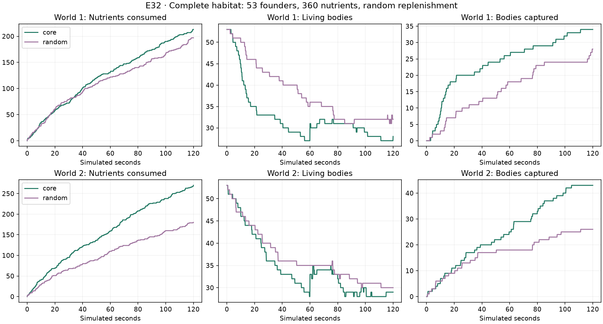
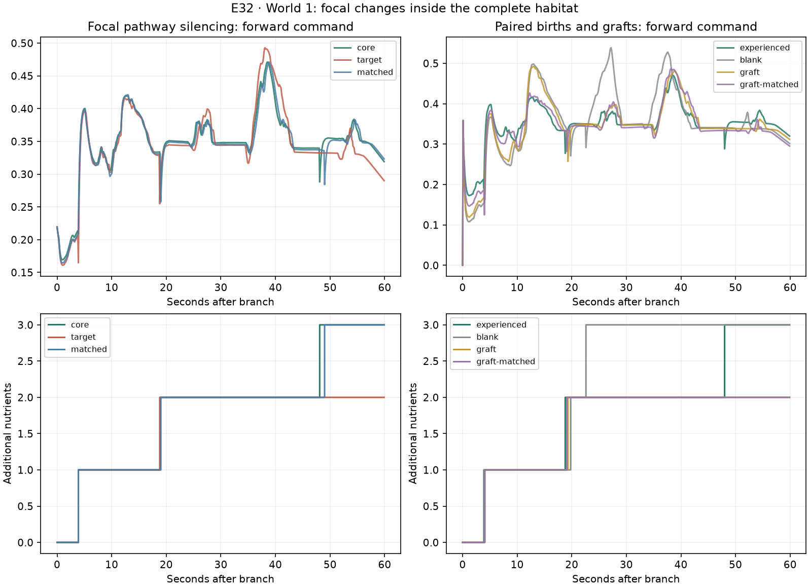
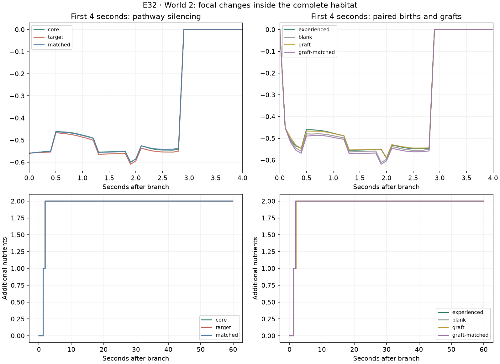

# E32: internal activity tested inside the complete ocean

[中文](report.zh.md) · [Registration](design.en.md) · [Measures](analysis-registration.md) · [Execution](execution-notes.md)

Registered2026-10-03. All18 conditions completed; the independent sources are **two world seeds**, not18 independent populations.

## Main answers

**Core control has a clear feeding advantage over this random baseline in both intact worlds:**213 versus197 and270 versus180 nutrients (+8.1%,+50.0%). Intake per living-body second is27.5% and59.5% higher. Other organisms,food,random replenishment and environmental senses remain throughout,correcting E31's habitat-removal limitation.

**One concrete feeding benefit depends on a selected internal pathway.** Silencing individual0's target pathways removes recently uncued activity,changes subsequent commands/trajectory,and reduces60s intake from3 to2. Silencing75 matched other edges leaves intake at3. Activity,commands and exact nutrient events connect the manipulation to the outcome.

**Persistent structure can transfer an action pattern; transferred foraging benefit is not general.** In source2,target grafting reduces action distance to the experienced birth by about68% compared with blank and outperforms a matched graft,without changing capture/death outcomes. For individual0,both grafts resemble the experienced actions more closely but consume2 nutrients versus3 for blank. Pattern transfer and ecological benefit are distinct observed questions.

## World results

Each world starts with53 bodies and360 nutrients in a1.2m square,allows97 live bodies,and replenishes one nutrient per simulated second at a random position. Observe120s with finite energy,motor costs,mutation,shells,contact capture,reproduction,water,temperature,collision and proprioceptive feedback. No live host telemetry,fusion or sharing.

| World | Control | Nutrients | Captures | Births | Final alive | Living-body seconds | Nutrients/body-second |
| --- | --- | ---: | ---: | ---: | ---: | ---: | ---: |
| 1 | core | 213 | 34 | 9 | 28 | 3892.62 | 0.05472 |
| 1 | random | 197 | 28 | 7 | 32 | 4591.18 | 0.04291 |
| 2 | core | 270 | 43 | 19 | 29 | 4136.06 | 0.06528 |
| 2 | random | 180 | 26 | 3 | 30 | 4397.82 | 0.04093 |

Core commands are smoother and more aligned with locally measured nutrient gradients: mean angular alignment0.140 versus0.013 in world1 and0.136 versus−0.001 in world2. Mean planar command magnitude is lower:0.433/0.765 and0.494/0.763. Thus its behavior is observably different from this random controller; total advantage still combines immediate sensing,wiring,command scale/continuity and experience. Core cadence/amplitude are unrestricted. The random baseline uses independent commands each second; it does not stand for every possible random strategy.

Final population is smaller by4 and1 while captures are higher. The user approved E33 to disable mutual predation and separate this environmental contribution. E32 numbers and rules remain intact.

## Individual0: a local pathway changes a real feeding opportunity

Selection uses only57–60s activity and fixed identity order. At60s,the **whole ocean** is copied and only the focal engine changes. Three target nodes have75 selected incoming edges;75 matched edges have mean weight/stability matching error0.00534.

For target nodes not directly stimulated in either arm during the preceding1s,the common61–70s activity integral is0.79335 intact,0 under target silence,and0.79019 matched (99.6% retained). First action difference appears at the0.2s sample,with60s command MAE0.01083 target versus0.00485 matched. This is the first observed100ms sample,not exact continuous latency.

Intact0 ingests nutrient404 at63.835s,225 at78.890s,and50 at108.015s. Target silence retains404,but instead reaches269 at78.785s and no third particle. Matched silence retains404/225/50,the third at108.910s. Different routes encounter different existing particles; no target was placed in front of the focal body. This establishes a positive contribution in this encounter,not a full percentage decomposition of the population's16/90 extra nutrients.

## Individual2: transferable commands and an offspring encounter

The second source has128 target/matched edges,mean matching error0.03329. Common uncued activity is0.25188 intact,0 target,and0.25085 matched. During approximately2.9s of common physical survival,command MAE is0.01032 target versus0.00158 matched. The internal contribution repeats.

Intact2 captures17 at61.16s,eats two particles,gives birth to60 at62.00s,and is captured by its own newborn at62.88s. Ocean/3 protects immature children from parents but not the reverse. This lineage chain belongs in the explanation; the neural variants retain the same focal endpoints. Physical capture at62.88s and Core activity death at65.62s are separate events. These contrasts do not locate a target region that decides successful pursuit or escape.

Paired births reset immediate neural activity while retaining physical age,position,current finite reserve and the whole habitat. Target graft MAE to the experienced birth is0.00316,blank0.00981,matched graft0.01333 during common survival. The approximately68% reduction supports **specific persistent-structure transfer of a command pattern**,without a better encounter outcome. The user approved bilateral parent–child protection until maturity in future studies; E32 keeps its registered rule. E33 disables all predation,so protection direction is immaterial there.

## All focal outcomes

Results cover60–120s. Intact/silenced arms retain immediate state. Experienced/blank/graft births reset it identically and should be compared within that set. Blank births continue normal learning. Both scopes retain every other body and all food.

| Condition | 0 food | 0 captures | 0 alive | 2 food | 2 captures | 2 alive |
| --- | ---: | ---: | --- | ---: | ---: | --- |
| 原意识 / intact | 3 | 0 | 是 / yes | 2 | 1 | 否 / no |
| 目标静默 / target | 2 | 0 | 是 / yes | 2 | 1 | 否 / no |
| 匹配静默 / matched | 3 | 0 | 是 / yes | 2 | 1 | 否 / no |
| 单体随机 / focal random | 4 | 0 | 是 / yes | 5 | 1 | 是 / yes |
| 保留经历 / experienced | 3 | 0 | 是 / yes | 2 | 1 | 否 / no |
| 空白 / blank | 3 | 0 | 是 / yes | 2 | 1 | 否 / no |
| 目标移植 / target graft | 2 | 0 | 是 / yes | 2 | 1 | 否 / no |
| 匹配移植 / matched graft | 2 | 0 | 是 / yes | 2 | 1 | 否 / no |

“Uncued” means no direct input on that node's channel during the preceding1s,not that the world is silent. Matched local manipulations supply causal evidence. Matching covers count,weight and stability,not identical topology. Complete inputs,commands,states and events remain available.

**Focal random replacements also have favorable outcomes.** Individual0 consumes4 rather than3 nutrients,but motor expenditure rises to82.81 from26.09 (about3.2×). Randomly controlled2 survives and consumes5,where intact2 is captured after consuming2. Population-level Core advantage and these favorable focal random replacements coexist; they answer different questions. Neither universal individual benefit nor universally superior learned experience is established. E33 tests how population differences change without predation pressure.

## Footage,tools and limits

Eight actual-record MP4s cover Core/random full worlds,feeding,capture,release,and the same-time intact/target/matched feeding comparison. The whole habitat remains visible; focal zoom is additional.100ms state samples are displayed at10fps,full overviews at2× and excerpts at1×. The synchronized comparison clips each last13s. Release footage establishes a physical release,not a localized internal cause of escape.

Open`.work/ocean-community-20261003/media/final/gallery.html`locally; four HTML world replays are also retained. Local Lab project`0b662685-7484-4c20-b1cb-064b53a582e4`contains designs,bilingual reports and video records. Whole-evidence archives stay local.

Reusable tools preserve whole-world forks,focal-only interventions,birth-clock/current-reserve alignment,focal-random restoration and process recording. No Core dynamics,defaults,propagation clocks or sensory mappings changed. Ten relevant apparatus/contact tests passed,as did video encoding and1440/390px playback,pause and seek checks. A renderer-only periodic-seam line artifact was corrected without changing recorded trajectories.

The18 completed cases used81.76simulation process-minutes. Account usage was17% at registration and19% at report generation,including shared use. One simulation worker; storage/publication receipts are separate. A naming collision initially skipped two focal-random cases; distinct names completed both without overwriting prior evidence. No old-data deletion or repetitive full audits.

## What this advances

The new result is **internal activity changing a concrete feeding outcome in an intact complex habitat**,plus transferable action patterns in selected persistent connections. Stable transfer of useful skills,localized pursuit/escape mechanisms and complete population attribution remain open. E33 first separates predation effects. Subsequent natural pre-encounter interventions should retain the whole habitat;3D and longer evolution remain separate decisions. E32 does not revise the prior`autonomy-criteria/1`pass or redefine consciousness through a new intake threshold.
