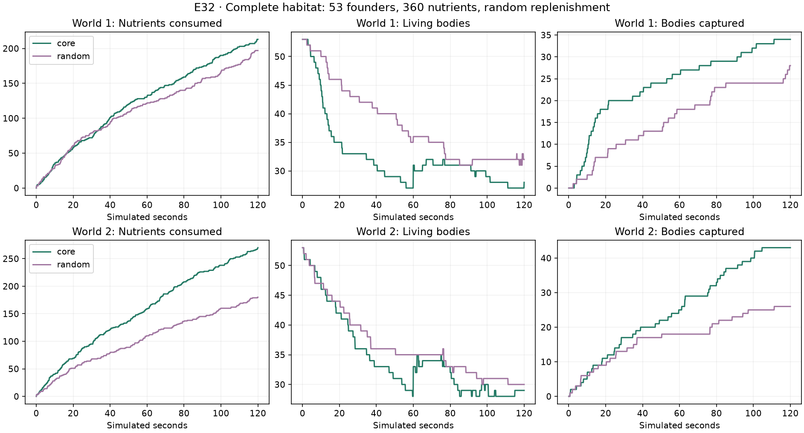
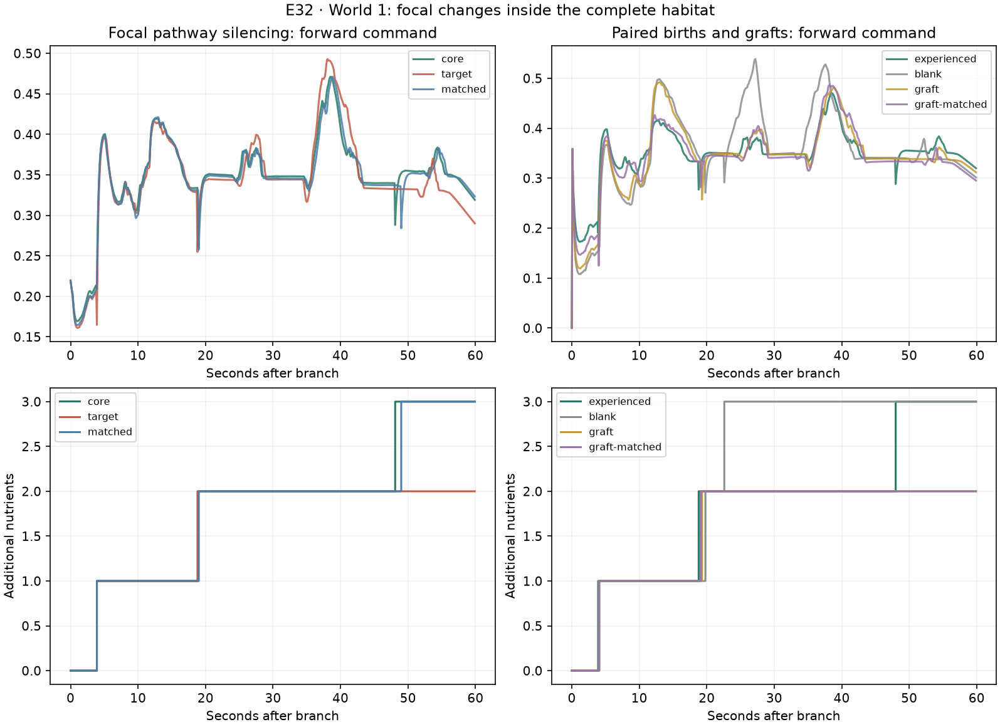
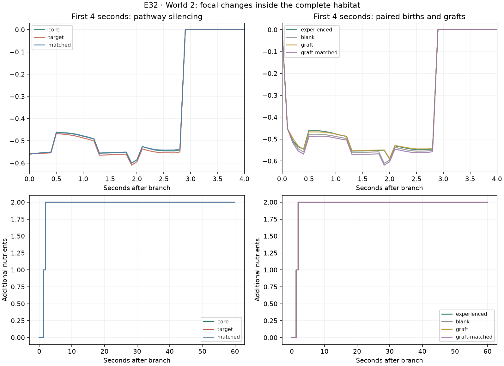

# E32 完整海洋：内部活动的作用，终于放回原环境检验

[English](report.en.md) · [事前设计](design.zh.md) · [指标定义](analysis-registration.md) · [执行记录](execution-notes.md)

2026-10-03登记。本报告依据18个完成的世界/分叉；独立来源是两个世界种子，不能把18个分支称为18个独立种群。

## 先回答本轮真正的问题

**意识驱动与随机驱动有清楚差别，而且本轮两个完整世界都存在摄食优势。**意识组摄入213对197、270对180，分别多8.1%和50.0%；按累计活体时间计算，摄食率分别高27.5%和59.5%。这次保留了其他个体、营养、随机刷新与全部感官环境，E31删减环境的问题已经纠正。

**至少一个完整环境中的摄食收益，确实有局部内部联想活动的贡献。**0号的目标通路被静默后，近期未受直接提示的活动消失，随后动作与轨迹改变，60秒内摄入由3颗降至2颗；静默同等数量、权重/稳定度相近的其他连接，仍为3颗。不是仅凭食量猜测原因：活动、动作、路径与具体营养摄入事件都有记录。

**经历形成的结构能携带动作模式，但“移过去就更会觅食”没有得到普遍支持。**第二个来源2号的目标连接移植，使动作与经历者的差距比空白减少约68%，优于匹配移植；这次捕获和死亡结果却不变。第一个来源中，目标及匹配移植都更像经历者，但摄入都是2颗，空白为3颗。模式转移、作用和收益必须分别回答。

## 完整海洋里的群体结果

1.2米见方海域，53初始个体，97在世上限，360颗初始营养，每模拟秒在随机位置补一颗；每个主世界120模拟秒。有限能量、运动耗能、外壳、变异、持续接触捕获、繁殖、水流、温度、碰撞及本体感官全部保留。没有实时宿主遥测，也没有融合或共享。

| 世界 | 驱动 | 营养摄入 | 捕获个体 | 出生 | 末存活 | 累计活体秒 | 营养/活体秒 |
| --- | --- | ---: | ---: | ---: | ---: | ---: | ---: |
| 1 | core | 213 | 34 | 9 | 28 | 3892.62 | 0.05472 |
| 1 | random | 197 | 28 | 7 | 32 | 4591.18 | 0.04291 |
| 2 | core | 270 | 43 | 19 | 29 | 4136.06 | 0.06528 |
| 2 | random | 180 | 26 | 3 | 30 | 4397.82 | 0.04093 |

意识组动作更连续，在有局部营养梯度的采样中更倾向朝浓度较高方向输出。单位方向与梯度的平均对齐值：世界1为0.140对0.013，世界2为0.136对−0.001。平均平移命令幅度也更小：0.433对0.765、0.494对0.763。**这支持它并非与当前随机控制器毫无区别地碰运气，但整体优势仍包含即时感官、身体接线、输出幅度/连续性及网络经历的共同影响。**正常意识的输出没有为对照而限速或限幅；随机基线是原有每秒独立随机指令，不代表所有可能的随机策略。

末存活数量少4个和1个，不能直接解释成意识组生存能力较差：它们同时捕获了更多个体。用户据此批准E33禁止相互吞食的配对补试，单独区分这一环境因素；该补试不改写本报告的数值或本轮规则。

## 0号：内部活动改变了真实的一次摄食机会

在主世界第57–60秒，只按既定活动规则选择目标；第60秒复制**整个海洋**，只改0号意识。它有3个目标节点、75条目标入边；匹配对照同为75条，平均权重/稳定度匹配误差0.00534。

对两边均在此前1秒没有直接通道输入的目标活动，第61–70秒的共同可测积分为：原意识0.79335，目标静默0，匹配静默0.79019。后者保留约99.6%。动作在静默后0.2秒的采样中出现差异，目标静默的60秒平均动作差0.01083，匹配静默0.00485。0.2秒是100毫秒采样下首次观察到的差异，不能当作精确连续时间延迟。

具体经历如下：原意识先在63.835秒取得营养404、78.890秒取得225、108.015秒取得50。目标静默后仍取得404，但改为78.785秒取得269，之后没有取得第三颗。匹配静默仍取得404、225和50，第三次在108.910秒发生。因果差异体现在同一环境中走了不同路线、遇到了不同营养，并非人为把一团食物放到目标前方。

这支持“这部分内部活动对该次觅食有正面作用”。它还没有给出群体额外16/90颗营养中有多少百分比归于内部联想；只有两个预选焦点，也没有把当前所有有益行为定位完。

## 2号：动作模式可转移，遭遇还受繁殖与身体规则左右

第二世界依相同顺序规则选中2号，静默目标和匹配通路各128条，平均匹配误差0.03329。共同无直接提示时的活动积分由原来的0.25188变为目标静默0；匹配为0.25085。共同存活的约2.9秒内，目标静默动作差0.01032，匹配0.00158。内部通路作用再次出现。

原2号在61.16秒捕获17号，随后摄入两颗营养，62.00秒繁殖出60号；60号在62.88秒捕获自己的亲代。当前Ocean/3只阻止亲代吞食未成熟子代，没有阻止反向吞食。该来源各神经对照的终点相同，因此不能把这些结果写成已经证明某条区域决定了主动追猎或逃命。实际身体在62.88秒被捕获，原意识活动在65.62秒才依原生命规则终止；二者不能混为同一时刻。

出生式对照只重置即时神经状态，保持身体年龄、位置、当前有限储备与整个环境。目标连接移植的动作与经历者平均差0.00316，空白0.00981，匹配移植0.01333（共同存活约2.9秒）。**约68%的差距缩小由指定目标连接实现，说明这部分持久结构能搬动具体动作模式。**原规则下该遭遇结局没有改善。

用户随后明确批准：后续实验在子代成熟前采用亲子双向保护。本轮已经登记的对照继续原规则；下一期的环境修订不能混入当前样本。禁止吞食的E33则不触发任一方向的吞食。

## 所有焦点结果，不挑只好看的分支

每项都是原世界60–120秒。原样与静默保持即时状态；经历/空白/移植四项统一重置即时状态，只在这四项内部比较持久经历，不能把出生重置本身误算成记忆效果。空白副本仍可继续学习，并非关闭学习的石头。

| 条件 | 0号摄食 | 0号捕获 | 0号存活 | 2号摄食 | 2号捕获 | 2号存活 |
| --- | ---: | ---: | --- | ---: | ---: | --- |
| 原意识 / intact | 3 | 0 | 是 / yes | 2 | 1 | 否 / no |
| 目标静默 / target | 2 | 0 | 是 / yes | 2 | 1 | 否 / no |
| 匹配静默 / matched | 3 | 0 | 是 / yes | 2 | 1 | 否 / no |
| 单体随机 / focal random | 4 | 0 | 是 / yes | 5 | 1 | 是 / yes |
| 保留经历 / experienced | 3 | 0 | 是 / yes | 2 | 1 | 否 / no |
| 空白 / blank | 3 | 0 | 是 / yes | 2 | 1 | 否 / no |
| 目标移植 / target graft | 2 | 0 | 是 / yes | 2 | 1 | 否 / no |
| 匹配移植 / matched graft | 2 | 0 | 是 / yes | 2 | 1 | 否 / no |

局部未提示活动的判定是“该通道此前1秒无直接输入且活动存在”，不等于整个世界停止了输入。目标静默及匹配静默才提供它参与动作的因果证据。匹配覆盖数量、权重和稳定度，没有声称不同区域的拓扑完全等价。实际刺激、动作、完整状态和事件均保留，便于进一步核对。

**单个体随机替换也有明确的有利结果，不能略去。**0号改为随机驱动后摄食4颗（原为3颗），运动耗能82.81（原为26.09，约3.2倍）；2号随机替换后仍存活、摄食5颗，原意识在该遭遇中被捕获且只摄入2颗。总体意识组胜出与这两个焦点随机替换胜出可以同时成立：它们回答的范围不同。当前不能声称每个意识个体都有净收益，或已有经历总是优于其他动作序列。E33还将检验捕食压力拿掉后群体差异如何变化。

## 影片、工具和资源

本轮导出8段MP4：意识/随机全程、摄食、接触捕获、脱离，以及0号同一时段的原样/目标/匹配三联对照。全景保留全部生态，附加近景不替代全景。视频依据实际100毫秒状态记录，10fps；全程片按2倍速，其他片1倍速，不生成额外实验帧或样本。三联片各13秒，可同步播放。脱离影片只证明发生脱离，本轮尚未把其收益定位到指定内部区域。

本地影片目录：`.work/ocean-community-20261003/media/final/`，`gallery.html`可直接打开；完整海洋还可在4个HTML回放中逐时查看。平台独立项目`0b662685-7484-4c20-b1cb-064b53a582e4`保存设计、双语报告及影片记录。

提炼了完整海洋分叉、只改单个意识、出生副本时钟/储备对齐、单个体随机控制的保存恢复与过程记录工具。原Core公式、参数、传播时钟及感官映射均未改。10项相关工具/物理测试通过；全景影片编码、1440/390像素播放/暂停/定位验收通过。纠正了视频中跨周期边界形状画成横线的渲染错误，不改模拟轨迹。

本轮18个完成条件合计81.76模拟进程分钟；登记账户17%，报告生成时19%（共享账户变化一起计入）。保持单模拟worker；证据存储及入库收据另见交付记录。没有清理旧数据、重复运行旧种群或反复全量校验。一次研究调度名称冲突让两个单体随机条件被跳过，已用独立名称补全；原数据没有被覆盖，见执行记录。

## 值得继续的明确问题

本轮最重要的新证据是：**完整复杂环境中，内部活动不仅改变数值，还改变了具体摄食后果；选定连接也能转移动作模式。**未完成的是有益技能的稳定移植、主动追猎/逃命的指定内部机制，以及群体优势的分量归因。E33按用户建议先拆分捕食对种群结果的影响。之后可围绕自然遇食/遇敌前的短窗选择更多焦点，保留整个环境做区域静默、恢复及移植；不再退回孤立小装置替代生态验证。三维及更长演化另行决定。

本轮补足E31的环境缺口，不倒改既定`autonomy-criteria/1`通过结论，也不以新的食量判据重新定义“意识”。
