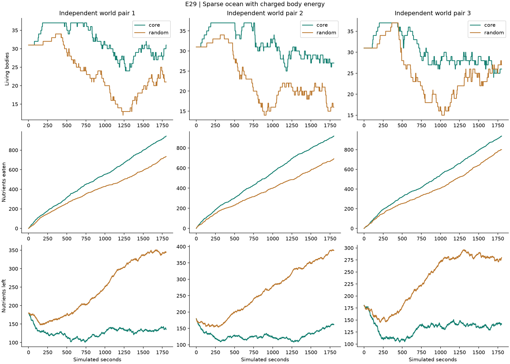
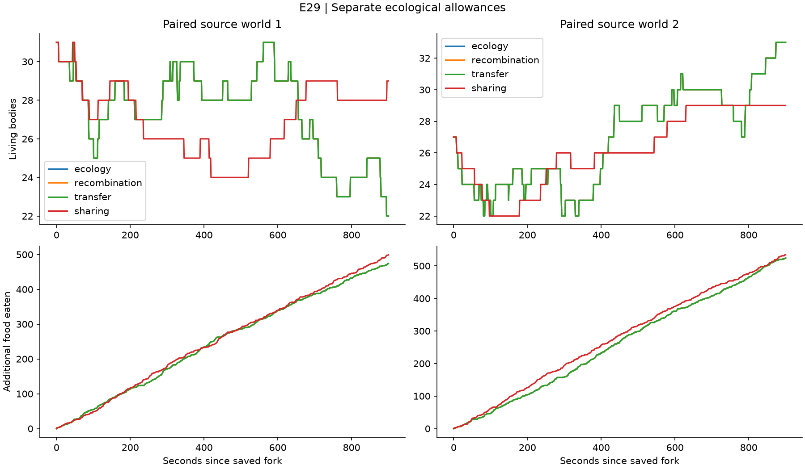

# E29: Survival, body variation and resource exchange in a sparse ocean

2026-10-03 · `continuous-memory/2` · `threemind.ocean/2`

[预登记 / Registration](design.en.md) · [执行与修订 / Execution and amendments](execution-notes.md)

## Findings first

Core-minus-random food differences across the three primary pairs are **+209 (+28.4%) / +226 (+32.7%) / +138 (+17.2%)**; final survivor differences are **+10 / +11 / -1**. The original confirmation gate passed. This gate allocates follow-up resources; total intake does not replace intake per living-body second.

**All three Core groups sustain more total living-body time and eat more overall, yet intake per living-body second is slightly lower in every pair.** This is an advantage in sustaining the population, not evidence that every individual finds food faster. The third Core group ends with one fewer survivor despite its longer cumulative survival; preserve both observations.

Ecological forks added 168 offspring, 0 engulfings and 43,043 compatible exchanges. Enabling these material processes is not evidence of active cooperation or new species; compare actual paired outcomes.

**Contact sharing changes survival and reproduction, but does not improve every outcome.** The paired food differences are +25 / +10, endpoint survivors +7 / -4, births -11 / -21, and cumulative living-body seconds -352.30 / -650.24. A better first endpoint does not imply a benefit throughout that observation period or in the other source. No successful recombination, engulfing or engulfing-derived inheritance occurred; absence of realized events is not evidence that they occurred without effect.

Independent pair 4 again favors Core drive: intake 952 versus 783 (+21.6%) and living-body time 58,292.08 versus 44,704.26 seconds. In the fixed-source new-environment comparison, retained history yields 247 food versus 257 after erasure, without a positive transfer advantage. Retaining existing communication yields 164 versus 140 after silencing, but consumes 9,439.11 more Core energy and ends with 30 versus 33 survivors. Communication contributes to behavior with a cost; the experiment does not localize a specific autonomous association region. All four attribution controls completed 300 seconds.

## 1. Core versus random drive

Each world begins with 31 founders, permits 37 living bodies and observes 1,800 simulated seconds. There is no default age death; the observation horizon saves and pauses the population. The 1.2 m square starts with 180 food particles, permits 1,024 and adds one every 2 seconds. Physics advances every 5 ms and senses sample every 20 ms. No live hardware telemetry is connected.

| Pair | Drive | Seconds | Food | Food/body-s | Living body-s | Survivors | Offspring |
|---|---|---|---|---|---|---|---|
| 1 | core | 1,800 | 944 | 0.01637 | 57,657 | 31 | 62 |
| 1 | random | 1,800 | 735 | 0.01731 | 42,464 | 21 | 41 |
| 2 | core | 1,800 | 918 | 0.01595 | 57,546 | 27 | 56 |
| 2 | random | 1,800 | 692 | 0.01654 | 41,843 | 16 | 42 |
| 3 | core | 1,800 | 938 | 0.01706 | 54,975 | 26 | 57 |
| 3 | random | 1,800 | 800 | 0.01757 | 45,528 | 27 | 55 |

Independent worlds, not offspring or millions of correlated input frames, are the experimental units. Starvation with food still present indicates failure to reach usable food in time, not exhaustion of all environmental supply.

## 2. Possible sources of advantage

| Pair | Drive | Motor energy | Core energy | Path m | Translation command squared | Velocity/gradient cosine |
|---|---|---|---|---|---|---|
| 1 | core | 23,515 | 285,776 | 613.92 | 0.2254 | 0.1129 |
| 1 | random | 33,105 | 226,537 | 381.18 | 0.6639 | 0.0650 |
| 2 | core | 21,166 | 287,748 | 601.87 | 0.1913 | 0.0971 |
| 2 | random | 30,848 | 221,069 | 359.22 | 0.6664 | 0.0624 |
| 3 | core | 24,762 | 283,077 | 645.93 | 0.2512 | 0.0873 |
| 3 | random | 32,975 | 239,434 | 385.39 | 0.6658 | 0.0828 |

Commands are limited by available body fuel before producing motion. Gradient alignment describes measured velocity relative to water and local nutrient signals; it is not a learning verdict by itself. Random commands change once per second; Core commands are read every 20 ms. Magnitude, persistence and energy costs differ, so primary performance alone cannot isolate learned foraging from economical motion, feedback, node history or communication. Remaining still or circling is never scored as wrong; actual energy consequences determine survival.

## 3. Ecological forks

Fork the fixed first two Core endpoints into four 900-second continuations each. Intake, birth and event counts below are increments after the fork; survivors are endpoint values. Earlier history is not counted again.

| World | Added s | Added food | Survivors | Births | Engulfing | Recombination | Transfer | Exchange |
|---|---|---|---|---|---|---|---|---|
| fork-0-ecology | 900 | 474 | 22 | 21 | 0 | 0 | 0 | 0 |
| fork-0-recombination | 900 | 474 | 22 | 21 | 0 | 0 | 0 | 0 |
| fork-0-sharing | 900 | 499 | 29 | 10 | 0 | 0 | 0 | 29,808 |
| fork-0-transfer | 900 | 474 | 22 | 21 | 0 | 0 | 0 | 0 |
| fork-1-ecology | 900 | 524 | 33 | 29 | 0 | 0 | 0 | 0 |
| fork-1-recombination | 900 | 524 | 33 | 29 | 0 | 0 | 0 | 0 |
| fork-1-sharing | 900 | 534 | 29 | 8 | 0 | 0 | 0 | 13,235 |
| fork-1-transfer | 900 | 524 | 33 | 29 | 0 | 0 | 0 | 0 |

Differences below are relative to each source's ecology fork. Exchange counts denote transfer steps, not independent encounters or active cooperative acts.

| Source | Mechanism | Food difference | Living body-s difference | Survivor difference |
|---|---|---|---|---|
| 1 | recombination | +0 | +0.0 | +0 |
| 1 | transfer | +0 | +0.0 | +0 |
| 1 | sharing | +25 | -352.3 | +7 |
| 2 | recombination | +0 | +0.0 | +0 |
| 2 | transfer | +0 | +0.0 | +0 |
| 2 | sharing | +10 | -650.2 | -4 |

Actual transfer energy is broken down below. A pair exchanging in both directions counts once. Other means not a direct parent-child relationship, and may still include other relatives. Genealogy is consulted only by the observer, never supplied to Core or the sharing rule.

| World | Distinct pairs | Sent energy | Received energy | Parent→child received | Child→parent received | Other received |
|---|---|---|---|---|---|---|
| fork-0-sharing | 135 | 46,122.4 | 41,510.2 | 5,099.7 | 3,012.9 | 33,397.6 |
| fork-1-sharing | 130 | 47,292.1 | 42,562.9 | 3,635.7 | 774.0 | 38,153.2 |

Trait ranges cover all retained individuals, including the dead. Surface types count living compatible classes, not species.

| World | Maximum generation | Radius mm | Shell | Reflectance | Living surface types |
|---|---|---|---|---|---|
| fork-0-ecology | 2 | 7.04–9.33 | 0.144–0.354 | 0.335–0.685 | 3 |
| fork-0-recombination | 2 | 7.04–9.33 | 0.144–0.354 | 0.335–0.685 | 3 |
| fork-0-sharing | 3 | 7.32–9.06 | 0.151–0.263 | 0.492–0.625 | 1 |
| fork-0-transfer | 2 | 7.04–9.33 | 0.144–0.354 | 0.335–0.685 | 3 |
| fork-1-ecology | 2 | 7.41–10.49 | 0.024–0.381 | 0.312–0.790 | 4 |
| fork-1-recombination | 2 | 7.41–10.49 | 0.024–0.381 | 0.312–0.790 | 4 |
| fork-1-sharing | 2 | 7.12–8.00 | 0.200–0.200 | 0.382–0.500 | 2 |
| fork-1-transfer | 2 | 7.41–10.49 | 0.024–0.381 | 0.312–0.790 | 4 |

Additional read-only diagnostics count individual sample frames with neighbor/enclosure signals, not independent encounters. Enclosure need not last long enough or have sufficient energy for engulfing; these diagnostics do not replace the primary criterion.

| World | Neighbor frames | Enclosure frames | Protected steps |
|---|---|---|---|
| fork-0-ecology | 443225 | 7 | 0 |
| fork-0-recombination | 443225 | 7 | 0 |
| fork-0-sharing | 498517 | 0 | 0 |
| fork-0-transfer | 443225 | 7 | 0 |
| fork-1-ecology | 513776 | 19 | 0 |
| fork-1-recombination | 513776 | 19 | 0 |
| fork-1-sharing | 405863 | 0 | 0 |
| fork-1-transfer | 513776 | 19 | 0 |

The ecology baseline permits random body mutation and engulfing. Recombination, engulfing-derived inheritance and lossy contact sharing are separate additions. Variation is limited to radius, thrust, sensing range, shell, reflectance, compatible surfaces and a neutral marker. Shells have mass, drag, maintenance/construction costs and engulfing resistance; reflectance changes local measurements without enemy labels. Parent protection below 60 seconds is an explicit environmental rule, not emergent parenting. Trait diversity is not demonstrated species diversity.

Optional mechanisms share a saved mutation RNG, including unsuccessful draws; food mixing also depends on remaining particle count. Forks share exact initial conditions and replayable dynamics, not identical future random tapes. A difference with no successful recombination cannot be attributed to successful fusion.

## 4. A discovered newborn-fuel coupling

The original primary configuration gives offspring 180r in Core energy and 60r in body fuel, but digestion refills Core to 240r, potentially consuming all initial motor fuel. Records show this at 77 and 77.02 seconds. All six original primary arms and their evidence retain this configuration. Before any ecological arm began, all eight received the prospective allocation of 240r to Core and 60r to body fuel, charging parents the additional 60r. No existing individual was refueled or revived. Thus primary-to-ecological differences cannot be attributed only to predation and mutation. The measured engineering scale r = 5.706242779562836 is not a biological constant.

## 5. Verification and resources

There are 14 primary/ecological worlds and 899 active copies plus births. Incomplete/unexecuted: none. Aggregate simulation process time: 9.58 hours, summing parallel workers.

Restoration covered 230 snapshots with maximum absolute ledger residual 7.7e-06. The following complete intervals matched inputs/actions/events/final state; this is not a full rerun of every world.

| Segment | Start s | End s | Steps |
|---|---|---|---|
| cases\phase1-0-core | 0 | 120 | 6000 |
| cases\phase1-0-random | 0 | 120 | 6000 |
| cases\phase1-0-core\continuations\01 | 749 | 869 | 6000 |
| cases\phase1-1-core\continuations\01 | 450 | 570 | 6000 |
| cases\fork-0-ecology | 1,800 | 1,920 | 6000 |
| cases\fork-0-sharing | 1,800 | 1,920 | 6000 |
| cases\control-0-silence | 1,800 | 1,920 | 6000 |

Three worlds safely paused when database connections closed during the network incident, then resumed from verified states. An earlier pause at 749 seconds changed scheduling only. Errors, checkpoints and random states remain; wall-clock downtime is not model time. Integer-versus-string JSON map-key comparison was fixed only in the verifier.

Independent confirmation also paused at 473/524 seconds because the operator failed to refresh account usage on time, then resumed after exact checks. The concurrent Docker incident did not require a service restart: the engine responded, and local PostgreSQL had remained running since September 28. The recorded account-check pause must not be attributed to Docker.

Formal verification consumed 63.7 minutes in total, including the stopped first attempt. World and selected-interval receipts are bound to evidence hashes; retries preserve failures and charge their time. The combined simulation/verification allowance is 14 process-hours; the delivery receipt records complete measured usage.

Thirteen Ocean /2 tests, two read-only statistics tests, two copy-intervention tests and fifteen legacy/survival regressions passed. All 1,500 engineering steps replayed; Python/Rust state comparison used declared tolerances. The offline viewer passed checks at 1,440 and 390 pixels. Full graphical cohort launching remains T08; playback is not live orchestration.

## 6. Next decisions

Use complete paired outcomes, independent confirmation and registered history/communication controls before locating and transplanting specific active structures. Whole-body or motor differences are not localized association evidence. Stable ecological types, active cooperation and organs emerging from general material rules remain open. This finite trait family is a tractable selection experiment, not calibrated early Earth, and longer execution does not guarantee intelligence.

## Supplement: independent confirmation and causal controls

| World | Status | Seconds | Food | Food/body-s | Living body-s | Survivors | Core cost | Body cost |
|---|---|---|---|---|---|---|---|---|
| confirm-3-core | horizon_paused | 1800.0 | 952 | 0.01633 | 58292.1 | 35 | 287900.0 | 32905.9 |
| confirm-3-random | horizon_paused | 1800.0 | 783 | 0.01752 | 44704.3 | 20 | 235312.0 | 45282.4 |
| control-0-inherited | horizon_paused | 300.0 | 247 | 0.02373 | 10409.0 | 37 | 59332.2 | 11450.6 |
| control-0-naive | horizon_paused | 300.0 | 257 | 0.02408 | 10671.0 | 37 | 57550.9 | 11337.7 |
| control-0-sham | horizon_paused | 300.0 | 164 | 0.01833 | 8948.0 | 30 | 44349.9 | 5971.3 |
| control-0-silence | horizon_paused | 300.0 | 140 | 0.01584 | 8837.4 | 33 | 34910.8 | 5303.8 |

- independent confirmation: food +169; living body-s +13587.8; survivors +15; Core cost +52588.0; body cost -12376.6.
- persistent history retained minus erased: food -10; living body-s -262.0; survivors +0; Core cost +1781.3; body cost +112.9.
- existing communication retained minus silenced: food +24; living body-s +110.6; survivors -3; Core cost +9439.1; body cost +667.5.

These interventions use one fixed source world; offspring are not independent replicates. Silencing preserves existing activity and in-flight signals while permitting new edges and unmasked births. Common-garden controls reset both arms' activity, clocks and initial energy. Later energy differences are intervention consequences and must be interpreted alongside behavior and survival, not equated with better learned foraging.

| World | Initial bodies | Original intake | Original survivors | Births | Offspring intake | Offspring survivors |
|---|---|---|---|---|---|---|
| control-0-inherited | 31 | 239 | 31 | 6 | 8 | 6 |
| control-0-naive | 31 | 257 | 31 | 6 | 0 | 6 |
| control-0-sham | 31 | 149 | 17 | 13 | 15 | 13 |
| control-0-silence | 31 | 140 | 21 | 12 | 0 | 12 |

Initially masked 10625 edges. At the endpoint, surviving original donors have 6841 masked and 239 unmasked edges. Original survivors: 21; newborn survivors: 12. Normal births reset research masks.

### 2026-10-03: interpretation of this batch

Retained history does not confer an overall positive transfer advantage here. All 31 original bodies survive in both new-environment arms and both produce six offspring; offspring with retained history contribute 262 fewer living-body seconds, and total food is ten lower. Offspring intake of eight versus zero is retained as an observation, but birth timing, positions and later stimuli differ, so this alone does not establish improved inherited capability. Erasure removes persistent edges and node history together, not a single memory variable.

Retained communication produces 24 more food particles (+17.1% over silencing) and a higher intake per living-body second, at the cost of 9,439.11 extra Core energy and 667.48 extra body energy, with three fewer endpoint survivors. Original bodies and offspring are reported separately above. Communication influences this source population's foraging, while benefits and costs jointly affect survival; neither intake nor endpoint survival substitutes for the other. Subsequent sensory inputs diverge with movement as a consequence of the closed-loop intervention.

The intervention includes sensory transmission and internal re-entry; it does not locate a particular autonomous association region. Selective regional removal, reversal and transplantation were not run. Recommended next steps are amplitude/persistence-matched random controls, then localization of feeding-relevant connections and their energy costs. These are proposals, not launched studies or changes to Core/default parameters.

