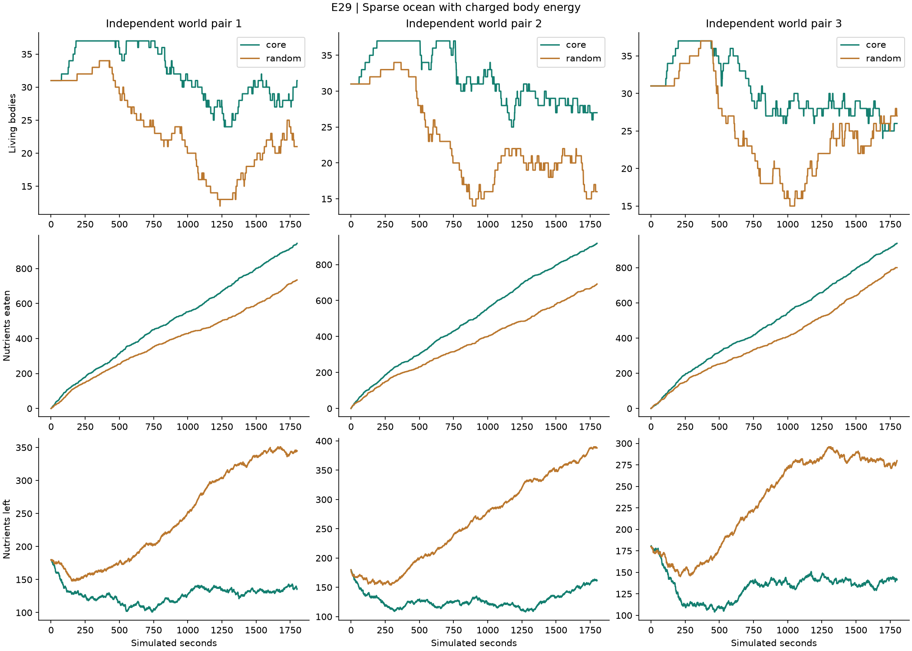
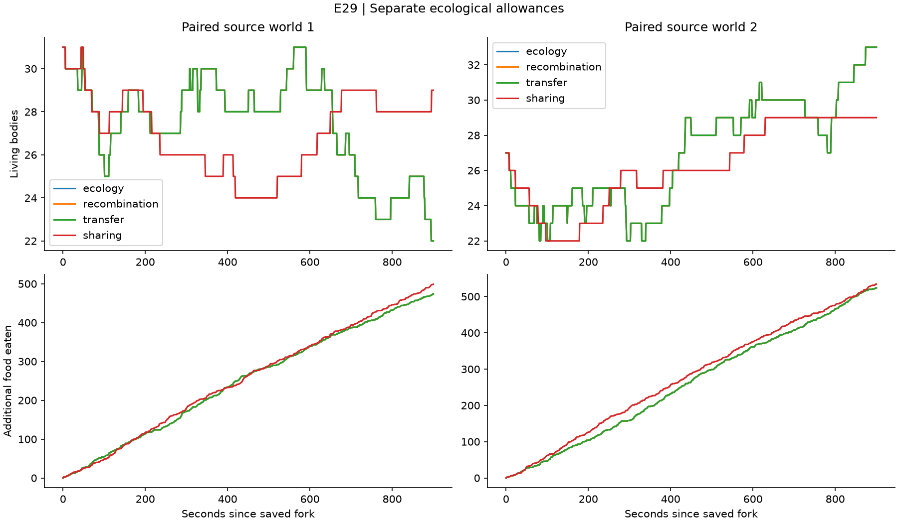

# E29：稀疏海洋中的生存、身体变异与资源交换

2026-10-03 · `continuous-memory/2` · `threemind.ocean/2`

[预登记 / Registration](design.zh.md) · [执行与修订 / Execution and amendments](execution-notes.md)

## 先说结果

三个主世界的意识驱动相对随机驱动，摄食差分别为 **+209 (+28.4%) / +226 (+32.7%) / +138 (+17.2%)**，末态存活数差为 **+10 / +11 / -1**。达到原先登记的进一步确认门限。门限只用于分配后续实验资源，完整指标如下，不能把总摄食量替代单个活体的摄食效率。

**一个很有价值的区别：三组意识驱动的累计存活时间和总摄食都更高，但每个活体每秒摄食反而都略低。**它的优势更像是维持一个更能持续生存的种群，而非每个个体都更快找到食物。其中第三组末态少存活1个，并不抹去此前累计存活时间更长的事实；两项结果都保留。

生态分叉新增 168 个后代、0 次吞食、43,043 次相容接触交换。身体变异和接触交换是环境允许的规则，是否改善生存要看与同源对照的差别；开了开关本身不是主动合作或新物种的证据。

**接触资源交换确实改写了生存与繁殖，但没有表现为所有指标都改善。** 两个来源分别多吃 +25 / +10 颗，末态存活差 +7 / -4 个，出生差 -11 / -21 个，累计活体时间差 -352.30 / -650.24 秒。第一组终点多活下来，不代表整个观察期或第二组也有相同收益。繁殖混合、吞食及吞食来源遗传均没有实际发生，不能将此写成它们发生后无效。

独立第4对再次出现意识驱动优势：摄食952对783（多21.6%）、累计活体时间58292.08对44704.26秒。固定来源的新海域对照中，保留经历摄食247对清除后的257，未取得正向迁移优势；保留既有通信摄食164对静默后的140，但Core多耗9439.11单位，末态存活30对33。通信对本轮行为有实际贡献，也伴随代价；这不能直接定位为某片自主联想区域。全部四个归因对照均完成300秒。

## 一、意识驱动与随机驱动

每个世界31个创始者、37个活体上限，观察1800模拟秒。无默认年龄死亡；观察期到达只暂停保存，个体仍按能量与活动规则生存或死亡。海域1.2米见方，初始180颗营养、上限1024、每2秒补一颗。物理5ms、感官20ms；没有接入实时硬件遥测。

| 组 | 驱动 | 模拟秒 | 摄食颗数 | 颗/活体秒 | 活体秒合计 | 末态存活 | 后代 |
|---|---|---|---|---|---|---|---|
| 1 | core | 1,800 | 944 | 0.01637 | 57,657 | 31 | 62 |
| 1 | random | 1,800 | 735 | 0.01731 | 42,464 | 21 | 41 |
| 2 | core | 1,800 | 918 | 0.01595 | 57,546 | 27 | 56 |
| 2 | random | 1,800 | 692 | 0.01654 | 41,843 | 16 | 42 |
| 3 | core | 1,800 | 938 | 0.01706 | 54,975 | 26 | 57 |
| 3 | random | 1,800 | 800 | 0.01757 | 45,528 | 27 | 55 |

每一配对世界才是独立实验单位。后代和数百万感官帧彼此相关，不能拿它们冒充数百万次独立验证。海中仍有食物而部分个体饿死，表示有限时间内找不到或到达不了食物，不是全世界食物已经用光。

## 二、优势究竟可能来自哪里

| 组 | 驱动 | 推进耗能 | Core耗能 | 总路径米 | 平移动作平方均值 | 速度/食物梯度余弦 |
|---|---|---|---|---|---|---|
| 1 | core | 23,515 | 285,776 | 613.92 | 0.2254 | 0.1129 |
| 1 | random | 33,105 | 226,537 | 381.18 | 0.6639 | 0.0650 |
| 2 | core | 21,166 | 287,748 | 601.87 | 0.1913 | 0.0971 |
| 2 | random | 30,848 | 221,069 | 359.22 | 0.6664 | 0.0624 |
| 3 | core | 24,762 | 283,077 | 645.93 | 0.2512 | 0.0873 |
| 3 | random | 32,975 | 239,434 | 385.39 | 0.6658 | 0.0828 |

动作是运动接口的命令，身体还会根据燃料限制实际推进；命令大不等于实际移动多。梯度余弦只记录相对水流的速度与局部感官梯度的同向程度，不是单独的学习判据。

随机组每1秒抽样并保持动作，意识组每20ms从活动得到动作；幅度、持续性和耗能不同。因此主对照能回答本装置中哪种驱动更利于生存，不能单凭胜负把差别全部归给学会觅食。身体更省能、感官与运动的闭环、节点经历、连接通信都应进一步区分。原地不动或绕圈没有被实验程序判为错误，只有实际获得食物和付出的能量影响生存。

## 三、生态分叉

固定取前两个意识世界的末态，各复制为4个分叉，再观察900秒，不按成绩选取最好来源。下表摄食/出生/事件均为分叉后的新增量，存活是分叉末态值；不把前1800秒的历史再次算作新效果。

| 世界 | 新增秒 | 新增摄食 | 存活 | 出生 | 吞食 | 繁殖混合 | 吞食来源 | 交换 |
|---|---|---|---|---|---|---|---|---|
| fork-0-ecology | 900 | 474 | 22 | 21 | 0 | 0 | 0 | 0 |
| fork-0-recombination | 900 | 474 | 22 | 21 | 0 | 0 | 0 | 0 |
| fork-0-sharing | 900 | 499 | 29 | 10 | 0 | 0 | 0 | 29,808 |
| fork-0-transfer | 900 | 474 | 22 | 21 | 0 | 0 | 0 | 0 |
| fork-1-ecology | 900 | 524 | 33 | 29 | 0 | 0 | 0 | 0 |
| fork-1-recombination | 900 | 524 | 33 | 29 | 0 | 0 | 0 | 0 |
| fork-1-sharing | 900 | 534 | 29 | 8 | 0 | 0 | 0 | 13,235 |
| fork-1-transfer | 900 | 524 | 33 | 29 | 0 | 0 | 0 | 0 |

以下为各可选机制相对同源ecology分叉的差；正负都保留。交换次数按实际转移步骤计，不是独立碰面次数或主动合作次数。

| 源组 | 机制 | 摄食差 | 活体秒差 | 存活数差 |
|---|---|---|---|---|
| 1 | recombination | +0 | +0.0 | +0 |
| 1 | transfer | +0 | +0.0 | +0 |
| 1 | sharing | +25 | -352.3 | +7 |
| 2 | recombination | +0 | +0.0 | +0 |
| 2 | transfer | +0 | +0.0 | +0 |
| 2 | sharing | +10 | -650.2 | -4 |

交换的实际能量流向如下。双向交换的同一对个体只算一对；“其他”只表示不是直接亲子，仍可能有其他亲缘。亲子关系仅由观察工具查谱系，不送入内核或交换规则。

| 世界 | 发生交换的个体对 | 送出能量 | 收到能量 | 亲代→子代收到 | 子代→亲代收到 | 其他收到 |
|---|---|---|---|---|---|---|
| fork-0-sharing | 135 | 46,122.4 | 41,510.2 | 5,099.7 | 3,012.9 | 33,397.6 |
| fork-1-sharing | 130 | 47,292.1 | 42,562.9 | 3,635.7 | 774.0 | 38,153.2 |

身体差异如下，区间覆盖保留的全部个体（包括死者）；末列仅数存活体的表面类型，不把类型标签当物种。

| 世界 | 最高代次 | 半径mm | 外壳 | 反射率 | 存活相容类型数 |
|---|---|---|---|---|---|
| fork-0-ecology | 2 | 7.04–9.33 | 0.144–0.354 | 0.335–0.685 | 3 |
| fork-0-recombination | 2 | 7.04–9.33 | 0.144–0.354 | 0.335–0.685 | 3 |
| fork-0-sharing | 3 | 7.32–9.06 | 0.151–0.263 | 0.492–0.625 | 1 |
| fork-0-transfer | 2 | 7.04–9.33 | 0.144–0.354 | 0.335–0.685 | 3 |
| fork-1-ecology | 2 | 7.41–10.49 | 0.024–0.381 | 0.312–0.790 | 4 |
| fork-1-recombination | 2 | 7.41–10.49 | 0.024–0.381 | 0.312–0.790 | 4 |
| fork-1-sharing | 2 | 7.12–8.00 | 0.200–0.200 | 0.382–0.500 | 2 |
| fork-1-transfer | 2 | 7.41–10.49 | 0.024–0.381 | 0.312–0.790 | 4 |

以下是新增只读诊断，不替换原主判据：实际邻近信号和包裹信号的个体采样帧数。它们不是独立碰面次数；包裹信号也不保证持续足够久或有足够能量吞食。

| 世界 | 非零邻近帧 | 非零包裹帧 | 亲代保护步骤 |
|---|---|---|---|
| fork-0-ecology | 443225 | 7 | 0 |
| fork-0-recombination | 443225 | 7 | 0 |
| fork-0-sharing | 498517 | 0 | 0 |
| fork-0-transfer | 443225 | 7 | 0 |
| fork-1-ecology | 513776 | 19 | 0 |
| fork-1-recombination | 513776 | 19 | 0 |
| fork-1-sharing | 405863 | 0 | 0 |
| fork-1-transfer | 513776 | 19 | 0 |

基础ecology有随机身体变异和吞食；recombination仅另允接触繁殖混合；transfer仅另允吞食后保留身体遗传来源；sharing仅另允相容接触时有损资源交换。融合/交换不开启时不是强行禁止意识形成任何偏好，只是此环境没有相应材料过程。

变异限于半径、推进力、感知范围、外壳、反射率、表面相容性和中性标记。外壳有重量/阻力/建造和维持代价，也增加吞食难度；降低反射率改变局部感官量，不让内核预知敌我。母体不能吞食不足60秒的自己的子体，这是明确的环境保护规则，不是已涌现的亲情。体型或标签不同还不能称新物种，稳定遗传与跨环境保持仍需后续验证。

可选机制共用身体变异随机流，连失败的概率抽取也可能改变后续抽样；营养混合随机流还随剩余颗粒数变化。因此分叉保证同源初态及逐步可重放，不保证未来随机事件逐一相同。零成功融合的分叉差别不能解释成成功融合的作用。

## 四、发现并处理的供能配置问题

旧主配置给新生体Core180r、身体60r，但消化优先把Core补回240r，可能立即用完身体的推进燃料。原始记录在77秒出生、77.02秒补能的个体上确认了此事。六个主组保留该配置，不能悄悄重算成更有利版本。

八个生态分组启动前统一改成新生Core240r＋身体60r，由亲代额外支付60r；没有凭空送能、补发给旧个体或复活死者。该修订使生态分组的对照仍共有相同出生条件，但主阶段与生态阶段的差别不能只归因于捕食和变异。r=5.706242779562836来自独立工程样例的每体每秒Core支出，不是生物常数。

## 五、完整性、资源与可重现性

正式主/生态世界 14 个，包含复制的存活身体和出生共 899 次；未完成/未执行：none。模拟进程耗时合计 9.58 小时，不能把并行时间当免费资源。

恢复检查覆盖 230 份保存状态，能量账本最大绝对残差 7.7e-06。下列完整区间重放同时匹配输入、动作、事件及结束状态；不是所有正式世界从头全程重放。

| 分段 | 起点秒 | 终点秒 | 步数 |
|---|---|---|---|
| cases\phase1-0-core | 0 | 120 | 6000 |
| cases\phase1-0-random | 0 | 120 | 6000 |
| cases\phase1-0-core\continuations\01 | 749 | 869 | 6000 |
| cases\phase1-1-core\continuations\01 | 450 | 570 | 6000 |
| cases\fork-0-ecology | 1,800 | 1,920 | 6000 |
| cases\fork-0-sharing | 1,800 | 1,920 | 6000 |
| cases\control-0-silence | 1,800 | 1,920 | 6000 |

网络中断时三个世界因数据库连接关闭而安全暂停，核验后从原状态继续。另一次749秒暂停用于独立世界并行编排。所有旧错误、状态、随机流、检查点和接续边界保留，墙钟暂停不推进模型时间。JSON整数键/字符串键的校验错误只在验证器修正，没有更改模型。

独立确认又在473/524秒因操作者未及时刷新账户用量检查而保护暂停，完整核验后原样续跑。同期用户报告Docker崩溃，检查时Docker引擎已响应、本地PostgreSQL仍自9月28日起运行；这次保护暂停不能归因于Docker，也没有为此重启服务。

最终正式核验累计耗时 63.7 分钟，包含已停止的首个核验尝试。每个保存状态和选定重放区间有与源文件摘要绑定的核验收据；重试不抹去失败记录或退还已耗资源。总预算为模拟与正式核验合计14进程小时，完整实耗另见交付收据。

装置与Core源码摘要固定；13项Ocean /2测试、2项只读统计测试、2项副本干预测试，以及15项旧海洋/生存回归通过。工程样例全1500步重放，Python/Rust状态按既定容差核对。离线回放器验过1440/390像素；完整群体实时启动UI仍在T08，不能用离线播放器冒充已实现。

## 六、下一步如何选择

先依据完整比较判断驱动优势能否跨种子保持，再用已登记的独立确认与经历/连接对照找原因。若有作用，再定位具体连接和活动片段，做匹配的移除、假干预、解除与移植。不能先挑一个看起来有趣的区域，再把普通身体/运动差异改称自主联想证据。

稳定生态型、主动合作、感官或器官由更基本材料规则自发出现仍未被本实验完成。当前有限身体参数可以检验代价与选择，不等同于早期地球，也不因为跑得久就保证产生智能。对这些问题的设想继续留在研究计划，而不是悄悄删掉。

## 补充：独立确认与因果对照

| 世界 | 状态 | 模拟秒 | 摄食 | 颗/活体秒 | 活体秒 | 存活 | Core耗能 | 身体耗能 |
|---|---|---|---|---|---|---|---|---|
| confirm-3-core | horizon_paused | 1800.0 | 952 | 0.01633 | 58292.1 | 35 | 287900.0 | 32905.9 |
| confirm-3-random | horizon_paused | 1800.0 | 783 | 0.01752 | 44704.3 | 20 | 235312.0 | 45282.4 |
| control-0-inherited | horizon_paused | 300.0 | 247 | 0.02373 | 10409.0 | 37 | 59332.2 | 11450.6 |
| control-0-naive | horizon_paused | 300.0 | 257 | 0.02408 | 10671.0 | 37 | 57550.9 | 11337.7 |
| control-0-sham | horizon_paused | 300.0 | 164 | 0.01833 | 8948.0 | 30 | 44349.9 | 5971.3 |
| control-0-silence | horizon_paused | 300.0 | 140 | 0.01584 | 8837.4 | 33 | 34910.8 | 5303.8 |

- 独立确认：意识减随机：摄食+169颗；累计活体时间+13587.8秒；存活数+15；Core耗能+52588.0；身体耗能-12376.6。
- 经历保留减清除：摄食-10颗；累计活体时间-262.0秒；存活数+0；Core耗能+1781.3；身体耗能+112.9。
- 连接通信保留减静默：摄食+24颗；累计活体时间+110.6秒；存活数-3；Core耗能+9439.1；身体耗能+667.5。

这些对照使用一个固定来源世界，不能把后代数量当独立复制。静默保留既有活动和在途信号，未来新边与后代仍可通信；新环境经历对照同时重置两边的活动、时钟和初始能量。后续耗能差也是干预的后果，必须与运动及存活一起解释，不能仅从节省能量后的生存改善认定学会了更好的觅食。

| 世界 | 起始活体 | 原个体摄食 | 原个体存活 | 新出生 | 后代摄食 | 后代存活 |
|---|---|---|---|---|---|---|
| control-0-inherited | 31 | 239 | 31 | 6 | 8 | 6 |
| control-0-naive | 31 | 257 | 31 | 6 | 0 | 6 |
| control-0-sham | 31 | 149 | 17 | 13 | 15 | 13 |
| control-0-silence | 31 | 140 | 21 | 12 | 0 | 12 |

静默开始时覆盖10625条连接；结束时原存活来源仍有6841条连接被静默，另有239条未被静默。原个体存活21个，新增后代存活12个；后代按正常出生规则清空研究用屏蔽。

### 2026-10-03：本轮结果的解释

新海域中的旧经历没有带来整体正向迁移：两边原个体都31个存活、都生出6个后代；保留经历组后代在观察期内的累计存活时间少262秒，总摄食少10颗。后代摄食8对0值得保留，但出生时刻、位置和后续刺激已经不同，不能单凭8对0称遗传能力已增强。此次清除同时去掉持久连接与节点历史，不单独归因于某一种记忆变量。

既有通信保留时多吃24颗（相对静默多17.1%），单位活体时间摄食也较高；同时Core多耗9439.11单位、身体多耗667.48单位，终点少活3个。原个体与后代都列在上表。因而通信对这个来源群体的觅食过程确有影响，但收益和代价共同决定存活，不能把摄食收益与终点存活互相代替。两组未来接收的刺激随运动分开，是闭环干预的后果。

这一对照包含感官传导与内部再入，没有定位某一片自主联想活动。局部活动的选择性移除、解除和移植未在本轮执行；优先下一轮先匹配随机动作的幅度／持续性，再定位能提高摄食的连接和相应耗能。上述均为后续建议，不是已启动实验，也不据此修改Core或普通默认参数。

