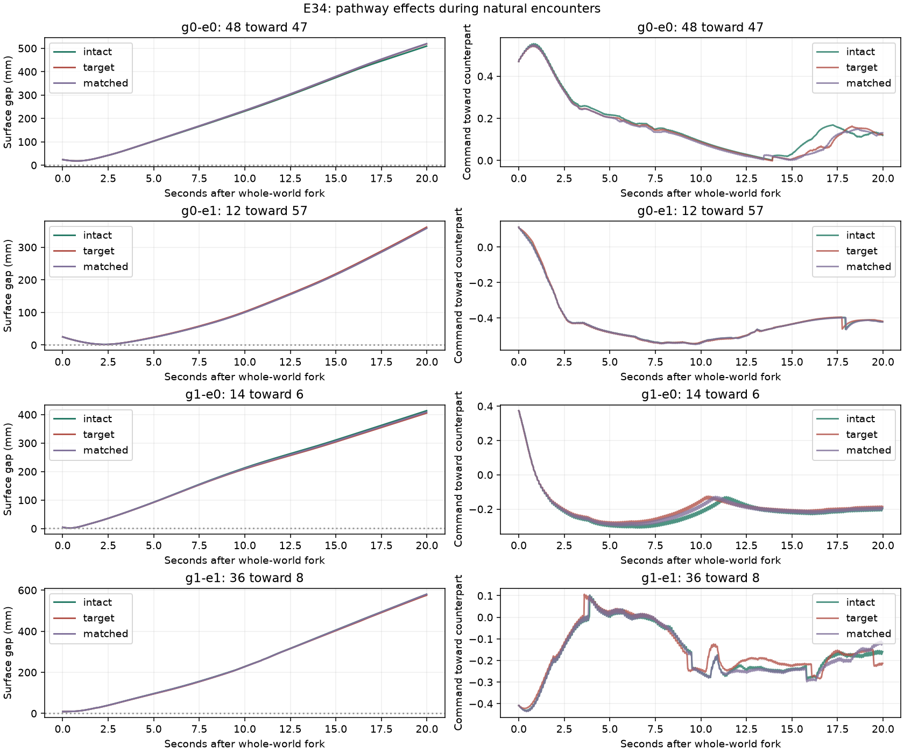
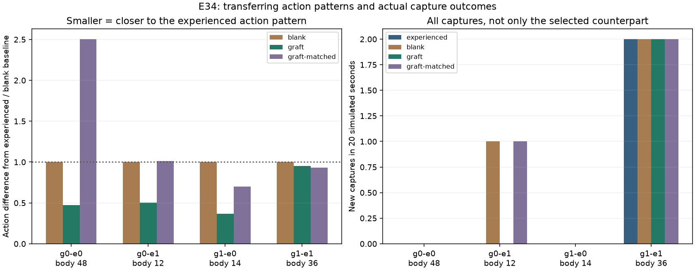

# E34: internal activity changes action; persistent connections change a capture outcome

> **Revision r2 · 2026-10-10**
> Revision reason: Verified original-file relocation; append location-resolution guidance and preserve the experiment conclusions.
> Original: [report.en.md](report.en.md); parent r1: [report.en.md](report.en.md)

[中文](report.zh.md) · [Preregistration](design.en.md) · [All measured tables](measured-tables.md) · [Execution corrections](execution-notes.md) · [Commands](README.md)

Completed 2026-10-04: two complete oceans, four prospectively selected encounters, eight 20-second arms each. All 32 forks completed. The directory retains the drafting date.

## Findings

Connections were not behaviorally inert records. Silencing pathways associated with activity lacking recent direct input reduced that activity in all four sources and changed action. Target grafts made actions closer to the experienced donor than both blank and matched grafts in **3/4 sources**. Transferring a pattern is distinct from improving survival or capture.

**One persistent-state intervention changed whether a capture actually occurred.** Body 12's blank copy captured body 57 at 3.08 seconds; its matched graft did so at 3.04 seconds. The experienced copy and target graft did not contact or capture body 57. Target grafting reduced action distance from the experienced copy by about 49.4% relative to blank and restored its no-capture outcome. The direction reduces capture; it is not evidence of better hunting or a moral choice. All neighbors, food and water remained present.

**A separate capture advantage was not localized to the selected pathways.** Body 36 captured bodies 9 and 40 when intact, but none under random control. Target silencing reduced selected uncued activity by about 97.1%, yet both captures still happened with changed timing. Matched silencing also retained both captures. These 128 connections affected the process but were not necessary for those captures under these conditions.

This strengthens causal evidence that internal activity and persistent experience affect behavior in a complete habitat. It **does not yet fully attribute E32's population-level capture advantage to the selected association pathways**, nor establish that every capture is active pursuit. Neither the group advantage nor the local causal effects are withdrawn; their quantitative connection remains incomplete.

## Activity and action

Regions were chosen from preceding activity without looking at later capture success. Up to 128 inbound edges per source were silenced; matched controls had the same count and similar weight/stability. Activity reduction uses shared samples during seconds 1–10 whose corresponding channels received no direct input in the preceding second in either branch. Other sensory inputs continue. Action distance is mean absolute component difference over common living periods during 20 seconds. These two scales must not be conflated.

| Source | Target activity reduction | Matched reduction | Target action distance | Matched action distance | Captures: intact/target/matched/random |
| --- | ---: | ---: | ---: | ---: | --- |
| g0-e0, body 48 | 99.89% | 1.86% | 0.017757 | 0.018300 | 0 / 0 / 0 / 0 |
| g0-e1, body 12 | 15.90% | 0.42% | 0.004206 | 0.001551 | 0 / 0 / 0 / 0 |
| g1-e0, body 14 | 78.65% | 0.37% | 0.013396 | 0.008241 | 0 / 0 / 0 / 0 |
| g1-e1, body 36 | 97.06% | 1.17% | 0.024504 | 0.021344 | 2 / 2 / 2 / 0 |

Direction is relative to the prospectively selected counterpart, not a retrospectively convenient victim. Sources 48→47, 14→6 and 36→8 never contacted that designated body. Body 36 captured two others. Moving away is not classified as abnormal or wrong.

## Persistent experience and grafting

The four birth-style arms uniformly reset immediate activity and queues while preserving physical age, position, velocity and current finite reserves. Experienced copies inherit persistent state; blank copies preserve the receptor framework; grafts transfer the selected persistent connections and their specified associated local state. Learning then continues. These are persistent-state tests, not transfers of live activation.

| Source | Experienced vs blank | vs target graft | vs matched graft | Reduction relative to blank | Captures: experienced/blank/target graft/matched graft |
| --- | ---: | ---: | ---: | ---: | --- |
| g0-e0, body 48 | 0.011810 | 0.005580 | 0.029571 | 52.7% | 0 / 0 / 0 / 0 |
| g0-e1, body 12 | 0.030611 | 0.015478 | 0.030955 | 49.4% | 0 / 1 / 0 / 1 |
| g1-e0, body 14 | 0.062173 | 0.022902 | 0.043492 | 63.2% | 0 / 0 / 0 / 0 |
| g1-e1, body 36 | 0.053969 | 0.051304 | 0.050408 | 4.9% | 2 / 2 / 2 / 2 |

Body 12 demonstrates an effect beyond numerical similarity: persistent state can alter a physical encounter and its outcome. Experience or donor resemblance must not automatically be interpreted as better performance. Sources 48 and 14 showed measurable pattern transfer without a designated capture.

## Every focal capture

| Source | Arm | Hunter → victim | Seconds after fork | Method |
| --- | --- | --- | ---: | --- |
| g0-e1 | blank | 12 → 57 | 3.080 | contact |
| g0-e1 | graft-matched | 12 → 57 | 3.040 | contact |
| g1-e1 | intact | 36 → 9 | 10.540 | contact |
| g1-e1 | intact | 36 → 40 | 16.320 | contact |
| g1-e1 | target | 36 → 9 | 10.300 | contact |
| g1-e1 | target | 36 → 40 | 16.600 | contact |
| g1-e1 | matched | 36 → 9 | 10.540 | contact |
| g1-e1 | matched | 36 → 40 | 16.300 | contact |
| g1-e1 | experienced | 36 → 9 | 10.480 | contact |
| g1-e1 | experienced | 36 → 40 | 16.380 | contact |
| g1-e1 | blank | 36 → 9 | 9.820 | contact |
| g1-e1 | blank | 36 → 61 | 19.080 | contact |
| g1-e1 | graft | 36 → 9 | 9.980 | contact |
| g1-e1 | graft | 36 → 61 | 18.920 | contact |
| g1-e1 | graft-matched | 36 → 9 | 9.860 | contact |
| g1-e1 | graft-matched | 36 → 61 | 19.300 | contact |

These are recorded physical events, not captures inferred by a readout. Shell and contact-duration rules remained operative. Immature parent–child protection was bilateral as approved.

## Scope and next questions

Selection starts after E32's 60-second snapshots. Its [capture-composition addendum](../2026-10-03-ocean-community/capture-composition-addendum.md) shows g0's advantage concentrated earlier, whereas g1 differed in both periods. Late local negative ablations cannot rule out early pathways or other organisms; body 12's changed outcome cannot explain all population benefit either.

Every fork retains the source world, random nutrient replenishment, other brains, physical sensing and mutation. Only registered focal interventions and the explicit future protection rule differ; Core equations are unchanged. Two world seeds do not become 32 independent ecological replicates. Unselected pathways can remain active after a 128-edge intervention.

Approved E35 examines whole copied populations and operating costs; E36 examines shared-ocean competition. A focused future capture-attribution study should save complete worlds before early actual contact and analyze pathways associated with the subsequently captured body, separating discovery from evaluation and retaining failed encounters. This is a recommendation, not a post hoc extension of this batch.

## Media and evidence

Footage includes body 12's four persistent-state arms and body 36's intact/target/matched captures. Each preserves the full habitat with a supplementary inset: 20 simulated seconds at real replay speed, recorded every 100 ms without invented intermediate activity. Illustration selection adds no statistical samples.

Total 46.40 simulation-process minutes, one worker. Complete states, inputs, trajectories and events remain in `.work/ocean-hunting-20261003`. Local project `315c50a4-0a3a-4b07-b760-0fc053730a39` holds designs, reports and clips; the full raw archive remains local. See the separate delivery receipt.

> **Storage-location revision · 2026-10-10**
> This edition adds the verified move of the selected originals to `E:\ThreeMindData`. Stable scientific identities and hashes, experiment dates, measurements and conclusions remain unchanged. Paths in the preserved body describe historical sources; use the registered evidence resolver for current locations. Repository documents and frozen fixtures remain in place, and source copies are retained. Structured query data and running checkpoints remain in the database. This annotation does not assert that missing historical evidence was recovered.
