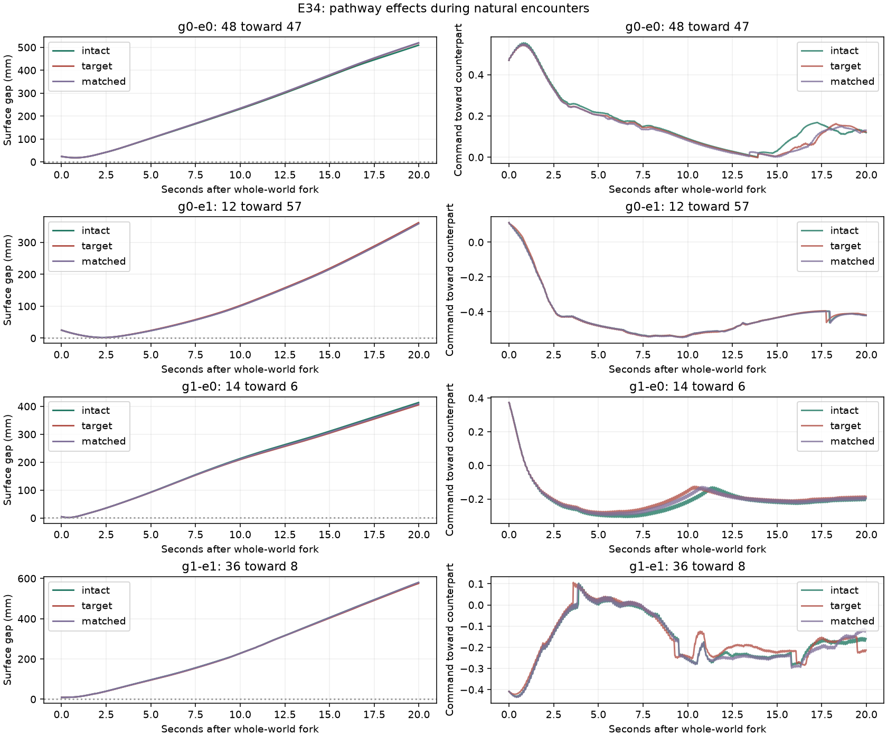
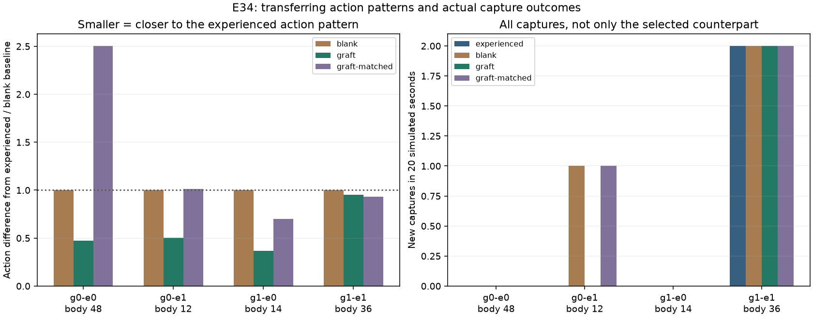

# E34：内部活动改变了动作；持久连接也改变了实际捕获结果

> **修订 r2 · 2026-10-10**
> 修订原因：原件存储位置已迁移并核验，追加当前位置解析说明，保留原实验结论。
> 原版：[report.zh.md](report.zh.md)；父版本 r1：[report.zh.md](report.zh.md)

[English](report.en.md) · [事前设计](design.zh.md) · [完整实测表](measured-tables.md) · [执行更正](execution-notes.md) · [命令](README.md)

2026-10-04完成。2个完整海洋、4个事前规则选中的遭遇来源，各8个20秒对照；32项分叉全部完成。目录日期是起草日，不是完成日。

## 先说清楚这次发现了什么

**连接不是一份对行为无用的记录。**屏蔽与未直接提示活动有关的连接，四个来源中的相关活动都下降，动作随后改变。把这些连接移植到同受体空白副本后，3/4个来源的动作比空白和匹配移植都更接近经历者。这里转移的是可测的动作模式，不能仅凭“更像原个体”就称为生存收益。

**其中一次，连接改变了“是否真的捕获到对方”。**12号的空白副本在分叉后3.08秒捕获57号，匹配连接移植在3.04秒捕获；保留经历和目标连接移植均未接触、更未捕获57号。目标移植让动作差距相对空白缩小约49.4%，同时恢复了经历者的“不发生这次捕获”结果。这个方向是减少捕获，不能改口说成增强捕食，也不推断它具有善恶意图。其他个体、营养和水域始终存在。

**也有明确的未归因结果。**36号原样捕获了9号和40号；随机控制没有捕获。目标通路静默使所选区域无直接提示的活动下降约97.1%，仍捕获这两只，只是时刻改变；匹配静默也仍捕获。由此不能把这两次捕获的必要原因归给这128条连接。它们影响了过程，但该局部通路不是当前条件下完成捕获的必要条件。

所以，本轮已经加强“内部活动与经历能因果地改变完整生态里的行为”的证据；**尚未把E32整组捕获优势充分归因于所选联想通路，更没有证明全部捕获都是主动追猎。**这不撤销已经测到的整体优势和局部因果作用，两者现在还缺一段定量连接。

## 内部活动与动作

目标区域在干预前按最近活动选择，不看之后的捕获结果。每源最多128条入向连接，匹配组使用同数量、权重/稳定度相近的其他连接。静默改变传导，不改身体或移除其他生物。

下面的活动下降只比较分叉后1–10秒、两分支对应通道此前1秒均无直接输入的共同样本；因此不是把所有感官都关闭。动作差距为20秒共同存活期间各动作分量绝对差的平均值。四个来源均保留足够共同存活观察。活动下降与动作差距是不同量，不能把前者很大写成行为差距同样巨大。

| 来源 | 目标静默：活动下降 | 匹配静默：活动下降 | 目标：动作差距 | 匹配：动作差距 | 新捕获：原样/目标/匹配/随机 |
| --- | ---: | ---: | ---: | ---: | --- |
| g0-e0, body 48 | 99.89% | 1.86% | 0.017757 | 0.018300 | 0 / 0 / 0 / 0 |
| g0-e1, body 12 | 15.90% | 0.42% | 0.004206 | 0.001551 | 0 / 0 / 0 / 0 |
| g1-e0, body 14 | 78.65% | 0.37% | 0.013396 | 0.008241 | 0 / 0 / 0 / 0 |
| g1-e1, body 36 | 97.06% | 1.17% | 0.024504 | 0.021344 | 2 / 2 / 2 / 0 |

图中的方向针对事前选中的邻近个体，不是追踪后来“最有利”的对象。48→47、14→6以及36→8均没有接触该指定对象。36号后来捕获的是另外两只，不能把“对8号没有靠近”写成“没有捕获活动”。负方向表示当前动作背离该对象，不自动定义为异常或错误。

## 经历及连接移植

四项出生式对照统一清除即时激活和排队事件，保留相同身体位置、速度、年龄及当前有限储备。经历者继承持久状态，空白副本保留同一受体框架，移植组分别转入目标或匹配持久连接及其规定的相关局部状态。分叉后继续正常学习。它们比较持久经历，不等于活跃状态的直接移植。

| 来源 | 经历者与空白动作差距 | 经历者与目标移植 | 经历者与匹配移植 | 目标移植相对空白缩小 | 新捕获：经历/空白/目标移植/匹配移植 |
| --- | ---: | ---: | ---: | ---: | --- |
| g0-e0, body 48 | 0.011810 | 0.005580 | 0.029571 | 52.7% | 0 / 0 / 0 / 0 |
| g0-e1, body 12 | 0.030611 | 0.015478 | 0.030955 | 49.4% | 0 / 1 / 0 / 1 |
| g1-e0, body 14 | 0.062173 | 0.022902 | 0.043492 | 63.2% | 0 / 0 / 0 / 0 |
| g1-e1, body 36 | 0.053969 | 0.051304 | 0.050408 | 4.9% | 2 / 2 / 2 / 2 |

12号说明：持久经历的影响不只停留在数值上，可以经动作和接触链条改变真实事件。它也提醒我们，不能把“有经历”“更像供体”预设成“吃得更多”。48号和14号未发生指定捕获，但目标移植的动作接近仍是正面可测现象。

## 每次焦点捕获发生在何时

| 来源 | 操作 | 捕获者 → 被捕者 | 分叉后秒 | 方式 |
| --- | --- | --- | ---: | --- |
| g0-e1 | blank | 12 → 57 | 3.080 | contact |
| g0-e1 | graft-matched | 12 → 57 | 3.040 | contact |
| g1-e1 | intact | 36 → 9 | 10.540 | contact |
| g1-e1 | intact | 36 → 40 | 16.320 | contact |
| g1-e1 | target | 36 → 9 | 10.300 | contact |
| g1-e1 | target | 36 → 40 | 16.600 | contact |
| g1-e1 | matched | 36 → 9 | 10.540 | contact |
| g1-e1 | matched | 36 → 40 | 16.300 | contact |
| g1-e1 | experienced | 36 → 9 | 10.480 | contact |
| g1-e1 | experienced | 36 → 40 | 16.380 | contact |
| g1-e1 | blank | 36 → 9 | 9.820 | contact |
| g1-e1 | blank | 36 → 61 | 19.080 | contact |
| g1-e1 | graft | 36 → 9 | 9.980 | contact |
| g1-e1 | graft | 36 → 61 | 18.920 | contact |
| g1-e1 | graft-matched | 36 → 9 | 9.860 | contact |
| g1-e1 | graft-matched | 36 → 61 | 19.300 | contact |

这些是原始事件记录中的捕获，不由读出器根据运动轨迹猜测。外壳及接触保持条件继续生效；亲子成熟前使用已批准的双向保护。

## 能回答什么，还不能回答什么

本项从E32第60秒开始选样，不覆盖早期全部捕获。E32补充核查表明，g0的捕获优势集中在前60秒；g1前后均有差异。[捕获构成补充](../2026-10-03-ocean-community/capture-composition-addendum.md)因此不能用本轮晚期局部阴性消融，否定早期其他连接、其他个体的作用；同样不能用12号的一次变化声称已经解释全部优势。

各分支保留相同来源的整个世界、随机营养刷新、其他意识、物理反馈和变异。只有注册干预及未来双向亲子规则不同，Core公式不变。两环境种子不是32个独立生态重复。目标区域最大128条，未覆盖的联想通路仍可参与行为。

接下来已批准的E35比较同一整组副本的控制能力和停用内核成本，E36比较两组在同一海洋中的竞争。若再追究捕食优势的神经来源，最有针对性的待办是在早期真实接触前保存完整世界，定位**实际后来捕获的对象**相关过程；选样与评价仍须分开，不删掉未捕获来源。这是下一轮建议，本轮不临时加样追逐阳性。

## 影片、资源与留存

影片包含12号的四种经历/移植对照，以及36号原样/两种静默的实际捕获。每段均为完整海洋加辅助近景，20模拟秒、1倍速；100毫秒真实记录，不补造活动。影片按说明价值挑选，所有来源和阴性结果仍列在上表，不增加样本。

本批合计46.40模拟进程分钟，单worker。完整状态、输入、过程及事件独立保存于`.work/ocean-hunting-20261003`；本机研究项目`315c50a4-0a3a-4b07-b760-0fc053730a39`保存设计、报告和影片。原始大包只留本地。档案收据另列，不反复重算旧证据。

> **存储位置修订 · 2026-10-10**
> 本版追加已核验的原件迁移说明：本次清单中的原件迁至 `E:\ThreeMindData`，科学身份、哈希、原实验日期、测量与结论不变。保留正文中的路径表示历史来源，当前位置通过已登记的证据引用解析。仓库文档与冻结夹具留在原处，源副本保留；结构化查询数据及运行中的检查点仍存数据库。本说明不表示缺失的历史资料已恢复。
