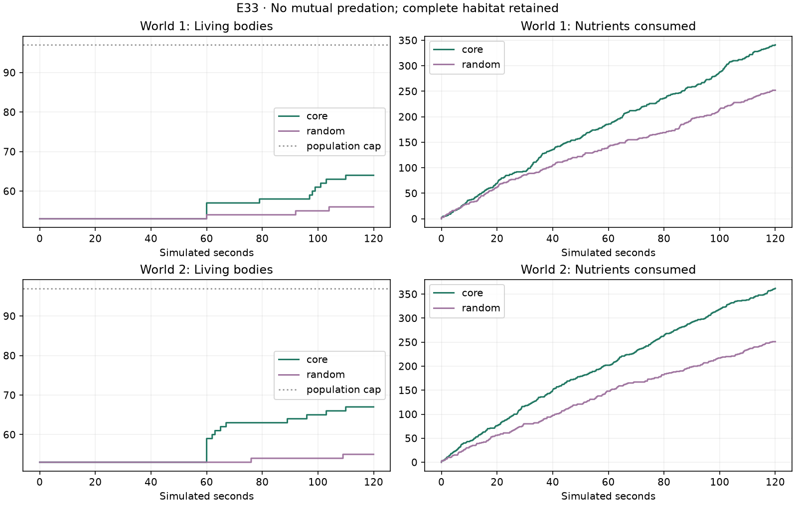

# E33: feeding and population growth without mutual predation

[中文](report.zh.md) · [Registration](design.en.md) · [Execution](execution-notes.md) · [Commands](README.md)

Registered2026-10-03; completed2026-10-04. All four120-simulated-second worlds finished. There are two independent environment seeds, not four independent ecological replicates.

## Direct answer

**Core-controlled feeding is higher in both paired worlds: +35.3% and +44.2% relative to random control.** Final living-population differences are +8 and +12. The complete habitats retain other bodies, random nutrient renewal, water, temperature, collisions, proprioception, mutation, reproduction and finite energy.

| World | Control | Nutrients | Births | Final alive | Living-body seconds | Nutrients/body-second | First population97 |
| --- | --- | ---: | ---: | ---: | ---: | ---: | --- |
| 1 | core | 341 | 11 | 64 | 6753.22 | 0.05049 | >120 s |
| 1 | random | 252 | 3 | 56 | 6464.06 | 0.03898 | >120 s |
| 2 | core | 362 | 14 | 67 | 7025.28 | 0.05153 | >120 s |
| 2 | random | 251 | 2 | 55 | 6415.04 | 0.03913 | >120 s |

“>120 s” is right-censoring, not an observed cap time. Body-failure counts are `{"g0-core": {}, "g0-random": {}, "g1-core": {}, "g1-random": {}}`. In the absence of deaths, population differences reflect births, not demonstrated longevity. The120s horizon pauses and saves organisms rather than killing them.

## What changed in the interpretation

With predation in E32, Core populations ate213/270 nutrients versus197/180, but finished with28/29 living bodies versus32/30. They also captured34/43 bodies versus28/26. The no-predation results above show why fewer survivors alone cannot invalidate Core control: predation changes the population comparison.

Removing predation also lets potential prey keep feeding and reproducing. Subtracting the two experiments' totals does not isolate one neural mechanism or prove every earlier population loss resulted from superior hunting. E34 independently tests local pathways around prospective capture encounters.

## Exact comparison

The two E32 seeds,53 initial bodies,1.2m square,360 initial nutrients,one new nutrient per second,4096 nutrient capacity,97 population cap and other parameters are retained. Only the existing`predation`flag is disabled in new worlds. Initial bodies/positions/sensory mappings use paired seeds; subsequent behavior-induced environmental divergence remains natural.

The flag disables the capture/consumption chain, including capture-dependent persistent adhesion and its cost. Geometric collisions and feedback remain. This boundary was declared before simulation; it is not a final-swallow-only intervention.

Random control uses the original independent command updated every simulated second. Its Core still receives its own actual sensory input and consumes energy, while its output does not drive the body. **It is a random-controller comparison, not a fully stopped-Core comparison.** The user's newer request for whole-population copies with both versions is recorded separately. Normal Core action cadence/amplitude remain unrestricted at20ms.

No Core equations,forgetting,inhibition,energy depletion/recovery or sensory mappings changed. No good-food label was injected. The group advantage is not fully attributed to experience or association by this result; E32 contributes a specific complete-habitat feeding example, and E34 examines capture mechanisms.

## Resources and delivery

The four cases used49.97simulation-process minutes with one worker. States,inputs,events and100ms ecological trajectories are retained. Bilingual reports,figures and descriptions are published only to the verified local ThreeMind project; the full evidence archive stays local. No old-data scan or repeated full hashing was performed.

Project:`0d64c773-bdab-4de5-a4a5-fcbc48964403`. See[commands](README.md) and the delivery receipt for archive/report identifiers. This experiment does not introduce a new consciousness criterion or revoke the existing`autonomy-criteria/1`result.
