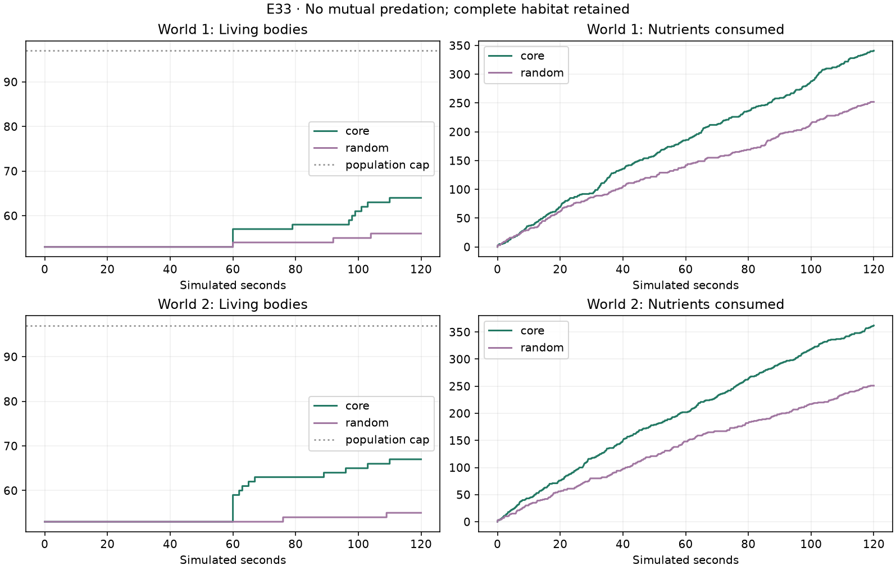

# E33：拿掉相互吞食，意识组的摄食与种群表现怎样？

> **修订 r2 · 2026-10-10**
> 修订原因：原件存储位置已迁移并核验，追加当前位置解析说明，保留原实验结论。
> 原版：[report.zh.md](report.zh.md)；父版本 r1：[report.zh.md](report.zh.md)

[English](report.en.md) · [登记方案](design.zh.md) · [执行记录](execution-notes.md) · [操作](README.md)

登记于2026-10-03，完成于2026-10-04。四个120模拟秒世界全部完成，来源是两个独立环境种子；四个分支不是四个独立环境重复。

## 直接答案

**禁止相互吞食后，意识组摄食两对均更高：两对分别比随机组+35.3%、+44.2%。**末存活差为+8和+12。本实验保留全部身体、随机营养刷新、水流、温度、碰撞、本体感官、变异、繁殖及有限供能，不是单个体小装置。

| 世界 | 驱动 | 营养摄入 | 新生个体 | 末存活 | 累计活体秒 | 营养/活体秒 | 首次到达97个体 |
| --- | --- | ---: | ---: | ---: | ---: | ---: | --- |
| 1 | core | 341 | 11 | 64 | 6753.22 | 0.05049 | >120 s |
| 1 | random | 252 | 3 | 56 | 6464.06 | 0.03898 | >120 s |
| 2 | core | 362 | 14 | 67 | 7025.28 | 0.05153 | >120 s |
| 2 | random | 251 | 2 | 55 | 6415.04 | 0.03913 | >120 s |

“>120 s”表示观察结束尚未到达上限，不能说谁更早达到。死亡原因原始汇总为`{"g0-core": {}, "g0-random": {}, "g1-core": {}, "g1-random": {}}`；没有死亡时，末存活差来自繁殖，不能改称已经证明更长寿。观察到120秒只是保存并暂停，不把期限设为个体死亡年龄。

## 这回答了此前哪个疑点

E32允许吞食时，意识组摄食213/270颗，随机组197/180颗；但末存活是28/29对32/30，意识组反而少4/1个。同时意识组捕获34/43个，随机组28/26个。现在关闭相互吞食，食量与种群差发生上述变化。**因此，仅凭E32末存活较少来否定意识控制，是不成立的；捕食环境确实改变了人口统计的解释。**

这不是说已经把E32每一例减少都逐一证明为“更擅长捕猎”。禁止吞食也让原本会成为猎物的个体继续摄食和繁殖，后续生态会分岔；不能把两轮总量相减当成单一神经机制的精确效应。捕获行为的局部原因交由另行登记的E34分析。

## 对照究竟改变了什么

复用E32的两个种子、同样的53个初始身体、1.2米边长、360颗初始营养、每秒补1颗、容量4096、种群上限97，以及全部原参数；只在新世界显式关闭原有`predation`。初始随机位置、身体参数和感官映射按相同种子生成，后续各组行为引起的世界变化自然保留。

该开关关闭吞食/捕获链，包括依赖捕获状态的持续黏附和相关消耗；几何碰撞及反馈仍存在。不能把它说成仅取消最后一下吞咽而其余钳制都完全不变。设计阶段已登记此边界。

随机组用原有每1模拟秒更新的独立随机动作；其内核仍接收自身实际感官输入并耗能，但输出不控制身体。**这是随机控制对照，不是已经停用整个内核的对照。**两者的区别已按用户最新要求列入下一阶段整组分叉计划。正常意识的20毫秒控制输出没有被限频、限幅或改造成随机组的节律。

本轮不改变Core动力学，不关闭遗忘、抑制、能量耗竭恢复，不注入“食物是好事”的标签。也不把整组优势直接归因于经历或联想；E32的完整环境局部静默已提供一例具体摄食贡献，E34继续定位捕获过程。

## 资源和交付

四项模拟合计49.97进程分钟，单worker。设计、状态、输入、事件和100毫秒生态轨迹保留；只把双语报告、图表与说明写入本机ThreeMind项目，完整证据包留本地，不扫描旧大数据、不反复重算哈希。图中每点来自实际模拟记录。

独立项目：`0d64c773-bdab-4de5-a4a5-fcbc48964403`。命令和证据目录见[README](README.md)，归档大小及报告编号见交付记录。本轮不增加一条新的意识判据，也不撤销已有`autonomy-criteria/1`结论。

> **存储位置修订 · 2026-10-10**
> 本版追加已核验的原件迁移说明：本次清单中的原件迁至 `E:\ThreeMindData`，科学身份、哈希、原实验日期、测量与结论不变。保留正文中的路径表示历史来源，当前位置通过已登记的证据引用解析。仓库文档与冻结夹具留在原处，源副本保留；结构化查询数据及运行中的检查点仍存数据库。本说明不表示缺失的历史资料已恢复。
