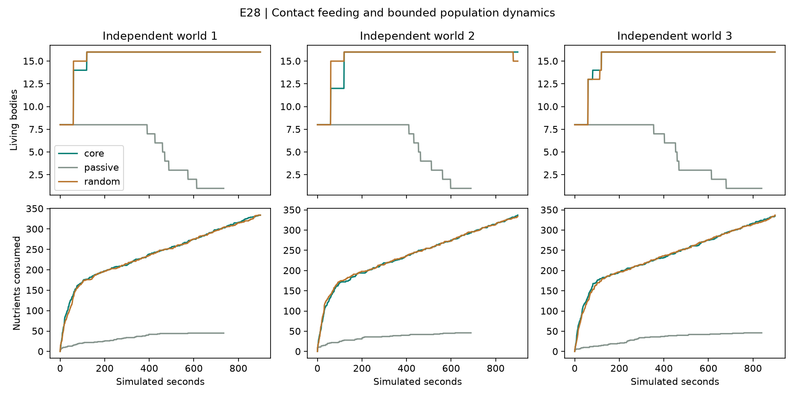
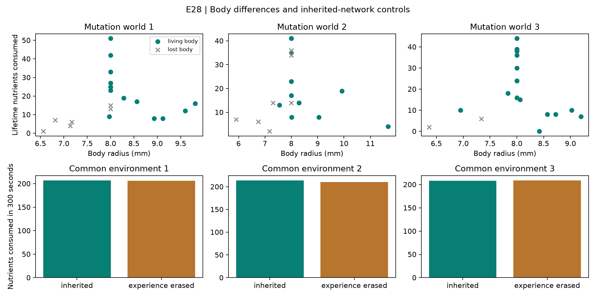
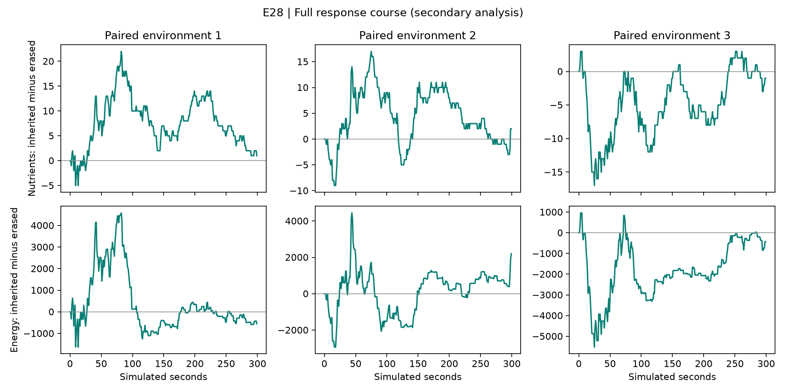

# E28: contact feeding supports survival and reproduction; learning needs its own comparison

2026-10-03. Project `e53a833e-6566-463c-90c2-a94a8fe2a8ef`. Core and previous evidence remain unchanged.

## Findings

Core-driven worlds contained 48 individuals including 24 offspring; 48 remained alive and 0 died, with 1006 particles consumed. Passive controls had 0 survivors, 0 offspring and 137 particles. Random-action controls had 47 survivors, 24 offspring and 1005 particles.

**The action–nutrient-contact–Core-feeding–survival/reproduction loop now operates.** The easier starting environment removes E27's failure to obtain a first meal. **The common-garden comparisons do not show inherited benefit in both intake and energy across all three pairs. Movement, feeding and reproduction alone therefore do not establish a learned superior foraging policy.**

## First-stage worlds

| World | Seconds | Born total | Offspring | Living Core / bodies | Dead | Food particles | Last generation |
|---|---:|---:|---:|---:|---:|---:|---:|
| phase1-0-core | 900.00 | 16 | 8 | 16 / 16 | 0 | 334 | 1 |
| phase1-0-passive | 734.94 | 8 | 0 | 0 / 0 | 8 | 45 | 0 |
| phase1-0-random | 900.00 | 16 | 8 | 16 / 16 | 0 | 334 | 1 |
| phase1-1-core | 900.00 | 16 | 8 | 16 / 16 | 0 | 337 | 1 |
| phase1-1-passive | 689.04 | 8 | 0 | 0 / 0 | 8 | 46 | 0 |
| phase1-1-random | 900.00 | 16 | 8 | 15 / 15 | 1 | 334 | 1 |
| phase1-2-core | 900.00 | 16 | 8 | 16 / 16 | 0 | 335 | 1 |
| phase1-2-passive | 839.90 | 8 | 0 | 0 / 0 | 8 | 46 | 0 |
| phase1-2-random | 900.00 | 16 | 8 | 16 / 16 | 0 | 337 | 1 |

Each begins with 8 founders and is observed for 900 simulated seconds or actual extinction. The horizon pauses living individuals; it does not kill them. All drive variants retain the same Core/sensing/accounting. Passive sets external forces to zero; random samples actions once per second. Three independently seeded worlds are repetitions, not every related descendant or resumed segment. Controls share initial seeds and generation rules; subsequent actions, feeding and random-number calls change the environment trajectory. They are not a fixed replay of identical nutrient positions. Useful movement is distinct from experience improving control.

## Mutation and engulfing

The preregistered ecological gate passed=`True`. It requires feeding/reproduction in at least two Core worlds and shortage/reserve decline, not a consciousness or learning conclusion. 3 second-stage worlds recorded 14 geometric engulfings, body radii 5.90–11.67 mm, and maximum local generation 2.

| World | Seconds | Born total | Offspring | Living Core / bodies | Dead | Food particles | Last generation |
|---|---:|---:|---:|---:|---:|---:|---:|
| phase2-0 | 900.00 | 19 | 11 | 13 / 13 | 6 | 336 | 1 |
| phase2-1 | 900.00 | 18 | 10 | 11 / 11 | 7 | 336 | 2 |
| phase2-2 | 900.00 | 18 | 10 | 16 / 16 | 2 | 335 | 1 |

Generation is counted from zero for each new ocean. Phase-two founders inherit from living phase-one parents, whose identities and state hashes are separately recorded. Local generation counts do not describe the full cross-experiment ancestry.

Top: individual size, lifetime intake and body survival. Individuals differ in age and are related within worlds, so these points are not independent evidence of a size effect. Bottom: inherited versus experience-erased networks by independent environment.

Body radius, thrust and sensing range mutate; brain wiring is not randomly rewritten. Full geometric enclosure for 200 ms is required. Recover 60% of prey's bodily food stores and discard the rest; its Core closes inputs and continues naturally. Body destruction is not fabricated immediate consciousness death. The apparatus has local nutrient/contact/proprioceptive sensing but no direct other-body identity/position input; this batch does not test targeted pursuit.

The 16-body computing cap repeatedly deferred births. A plateau at 16 is not a measured natural carrying capacity. Short-lived morphological differences and the limited generations do not establish species. Further work should raise that computing boundary under the same food budget and test stable inheritance in common environments before making such claims.

## Inherited versus experience-erased networks

| World | Inherited minus blank: food | Energy | Living |
|---|---:|---:|---:|
| 0 | +1 | -545.402 | +0 |
| 1 | +4 | +2531.756 | +0 |
| 2 | -1 | -432.823 | +0 |

Fraction of generated nutrients consumed, inherited / experience-erased: 1: 94.1% / 93.6%；2: 97.3% / 95.5%；3: 94.5% / 95.0%. Near100%, total intake is capped by supply. Small differences alone neither establish stable adaptation nor prove an absence of learning.

Energy accounting, inherited minus erased (negative means lower expenditure/loss):

| Environment | Core expenditure difference | Storage overflow difference |
|---|---:|---:|
| 0 | -342.026 | +1209.820 |
| 1 | +2.539 | -1244.722 |
| 2 | +275.002 | -164.571 |

This explanatory decomposition was added after the first pair showed substantial storage overflow. It does not replace the primary endpoint. Food that cannot be stored is a recorded loss, distinct from Core expenditure. Reduced expenditure may reflect useful adaptation or generally weaker responses; matched-input controls would distinguish these explanations.

Same new environments, ordinary body and energy; four individuals for 300 seconds, reproduction disabled equally. The naive control preserves receptor/node identities to preserve external motor wiring, replaces histories with actual blank-node defaults and removes edges. **Erasure happens once before birth; both arms continue learning during evaluation.** This tests network transfer into a new environment and ordinary body, not the full inherited organism retaining its mutated body. Matched comparisons retaining each original body are a further question. Original parents are unchanged. Results are limited to completed pairs.

| World | Seconds | Born total | Offspring | Living Core / bodies | Dead | Food particles | Last generation |
|---|---:|---:|---:|---:|---:|---:|---:|
| evaluation-0-blank | 300.00 | 4 | 0 | 4 / 4 | 0 | 206 | 0 |
| evaluation-0-inherited | 300.00 | 4 | 0 | 4 / 4 | 0 | 207 | 0 |
| evaluation-1-blank | 300.00 | 4 | 0 | 4 / 4 | 0 | 210 | 0 |
| evaluation-1-inherited | 300.00 | 4 | 0 | 4 / 4 | 0 | 214 | 0 |
| evaluation-2-blank | 300.00 | 4 | 0 | 4 / 4 | 0 | 209 | 0 |
| evaluation-2-inherited | 300.00 | 4 | 0 | 4 / 4 | 0 | 208 | 0 |

Secondary process analysis: positive values favor inherited copies at that time, negative values favor erased copies. The entire0–300second course is shown; selected peaks do not replace the primary endpoint or demonstrate lasting advantage by themselves.

## Evidence and limits

This is a planar neutral-buoyancy approximation, not full fluid dynamics. Physics 5 ms, sensing 20 ms, original Core timing/forgetting/inhibition unchanged. Initial 160 particles, capacity 160, globally at most one addition every 5 seconds regardless of population. Calibration expenditure 10.746436/s sets initial reserve 2579.144543 and nutrient value 322.393068. Offspring are funded from parental stored nutrients and receive zero free initial Core energy. Maximum final population-ledger error is 6.41448e-08; mechanical joules remain separate from Core energy units. **Propulsion work and the manufacturing cost of a larger body are not additionally charged as food consumption.** Size already affects motion through inertia and viscous drag, but these tradeoffs are not a complete biological energy economy; greater engulfing capacity alone does not demonstrate advanced control.

Ten new tests plus five existing survival-tool tests passed; full 1500-step calibration replay passed, Python/Rust agreed within stated tolerance, same-backend continuation matched, and the offline viewer passed 1440/390-pixel interactions. Formal-population replay coverage is listed separately in delivery. 5 protected pauses were continued with immutable original evidence. After an account-usage reading dropped, previous observed consumption was carried forward for budgeting.

199 individuals; 18 worlds; 3.928 simulation wall hours. Final storage/account figures are in delivery. Prospective resource amendments increased wall budget to 4.5 hours and storage to 6/8 GiB; original 2/4-hour registrations were retained and scientific endpoints unchanged. One simulation worker; memory 4 GiB, free RAM 2 GiB, C 5 GiB, E 15 GiB, account +6/+10-point limits retained.

Next: increase the computing population boundary under the same food budget, extend observation, and replicate common-garden effects across independent lineages/environments. Isolate internal mechanisms only after a reproducible inherited advantage. Other-body sensing and explicit movement/body-production food costs would be separate peripheral changes. This batch does not justify changing forgetting/energy/strong-input equations or claiming new species.

[Preregistration](design.en.md) · [Execution](execution-notes.md) · [Operation and proposal](../../../docs/en/plans/primitive-ocean.md)

## Delivery verification addendum

All18worlds' initial/final states and continuation boundaries restore. All five continuation segments replay fully; the first formal world also matches a6000-step/120-second partial replay. Inputs/actions/events and final states match within each declared scope, and frozen apparatus hashes are unchanged. This is not full replay of all18worlds. A separately versioned larger sparse ocean with body costs, defense, newborn protection and independent fusion/cooperation controls is now approved; these data stay unchanged.
