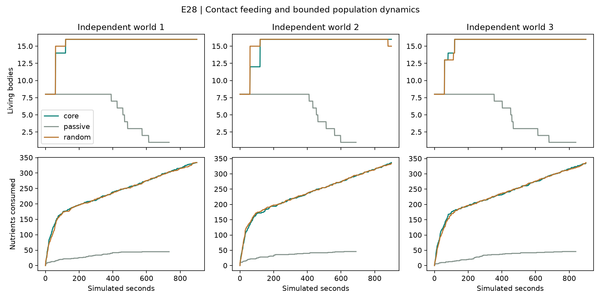
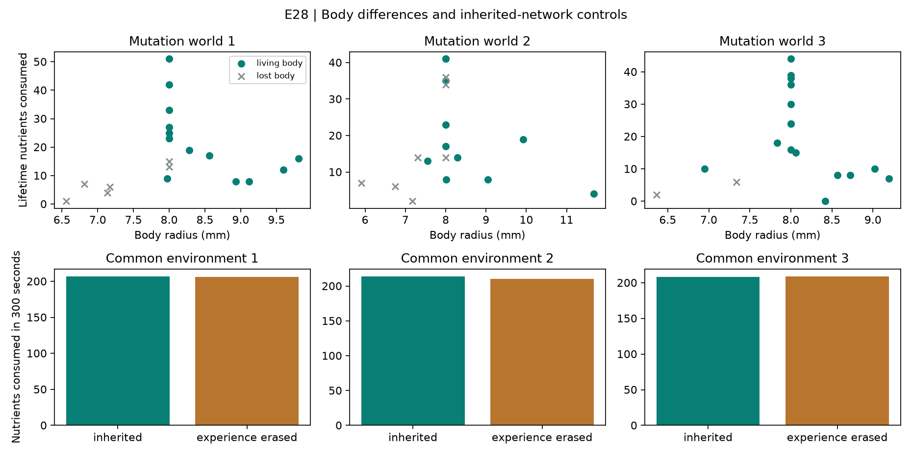
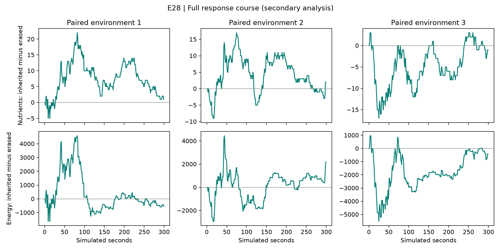

# E28：营养海洋让生存与繁殖发生了，学习优势要单独看

> **修订 r2 · 2026-10-10**
> 修订原因：原件存储位置已迁移并核验，追加当前位置解析说明，保留原实验结论。
> 原版：[report.zh.md](report.zh.md)；父版本 r1：[report.zh.md](report.zh.md)

日期：2026-10-03。独立项目 `e53a833e-6566-463c-90c2-a94a8fe2a8ef`。Core 没有修改，旧 E27 及所有旧实验保持原样。

## 先说结果

- 意识驱动三世界共 48 个体，其中后代 24 个，末态存活 48、死亡 0，摄入 1006 颗营养。
- 停止驱动对照末态存活 0，后代 0，摄入 137 颗；随机驱动末态存活 47，后代 24，摄入 1005 颗。
- **这次已经打通真实的“动作→接触营养→补给内核→存活与繁殖”过程。** 用户提出把起点放简单，是有效的实验调整。此前机械臂没有第一次成功供能的障碍，在此环境中消失了。
- **共同环境比较尚未给出三组一致的继承优势。不能把本轮会游动、会摄食、能繁殖直接升级为已经学会更好的觅食策略。**
- 第二阶段完成 3 个世界，观察到 14 次几何吞食；身体半径出现 5.90–11.67 mm 的变体，各世界最高后代代次为 2。出现了不同体型，但本轮没有建立稳定物种分化的证据。

## 第一阶段：控制动作是否有用

| 世界 | 模拟秒 | 累计个体 | 后代 | 存活意识 / 躯体 | 意识死亡 | 摄入颗粒 | 最高代次 |
|---|---:|---:|---:|---:|---:|---:|---:|
| phase1-0-core | 900.00 | 16 | 8 | 16 / 16 | 0 | 334 | 1 |
| phase1-0-passive | 734.94 | 8 | 0 | 0 / 0 | 8 | 45 | 0 |
| phase1-0-random | 900.00 | 16 | 8 | 16 / 16 | 0 | 334 | 1 |
| phase1-1-core | 900.00 | 16 | 8 | 16 / 16 | 0 | 337 | 1 |
| phase1-1-passive | 689.04 | 8 | 0 | 0 / 0 | 8 | 46 | 0 |
| phase1-1-random | 900.00 | 16 | 8 | 15 / 15 | 1 | 334 | 1 |
| phase1-2-core | 900.00 | 16 | 8 | 16 / 16 | 0 | 335 | 1 |
| phase1-2-passive | 839.90 | 8 | 0 | 0 / 0 | 8 | 46 | 0 |
| phase1-2-random | 900.00 | 16 | 8 | 16 / 16 | 0 | 337 | 1 |

每世界8个创始个体，观察上限900模拟秒。这个上限只是暂停保存，不是死亡时限。不同驱动组仍运行同一 Core 和感官；停止驱动只令外设推力归零，随机驱动每秒重新抽取动作。三组环境是独立重复；相关个体、后代和恢复分段不是额外独立样本。对照共享初始环境种子和生成规则；动作、摄食及随机数调用随后会改变环境轨迹，并非固定不变的同一场营养录像。

意识驱动与随机驱动的差别用于判断是否已超越一般运动带来的扫食机会。即便两者同样有效，前者仍证明 ThreeMind 能通过外设作用于环境并维持自身；但该事实不能代替“经历改善行为”的对照。

## 第二阶段：身体变异与包裹吞食

预定生态链条件通过状态：`True`。条件是至少两个意识驱动世界有真实摄食和繁殖，同时观察到供给不足下的储备下降/缺能。该条件不是意识或适应性标准。

| 世界 | 模拟秒 | 累计个体 | 后代 | 存活意识 / 躯体 | 意识死亡 | 摄入颗粒 | 最高代次 |
|---|---:|---:|---:|---:|---:|---:|---:|
| phase2-0 | 900.00 | 19 | 11 | 13 / 13 | 6 | 336 | 1 |
| phase2-1 | 900.00 | 18 | 10 | 11 / 11 | 7 | 336 | 2 |
| phase2-2 | 900.00 | 18 | 10 | 16 / 16 | 2 | 335 | 1 |

表中代次以各新海洋创始者为0代。第二阶段创始者来自第一阶段活着的父本，跨阶段来源及脑状态摘要另存；这里的局部代次不能冒充完整跨实验谱系的代数。

上排每点是一个体，展示大小、累计摄入和身体存活；出生早晚和同世界内亲缘关系不同，不能将这些点当成独立重复来推断体型因果。下排按独立环境比较继承与无经历网络。

随机变异作用于身体半径、推力及局部化学感官范围；不随机更改脑连接，也不写入“追逐猎物”的偏好。较大软包膜完全容纳另一包膜并持续200ms才计吞食；可回收的身体食物储备按60%转换，其余损失。被吞食者关闭感官后，其 Core 仍自然演化，身体失效不直接伪装成意识死亡。

本装置只有局部营养浓度、接触和本体测量，没有向内核提供其他个体的身份或位置，因而本轮也不测试识别特定猎物的追逐策略。吞食的几何规则能运行，与已经演化出主动捕猎是不同问题。

“有利、有害”由摄入、生存与繁殖后果衡量，不由内核里的价值标签衡量。计算人口上限16多次造成繁殖暂缓，所以停在16不是已找到环境自然承载量。最高代次及短观察长度也不足以判断物种。若继续，优先提高这一计算上限并预先安排更长观察，随后做相同新环境中的稳定遗传比较，不先改内核。

## 经历是否改善后代

| 环境 | 继承减去无经历：摄入颗粒 | 剩余能量 | 存活数 |
|---|---:|---:|---:|
| 0 | +1 | -545.402 | +0 |
| 1 | +4 | +2531.756 | +0 |
| 2 | -1 | -432.823 | +0 |

各组已生成营养的摄入比例（继承/无经历）：1: 94.1% / 93.6%；2: 97.3% / 95.5%；3: 94.5% / 95.0%。接近100%时，总摄入已受供给上限限制；优势不明显不能直接解释为没有学习，也不能凭少数颗粒差异就认定稳定适应。

进一步核对能量去向（均为继承减去无经历；耗能/损失为负表示更少）：

| 环境 | 内核耗能差 | 储存溢出损失差 |
|---|---:|---:|
| 0 | -342.026 | +1209.820 |
| 1 | +2.539 | -1244.722 |
| 2 | +275.002 | -164.571 |

这一分解是在首组结果显示明显储存溢出后增加的解释性分析，不替换主判据。吃到但装不下的食物已明确计为损失，不能把它等同于内核耗能。耗能减少可来自有效适应，也可来自整体响应减弱，需匹配输入进一步区分。

比较采用存活亲代的出生副本、同一新环境、同样普通身体/能量。无经历对照保留同一受体通道与节点身份，按 Core 的空白节点初值清除经历与边，防止意外更换运动接线；两组都关闭繁殖，先比较同样4个体的300秒表现。**无经历只在出生前清除一次，两组测试期间都继续学习。** 这是迁入新环境及普通身体后的网络比较，不代表保留原变异躯体的整体版本优劣；以后可增加保留原躯体的配对比较。原父本不修改。三组中若只完成部分，则只解释已完成部分，不能宣称计划全过。

| 世界 | 模拟秒 | 累计个体 | 后代 | 存活意识 / 躯体 | 意识死亡 | 摄入颗粒 | 最高代次 |
|---|---:|---:|---:|---:|---:|---:|---:|
| evaluation-0-blank | 300.00 | 4 | 0 | 4 / 4 | 0 | 206 | 0 |
| evaluation-0-inherited | 300.00 | 4 | 0 | 4 / 4 | 0 | 207 | 0 |
| evaluation-1-blank | 300.00 | 4 | 0 | 4 / 4 | 0 | 210 | 0 |
| evaluation-1-inherited | 300.00 | 4 | 0 | 4 / 4 | 0 | 214 | 0 |
| evaluation-2-blank | 300.00 | 4 | 0 | 4 / 4 | 0 | 209 | 0 |
| evaluation-2-inherited | 300.00 | 4 | 0 | 4 / 4 | 0 | 208 | 0 |

这是辅助过程分析：曲线大于0表示当时继承副本更多，小于0则相反。完整展示0～300秒，不挑最好看的时刻替代主判据；某个时间段的优势不自动代表长期稳定优势。

## 装置、证据和真实边界

二维中性浮力水层使用惯性与线性黏性阻力，不是完整流体仿真。感官每20ms、物理每5ms；Core 传播、遗忘、抑制和能量机制保持普通默认。初始160颗营养、全局每5秒最多补1颗、容量160；不因个体繁殖增加供给。校准耗能 10.746436 单位/秒，正式起始能量 2579.144543、每颗营养 322.393068。这些是外部资源数值，不是生物常数。

子代的启动能量从亲代身体储备扣除，免费 Core 初始量为0；未靠复制生成能量。本批各世界末态总账最大绝对差 6.41448e-08，相对于约十万单位的总供给属于浮点累加误差。机械做功仍单独记录，未虚称其焦耳已与 Core 实验能量等价。**当前没有把推进器的机械功或更大躯体的制造成本另行折算为食物消耗**；大小已经通过惯性和黏性阻力影响运动，但尚不是完整的生物能量经济，不能把“大体型吞食更多”独自当成高级控制能力。死亡、资源暂停与观察结束分别保存。

已完成：10项新工具测试及5项既有供能工具测试；1500步独立校准完整重放；Python/Rust状态在声明数值容差内一致；同后端保存继续一致；1440/390宽度回放页操作验收。正式群体重放的范围由交付记录单列，不能拿校准代替全部正式复算。

科学模拟成本：199 individuals; 18 worlds; 3.928 simulation wall hours。初始账户15%，最终账户和实际新增存储见交付记录；本批只占用一个模拟worker。共5次保护暂停采用原状态接续，原证据不覆盖。账户读数下降后仍保留旧窗口已观察的消耗继续计数。最终明确追加的资源预算为累计4.5小时、存储软限6GiB/硬限8GiB，原2/4小时登记保留；内存4GiB、可用内存2GiB、C盘5GiB/E盘15GiB余量、账户+6/+10个百分点边界不变。

## 下一步最有用的工作

先比较同样营养供给下提高人口上限、延长观察带来的结果，判断当前群体是否真的会受到资源限制；再扩大共同环境评估的独立谱系与环境数量。若观察到稳定继承优势，再定位连接与节点历史贡献。是否增加能感受同类的物理感官，以及如何让不同躯体的运动/制造耗能影响生存，作为独立外设版本决定。没有理由凭本批就改能量、遗忘或强刺激公式，也没有证据把全部个体差异叫新物种。

[预登记](design.zh.md) · [执行与预算修订](execution-notes.md) · [操作与用户原话](../../../docs/zh/plans/primitive-ocean.md)

## 交付核验追加

18世界全部初态、末态和接续边界可恢复；5个续段完整重放，另首个正式世界前6000步（120模拟秒）部分重放，输入、动作、事件、完整末态全部按各自核验范围一致。冻结装置源码摘要未变。没有将部分重放冒称18世界全程复算。用户已批准将更大种群、稀疏海域、身体耗能、防御变异、新生保护和独立融合/合作对照放入下一版；本报告数据不变。

> **存储位置修订 · 2026-10-10**
> 本版追加已核验的原件迁移说明：本次清单中的原件迁至 `E:\ThreeMindData`，科学身份、哈希、原实验日期、测量与结论不变。保留正文中的路径表示历史来源，当前位置通过已登记的证据引用解析。仓库文档与冻结夹具留在原处，源副本保留；结构化查询数据及运行中的检查点仍存数据库。本说明不表示缺失的历史资料已恢复。
