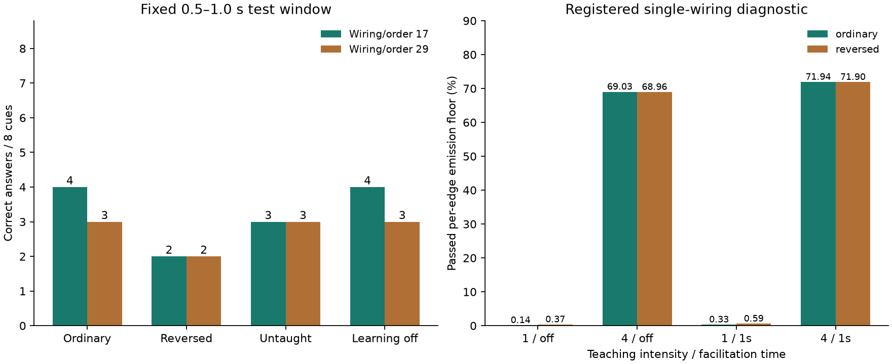

# E42：Qwen 可以转译活动，但当前教学尚未建立可靠的新配对表达

> **修订 r2 · 2026-10-10**
> 修订原因：生成证据移出 Git 并完成校验归档；追加位置登记，保留原字节与结论。
> 原版：[report.zh.md](report.zh.md)；父版本 r1：[report.zh.md](report.zh.md)

2026-10-04。项目 `2f6dc868-4ee2-4131-af36-36f4935a9844`。依据：[计划与原话](../../../docs/zh/plans/scratch-language-centre.md)、[执行补记](execution-notes.md)、[完整数值](/api/v2/storage/research-artifacts/research-artifact:2f952ae69afb85c3ff337c54/content)。这是本批条件的结论，不覆盖此前海洋及内部活动实验。

**最有价值的结果有两项：活动到词语的转换确实可行；默认教学中网络通信不足也确实存在，强度4能明显改变这一点。但通信增强没有自动变成正确的新配对回答。下一步应检验普通强度的间隔复习，而不是直接扩大 Transformer 训练。**

## 做了什么

输入使用本机固定的 Qwen3-Embedding-0.6B，输出使用 Qwen3-0.6B；两者基础权重冻结。只训练一个活动到输出模型前缀的线性转换头。Core 保持 `continuous-memory/2`，原始方程、默认值、映射和旧实例不改。输出器看当前窗口活动和固定提示，不看问题、教学句子、此前生成的文字；输出不回灌。

先用松子、铃铛、陶杯、柳叶各自的活动校准，再教“甲是松子。”“乙是铃铛。”“丁是陶杯。”“戊是柳叶。”。每句首次连续12次、复习6次及3次；教学强度1、提示0.5，所有输入间隔固定0.5模拟秒。每个课程84句、42模拟秒。**这是重复次数递减，尚不是每句间隔逐渐拉长的学习曲线。**

每种教学终态分别复制后测试四个名字及“名字＋是”，避免前一个测试污染后一个。主要文字判据固定为提示后0.5～1秒窗口；完整轨迹和原始通道最近词同时保存。两套适配器接线/教学顺序种子17、29；不是两套独立随机生成的 Core。普通、反转、空白、关闭学习四组比较；空白等长等待且没有隐形输入。

## 直接结果

| 接线/课程种子 | 普通教学 | 反转教学 | 未教学 | 关闭学习 | 同一提示在正反教学下都答对 |
| --- | --- | --- | --- | --- | --- |
| 17 | 4/8 | 2/8 | 3/8 | 4/8 | 1/8 |
| 29 | 3/8 | 2/8 | 3/8 | 3/8 | 2/8 |

两个选用的转换头都在8个有活动的留出词窗口上译对8/8。这8个窗口来自四词的两段活动，不是八个独立词或开放对话。静默窗口单列，原始全窗口分母仍保留。600步校准的旧有符号平均布局在两套接线上均有效；峰值布局在17上也可校准，在29上发生半精度数值错误，不能据此判为方法失败。

正常教学与关闭学习的八个文字答案逐项一致；反转教学两套均偏向输出“铃铛。”。原始活动最近词诊断也未给出良好的新配对恢复：普通、反转、关闭学习均2/8，空白3/8。当前失败不只是“Qwen把明显正确的答案说错了”；但这一个最近词工具也不能证明轨迹中完全没有其他可学习信息。

打乱活动特征后，两套分别有25/32、27/32文字发生改变；交换正反经历的活动后有6/16、14/16改变。**输出受活动影响，但并未可靠表达刚教的新对应。** 全零特征被软件明确设为静默；这个对照不能冒充输出器自己学会了依赖意识。

初始要求至少四种子中三个通过。17失败后、29开始前登记：若前两个都失败，就停止43、71的昂贵训练。现按该规则停止；未运行者不算阴性，也不声称四种子重复失败。从零联合训练和家系逻辑尚未启动。

## 找到了什么具体问题

Qwen整句的64维映射高度重叠。同一名字配不同名词时，句向量余弦为0.683～0.814，64个有符号通道中44～52个相同。训练后约98个节点、8264～8340条边；普通强度的平均边权约0.03。密集连边不等于有区分能力，也不等于信号真的传过去。

默认普通/反转教学中，局部释放后发出的量为49.91/53.20，能通过原逐边门槛的量仅0.07071/0.19741，即0.142%/0.371%。源码确认这里是**局部释放后低于发射端门槛**，不是到达目标后被饱和挡住。因此没有取消能耗、移低门槛或更换映射来“做出”好结果。

另行登记、单独报告的种子17诊断如下。只改变现有教学强度及易化时间常数；额外强刺激巩固项保持启用，故强度4不被解释为纯粹乘四。提示仍0.5，输出头固定，存在超出其词校准状态的风险。

| 教学强度 / 易化 | 教学中通过逐边门槛的比例：普通 / 反转 | 无新输入后通过门槛的量：普通 / 反转 | 正反教学文字正确数 |
| --- | --- | --- | --- |
| 1 / 关闭 | 0.142% / 0.371% | 0 / 0 | 4/8、2/8 |
| 4 / 关闭 | 69.032% / 68.960% | 5.782 / 5.806 | 3/8、2/8 |
| 1 / 1秒 | 0.334% / 0.589% | 0 / 0 | 4/8、2/8 |
| 4 / 1秒 | 71.940% / 71.901% | 8.431 / 8.605 | 3/8、2/8 |

强度4使平均边权达到约0.48，通信明显增强；易化在其上继续增加传递。**这是有效的动力学变化，但尚未改善语言任务。** 不把更强刺激推荐为日常教学，也不因正常衰退就判遗忘机制失效。

## 无新输入时实际看到了什么

默认组最后一次教学结束后，仍有约0.86～0.92模拟秒活动，随后按原规则死亡。在20ms采样中没有节点激活上升或归零后再入，且没有通过门槛的新传递；本条件看到的是残余衰减，不能把它写成长期循环。

强度4条件不同：停止外部输入后仍有内部传播，观察到148～216次“节点在相邻采样间激活上升”（不是148～216个不同节点），活动延续约1.22～1.24秒。没有归零后再入，也没有长时间持续循环。这是比单纯衰减更丰富的真实过程。它不否定其他已完成实验中内部活动对行为的因果贡献。

所有语言窗口都保存。例如强度4、无易化、普通教学的无提示输出为 `Shader.` → `陶杯。` → `松子。` → 静默。加易化后为 `Shader.` → `陶杯。` → `陶杯。` → 静默；反转组偏向重复“铃铛。”。这些输出未筛除，也未被当作已解释的思考内容。`Shader.` 出现在未校准的强活动状态，提示预训练输出器在陌生状态下仍可能凭语言先验表达；不能把它当作 ThreeMind 自行学到了这个概念。

## 工具与可查证材料

- UI 对话页新增“连续观察内部活动”，不发送新提示，逐窗记录；停止、死亡及错误均可见。每次最多120窗，墙钟耗时与模拟秒分列。宽屏1440及窄屏390验收。
- Python `LanguageSession.observe/stream`、`language observe` JSONL、API `.../observations` 和共享操作 `language.observe` 使用同一能力。批量解码只复用冻结权重，不继承生成上下文。
- 图形/JSON可选择旧有符号平均与新无符号峰值投影；新协议 `/2` 独立，旧 `/1` 的序列化和映射身份不变。峰值减少正负抵消，但仍存在桶碰撞，不是无损观察器。
- 增加 worker 能力匹配，旧 worker 不会误领新观察/投影任务。无输入观察与直接推进的状态一致性、Python/Rust恢复、CLI/API和历史身份均已测试；Core没有改动。
- 输入、完整轨迹、快照、头权重、失败请求、冻结源码与分析存于独立工作目录及项目报告/记录；仅做一次证据归档，不扫描或重复校验旧数据。

科研计算共164个Core实例/分支、24个成功计算任务；成功模拟约493秒墙钟、编码/训练/解码约2034秒，共约42.1分钟，另有失败尝试和工程验收开销。原始工作数据归档前约1.30GiB。原限额为256实例、4小时计算、4GiB新增证据；最终归档占用见交付记录。CUDA峰值布局的两次非有限损失保留，80步CPU全精度重试成功5/8；600步重试因不会改变选头结果而未执行。

## 用户纠正与下一轮

用户指出普通刺激迅速衰退可以是正常现象，要求空白实例、普通强度、每句话先密后疏且可交叉的复习。这个纠正成立：本批固定0.5秒的重复没有验证间隔复习，也没有资格据此否定该方法。强刺激只作诊断。

下一批单独登记：普通强度1；逐句间隔增大；等剂量集中重复、反转教学、空白和关闭学习对照；分阶段及延迟测试，区分学习、遗忘、表达。是否在长间隔加入可重放弱环境背景单独确认；不偷改死亡规则，不复活死亡实例，不加入含答案的维持刺激。原E42结果与门槛保持原义。先解决这项用户指定的验证，再决定从零Transformer训练与逻辑课程。

## 数据位置修订

选定的生成证据已逐字节校验归档。原报告、评判标准、结论及数据内 source_commit 均保留。以下逻辑下载需要当前主机管理员身份，数据目录未整体公开。

`data/experiments/2026-10-04-language-centre/`

[Location and hash index / 位置及哈希登记](../../artifact-index/2026-10-09-relocations.json)

- [results.json](/api/v2/storage/research-artifacts/research-artifact:2f952ae69afb85c3ff337c54/content) — 146900 B; SHA-256 `005babe27e0a8f2bc9002ec5a7b3a9d325ca0d560e250731b737c03207a9e0ca`.
