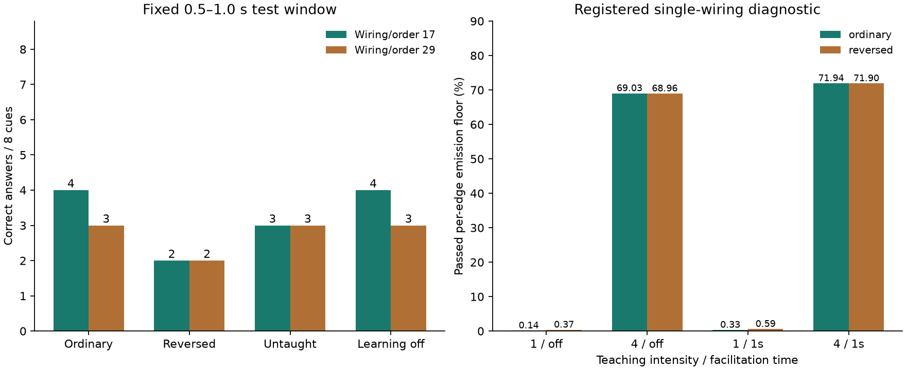

# E42: Qwen can translate activity; this teaching schedule did not establish reliable new pair expression

> **Revision r3 · 2026-10-10**
> Revision reason: Verified original-file relocation; append location-resolution guidance and preserve the experiment conclusions.
> Original: [report.en.md](report.en.md); parent r2: [report.r2.en.md](report.r2.en.md)

> **Revision r2 · 2026-10-10**
> Revision reason: Relocate generated evidence out of Git; preserve original bytes and conclusions.
> Original: [report.en.md](report.en.md); parent r1: [report.en.md](report.en.md)

2026-10-04. Project `2f6dc868-4ee2-4131-af36-36f4935a9844`. Sources: [plan and original request](../../../docs/en/plans/scratch-language-centre.md), [execution decisions](execution-notes.md), [complete measurements](/api/v2/storage/research-artifacts/research-artifact:2f952ae69afb85c3ff337c54/content). Conclusions concern these conditions, not earlier ocean or internal-activity studies.

**Two useful findings are established: activity-to-word conversion works on the calibrated vocabulary; communication is extremely weak under default teaching and increases substantially at intensity4. More communication did not automatically produce correct new pair answers. The next study should test ordinary-intensity spaced review before scaling Transformer training.**

## Design

Locally pinned Qwen3-Embedding-0.6B encodes input; Qwen3-0.6B decodes output. Both bases are frozen; only a linear activity-to-prefix conversion head is trained. Core remains `continuous-memory/2`, with no equation, default, mapping or historical-instance changes. The decoder receives current activity and a constant prompt, not the question, lessons or earlier generated text. Outputs are not fed back.

Four words—pine nut, bell, ceramic cup and willow leaf in Chinese—calibrate the head independently. Four Chinese names are subsequently assigned those words. Each sentence receives12 consecutive first repetitions, then6 and3 reviews. Teaching intensity1, cue0.5; **every presentation remains0.5 simulated seconds apart**. Each course has84 sentences across42 seconds. This reduces repetition counts; it is not an increasing per-sentence spacing schedule.

Each cue forks the same teaching endpoint. Four names and each name followed by “是” give eight cues. The primary text window is fixed at0.5–1s after the cue; complete trajectories and nearest-calibrated-word raw diagnostics are retained. Wiring/teaching-order seeds17 and29 do not mean independently randomized Core brains. Ordinary, reversed, untaught and learning-off conditions are compared. Untaught instances wait the same42s without hidden stimulation.

## Results

| Wiring/order | Ordinary | Reversed | Untaught | Learning off | Same cue correct under both ordinary and reversed teaching |
| --- | --- | --- | --- | --- | --- |
| 17 | 4/8 | 2/8 | 3/8 | 4/8 | 1/8 |
| 29 | 3/8 | 2/8 | 3/8 | 3/8 | 2/8 |

Both selected heads translate8/8 active held-out calibration windows correctly. Those are two windows from each of four words, not eight independent words or open dialogue. Silent tails are judged separately; original all-window counts remain. Signed-average600 succeeds for both wirings. Peak projection also calibrates for17; a numerical FP16 failure on29 is not evidence against the projection itself.

Ordinary and learning-off answers are identical cue by cue. Both reversed conditions favor “铃铛。” (bell). Raw nearest-word diagnostics score2/8 for ordinary/reversed/learning-off and3/8 for untaught. Thus this is not simply Qwen mistranslating an obvious correct raw answer, although one diagnostic cannot establish that no other decodable information exists.

Feature shuffling changes25/32 and27/32 outputs; swapping ordinary/reversed activity changes6/16 and14/16. **Words depend on activity without reliably expressing the newly taught relation.** Zero features are silenced by an explicit software guard, not by independently learned dependence on Core.

After17 and before29, a futility rule was registered: if both fail, three passes among the original four seeds become impossible. Accordingly43/71 are not trained, not counted as negatives, and not described as a four-seed failure. Scratch joint training and family reasoning have not begun.

## Identified bottleneck and bounded diagnostic

The64-dimensional whole-sentence input overlaps heavily. Sentences with the same name but different nouns have cosine0.683–0.814 and share44–52 of64 signed channels. Teaching produces about98 nodes and8264–8340 edges, with mean weight about0.03 at intensity1. Dense structure does not itself establish selective communication.

Ordinary/reversed default teaching emits49.91/53.20 after local release, but only0.07071/0.19741 passes the existing per-edge emission floor:0.142%/0.371%. Source inspection identifies post-release rejection, not target saturation. Neither the floor nor input mapping nor consumption was changed to obtain a preferred outcome.

The separately registered seed17 diagnostic changes only existing teaching intensity and facilitation time. The extra strong-stimulus consolidation term stays enabled; intensity4 is not called pure scaling. All cues remain0.5, the output head remains frozen, and stronger activity may fall outside its calibration distribution.

| Intensity / facilitation | Passed emission floor: ordinary / reversed | Passed amount after external input stops | Text correct: ordinary / reversed |
| --- | --- | --- | --- |
| 1 / off | 0.142% / 0.371% | 0 / 0 | 4/8,2/8 |
| 4 / off | 69.032% / 68.960% | 5.782 / 5.806 | 3/8,2/8 |
| 1 / 1s | 0.334% / 0.589% | 0 / 0 | 4/8,2/8 |
| 4 / 1s | 71.940% / 71.901% | 8.431 / 8.605 | 3/8,2/8 |

Intensity4 raises mean edge weight to roughly0.48 and greatly increases communication; facilitation adds further transmission. **The dynamics change is real, but language performance does not improve.** Strong stimulation is not recommended as everyday teaching, and ordinary decay is not automatically called defective forgetting.

## Activity without new input

Default teaching leaves approximately0.86–0.92s of activity before ordinary death handling. At20ms sampling, there are no activation increases or zero-to-active reentries; no new transmission passes the floor. These windows show residual decay rather than a prolonged loop.

Intensity4 leaves actual internal propagation after external input ends:148–216 node-to-next-sample increases, not148–216 distinct neurons. Activity lasts approximately1.22–1.24s, without zero-to-active reentry or prolonged circulation. This is richer than pure decay. It does not revoke earlier independent causal evidence for internal activity affecting behavior.

All language windows are retained. Strong/no-facilitation ordinary teaching produces `Shader.` → `陶杯。` → `松子。` → silence. With facilitation it produces `Shader.` → `陶杯。` → `陶杯。` → silence; reversed teaching favors repeated bell. These are unfiltered translations, not established semantic thoughts. `Shader.` on an uncalibrated strong state exposes the pretrained decoder's linguistic prior; it is not evidence that Core learned that concept.

## Tools, evidence and resources

The dialogue UI now offers continuous no-input observation in the same timeline, with stop/death/errors, at most120 windows per start and separate wall/simulated time. Python `observe/stream`, CLI JSONL, API observations and shared operation `language.observe` expose the same ability. Batch decoding reuses weights but no generated-token history. New peak projection has protocol/2; legacy/1 serialization and mapping identities stay unchanged. Peak projection avoids signed cancellation but remains lossy through bucket collisions. Visual/JSON configuration can select it for new sessions, requiring a matching head.

Worker capabilities prevent old workers from claiming new operations/projections. Direct-advance equivalence, Python/Rust restoration, CLI/API, original identities and desktop1440/mobile390 interactions are checked. Frozen sources, inputs, trajectories, snapshots, heads and failures remain in the independent project/work directory. Core is unchanged. Evidence uses one archive pass, not repeated historical hashing.

There are164 Core cases/forks and24 successful compute jobs:493s simulation wall time and2034s encoding/training/decoding, about42.1 minutes total, excluding failed attempts and engineering checks. Raw working evidence is about1.30GiB before archive; final storage is recorded at delivery. Limits were256 cases,4h compute and4GiB new evidence. Two peak-layout CUDA nonfinite-loss attempts are retained. An80-step CPU float32 retry reaches5/8 active calibration; a600-step CPU retry is deferred because it could not change head selection under the registered tie rule.

## User correction and continuation

The user correctly distinguishes ordinary fading from a defect and requests blank instances taught at ordinary intensity with individually increasing, interleaved review intervals. Fixed0.5s teaching did not test that proposal. Strong stimulation remains a diagnostic only.

A separate follow-up will compare intensity1 spaced review, dose-matched massed review, reversed teaching, untaught and learning-off controls, using intermediate and delayed tests. A replayable weak environment during long gaps is a separate explicit decision; no changed death rule, revival or answer-bearing maintenance input is permitted. E42 criteria and evidence retain their meaning. Complete this user-requested test before deciding on scratch Transformers or logic courses.

## Data location revision

Selected generated evidence has been archived and verified byte for byte. Original reports, criteria, conclusions and embedded source_commit values are preserved. The logical downloads below require the current host administrator. The data directory is not public.

`data/experiments/2026-10-04-language-centre/`

[Location and hash index / 位置及哈希登记](../../artifact-index/2026-10-09-relocations.json)

- [results.json](/api/v2/storage/research-artifacts/research-artifact:2f952ae69afb85c3ff337c54/content) — 146900 B; SHA-256 `005babe27e0a8f2bc9002ec5a7b3a9d325ca0d560e250731b737c03207a9e0ca`.

> **Storage-location revision · 2026-10-10**
> This edition adds the verified move of the selected originals to `E:\ThreeMindData`. Stable scientific identities and hashes, experiment dates, measurements and conclusions remain unchanged. Paths in the preserved body describe historical sources; use the registered evidence resolver for current locations. Repository documents and frozen fixtures remain in place, and source copies are retained. Structured query data and running checkpoints remain in the database. This annotation does not assert that missing historical evidence was recovered.
