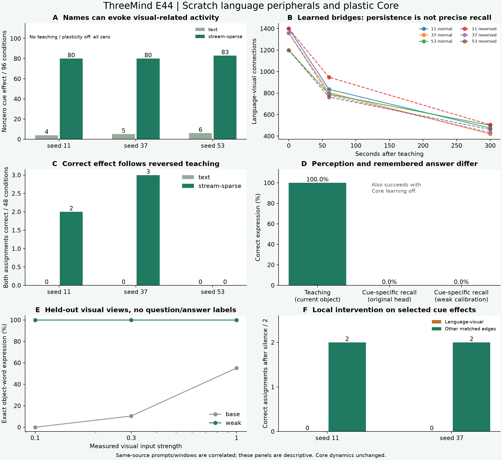

# E44: words can evoke visual activity; reliable recall-to-language remains unfinished

> **Revision r3 · 2026-10-10**
> Revision reason: Verified original-file relocation; append location-resolution guidance and preserve the experiment conclusions.
> Original: [report.en.md](report.en.md); parent r2: [report.r2.en.md](report.r2.en.md)

> **Revision r2 · 2026-10-10**
> Revision reason: Relocate generated evidence out of Git; preserve original bytes and conclusions.
> Original: [report.en.md](report.en.md); parent r1: [report.en.md](report.en.md)

2026-10-05; executed October 4–5. Project `a6fe320f-1e36-49f2-a5d0-b9c4597d83dc`.

[Design](design.en.md) · [Execution details](execution-notes.en.md) · [Full results](/api/v2/storage/research-artifacts/research-artifact:a2bbd91e88396b83b50c6494/content) · [Continuous histories](../../../.work/language-development-20261004/language-development.html) · [Delivery](delivery.en.md)

**Two useful advances emerged. After teaching, words can recruit visual-related activity through newly learned connections. A scratch language peripheral can express actual sensory activity, including weaker activity the original head missed. What remains unreliable is retrieving the correct object from a new name and expressing that retrieval.** This is neither no learning nor completed language acquisition.

## 1. Teaching and measurement

Core remains `continuous-memory/2` with ordinary defaults, including forgetting, inhibition, depletion and recovery; additional facilitation remains off. No Core formula, propagation threshold, timing architecture, historical sensor or saved consciousness was changed.

A MuJoCo apparatus retains four objects: a red sphere, blue box, green cylinder and yellow block. The teacher changes viewpoint; five rays supply measured distances and material RGB alongside short sentences such as “甲是红球。”. Normal teaching assigns four new names to the four objects; reversed teaching reverses assignments. Plasticity-off and untaught sources provide controls. Object names belong to external teacher records and peripheral supervision, never semantic labels or correct paths inside Core. There is no active body control. Colours and shapes are confounded in these four objects; this is not a test of general colour/shape understanding or complete embodiment.

Each sentence receives 12 consecutive presentations 0.5 simulated seconds apart, then eight reviews at each same-item interval of 2, 4, 8 and 16 seconds, followed by a final review: **45 presentations per sentence, 180 total, ending at 266 seconds**. Teaching strength is 1. Name and name-plus-“是” cues at strengths 0.5/1 are delivered to separate copies immediately, 60 seconds and 300 seconds after teaching. Strong stimulation is not ordinary teaching.

Background input replays E43's 840-second physical host/recording-process telemetry at its original timestamps, identities and values. It is not feedback from this experiment's current CPU load, is not looped or stretched, and is common to all groups. No new language does not mean no external input.

Input and output Transformers start from random weights, with two layers and width64. An independent input representation is trained and frozen; Core then learns from experience, and an output Transformer learns to express activity. This is staged co-development, not end-to-end gradient propagation through Core. Input training uses1200 steps, original output training1600, with a200-step checkpoint; the later weak-activity head adds1200. There are no pretrained Qwen or other weights. Formal name-object assignments never enter output-head training.

Independent calibration compares the existing text sensor, whole-sentence vector, dense character stream and sparse character stream. Selection fixes text and sparse stream for three formal seeds:11,37,53. The character stream has its own protocol identity; old mappings and NFKC remain intact.

The registered primary visual analysis compares the whole two-second cued trajectory against a same-snapshot uncued trajectory, then against four physical-view templates. This analysis never enters Core or filters the language head's raw input. Half-second windows, full20-ms trajectories and empty outputs are retained.

## 2. A clear advance: language recruits another sensory representation

Each row below combines normal/reversed histories, four names and their suffix forms, two strengths and three times:96 correlated conditions per seed, not96 independent individuals. A nonzero effect means a registered visual-template difference above numerical tolerance, not a correct answer.

| Input | Seed11 | Seed37 | Seed53 |
| --- | --- | --- | --- |
| Existing text sensor |4/96|5/96|6/96|
| Scratch Transformer sparse stream |**80/96**|**80/96**|**83/96**|
| Plasticity off / no teaching |Both routes zero|Both routes zero|Both routes zero|

The sparse route gives243/288 learned conditions with visual-related changes, versus15/288 for text. **A word can now recruit activity in another sensory system that participated in earlier teaching.** Failure to express accurate answers must not erase this result.

After300 seconds, the six learned sparse sources retain420–505 language-visual edges each, versus20–40 for text. Source labels classify channels only in read-only analysis; no brain regions are predefined in Core. Visual activation at those uncued snapshots is zero: retained structure and currently recalled activity differ.

The routes are not dose-matched. For seed11's “甲是红球。”, text supplies one frame, language amount3.532 and visual amount2; the stream supplies five frames, language amount5 and visual amount10. Stream cue channels are also fully present in teaching prefixes, while some text cues overlap only8/9. This is a **sensory-design and curriculum combination benefit**, not an isolated Transformer, sparsity or visual-exposure effect.

## 3. Accurate correspondence versus broad visual recruitment

For the same cue to identify the intended object under both normal and reversed histories:

| Route |Seed11|Seed37|Seed53|
| --- | --- | --- | --- |
| Text |0/48|0/48|0/48|
| Sparse stream |**2/48**|**3/48**|0/48|

These five conditions are not five independent learned facts. Seed11's successes concern “乙/乙是”60 seconds after teaching. Seed37 includes “乙/乙是” and “戊” immediately after teaching. None passes the joint criterion at300 seconds. Most cues can change visual activity without selecting the taught object precisely. Fluency in the output head cannot substitute for this missing specificity.

### Local silencing identifies an actual learned route

The preregistered follow-up selects only the first successful condition per seed; seed53 has none and is not forced into the test. Each normal/reversed snapshot receives language-visual edge silence and an equal-count, approximately weight-matched other-edge silence, each with cued/uncued copies. [Registration](bridge-ablation-registration.en.md)

| Source |Cue and delay|Language-visual edges silenced|Other matched edges silenced|
| --- | --- | --- | --- |
|11 normal|乙是;60 seconds|Visual difference zero|Blue box still leads|
|11 reversed|Same|Visual difference zero|Green cylinder still leads|
|37 normal|乙;immediate|Maximum residual about1.3×10⁻¹¹, below tolerance|Blue box still leads|
|37 reversed|Same|Visual difference zero|Green cylinder still leads|

The masks contain290,295,160,160 edges respectively. Counts match; maximum individual weight errors range0.0918–0.1063. Topology and weights are not perfectly matched. Matched silence can change amplitude; preserved ranking does not mean an identical waveform.

**These four checkpoints support a causal contribution of learned language-visual connections to the measured cue effects.** This advances beyond correlation, but is attribution of selected phenomena, not a new population accuracy estimate or evidence about every name/path/transplant. No connection rule was added to achieve it.

[Scalable figure](findings.svg). Conditions and windows are correlated observations.

## 4. A real expression-tool blind spot was partly corrected

Each of six original heads correctly expresses540 current-object teaching windows and67 untaught-background windows, at both200 and1600 steps. Plasticity-off histories also succeed: this measures peripheral reading of current perception, not Core acquisition of new names.

Original heads often miss weaker independently presented visual activity. A separate continuation calibrates measured object inputs without revealing formal name answers. Whole view8 sources train the continuation; view9 sources are held out. [Registration](weak-expression-registration.en.md)

| Visual input strength |Original exact windows|After calibration|
| --- | --- | --- |
|0.1|0/96|**96/96**|
|0.3|10/96|**96/96**|
|1|53/96|**96/96**|

These288 windows come from36 held-out sources projected into two route bases; adjacent windows/projections are not independent samples. Core is unchanged. Formal teaching/background checks remain607/607 per head, untaught background is not translated into object words, and all2403 zero-input control windows remain empty.

The calibrated head superficially produces26 paired windows correct under both assignments. In every case, the same words already occur in matching uncued copies. Requiring cue-specific change leaves **0/1152 paired half-second windows for either head**. Residual perception must not be relabelled a newly answered question. Both raw and controlled counts are retained.

## 5. Continuous activity and attempted monologue

Eighteen continuous sources run0–566 seconds,1132 half-second windows each, translated by two frozen heads:40752 translations. Normal, reversed and untaught lives remain separate. Plasticity-off full activity and short-window text also remain in the archive, outside the18 main replays.

The original heads are silent throughout windows without new teaching. Calibrated heads express fading object activity between reviews. For seed11's sparse normal source,150 of352 interleaved-background windows contain object words. Immediately after teaching, two half-second windows say“黄块。”; the following598 are empty. Text is neither polished nor fed back.

**Short sensory persistence that was previously invisible to the language head is now readable.** However, these words remain under propagation-off and no-learned-connection controls. They cannot yet be attributed specifically to inter-node associative monologue. Neither head reliably expresses the blue/green effects identified by the local intervention. Better weak-perception calibration does not solve all mixed-activity interpretation.

Internal transmission itself occurs. In seed11's12-second uncued normal branch, sent amount is8.439; propagation-off gives0 while background sustains life. With all external input stopped, another7.313 is sent over2.22 seconds before death. All24 external-stop branches reach death after1.19–2.27 seconds; these durations include the existing grace period and are not pure activation lifetimes. Sent signals are not automatically new autonomous thoughts.

No causally validated logical monologue was decoded in this batch. Empty text likewise cannot negate recorded internal activity or earlier autonomy evidence.

## 6. Next priorities

1. **Separate the sources of cross-sensory improvement.** Match language dose, visual exposure and course length while varying prefix consistency, character timing and sparsity. Keep the present successful conditions as references and Core unchanged.
2. **Improve distinguishable shared experience.** In a complete small scene, add measured visual changes, touch, proprioception and interaction consequences; compare single senses, joint senses, active interaction and replay. Reuse existing adapters, without passing hidden object IDs as meanings. The user's multisensory and bidirectional-association proposal is recorded in the [roadmap](../../../docs/en/plans/language-development.md).
3. **Calibrate expression using independent evidence.** Keep weak measured associations, uncued background, sensory persistence and local silence as separate validation material. New training must not reveal formal assignments. Half-second projections and four object words do not establish general language or temporal understanding.

No deterministic Core defect requiring immediate alteration was identified. Imprecision could reflect encoding, exposure, local learning and expression jointly; no single confirmed kernel gap has been isolated. Forgetting and thresholds were not changed to obtain answers. The first bounded A–C batch is complete; social communicationD and longer complex developmentE remain unstarted, not failed.

## 7. Resources, interruption and delivery

1522 sources/branches completed. One incomplete attempt was retained after the30-minute usage-refresh guard stopped it:1523 attempts total, below1536. Completed units were reused and only the unfinished source rerun. Recorded simulation/training/translation time is69.61 minutes, excluding all editorial/orchestration waiting; limit4 hours. Pre-archive local evidence is about1.05GiB, with archive and database copies additionally counted toward8GiB. Shared account readings rose35%→38%; integer readings and concurrent usage are not precise task billing.

Docker's engine became unavailable, not merely its UI. Native Python, MuJoCo, PyTorch and Windows PostgreSQL continued normally, so no service restart was needed. Real training/translation used the localGTX1650 and CUDA PyTorch. An unnecessary resource-check parse of large training datasets was removed without changing results.

Reusable tools include character-stream compilation, temporal projection retaining unknown channels, activity-change descriptions, scratch temporal-language models and Python/CLI access. [Operations](../../../docs/en/reference/language-development-tools.md). Six targeted tests, including observer noninterference, and five existing non-API observation tests passed. Replay supports1440/390 widths, source selection, seeking, playback, pagination and export. Full activity, states, weights, failure records, designs, reports and viewer are published through ThreeMind services into the new research project. Historical data and Core remain unchanged; commits are local, without push.

## Data location revision

Selected generated evidence has been archived and verified byte for byte. Original reports, criteria, conclusions and embedded source_commit values are preserved. The logical downloads below require the current host administrator. The data directory is not public.

`data/experiments/2026-10-04-language-development/`

[Location and hash index / 位置及哈希登记](../../artifact-index/2026-10-09-relocations.json)

- [results.json](/api/v2/storage/research-artifacts/research-artifact:a2bbd91e88396b83b50c6494/content) — 1469894 B; SHA-256 `681cee59b1f81c52b6c078db08a5f43b21d2b5f773f0d70991fadc70fcc7b478`.

> **Storage-location revision · 2026-10-10**
> This edition adds the verified move of the selected originals to `E:\ThreeMindData`. Stable scientific identities and hashes, experiment dates, measurements and conclusions remain unchanged. Paths in the preserved body describe historical sources; use the registered evidence resolver for current locations. Repository documents and frozen fixtures remain in place, and source copies are retained. Structured query data and running checkpoints remain in the database. This annotation does not assert that missing historical evidence was recovered.
