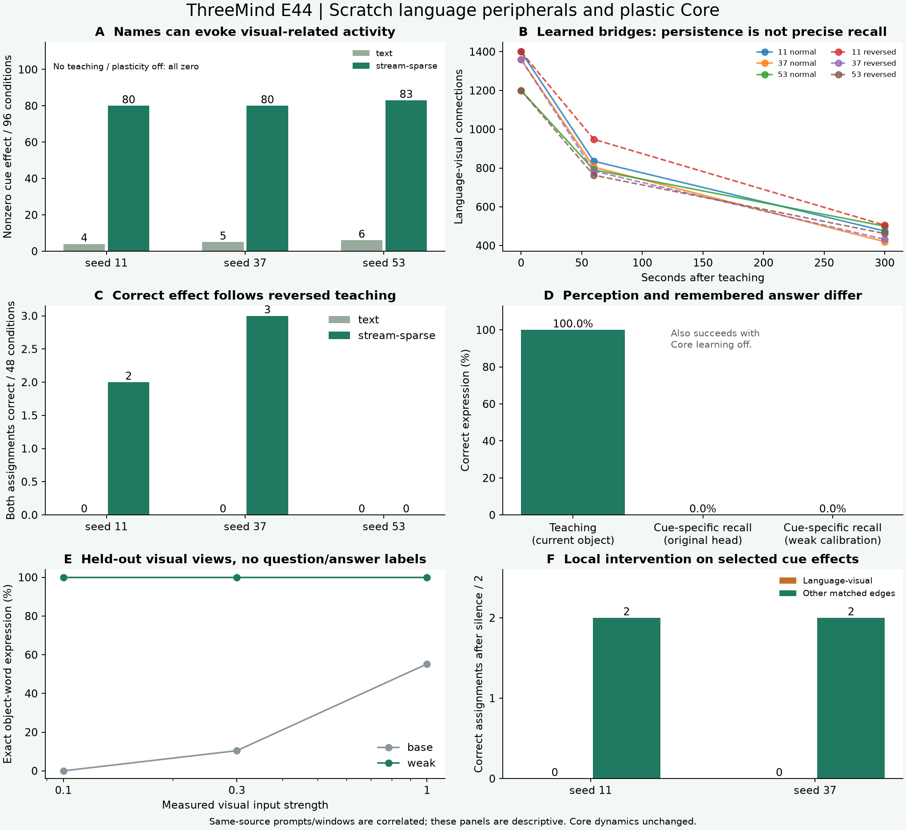

# E44：词语开始能唤起视觉活动，语言表达还没有接通可靠的新知识回忆

2026-10-05；实验于10月4—5日执行。项目 `a6fe320f-1e36-49f2-a5d0-b9c4597d83dc`。

[设计](design.zh.md) · [执行细节](execution-notes.zh.md) · [完整数值](results.json) · [连续活动回放](../../../.work/language-development-20261004/language-development.html) · [实施记录](delivery.zh.md)

**本轮有两项实质进展：教学后，单独的词语提示能够经过新形成的连接，引起视觉相关活动；从零训练的语言输出器也能把实际感官活动说成词语，包括原先漏读的较弱活动。尚未做到的是：稳定地想起正确的物体，并把这段回忆说出来。** 这不是“什么都没学到”，也不是“已经学会语言”。下面分别说明哪一环已通、哪一环仍不可靠。

## 1. 实际怎样教、怎样测

保留 `continuous-memory/2` 及其普通默认：遗忘、抑制、耗竭和恢复均保持，额外易化仍关闭。本轮没有修改 Core、传播门槛、时间机制、旧感官或旧实例。

MuJoCo装置同时保留红球、蓝盒、绿柱、黄块四个物体。教师改变观察方向，通过五条射线的距离和RGB测量提供视觉刺激，同时教“甲是红球。”“乙是蓝盒。”“丁是绿柱。”“戊是黄块。”。反转组颠倒对应；另设关闭可塑学习、未教学对照。物体名称只用于外部教师记录和语言外设训练，**没有给Core语义标签或正确路径**。这个装置没有主动躯体控制；四种颜色和四种形状尚未独立组合，不把它称为完整具身学习或一般颜色／形状理解。

每句先连续重复12次，间隔0.5模拟秒，再交错复习，同一句间隔依次为2、4、8、16秒，每档8次，最后共同复习一次：**每句45次，共180次，266秒结束**。普通教学强度1；之后以“名字”“名字是”、强度0.5或1，从同一快照的独立副本测试。观察教学结束、60秒后、300秒后。没有把强刺激当普通教学。

背景是E43保存的840秒真实宿主和采集进程遥测，按原采样时刻、数值和身份重放，不是本轮CPU负载的实时反馈，不循环或拉伸。背景覆盖所有组，不能把“没有新语言输入”写成“没有外界刺激”。

输入Transformer和输出Transformer都从随机权重开始，2层、宽64。先训练独立语言表示，再固定输入外设让Core从经历学习；输出器学习如何把活动表达成对象词语。这里的共同发育是**分阶段学习**，不是梯度穿过Core的端到端训练。本轮输入训练1200步，输出训练1600步，保留200步版本；后述弱活动校准另加1200步。没有使用Qwen或其他预训练权重。正式名字与物体的对应不进入输出器训练。

独立校准材料先比较原文本、整句向量、稠密逐字流、稀疏逐字流，随后固定原文本与稀疏逐字流两路线，正式使用11、37、53三个种子。新逐字协议独立编号，旧映射保持原义，NFKC没有关闭。

主要目标分析使用提示后完整2秒的视觉活动，相对同快照无提示过程作差，再与四种实际视觉测量模板比较。这个分析不进入Core，也不筛掉语言输出器的原始活动。各半秒窗口、原始20毫秒轨迹、空输出均保存。

## 2. 最明显的进展：语言确实能牵动另一种感官的活动

下表合并正常和反转教学，每个种子96个提示条件：四个名字及其“名字是”、两强度、三时点、两教学方向。它们是相关的同源测试，**不是96个独立个体**。“有变化”指预登记视觉模板分数的提示差量超过数值门槛，不是回答正确。

| 输入路线 | 种子11 | 种子37 | 种子53 |
| --- | --- | --- | --- |
| 原文本感官 | 4/96 | 5/96 | 6/96 |
| 从零Transformer稀疏逐字流 | **80/96** | **80/96** | **83/96** |
| 关闭学习／未教学 | 各路线均为0 | 各路线均为0 | 各路线均为0 |

稀疏逐字路线共243/288个已教学条件出现视觉相关变化，原文本15/288。**输入词语后能唤起过去共同经历的另一类感官活动，这条方向取得了实测支持。** 不能仅因后面的语言答案还不准确，就抹掉这一进展。

连接也留下来：300秒后，稀疏路线六个正常／反转来源仍各有420～505条语言—视觉连接；原文本为20～40条。静态连接分组由外部已知的通道来源作只读统计，不是内核预设的脑区。此时无提示快照的视觉激活为0，说明“连接还在”与“正在想起它”确实是两回事。

不过，两路线并非等剂量：以种子11的“甲是红球。”为例，原文本是一帧，映射语言总量3.532、共同视觉总量2；逐字流是五帧，语言总量5、视觉总量10。稀疏逐字提示的通道也完整出现在教学前缀，原文本某些提示只有8/9通道重合。因此，这是**感官方案与课程组合的增益**，还不能单独归功于Transformer、稀疏化或更多视觉曝光。

## 3. 是准确的对应，还是笼统地唤起视觉

要求同一提示在正常和反转教学下，分别使正确物体占优，比只看“说中过一个词”更严格地检查经历作用。

| 路线 | 种子11 | 种子37 | 种子53 |
| --- | --- | --- | --- |
| 原文本 | 0/48 | 0/48 | 0/48 |
| 稀疏逐字流 | **2/48** | **3/48** | 0/48 |

五个条件并不代表五种独立知识：种子11的两个条件均涉及“乙／乙是”，发生在教学后60秒；种子37有“乙／乙是”和“戊”，发生在教学刚结束。300秒时没有正常与反转同时正确的条件。大多数时候，词语能引起视觉变化，却不能准确指向所教对象。这是接下来要解决的**对应精度**，不能用增加解码器的语言流畅度来代替。

### 局部连接静默找到了实际通路

按查看结果前写下的选择规则，每个种子只取首个正常／反转均正确的条件。种子53没有，未强凑。对两套种子的正常和反转来源分别做四个分支：目标连接静默／其他匹配连接静默，各配有提示／无提示。[补充登记](bridge-ablation-registration.zh.md)

| 来源 | 提示与等待时间 | 静默语言—视觉连接 | 静默其他匹配连接 |
| --- | --- | --- | --- |
| 11，正常 | 乙是；教学后60秒 | 视觉差量归零 | 蓝盒仍领先 |
| 11，反转 | 同上 | 视觉差量归零 | 绿柱仍领先 |
| 37，正常 | 乙；教学刚结束 | 最大残量约1.3×10⁻¹¹，低于数值门槛 | 蓝盒仍领先 |
| 37，反转 | 同上 | 视觉差量归零 | 绿柱仍领先 |

静默边数分别为290、295、160、160；控制组边数相同，权重尽量匹配，最大逐边误差0.0918～0.1063，并未做到拓扑或权重完全相等。匹配静默也会改变响应幅度，表中“仍领先”不意味着波形完全没变。

**这四个检查点支持：教学形成的语言—视觉连接实际承担了所测提示效应。** 它比只看到相关活动更进一步；但这是对已选中现象的归因，不是新的总体正确率，也没有覆盖所有名字、所有潜在通路或一般移植。未为本轮新增连接规则。

[可缩放原图](findings.svg)。图中计数是重复条件，不是独立人群样本。

## 4. 语言输出工具确实有漏读，而且本轮修好了其中一部分

六套路线／种子的原输出器，对各自540个当前物体教学窗口、67个未教学背景窗口均正确，200步与1600步版本都如此。关闭Core学习时也能正确表达当前物体：这是外设读懂当前感官活动的能力，不能当作Core学会新名字。

原输出器遇到较弱的独立视觉活动经常沉默。新增版本只用外部真实测量的物体刺激校准幅度，没有把正式名字答案交给它；视角8用于训练，视角9整个来源留作验证。[弱活动校准登记](weak-expression-registration.zh.md)

| 视觉输入强度 | 原输出器正确窗口 | 增加校准后 |
| --- | --- | --- |
| 0.1 | 0/96 | **96/96** |
| 0.3 | 10/96 | **96/96** |
| 1 | 53/96 | **96/96** |

共288个验证窗口来自36个新视角来源，经两路线投影；相邻窗口与两次投影不算独立样本。这项改善没有改变Core。在正式教学和未教学背景检查中，新增版本仍各套607/607，没有把未教学背景都译成熟词。置零活动的2403个无提示检查窗口也仍全部为空。

但问新名字时，新增版本表面上出现26个“正常／反转都说对”的成对窗口；逐个对照发现，这些词在相同快照**不提问时已经存在**。要求答案确因提示改变后，两版仍都是0/1152个配对半秒窗口。不能把刚看过物体的余留文字冒充新问题的回答。原始计数和对照计数都保留，没有隐藏较好看的数字。

## 5. 连续活动与“内心独白”观察到了什么

保存18个真实连续来源，每个0～566秒、1132个半秒窗口；两版冻结输出器共40752次转译。正常、相反经历、未教学分别可查，没有把测试分叉拼成连续生命历程。关闭学习来源的完整活动和短窗译文也在证据中，未列入18条主回放。

原输出器在无新教学窗口全部沉默。新增版本能够说出复习间隙中正在减弱的物体活动；以种子11稀疏正常来源为例，352个复习间隙窗口中150个出现对象词，教学结束后前两个半秒窗口仍为“黄块。”，随后598窗为空。原始文字不润色、不回灌。

这不是无价值的噪音：**此前看不到的短暂感官余留，现在可以被语言工具观察到了。** 但这些词在关闭传播、甚至没有形成连接的对照中仍会出现，当前不能将它们特指为节点间联想产生的独白。两版在刚才局部连接消融中，也没有可靠表达已被独立探针定位的蓝盒／绿柱效应。弱物体校准成功没有消除全部混合活动解释问题。

内部传播本身确实发生。例如种子11正常来源教学后的无语言12秒中，累计内部发送量8.439；关闭传播时为0，背景仍使意识存活。停止全部外部输入后，在2.22秒的后续记录中仍实际发出7.313的信号，随后因活动消失而死亡。全部24个停止外部输入分支在1.19～2.27秒达到死亡状态。这里的时长包括既有宽限期，不能当作活动持续时间；不把所有发出量都叫新的自主念头。

因此本轮没有读到经过因果验证的逻辑独白，却也不能用空白译文否定已经记录的内部活动或以前实验的自主活动结论。

## 6. 下一步最值得做什么

1. **先分清这次跨感官增益的来源。** 配平语言入射量、视觉曝光次数和课程长度，分别比较前缀一致性、逐字时序、稀疏度。保留当前成功条件作为参考，不先改Core。
2. **让对应更可区分。** 在完整小型环境中增加可测的视觉变化、接触、本体反馈和互动后果，再比较单感官、共同感官、主动互动及重放。复用已有适配器；名称不能变成隐藏的对象编号送入Core。用户提出的多感官与双向联想设想已记录在[后续计划](../../../docs/zh/plans/language-development.md)。
3. **继续校准表达，而不是以沉默或流畅代替测量。** 保留已定位的微弱联想、无提示背景、余留感官、局部静默作为独立验证材料；新的训练材料不得泄露这些正式对应。现有0.5秒投影和四词课程不足以宣布一般语言或时序解释能力。

本批未发现必须当场改变Core才能修复的确定性故障。对应不够精确可能涉及编码、曝光、局部学习与表达的共同作用；尚未定位到足以要求修改内核的单一缺口。没有为了得到答案取消遗忘或降低门槛。五阶段总计划的A–C首批已完成，社会交流D和更长期复杂发育E尚未启动，也不列为失败。

## 7. 预算、意外与交付

完成1522个来源／分支，另保留一次因额度读数超过30分钟未刷新而停止的未完成尝试，共1523次，低于1536上限。已完成单元直接续用，仅重做该未完成来源。模拟、模型训练与转译累计记录69.61分钟，不含全部人工整理和编排等待；计算上限4小时。归档前新增工作目录约1.05GiB，归档及数据库副本另计，总上限8GiB。账户读数35%→38%，含共享使用及整数取整，不是精确的本任务用量。

Docker引擎中途确实不可连接，并非只看到UI异常；本轮本机Python、MuJoCo、PyTorch及原生Windows PostgreSQL正常，实验不依赖Docker，没有为此重启服务。GPU实际训练／转译使用本机GTX1650与CUDA版PyTorch。另修掉资源检查反复解析大训练样本的纯工具开销。

新增通用逐字刺激编译、保留陌生通道的过程投影、活动变化统计、从零时序语言模型及Python／CLI。[工具说明](../../../docs/zh/reference/language-development-tools.md)。观察不改变状态等6项针对性测试、5项既有非API语言观察回归通过。连续回放支持1440／390宽度、选择经历、时间定位、播放、分页和导出。完整活动、快照、权重、失败记录、设计、报告与查看器通过ThreeMind服务进入独立研究项目。旧数据和内核保持原样；本地提交，不推送。
