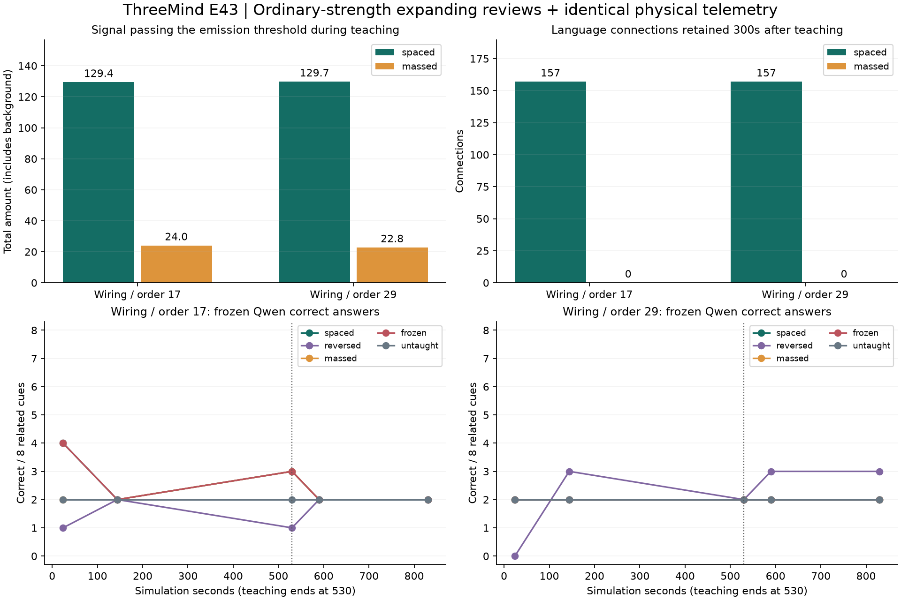

# E43: expanding reviews preserve stronger connections; reliable new pair expression remains unresolved

> **Revision r2 · 2026-10-10**
> Revision reason: Relocate generated evidence out of Git; preserve original bytes and conclusions.
> Original: [report.en.md](report.en.md); parent r1: [report.en.md](report.en.md)

2026-10-04. Project `9cc6f412-6512-4c96-9a86-af93bfedfff7`. Sources: [preregistration](design.en.md), [secondary cue-dose registration](probe-dose.en.md), [measured data](/api/v2/storage/research-artifacts/research-artifact:16bf4fb191c1676ecb701247/content), [execution notes](execution-notes.md). E42 remains intact.

**There is a concrete gain: with ordinary intensity and equal presentation count, expanding reviews produce a stronger, more persistent subset of connections than massed repetition. Both wirings retain157 language-to-language edges300 simulated seconds after teaching, versus zero under massed repetition. However, the current cues and frozen Qwen interface still do not reliably express the newly taught name–object assignments.**

## Method

Blank continuous-memory/2 consciousnesses retain ordinary defaults, inhibition, forgetting, local depletion/recovery and other mechanisms; extra facilitation stays off. Teaching intensity1, primary cues0.5. No Core equations, thresholds, sensory mappings, historical states or reports change.

Four intact sentences pair 甲/乙/丁/戊 with 松子/铃铛/陶杯/柳叶. Each initially receives12 consecutive repetitions; interleaved reviews then expand per-item intervals from0.5 to2,4,8,16,32s. A common final review yields57 presentations per sentence,228 total, ending at530s. The massed condition matches dose, elapsed duration, final review times and order. Other conditions reverse assignments, disable plasticity, or omit teaching. Seeds17/29 vary wiring and curriculum order, not independently initialized brains or populations. Cue forks are independent of one another and never write back to teaching.

Host and recorder-process telemetry are measured for840 real seconds and replayed with their original timestamps, channels and amounts, intensity0.2 each. This is recorded physical input, not synthetic data or the consciousness process's live feedback. No instance telemetry is invented. Simulated backgrounds are authorized future controls, not used in this primary comparison.

## Observed gain

| Measure | Wiring17: spaced / massed | Wiring29: spaced / massed |
| --- | --- | --- |
| Cumulative signal passing the edge emission floor during teaching, including background | 129.41 / 24.04 | 129.73 / 22.77 |
| Fraction of emitted amount | 31.49% / 4.56% | 31.47% / 4.33% |
| Maximum language-edge weight at teaching completion | 0.4407 / 0.0393 | 0.4407 / 0.0386 |
| Mean language-edge stability at teaching completion | 0.0442 / 0.0215 | 0.0438 / 0.0235 |
| Language edges retained300s later | **157 / 0** | **157 / 0** |

Qualified transmission is5.4–5.7times larger under spacing. Mean language-edge weight is actually lower, approximately0.0257 versus0.0322: averaging alone misses the stronger, more durable subset. At300s the retained maximum is approximately0.0927, with zero language-node activity. Retained structure is not ongoing association.

Learning-disabled sources have no remaining edges. These traces arise through existing local rules acting on experience, not from preassigned structures or Qwen writing test answers into Core. They establish persistence of learning-induced structure under these conditions; they do not establish that the157 edges encode the intended four assignments.

The source-basis structural partition was added as exploratory read-only diagnosis after transmission differences appeared. It does not add semantic regions to Core. Actual language/background channels do not collide;530/830s snapshots have no cross-basis edges. Normally learning sources have the same background-subnetwork statistics there and different language structure. Transmission totals remain whole-network quantities: static partitioning is not event-level attribution.

Overlapping curves mean equal scores. Eight cues are four names and four name+是 prompts, not eight independent experimental subjects.

## New assignment expression

The primary text window remains0.5–1s after the cue. Frozen Qwen bases and the unchanged mapping head receive activity only, without the question, lesson history or prior generated words.

| Wiring / test time | Spaced ordinary | Spaced reversed | Massed ordinary | Learning off | Untaught |
| --- | --- | --- | --- | --- | --- |
|17 / teaching complete|3/8|1/8|3/8|3/8|2/8|
|29 / teaching complete|2/8|2/8|2/8|2/8|2/8|
|17 /300s later|2/8|2/8|2/8|2/8|2/8|
|29 /300s later|2/8|3/8|2/8|2/8|2/8|

Matched success under both ordinary and reversed assignments is0/8 at all five checkpoints for both wirings. At teaching completion and60/300s later, all eight ordinary-spaced texts equal the learning-disabled outputs. Reliable new-pair expression is not demonstrated. This does not erase the retention gain.

The secondary nearest-word language-basis probe scores4/8 and2/8 immediately after ordinary spaced teaching, equal to massed and learning-disabled conditions;300s later all score3/8, equal to untaught. Matched no-cue subtraction does not reveal a stable reversal advantage. All four diagnostic windows and complete20ms trajectories are retained; primary-window failure is not a claim that every possible process code lacks information.

## Can an ordinary cue reactivate the trace?

After the structural observation and before reading primary Qwen test text,40 additional forks were registered: both seeds, all five conditions, four name+是 cues at the300s checkpoint, intensity1 instead of0.5. Everything else stays fixed; no source is retaught.

For both doses, total2s emission-floor passage minus the paired no-language branch is zero. Ordinary-spaced text scores remain1/4 for both wirings. Other conditions occasionally gain one answer but show no teaching-specific benefit; all values are in `secondary_cue_dose`. This localizes a retrieval problem: current prompts show no additional qualified transmission through the retained trace. Improving prose alone cannot fix that. Calibrate actual sensory input amounts, trace activation and process-to-language conversion before considering Core changes. Intensity4 retrieval was not tested and is not classified as ineffective.

## Background and no-new-language output

All ten sources remain active to830s. Background maintains overall life but, without observed cross-basis edges, does not keep every language node active.

Fifty independent no-new-language branches each retain four500ms windows while physical input continues. The untaught wiring17 source produces“铃铛。”in all20 windows; wiring29 produces“松子。”in10 and empty text in10. These outputs are preserved verbatim and never fed back or assembled into a fluent story. Empty text need not mean absent activity.

A head calibrated only on four isolated word responses can translate background into familiar vocabulary. Calibration accuracy is not validity on mixed input. These words are not yet verified memories or inner content. Future independent calibration should include background, mixed activity and multiple time scales, without using formal pair-test answers.

## Next steps and delivery

Retain ordinary-intensity expanding reviews: they measurably improve transmission and structural persistence. Prioritize sensory and retrieval calibration, identifying actual amplitudes and which retained connections a cue reaches. Any alternative mapping must be a separate version. Improve process-to-language calibration under mixed background while retaining reversed/untaught controls and raw trajectories. Scratch companion training and family logic remain the goal; the current interface has not passed the required feasibility sequence, so larger training has not started. These are recommendations, not new launched studies.

Completed500 source/fork instances:10 sources,450 primary branches,40 diagnostic branches, not500 independent seeds. No resource censorship. Inner simulation timers total686.47s and decoding426.62s; including restore, I/O and intervening analysis, the phase spans approximately34.1min, plus14min physical acquisition. Raw new evidence before archiving is approximately95.7MiB; archive/database copies are additional under the4GiB ceiling. Account readings34%→35% include shared use and rounding, not exact task billing.

Reusable tools now cover per-item schedules, physical telemetry acquisition/replay and explicitly scoped sensor-basis diagnosis. Three targeted tests and static checks pass. Bilingual designs/reports, activity viewer, complete checkpoints and input evidence are published through ThreeMind services; histories, research backlog and both Classical adaptations are updated. Local commits only; no push.

## Data location revision

Selected generated evidence has been archived and verified byte for byte. Original reports, criteria, conclusions and embedded source_commit values are preserved. The logical downloads below require the current host administrator. The data directory is not public.

`data/experiments/2026-10-04-language-spaced/`

[Location and hash index / 位置及哈希登记](../../artifact-index/2026-10-09-relocations.json)

- [results.json](/api/v2/storage/research-artifacts/research-artifact:16bf4fb191c1676ecb701247/content) — 1460748 B; SHA-256 `21b2e889bdfc96435be80542a4bda6aace28e2c81d86d5f32b49077611c5d5c9`.
