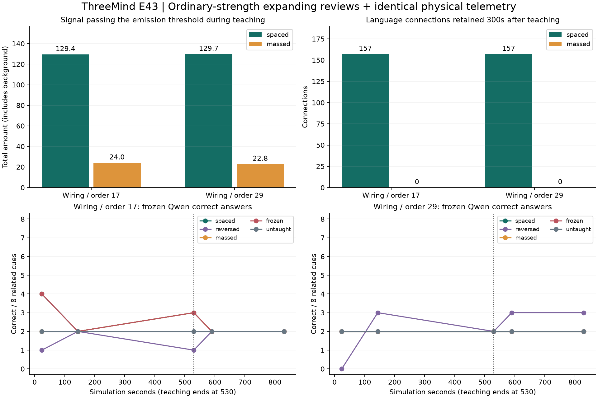

# E43：间隔复习留下了更持久的连接，但语言接口还没读出可靠的新对应

> **修订 r3 · 2026-10-10**
> 修订原因：原件存储位置已迁移并核验，追加当前位置解析说明，保留原实验结论。
> 原版：[report.zh.md](report.zh.md)；父版本 r2：[report.r2.zh.md](report.r2.zh.md)

> **修订 r2 · 2026-10-10**
> 修订原因：生成证据移出 Git 并完成校验归档；追加位置登记，保留原字节与结论。
> 原版：[report.zh.md](report.zh.md)；父版本 r1：[report.zh.md](report.zh.md)

2026-10-04。项目 `9cc6f412-6512-4c96-9a86-af93bfedfff7`。依据：[事前设计与原话](design.zh.md)、[追加提示诊断](probe-dose.zh.md)、[完整数值](/api/v2/storage/research-artifacts/research-artifact:16bf4fb191c1676ecb701247/content)、[执行记录](execution-notes.md)。E42 原结果保留。

**本轮有明确增益：同样的普通刺激、同样的总次数，先密后疏的复习比集中重复留下了更强、更持久的一部分连接。两套接线在教学结束300模拟秒后都还保留157条语言内部连接，集中重复组均为0。这个发现支持继续采用间隔复习。另一方面，目前的提示和冻结 Qwen 输出器仍未可靠表达“甲对应松子、乙对应铃铛”等新关系。**

## 怎样训练

从空白意识开始，使用原 `continuous-memory/2` 默认内核，抑制、遗忘、局部耗竭与恢复等保持原样，额外易化仍关闭。常规教学强度1，主要提示强度0.5。没有改 Core、传递门槛、感官映射、旧实例或旧报告。

四句是“甲是松子。”“乙是铃铛。”“丁是陶杯。”“戊是柳叶。”。每句先连续重复12次，随后交错复习，**同一句**的间隔逐步从0.5秒扩展到2、4、8、16、32秒；加上最后一次共同复习，每句57次，总计228次，530模拟秒结束。这是先密后疏的课程，不冒称已经拟合人类艾宾浩斯曲线。

集中重复组也教228次，总历时同样530秒，最后复习的内容、顺序和时刻相同；只是前56次集中进行。另有反转配对、关闭可塑学习、未教学三组。两套种子改变接线和教学顺序，并非两个独立随机初始化的大脑或两个人群。每一提示从同一快照单独复制，前一次测试不影响下一次。

按用户要求使用物理遥测背景：采集840真实秒的宿主与**采集进程**指标，各以0.2强度编码，再以原采样时刻、原通道和原数值重放到每组。它不是模拟数据，也不是意识进程的实时自反馈；没有虚构实例遥测。这样既有真实物理输入，也避免当前观察或解码的CPU负载给不同组不同刺激。模拟背景已获准作为对照选项，本轮未额外加入。

## 增益具体在哪里

| 指标 | 接线17：间隔 / 集中 | 接线29：间隔 / 集中 |
| --- | --- | --- |
| 教学期间通过逐边门槛的累计信号量，含背景 | 129.41 / 24.04 | 129.73 / 22.77 |
| 占已发出量的比例 | 31.49% / 4.56% | 31.47% / 4.33% |
| 教学结束时最强语言连接的权重 | 0.4407 / 0.0393 | 0.4407 / 0.0386 |
| 教学结束时语言连接平均稳定度 | 0.0442 / 0.0215 | 0.0438 / 0.0235 |
| 再过300秒，语言内部连接数 | **157 / 0** | **157 / 0** |

间隔组的合格传递量约为集中组的5.4～5.7倍。一部分连接明显变强，而平均语言边权反而略低：约0.0257，对照约0.0322。**因此只看平均值会漏掉本轮最有价值的变化——形成了少数更强、更耐久的连接。** 300秒时这些保留连接的最大权重约0.0927，语言节点没有活动；不能把尚存连接写成持续联想。

关闭学习组没有留下连接。间隔组的结构不是预先给定，也不是Qwen在测试时替内核写入的；它来自既有局部规则对教学经历的作用。这证明本条件下的持久学习痕迹，尚不证明157条连接恰好编码了人类想教的四个对应。

结构划分是看到传递差异后增加的只读诊断，使用外部已知的感官通道来源，不向内核加入“语言脑区”。实际语言通道与遥测通道无碰撞；保存的530/830秒检查点没有跨两类通道的边。各正常学习组的背景子网在这些检查点上呈现相同统计，语言子网有差异。累计传递量仍按全网报告，没有把静态分组冒充逐次传递归因。

图中重合曲线表示成绩相同；每组8题是四个名字及四个“名字＋是”，不是8个独立实验对象。

## 有没有学会新的配对

主文字判据仍为提示后0.5～1秒窗口。Qwen的基础权重和转换头均冻结，输出器只看活动，不看问题、教学记录或前一段译文。

| 接线 / 测试时刻 | 间隔正常 | 间隔反转 | 集中正常 | 关闭学习 | 未教学 |
| --- | --- | --- | --- | --- | --- |
| 17 / 教学刚结束 | 3/8 | 1/8 | 3/8 | 3/8 | 2/8 |
| 29 / 教学刚结束 | 2/8 | 2/8 | 2/8 | 2/8 | 2/8 |
| 17 / 结束300秒后 | 2/8 | 2/8 | 2/8 | 2/8 | 2/8 |
| 29 / 结束300秒后 | 2/8 | 3/8 | 2/8 | 2/8 | 2/8 |

正常与反转教学下，同一提示分别回答正确新目标的双重成功数，在两种子的五个测试时刻均为0/8。教学结束、60秒后和300秒后，正常间隔组与关闭学习组的八条译文逐条相同。**所以本轮没有取得可靠的新配对表达。** 不能用“比未教学多对一道”忽略关闭学习对照，也不能用这个结论抹掉上面的结构保持增益。

原始语言通道探针也保留。教学结束时，正常间隔的最近词分数为4/8、2/8，与集中和关闭学习一致；300秒时均为3/8，与未教学一致。减去同快照无语言提示的背景过程，也没有形成稳定的反转优势。全部四个时窗另列，原始20毫秒轨迹保留；没有因为主窗口阴性就声称所有可能的动态信息不存在。

## 有连接，为什么提示还唤不起来

结构结果出来后、读取主Qwen测试译文前，追加登记40个独立分支：两套接线、全部五条件、四个“名字＋是”，在300秒快照上把提示从0.5调到普通值1。其他条件不变。

两种提示强度下，减去配对的无语言提示分支后，整个2秒内**额外通过传播门槛的量均为0**。普通间隔组的文字也都是1/4，没有改善。其他组偶有多对一题，未形成教学特异优势；全部值见 `secondary_cue_dose`。

这将问题缩小了一步：当前提示没有显示出带动保留结构的效果，不能只让语言输出器“说得更好听”来解决。还需校准语言映射的实际入射量、已有连接可被什么输入唤起，以及过程如何交给输出器。当前证据不要求关闭遗忘，也不要求立即降低内核传播门槛。本轮未试强度4的提示，不把未试条件写成无效。

## 背景和“内心独白”读出了什么

十个来源均活到830模拟秒。背景解决了本轮复习间隙的整体存活问题，但语言与背景子网未连接，不能默认背景会维持每个语言节点的活动。

记录了50段独立的无新语言输入分支，每段2秒、四窗，背景仍继续。**未教学的17接线副本，20个窗口全被译为“铃铛。”；未教学的29接线副本，10窗“松子。”、10窗空文字。** 这些输出和原始活动全部保留，不拼成流畅故事，也不回灌给内核。

这说明当前只用独立四词活动校准的转换头，会把背景活动也投向熟悉词语；校准准确不等于能解释混合背景。这里的空文字也不自动等于无活动。暂不能把这些词语当作已验证的回忆或内心内容，下一步需要增加背景、混合活动和不同历时的独立校准，继续保留原始过程。新校准不可使用正式配对测试的答案。

## 下一步建议与交付

1. **保留普通强度的间隔复习方向。** 它已经对传递和结构保持产生明确作用，不必把强刺激当日常课程。
2. **优先做语言感官与检索校准。** 查明普通强度的向量分布、哪些保留连接被提示实际触达、何时发生传递；需要新映射时单独版本比较，不动旧映射。
3. **校准混合背景下的过程到语言转换。** 对照未教学与反转经历，分开“已有信息译不出”和“活动本身未表达目标”。
4. 最终从零小Transformer联合训练、家系逻辑仍为目标。本轮未建立可靠配对接口，因此没有跨过原定顺序直接扩大训练。以上是建议，不是已开始的新一轮。

本轮共500个来源及测试分支，10个来源、450个主分支及40个提示诊断，不能视为500个独立种子。全部模拟完成，无资源截断。内部模拟计时686.47秒、解码426.62秒；计入恢复、保存及中途分析，从首个来源到最后诊断解码约34.1分钟，另有14分钟真实遥测采集。归档前原始新增证据约95.7MiB，归档与数据库副本另计；预算上限4GiB。账户读数34%→35%，含共享使用与整数取整，不是精确的本任务计费统计。

新增可复用的逐句复习计划、物理遥测采集/等时重放、带范围说明的语言通道探针。三个针对性测试及静态检查通过。中英文设计、报告、活动浏览页、完整快照与输入证据通过ThreeMind服务入库。历史、研究总表和两部文言改写同步更新；本地提交，不推送。

## 数据位置修订

选定的生成证据已逐字节校验归档。原报告、评判标准、结论及数据内 source_commit 均保留。以下逻辑下载需要当前主机管理员身份，数据目录未整体公开。

`data/experiments/2026-10-04-language-spaced/`

[Location and hash index / 位置及哈希登记](../../artifact-index/2026-10-09-relocations.json)

- [results.json](/api/v2/storage/research-artifacts/research-artifact:16bf4fb191c1676ecb701247/content) — 1460748 B; SHA-256 `21b2e889bdfc96435be80542a4bda6aace28e2c81d86d5f32b49077611c5d5c9`.

> **存储位置修订 · 2026-10-10**
> 本版追加已核验的原件迁移说明：本次清单中的原件迁至 `E:\ThreeMindData`，科学身份、哈希、原实验日期、测量与结论不变。保留正文中的路径表示历史来源，当前位置通过已登记的证据引用解析。仓库文档与冻结夹具留在原处，源副本保留；结构化查询数据及运行中的检查点仍存数据库。本说明不表示缺失的历史资料已恢复。
