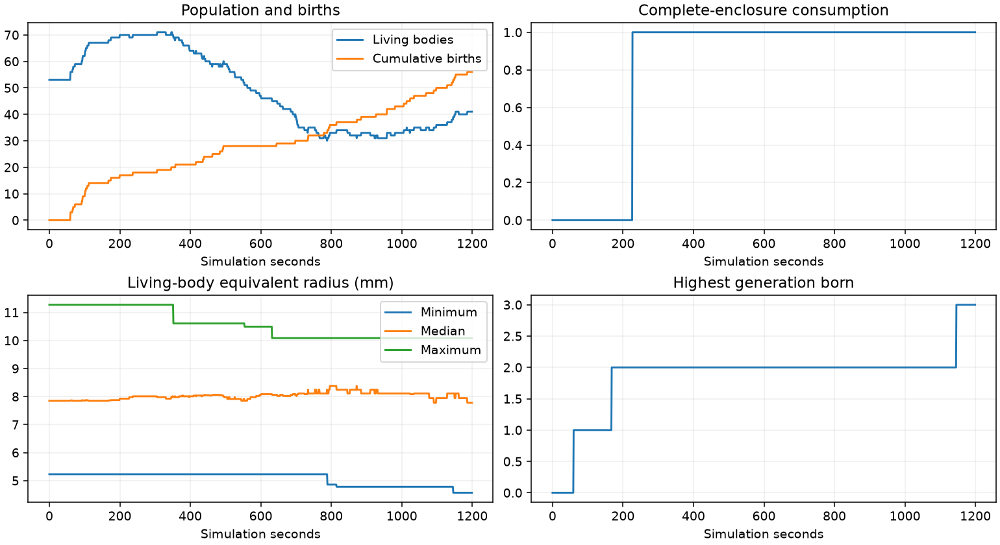

# E37: all-Core enclosure-only ocean and inherited variation

2026-10-04 · Project `bc5ac72c-27bf-4e3e-9a21-f922bc7ddc90` · Evidence `.work/ocean-enclosure-20261004`.

## Measured results

53 founders, **1200 simulated seconds**, **56 offspring**, highest **generation3**, **41 physical survivors** and **1 completed enclosure consumptions**. All bodies used Core control; no contact capture or random controller. Nutrients consumed1461, remaining99. Status`horizon_paused` preserves live states rather than killing at the horizon.

Offspring radius versus immediate parent: 10 increases, 9 decreases, 37 unchanged. Mutation starts from current parental traits, not a reset founder. Generation depth is not a count of species. Living generation counts: {'0': 11, '1': 19, '2': 10, '3': 1}.

30 surviving bodies still have positive bodily reserves. Cumulative unmet bodily maintenance is6613.53units. Physical presence is distinguished from funded motion; low reserves limit propulsion. Recorded body-failure categories: `{'captured': 1}`. Raw Core activity/energy states remain available.

## An actual ancestry chain

Selected by deepest generation among final survivors, then lowest ID, not size/capture success. Radius is the equal-planar-area parameter, not extent in every direction. Dead ancestors remain archived.

#37 (G0, 5.23 mm) → #84 (G1, 5.23 mm) → #95 (G2, 5.23 mm) → #105 (G3, 4.57 mm)

| ID | Parent | Generation | Radius mm | Shell | Elongation |
| --- | --- | --- | --- | --- | --- |
| 37 | — | 0 | 5.228 | 0.289 | 0.647 |
| 84 | 37 | 1 | 5.228 | 0.289 | 0.647 |
| 95 | 84 | 2 | 5.228 | 0.369 | 0.647 |
| 105 | 95 | 3 | 4.569 | 0.369 | 0.626 |

## Recorded enclosure events

First20 below; all events remain in`analysis.json` and per-segment`events.json`. Times refer to the complete habitat, not an isolated reenactment.

| Simulation s | Predator→prey | Radii mm | Held/required s | Energy received |
| --- | --- | --- | --- | --- |
| 226.06 | 59 → 32 | 9.059 / 5.944 | 0.200 / 0.200 | 173.96 |

Larger bodies gain geometric containment capacity but retain volume-dependent maintenance, locomotion and construction costs. A single long habitat records actual inheritance and consumption; it does not by itself establish a general size advantage. No extra body-size ablation or multi-environment selection trial was run. This observation does not replace E32–E36's control/internal-activity evidence.

## Separate apparatus boundary

Ocean/3 overlap separation obstructed entry. A5-second inward-motion calibration of14/7-mm bodies reached20.87-mm minimum center distance versus≤7mm required. New`threemind.ocean-enclosure/1` admits partial overlap only when the larger capsule can geometrically contain the other at current orientations. Consumption still requires continuous actual complete enclosure; shells extend dwell and impose energy cost. Incompatible shapes separate. No attraction, pursuit or neural reward is added. This is a declared soft-envelope approximation, not a tissue/fluid simulation.

Removal of contact capture and membrane entry are two explicitly declared environmental changes, not a one-factor E35 comparison. Core`continuous-memory/2`, propagation, forgetting, inhibition, energy and neural inheritance remain unchanged.

## Footage and evidence

The continuous full-habitat movie runs6×. Colours indicate generations, **not Core/random groups**. The panel displays population by generation, actual sizes and a current deepest ancestry example. Event excerpts select the first natural consumption of each segment, retain the full habitat and add a magnified view. Recorded100ms samples are held without invented interpolation or replay simulation.

Lossless inputs/actions20ms;150s checkpoints and segment boundary full states. Body dissipation57846.13, energy-ledger error-7.6e-07. Simulation process time112.98minutes. Capacity-deferred birth attempts0, nutrient capacity blocks0; attempts are not independent individuals. Delivery lists resources and actual media.

[Registration](design.en.md) · [Execution](execution-notes.md) · [Commands](README.md)
