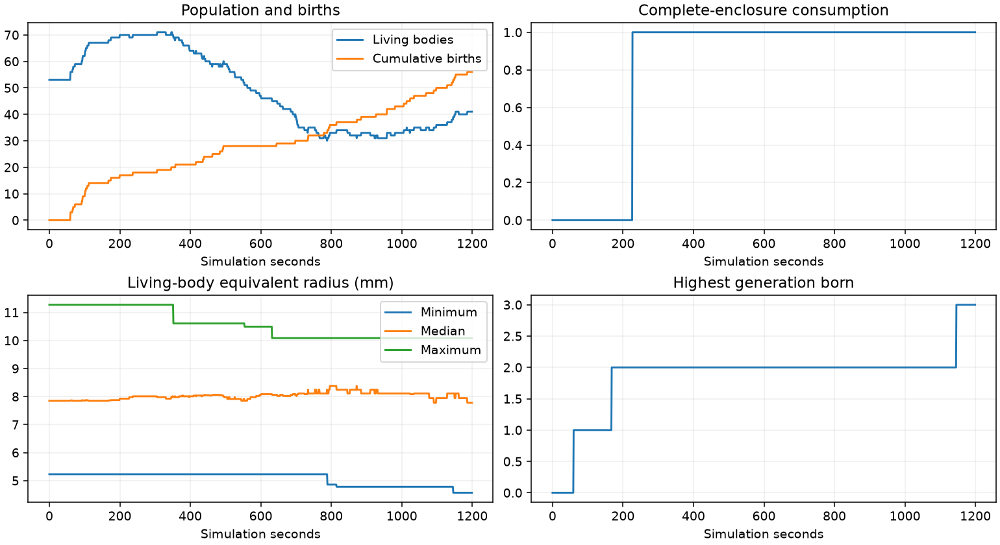

# E37: all-Core enclosure-only ocean and inherited variation — r3

> **Revision r3 · 2026-10-16**
> Revision reason: Add purpose, existing expectations, interpretation and explicit scientific conclusions; preserve criteria, results and historical editions.
> Original: [report.en.md](report.en.md); parent r2: [report.r2.en.md](report.r2.en.md)

Editorial synthesis dated 16 October 2026. Experiment dates, measurements, thresholds and version identities are unchanged. Purpose and meaning are reconstructed from the original protocol and report; judgments not prospectively quantified are not relabeled as preregistered passes. No subject was rerun and no large raw trajectory was recomputed.

[Parent report](report.r2.en.md) · [中文](report.r3.zh.md) · [Historical audit](../../../docs/en/plans/report-conclusion-audit-20261016.md). Parent bytes read for this review, SHA256: `de373745cbe943b71a46703c1f106686895b706eaeeccf8a2771723424a92526`.

## Purpose and expected evidence

E37 was designed to observe whether strict enclosure could produce actual consumption in a complete ocean and to record body size, natural reproduction and continuing ancestry. Evidence required real geometry, recorded events and complete body state. It did not require larger bodies always to prevail or one capture to establish learned hunting. Because Ocean/3 collisions prevented enclosure, the separately declared ocean-enclosure/1 environment allowed soft-membrane overlap and enclosure consumption. Those two environmental changes are not a single Core-mechanism ablation.

## Interpretation and conclusion

**Strict enclosure consumption occurred in this environment, and size was transmitted with variation in both directions through natural reproduction. The descriptive and apparatus-feasibility objectives were met.** Fifty-three founders produced 56 offspring over 1,200 internal seconds, reaching generation 3. Forty-one physical bodies remained, of which thirty retained body energy; forty-one must not be relabeled as forty-one energetic living consciousnesses.

At 226.06 seconds, body 59 enclosed body 32 for the required 0.2 seconds. Their radii were 9.059 and 5.944mm, and the event yielded 173.96 energy. This moves the evidence from an implemented rule to an actual consumption consequence in the complete habitat and provides a preserved candidate for further cultivation.

Among 56 births, radius increased relative to the parent in ten, decreased in nine and remained equal in thirty-seven. The 37→84→95→105 lineage had radii 5.228, 5.228, 5.228 and 4.569mm. Body attributes therefore continued and varied across generations; uniformly increasing size was not observed. A real inheritance chain and an actual consumption event are the concrete findings.

## Meaning for ThreeMind

This is **favorable to the feasibility of complete ecological research**: embodied control, actual enclosure consumption, continuing ancestry and reusable saved states coexist in one observed habitat. It is an ecological and apparatus result. Newly available capture opportunities created by environmental rules do not themselves establish improved learned hunting. Matched comparisons for learning benefits were not part of this observation's goal, so their absence does not revoke its achievement. Subsequent repeat-capture cultivation retains its separate registered outcomes.

## Preserved original evidence

> **Revision r2 · 2026-10-10**
> Revision reason: Verified original-file relocation; append location-resolution guidance and preserve the experiment conclusions.
> Original: [report.en.md](report.en.md); parent r1: [report.en.md](report.en.md)

2026-10-04 · Project `bc5ac72c-27bf-4e3e-9a21-f922bc7ddc90` · Evidence `.work/ocean-enclosure-20261004`.

### Measured results

53 founders, **1200 simulated seconds**, **56 offspring**, highest **generation3**, **41 physical survivors** and **1 completed enclosure consumptions**. All bodies used Core control; no contact capture or random controller. Nutrients consumed1461, remaining99. Status`horizon_paused` preserves live states rather than killing at the horizon.

Offspring radius versus immediate parent: 10 increases, 9 decreases, 37 unchanged. Mutation starts from current parental traits, not a reset founder. Generation depth is not a count of species. Living generation counts: {'0': 11, '1': 19, '2': 10, '3': 1}.

30 surviving bodies still have positive bodily reserves. Cumulative unmet bodily maintenance is6613.53units. Physical presence is distinguished from funded motion; low reserves limit propulsion. Recorded body-failure categories: `{'captured': 1}`. Raw Core activity/energy states remain available.

### An actual ancestry chain

Selected by deepest generation among final survivors, then lowest ID, not size/capture success. Radius is the equal-planar-area parameter, not extent in every direction. Dead ancestors remain archived.

#37 (G0, 5.23 mm) → #84 (G1, 5.23 mm) → #95 (G2, 5.23 mm) → #105 (G3, 4.57 mm)

| ID | Parent | Generation | Radius mm | Shell | Elongation |
| --- | --- | --- | --- | --- | --- |
| 37 | — | 0 | 5.228 | 0.289 | 0.647 |
| 84 | 37 | 1 | 5.228 | 0.289 | 0.647 |
| 95 | 84 | 2 | 5.228 | 0.369 | 0.647 |
| 105 | 95 | 3 | 4.569 | 0.369 | 0.626 |

### Recorded enclosure events

First20 below; all events remain in`analysis.json` and per-segment`events.json`. Times refer to the complete habitat, not an isolated reenactment.

| Simulation s | Predator→prey | Radii mm | Held/required s | Energy received |
| --- | --- | --- | --- | --- |
| 226.06 | 59 → 32 | 9.059 / 5.944 | 0.200 / 0.200 | 173.96 |

Larger bodies gain geometric containment capacity but retain volume-dependent maintenance, locomotion and construction costs. A single long habitat records actual inheritance and consumption; it does not by itself establish a general size advantage. No extra body-size ablation or multi-environment selection trial was run. This observation does not replace E32–E36's control/internal-activity evidence.

### Separate apparatus boundary

Ocean/3 overlap separation obstructed entry. A5-second inward-motion calibration of14/7-mm bodies reached20.87-mm minimum center distance versus≤7mm required. New`threemind.ocean-enclosure/1` admits partial overlap only when the larger capsule can geometrically contain the other at current orientations. Consumption still requires continuous actual complete enclosure; shells extend dwell and impose energy cost. Incompatible shapes separate. No attraction, pursuit or neural reward is added. This is a declared soft-envelope approximation, not a tissue/fluid simulation.

Removal of contact capture and membrane entry are two explicitly declared environmental changes, not a one-factor E35 comparison. Core`continuous-memory/2`, propagation, forgetting, inhibition, energy and neural inheritance remain unchanged.

### Footage and evidence

The continuous full-habitat movie runs6×. Colours indicate generations, **not Core/random groups**. The panel displays population by generation, actual sizes and a current deepest ancestry example. Event excerpts select the first natural consumption of each segment, retain the full habitat and add a magnified view. Recorded100ms samples are held without invented interpolation or replay simulation.

Lossless inputs/actions20ms;150s checkpoints and segment boundary full states. Body dissipation57846.13, energy-ledger error-7.6e-07. Simulation process time112.98minutes. Capacity-deferred birth attempts0, nutrient capacity blocks0; attempts are not independent individuals. Delivery lists resources and actual media.

[Registration](design.en.md) · [Execution](execution-notes.md) · [Commands](README.md)

> **Storage-location revision · 2026-10-10**
> This edition adds the verified move of the selected originals to `E:\ThreeMindData`. Stable scientific identities and hashes, experiment dates, measurements and conclusions remain unchanged. Paths in the preserved body describe historical sources; use the registered evidence resolver for current locations. Repository documents and frozen fixtures remain in place, and source copies are retained. Structured query data and running checkpoints remain in the database. This annotation does not assert that missing historical evidence was recovered.

## Revised conclusion

E37 met its observation goals for strict enclosure consumption and size variation across generations and delivered a reusable candidate. Its achievement is a real ecological event and lineage, rather than an uncontrolled claim of learning advantage.
