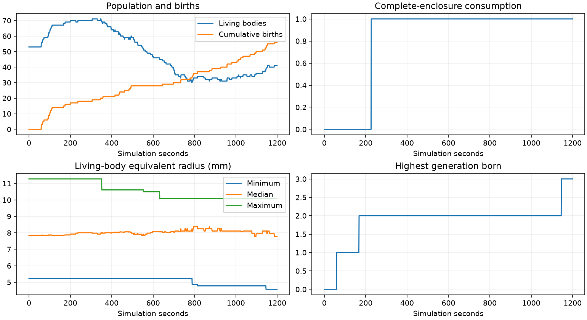

# E37：仅包裹吞食的意识驱动海洋与代际变化 — r3

> **修订 r3 · 2026-10-16**
> 修订原因：补充研究目的、既有预期、结果分析与明确科学结论；保留原判据、成绩和全部历史版本。
> 原版：[report.zh.md](report.zh.md)；父版本 r2：[report.r2.zh.md](report.r2.zh.md)

2026-10-16 结论补述。原实验日期、测量、门槛及版本保持不变。本版依据原方案和报告归纳研究问题与科学意义；未在原方案预先量化的判断，不冒称预登记通过。没有重新运行个体或复算大型原始轨迹。

[父报告](report.r2.zh.md) · [English](report.r3.en.md) · [全历史核查](../../../docs/zh/plans/report-conclusion-audit-20261016.md)。父文件本次读取 SHA256：`7d089faa6efcf81fcd6c1f550b00e3786b7991c60caa95c475f1c59336ff9925`。

## 研究目的与预期证据

E37的既定任务是在完整海域观察严格包围条件能否实际触发摄食，并记录体型、自然繁殖和谱系连续变化。要求真实几何接触、可回读事件及完整身体状态；没有预先要求“大体型一定占优”或“单次捕获已经证明学会狩猎”。原Ocean/3碰撞规则阻止了包围，因此本批独立声明ocean-enclosure/1的软膜重叠和包围摄食环境，不把两项环境变化冒称一个Core机制消融。

## 结果解释与结论

**严格包围摄食在该环境中确实发生，体型也随自然繁殖保留并发生双向变异；本批描述与装置可行性目标完成。** 53个创始身体在1,200内部秒内产生56个后代，最高到第3代；终点有41个物理存续身体，其中30个仍有身体能量。41不能另称41个有能量的存活意识。

226.06秒时，59号包围32号并满足0.2秒持续条件，半径分别为9.059、5.944mm，实际取得173.96能量。此事件把“规则已经实现”推进到“完整生态中的实际摄食后果”，提供了可保存和复用的捕食候选。

56次出生中，半径较亲本增大10次、减小9次、不变37次；37→84→95→105谱系的半径为5.228、5.228、5.228、4.569mm。这支持身体属性能够随世代延续并变化，且没有观察到所有后代一律变大的方向。存在真实遗传链与一个实际摄食事件，就是本批的明确发现。

## 对 ThreeMind 的意义

该结果**有利于后续完整生态研究的可实施性**：已取得具身控制、真实包围摄食、连续谱系和可复用状态的共同材料。它是一项生态现象与装置成果，不能把环境新开放的捕获机会解释成Core学习已经改善捕猎。评价学习收益需要另有原方案未设置的匹配对照；这不是撤销本次已完成的观察目标。之后的重复捕食培养应继续沿其独立登记结果判断。

## 原报告证据层（保留原文）

> **修订 r2 · 2026-10-10**
> 修订原因：原件存储位置已迁移并核验，追加当前位置解析说明，保留原实验结论。
> 原版：[report.zh.md](report.zh.md)；父版本 r1：[report.zh.md](report.zh.md)

2026-10-04 · 独立项目 `bc5ac72c-27bf-4e3e-9a21-f922bc7ddc90` · 原始证据 `.work/ocean-enclosure-20261004`。

### 直接结果

本轮从53个意识驱动个体开始，实际观察 **1200模拟秒**，出生 **56** 个后代，最高到 **第3代**，结束时 **41** 个躯体存活。完成 **1次完整包裹吞食**；没有接触捕获或随机驱动个体。营养摄入1461颗，海中尚余99颗。结束状态为`horizon_paused`，不是把仍活着的个体判死。

后代相对直接亲代的半径：10次变大、9次变小、37次不变。变异不是每次重置到创始体；它从当代亲本参数继续变化。最高代次表示继承链的深度，不是已经出现相同数量的新物种。

末存活代次分布：第0代 11个、第1代 19个、第2代 10个、第3代 1个。

其中身体储备仍大于零的有30个；累计未能支付的身体维持需求为6613.53单位。这里的“存活”首先指躯体仍物理存在，储备不足会限制推进，不把这些个体一概叫作仍有充分活动能力。身体失效分类为`{'captured': 1}`，另有原始Core活动/供能状态可查。

### 一个实际亲缘链

按“末态存活者中代次最深、同代取较小身份号”选择，不按体型或捕食成功挑选。半径是保持平面面积相等的尺寸参数，不是所有方向的外缘半径。父母即使已死亡，其原始身体和脑状态仍保留。

#37 (G0, 5.23 mm) → #84 (G1, 5.23 mm) → #95 (G2, 5.23 mm) → #105 (G3, 4.57 mm)

| 身份 | 亲代 | 代次 | 半径mm | 外壳 | 伸长 |
| --- | --- | --- | --- | --- | --- |
| 37 | — | 0 | 5.228 | 0.289 | 0.647 |
| 84 | 37 | 1 | 5.228 | 0.289 | 0.647 |
| 95 | 84 | 2 | 5.228 | 0.369 | 0.647 |
| 105 | 95 | 3 | 4.569 | 0.369 | 0.626 |

### 实际包裹事件

以下列前20次，全部事件另存`analysis.json`及各段`events.json`。时间为完整海洋的模拟时间；不是在剪裁出来的一对个体间重新上演。

| 模拟秒 | 吞食者→被吞食者 | 双方半径mm | 包裹持续/要求秒 | 转入能量 |
| --- | --- | --- | --- | --- |
| 226.06 | 59 → 32 | 9.059 / 5.944 | 0.200 / 0.200 | 173.96 |

更大躯体拥有几何包容能力，同时也承担原先按体积增长的运动、维持与繁殖构造成本。一次完整海洋能显示真实继承和捕食过程，但不能单凭最大体型或末态数量证明“大一定更好”；本轮没有额外做体型消融或多环境选择优势实验。原E32—E36的控制与内部活动结论不被这段展示性长观察替代。

### 为何另建环境版本

旧Ocean/3在完整包裹前就分离重叠躯体，直接关闭接触捕获会阻挡进入。14/7毫米躯体的5秒相向运动校准最小中心距20.87毫米，包裹却要求≤7毫米。新`threemind.ocean-enclosure/1`允许几何上能容纳对方的软包膜部分重叠进入；只有完整包裹持续满足要求才吞食。外壳延长时间并增加吞食开销。形状不相容者保留碰撞分离，不添加吸引、追逐指令或神经奖励。这是简化的软包膜几何环境，不是流体/组织仿真。

因此它包含“关闭接触吞食”和“软膜允许进入”两个明确环境变化，不能当成与E35只改一个参数的对照。Core仍为`continuous-memory/2`；传播、遗忘、抑制、能量及原有神经遗传规则未改。

### 录像与保存

全景录像保留全部个体、食物和随机补充，6倍速；颜色表示代次，**不是意识/随机两组**。右栏展示代次人数、实际尺寸和一条当时最深亲缘链。吞食片段按每段首个自然事件选择，保留全海，另加局部放大；有事件才生成，不补拍。影片是实测100毫秒采样的保持播放，没有插值或重演。

完整输入和动作每20毫秒无损保存；150秒检查点及段首尾脑/世界状态保留。身体运动、维持等合计耗散57846.13能量单位；总账误差-7.6e-07。总进程模拟时间112.98分钟。出生上限/种群上限导致的暂缓计数0，营养容量阻塞0；暂缓计数不是独立个体数。详细资源、录像及本地交付清单见交付记录。

[登记、预算与用户原话](design.zh.md) · [执行记录](execution-notes.md) · [命令](README.md)

> **存储位置修订 · 2026-10-10**
> 本版追加已核验的原件迁移说明：本次清单中的原件迁至 `E:\ThreeMindData`，科学身份、哈希、原实验日期、测量与结论不变。保留正文中的路径表示历史来源，当前位置通过已登记的证据引用解析。仓库文档与冻结夹具留在原处，源副本保留；结构化查询数据及运行中的检查点仍存数据库。本说明不表示缺失的历史资料已恢复。

## 修订结论

E37完成了严格包围摄食与跨代体型变化的观察目标，并交付可复用候选。其成果是完整生态中真实发生的事件与谱系，不是未经对照的学习优势宣称。
