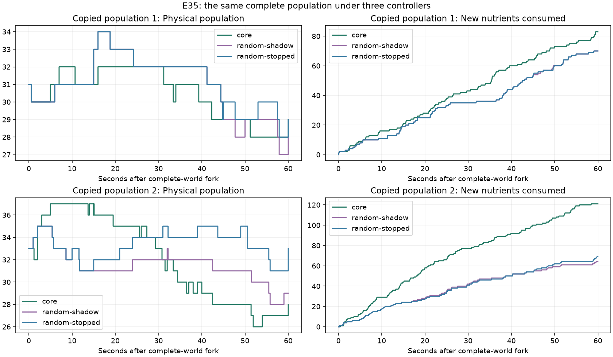
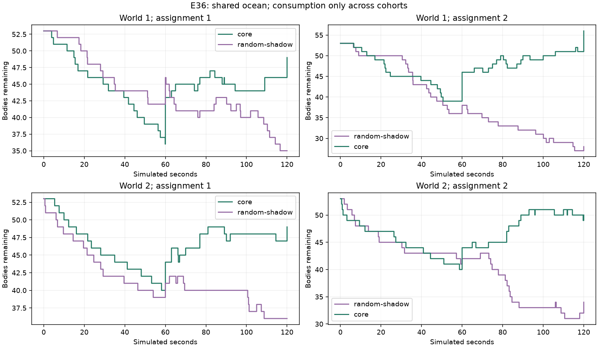

# E35–E36: copied populations and competition in one ocean

[中文](report.zh.md) · [Preregistration](design.en.md) · [Execution](execution-notes.md) · [Commands](README.md)

2026-10-04. All 10 registered conditions finished. Whole-population continuations use two historical worlds; mixed competition uses two different environment seeds with swapped A/B controllers. Swaps are not additional independent environments.

## Direct results

**E35 compares the same whole population copied.** Core-minus-random-retained-cost feeding differences are +13/+57; final physical-population differences are +1/-1. Every fork retains its complete world.

Random control with Core completely stopped also ate less: Core consumed 13 and 52 more nutrients in the two sources. Stopping Core saves energy and can increase births, so feeding and final population are separate outcomes.

**E36 remaining-population outcome: Core more numerous in 4/4, random in 0/4, tied in 0/4.** Core-minus-random differences across assignments are `[14, 28, 13, 16]`. Births and capture losses below explain how those counts arose.

## E35: whole-population controllers

Continue actual E32 full-world 60s snapshots for 60s with Core, random retaining Core operation, and random with Core stopped. Bodies, history, positions, ages, reserves, neighbors, food, time and random states share one source. Later ecology diverges naturally. Descendants inherit the experimental controller.

| Source | Controller | Initial alive | Final physical | Final body reserve>0 | New food | New captures | Births | New Core expense | New unmet maintenance |
| --- | --- | ---: | ---: | ---: | ---: | ---: | ---: | ---: | ---: |
| 1 | core | 31 | 29 | 29 | 83 | 7 | 5 | 15036.2 | 0.000 |
| 1 | random-shadow | 31 | 28 | 27 | 70 | 9 | 6 | 15402.7 | 4.822 |
| 1 | random-stopped | 31 | 29 | 29 | 70 | 9 | 7 | 0.0 | 0.000 |
| 2 | core | 33 | 28 | 26 | 121 | 18 | 13 | 16192.1 | 8.223 |
| 2 | random-shadow | 33 | 29 | 28 | 64 | 11 | 7 | 15742.0 | 10.279 |
| 2 | random-stopped | 33 | 33 | 33 | 69 | 12 | 12 | 0.0 | 0.000 |

The user's proposed within-group predation explanation has a concrete example in source 2: Core produced 6 more births but also 7 more captures than retained-Core random, ending one body lower. All physical losses in these continuations were captures. More feeding and reproduction can coexist with fewer bodies at the endpoint.

Positive body reserve is an energy measure, not a consciousness criterion. Conditions with new unmet maintenance or physically present bodies lacking reserve: `['g0-random-shadow', 'g1-core', 'g1-random-shadow']`. Stopping Core removes neural death; bodies have no separate irreversible starvation-death equation. Such physical presence must not be presented as longevity. No new death threshold was introduced for convenient results.

Stopped neural states/reserves remain frozen and are not donated to bodies. Descendants still pay original construction/body/neural-reserve costs. Saved operating energy is the declared intervention's consequence, not equalized away. The two random arms use identical commands for common identity/time. Normal Core cadence/amplitude are unrestricted.

## E36: shared-ocean competition

Area 2.88m², side 1.2√2m; 53 initial bodies per cohort, 720 initial nutrients, one random-position nutrient per 0.5s, capacity 8192, shared population cap 194. Water, temperature, gravity/buoyancy-related feedback, collision, proprioception, finite energy, shells, mutation and reproduction remain. No fusion, cooperative control or target labels. Immature parent–child protection is bilateral.

Each world has 53 body/brain twin pairs at different random positions. A/B is external metadata, never sensory friend/enemy information. Within-cohort consumption is forbidden; cross-cohort consumption is allowed. Swapped assignments keep physical states and food unchanged. Random control retains Core costs; E35 separately examines stopping Core.

The 60s and 120s horizons stop observation, not individual lifespans. They do not kill a Core at the endpoint; all bodies, brains and world states are saved for explicit continuation or new forks.

| World/assignment | Cohort/control | Final alive | Births | Captured by other group | Other body losses | Captures | Nutrients |
| --- | --- | ---: | ---: | ---: | ---: | ---: | ---: |
| 1/1 | A: core | 49 | 18 | 22 | 0 | 27 | 347 |
| 1/1 | B: random-shadow | 35 | 9 | 27 | 0 | 22 | 188 |
| 1/2 | A: random-shadow | 28 | 4 | 29 | 0 | 20 | 199 |
| 1/2 | B: core | 56 | 23 | 20 | 0 | 29 | 373 |
| 2/1 | A: core | 49 | 14 | 18 | 0 | 23 | 311 |
| 2/1 | B: random-shadow | 36 | 6 | 23 | 0 | 18 | 208 |
| 2/2 | A: random-shadow | 34 | 6 | 25 | 0 | 19 | 212 |
| 2/2 | B: core | 50 | 16 | 19 | 0 | 25 | 322 |

Conditions reaching the population cap: none. If no cap was reached, population differences were not censored by that limit.

Every final count can be checked as initial population plus births minus capture losses. Core had both more births and fewer losses to the other cohort in all four assignments; both contributed to its numerical advantage. The complete trajectories also retain earlier periods without that advantage.

Core remained more numerous in both environments after controller assignments were swapped; the result does not depend on selecting only one initial side. This group test does not alone attribute all benefit to memory or internal association; E32/E34 address local mechanisms. Predation permission is an external environment rule, not a neural good/bad value.

## What the intervention studies add

- [E33 without predation](../2026-10-03-ocean-no-predation/report.en.md): Core consumed 35.3% and 44.2% more nutrients even when organisms could not consume one another. Feeding benefit is not an artifact of eating competitors. No organism died in that window; population differences came from births.
- [E32 full-habitat interventions](../2026-10-03-ocean-community/report.en.md): body 0 consumed 3 nutrients intact, 2 with its selected pathways silenced, and 3 with matched pathways silenced. Existing internal pathways affected a concrete feeding sequence.
- [E34 capture and transplantation](../2026-10-03-ocean-hunting/report.en.md): target grafts moved blank-body actions closer to experienced actions than matched grafts in 3 of 4 sources. Body 12 also changed whether a capture occurred, in the direction of fewer captures. Body 36 retained two captures despite strong suppression of uncued activity in its selected region; that region was not necessary for those events.
- Whole-population copies and shared competition establish the broader control difference. **There is evidence both of population benefit and of internal pathways causally changing particular behavior; their quantitative contribution to the total benefit, relative to immediate senses and existing wiring, remains unresolved.** This does not erase the observed benefit or presume that every capture is deliberate pursuit.

## Evidence and scope

| Condition/cohort | Command/food-gradient cosine | Command along gradient | Water-relative velocity along gradient m/s | Food per living-body second | Captures per living-body second | Motor expense |
| --- | ---: | ---: | ---: | ---: | ---: | ---: |
| copy-g0-core: all | 0.1394 | 0.0630 | 0.001994 | 0.04544 | 0.00383 | 950.5 |
| copy-g0-random-shadow: all | -0.0069 | -0.0011 | 0.001301 | 0.03773 | 0.00485 | 2163.1 |
| copy-g0-random-stopped: all | -0.0052 | -0.0000 | 0.001328 | 0.03749 | 0.00482 | 2183.9 |
| copy-g1-core: all | 0.1887 | 0.0988 | 0.003047 | 0.06282 | 0.00935 | 1382.6 |
| copy-g1-random-shadow: all | 0.0008 | -0.0002 | 0.001091 | 0.03382 | 0.00581 | 2360.7 |
| copy-g1-random-stopped: all | 0.0150 | 0.0071 | 0.001111 | 0.03451 | 0.00600 | 2497.2 |
| mixed-g0-swap0: A | 0.1496 | 0.0738 | 0.002493 | 0.06419 | 0.00499 | 3704.9 |
| mixed-g0-swap0: B | -0.0013 | -0.0002 | 0.001272 | 0.03570 | 0.00418 | 6675.6 |
| mixed-g0-swap1: A | 0.0160 | 0.0188 | 0.001538 | 0.04254 | 0.00428 | 6168.7 |
| mixed-g0-swap1: B | 0.1395 | 0.0754 | 0.002633 | 0.06560 | 0.00510 | 4655.0 |
| mixed-g1-swap0: A | 0.0977 | 0.0573 | 0.001912 | 0.05557 | 0.00411 | 3576.9 |
| mixed-g1-swap0: B | 0.0252 | 0.0213 | 0.001454 | 0.04167 | 0.00361 | 6361.2 |
| mixed-g1-swap1: A | 0.0113 | 0.0087 | 0.001301 | 0.04352 | 0.00390 | 6204.5 |
| mixed-g1-swap1: B | 0.1014 | 0.0620 | 0.002080 | 0.05761 | 0.00447 | 4660.3 |

Direction is computed from the actual sensed nutrient gradient, not a desired heading injected into Core. Cosine 1 points toward the local gradient, 0 has no average alignment, and negative values point away. Only nonzero-gradient periods enter direction averages. Velocity also reflects inertia and contacts. Time samples are not independent organisms. These observations connect outcomes with directional behavior and energy, without defining intention from alignment alone.

Capture totals also depend on the number of living organisms and their exposure time. Captures per living-body second supplement interpretation without replacing the primary final-population criterion. Living-body time is integrated from 100ms habitat records; it does not add independent samples.

Complete habitat sampled every 100ms; actual inputs/actions recorded at 20ms. Movies replay recorded trajectories with green Core, purple random retained cost and blue stopped Core. They add no independent samples. No Core formulas, historical protocols/evidence or autonomy criteria were changed.

Final tables include events at the 120s boundary. The last movie frame shows an actual sample around 119.8s and may precede births at that boundary; it must not replace the final-state count.

Two independent environments and a finite horizon do not establish a universal ranking. The baseline is the original per-second independent random command, not every possible random controller; no matching restriction is imposed on Core.

Total 112.65 simulation-process minutes with one worker. All brains, bodies and worlds are saved without deleting old data. Designs, bilingual reports and videos are published to local project `851b8ff9-0fc4-4d65-802c-5b979c215890`; full raw evidence remains on disk. See the delivery receipt.
