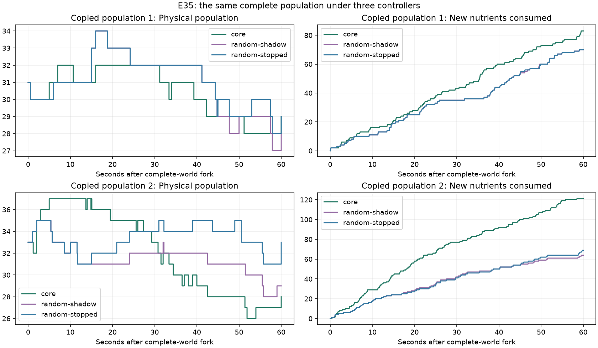
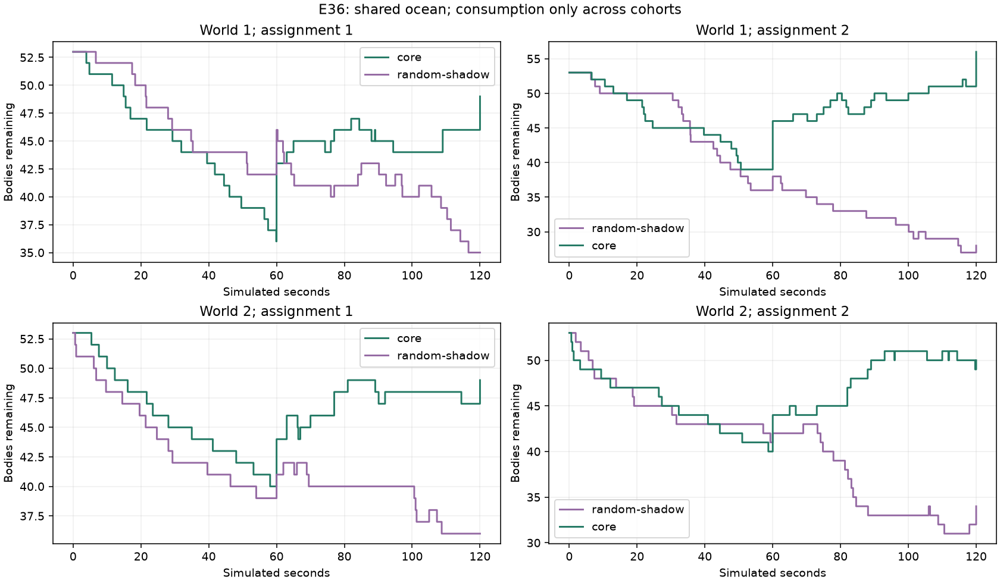

# E35–E36：同一整组换控制器，以及两组共海竞争

> **修订 r2 · 2026-10-10**
> 修订原因：原件存储位置已迁移并核验，追加当前位置解析说明，保留原实验结论。
> 原版：[report.zh.md](report.zh.md)；父版本 r1：[report.zh.md](report.zh.md)

[English](report.en.md) · [事前登记与原话](design.zh.md) · [执行记录](execution-notes.md) · [命令](README.md)

2026-10-04。10个登记条件全部完成。整组分叉来自两个完整历史世界；共同竞争使用另外两个环境种子，并分别交换A/B的控制方式。交换分支不是额外独立环境样本。

## 直接比较结果

**E35确实比较同一整组的副本。**保留Core耗能的随机控制相比正常意识驱动，两来源的“意识减随机”摄食差为+13、+57，末存活差为+1、-1。每组复制的是同一完整海洋，不是另选不同个体，也不是只有一只和一颗食物。

完全停用内核的随机组也没有赶上摄食：两个来源的意识组分别多摄入13、52颗。停核省下的能量会增加出生，所以“吃得更多”和“剩得更多”须分别解释。

**E36共同竞争的末存活判定：意识组更多4/4，随机组更多0/4，平局0/4。**四个位置分配下的意识减随机人数为`[14, 28, 13, 16]`。这直接回答“同海互相竞争后，哪组还剩更多”；下表同时列出出生和被捕，以便看清数量怎样形成。

## E35：整个意识组同时替换控制方式

从E32第60秒的完整状态出发，观察后续60秒。三个条件为正常意识、随机但保留Core工作/耗能、随机且停用Core。遗传身体、位置、年龄、能量、其他个体、食物、物理时间和随机状态均同源；分叉后的生态自然变化保留。所有新生后代继承本组控制方式。

| 来源 | 驱动 | 初存活 | 末物理存在 | 末有身体储备 | 新摄食 | 新捕获 | 新生 | 新内核耗能 | 新维持供能不足 |
| --- | --- | ---: | ---: | ---: | ---: | ---: | ---: | ---: | ---: |
| 1 | core | 31 | 29 | 29 | 83 | 7 | 5 | 15036.2 | 0.000 |
| 1 | random-shadow | 31 | 28 | 27 | 70 | 9 | 6 | 15402.7 | 4.822 |
| 1 | random-stopped | 31 | 29 | 29 | 70 | 9 | 7 | 0.0 | 0.000 |
| 2 | core | 33 | 28 | 26 | 121 | 18 | 13 | 16192.1 | 8.223 |
| 2 | random-shadow | 33 | 29 | 28 | 64 | 11 | 7 | 15742.0 | 10.279 |
| 2 | random-stopped | 33 | 33 | 33 | 69 | 12 | 12 | 0.0 | 0.000 |

你提出的“吃掉同伴可能让意识组剩得更少”，在第二来源得到具体对应：意识组比保留内核的随机组多出生6个，也多捕获7个，所以最后反而少1个。这里所有躯体损失均由捕获解释。更多摄食和更多繁殖，确实可以与更少的期末个体同时出现。

末有身体储备不等于生命或意识判据，只是暴露停核比较中的供能差异。出现维持不足或无储备物理个体的条件为`['g0-random-shadow', 'g1-core', 'g1-random-shadow']`。停止Core会移除神经死亡途径；身体目前没有独立不可逆饥饿死亡公式。因此这类物理存在不能冒充更长寿，不能为了让比较“漂亮”而临时加死亡门槛。

停核时，原神经状态及储备被冻结并保留，不赠送给身体；后代仍支付原构造、身体及神经初始储备成本。无内核运行耗能是一项明确干预的后果，不假装所有代价完全一样。两类随机分支对同一身份/时刻使用同一随机指令；正常意识输出没有人为限频或限幅。

## E36：在同一片海洋里较量

面积2.88平方米、边长1.2√2米，每组53个初始个体，初始营养720颗，每0.5秒随机补1颗，容量8192、共享个体上限194。保留水流、温度、重力/浮力相关反馈、碰撞、本体感官、有限供能、外壳、身体变异和繁殖；未引入融合、合作策略或猎物标签。亲子在子代成熟前双向保护。

每个世界53对初始身体与意识相同的孪生副本，处于不同随机位置；A/B阵营不进入内核。只允许组间吞食，组内不能吞食。交换分支保持物理位置、身体及食物不变，只交换哪一组由意识控制。本项随机组保留Core耗能，停核的代价区别由E35单列。

60秒、120秒都是实验的观察截止长度，不是个体寿命限制；没有按观察截止杀死意识。结束时保存全体和环境状态，以后可明确恢复或另建分叉。

| 世界/位置分配 | 组与控制 | 末存活 | 新生 | 被另一组捕获 | 其他躯体损失 | 捕获对方 | 营养摄入 |
| --- | --- | ---: | ---: | ---: | ---: | ---: | ---: |
| 1/1 | A: core | 49 | 18 | 22 | 0 | 27 | 347 |
| 1/1 | B: random-shadow | 35 | 9 | 27 | 0 | 22 | 188 |
| 1/2 | A: random-shadow | 28 | 4 | 29 | 0 | 20 | 199 |
| 1/2 | B: core | 56 | 23 | 20 | 0 | 29 | 373 |
| 2/1 | A: core | 49 | 14 | 18 | 0 | 23 | 311 |
| 2/1 | B: random-shadow | 36 | 6 | 23 | 0 | 18 | 208 |
| 2/2 | A: random-shadow | 34 | 6 | 25 | 0 | 19 | 212 |
| 2/2 | B: core | 50 | 16 | 19 | 0 | 25 | 322 |

触及种群上限的条件：无。未触及上限时，不能把上限截断作为数量差异的解释。

四场的数量差都可以按“初始数量＋出生－被捕”逐项核对。意识组均出生更多、被另一组捕获更少，两者共同构成末数量优势；完整过程保留了早期尚未形成这一优势的阶段。

两个环境中，交换控制方式后，意识组仍然更多；结果不依赖只选一侧初始位置。该比较本身仍不能把所有优势归因于经历、联想或某个连接；E32和E34的局部干预分别回答机制问题。这里也没有把更善吞食设为内核的“好坏”偏好，只有外部生存环境规则。

## 结合消融和移植，已经查明了什么

- [E33禁捕对照](../2026-10-03-ocean-no-predation/report.zh.md)：不能吃掉其他个体时，意识组仍多摄食35.3%和44.2%。因此觅食优势不是吞食对手制造出来的假象；该窗没有死亡，数量差来自出生。
- [E32完整环境干预](../2026-10-03-ocean-community/report.zh.md)：0号个体的目标通路静默后，实际摄入从3颗变为2颗，匹配通路静默仍为3颗。已有内部通路确实影响了具体觅食过程。
- [E34捕获与移植](../2026-10-03-ocean-hunting/report.zh.md)：4个来源中，3个的目标移植让空白副本的动作比匹配移植更接近经历者；12号还改变了是否捕获的实际结果，方向是减少捕获。36号选定区域的大部分未提示活动被压低后，两次捕获仍发生，说明这些捕获不要求这一小块通路完整存在。
- 本批整组和共同海洋结果进一步确认了控制方式的整体差别。**现在已有“群体优势”和“内部连接对具体行为有因果作用”两层证据；尚未算清群体优势中有多少由后天经历、内部联想、即时感官和原有接线分别贡献。**这项未结问题不抹去已测得的优势，也不把每次接触捕获都先称为主动追猎。

## 过程证据与限制

| 条件/组 | 动作朝向食物梯度余弦 | 朝梯度动作分量 | 相对水流朝梯度速度m/s | 每活体秒摄食 | 每活体秒捕获 | 推进耗能 |
| --- | ---: | ---: | ---: | ---: | ---: | ---: |
| copy-g0-core: all | 0.1394 | 0.0630 | 0.001994 | 0.04544 | 0.00383 | 950.5 |
| copy-g0-random-shadow: all | -0.0069 | -0.0011 | 0.001301 | 0.03773 | 0.00485 | 2163.1 |
| copy-g0-random-stopped: all | -0.0052 | -0.0000 | 0.001328 | 0.03749 | 0.00482 | 2183.9 |
| copy-g1-core: all | 0.1887 | 0.0988 | 0.003047 | 0.06282 | 0.00935 | 1382.6 |
| copy-g1-random-shadow: all | 0.0008 | -0.0002 | 0.001091 | 0.03382 | 0.00581 | 2360.7 |
| copy-g1-random-stopped: all | 0.0150 | 0.0071 | 0.001111 | 0.03451 | 0.00600 | 2497.2 |
| mixed-g0-swap0: A | 0.1496 | 0.0738 | 0.002493 | 0.06419 | 0.00499 | 3704.9 |
| mixed-g0-swap0: B | -0.0013 | -0.0002 | 0.001272 | 0.03570 | 0.00418 | 6675.6 |
| mixed-g0-swap1: A | 0.0160 | 0.0188 | 0.001538 | 0.04254 | 0.00428 | 6168.7 |
| mixed-g0-swap1: B | 0.1395 | 0.0754 | 0.002633 | 0.06560 | 0.00510 | 4655.0 |
| mixed-g1-swap0: A | 0.0977 | 0.0573 | 0.001912 | 0.05557 | 0.00411 | 3576.9 |
| mixed-g1-swap0: B | 0.0252 | 0.0213 | 0.001454 | 0.04167 | 0.00361 | 6361.2 |
| mixed-g1-swap1: A | 0.0113 | 0.0087 | 0.001301 | 0.04352 | 0.00390 | 6204.5 |
| mixed-g1-swap1: B | 0.1014 | 0.0620 | 0.002080 | 0.05761 | 0.00447 | 4660.3 |

方向根据个体实际感官中的营养浓度梯度计算，并非告诉内核“应去哪里”。余弦接近1表示指向局部较浓方向，0表示没有平均方向，负值表示背离。只统计梯度非零的时段；动作与速度分开，后者还受惯性、碰撞等影响。许多时间点不冒充独立个体。此表可判断终点优势是否伴随有方向的行动及能量差异，但单凭方向不把它命名为有意图的觅食。

捕获总数也受存活个体和活动时间影响，因此列出每活体秒捕获作为解释；它不替换本项“期末哪组更多”的主判据。活体秒由100毫秒全景记录积分估计，属于群体过程量，不增加独立样本数。

完整海洋每100毫秒记录，输入/动作按原20毫秒节律记录；影片只重放实际轨迹。绿色意识、紫色保留Core耗能的随机、蓝色停核随机，显示实际存活与营养。媒体只是展示，不增加独立样本。本轮不改任何意识Core公式、旧协议、旧实验或既定自主活动判据。

末态表计入120秒截止时刻的事件；影片最后一帧为119.8秒附近的真实采样，可能尚未出现最后瞬间的出生，不能用尾帧人数代替末态表。

两独立世界及有限观察窗不足以保证所有环境下同一排序；报告直接给出这次结果，并保留与之不一致的局部和旧结果。原随机对照是每秒更新的独立随机命令，并不代表所有可能的随机控制器。没有给正常意识套上该节律。

合计112.65模拟进程分钟，单worker；已保存全体意识、身体与世界状态，没有清理旧数据。设计、双语报告和影片进入本机项目`851b8ff9-0fc4-4d65-802c-5b979c215890`，完整证据包保留本地。档案收据见交付记录。

> **存储位置修订 · 2026-10-10**
> 本版追加已核验的原件迁移说明：本次清单中的原件迁至 `E:\ThreeMindData`，科学身份、哈希、原实验日期、测量与结论不变。保留正文中的路径表示历史来源，当前位置通过已登记的证据引用解析。仓库文档与冻结夹具留在原处，源副本保留；结构化查询数据及运行中的检查点仍存数据库。本说明不表示缺失的历史资料已恢复。
