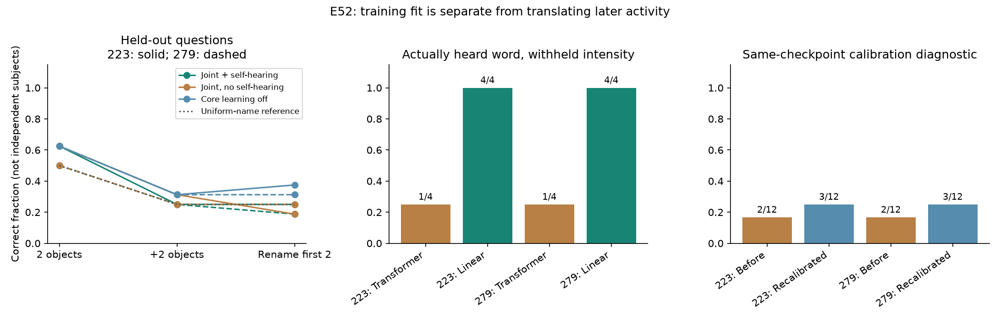

# E52: heard-word readout failure localized; recalled-content translation remains unresolved

> **Revision r3 · 2026-10-10**
> Revision reason: Verified original-file relocation; append location-resolution guidance and preserve the experiment conclusions.
> Original: [report.en.md](report.en.md); parent r2: [report.r2.en.md](report.r2.en.md)

> **Revision r2 · 2026-10-10**
> Revision reason: Relocate generated evidence out of Git; preserve original bytes and conclusions.
> Original: [report.en.md](report.en.md); parent r1: [report.en.md](report.en.md)

2026-10-05. [中文](report.zh.md) · [Design and amendments](design.en.md) · [Every actual answer](../../../.work/coadaptive-language-20261005/outputs.html) · [Results](/api/v2/storage/research-artifacts/research-artifact:b915861279b3db70f3879cf7/content)

An individual expression peripheral now continues learning, preserves bounded teaching replay, optionally hears its actual output, and receives ordinary teacher corrections. Core dynamics, defaults and sensory encoding remain unchanged.

The clearest new localization: **on the same raw observations, a linear transcriber recognizes 4/4 withheld-intensity heard words in each source; the original Transformer recognizes 1/4 in each.** That information reached the peripheral. Successful heard-word recognition nevertheless does not establish faithful translation of recalled content.

**The learning loop is implemented; faithful translation of content supplied by ThreeMind is not yet established.** Fitting demonstrations is distinct from answering later questions. An adapter attached to a Core with plasticity disabled can also fit demonstrations. Peripheral answering must not be credited to Core; failure of this reader likewise does not prove absence of Core information. Earlier E50 naming, pathway and transfer findings retain their original scope.

## Design

Two source courses, each with self-hearing, no self-hearing, and Core-plasticity-off arms: six continuing trajectories. Stage 0 teaches two spheres; stage 1 adds two boxes; stage 2 exchanges the spheres' names while retaining the boxes. Color and shape are crossed. Different statements about the same referent include its name, color, shape and a same-color relation, rather than camera angles alone.

Every first statement receives 10 consecutive presentations and later 2/4 second spaced reviews. Eight interactive teaching turns per stage update the adapter every four turns. Its actual words, including errors, can return through ordinary sensory input before the teacher demonstrates a correction. Labels remain external. Tests receive raw local process observations without baseline subtraction, per-query scaling or target-selected nodes.

The original co-learning arm supervises **pre-answer activity** using the teacher's subsequent answer. That can teach the peripheral to answer independently. The user's clarification therefore adds a stricter transcription-only control, never taught object-name answers.

## Joint learning

| Source | Arm | Stage | Actual live answers | Retrospective teaching fit | Independent questions | Frozen initial adapter |
| --- | --- | --- | --- | --- | --- | --- |
| 223 | Joint + self-hearing | 0 | 2/8 | 8/8 | 5/8 | 5/8 |
| 223 | Joint + self-hearing | 1 | 4/8 | 8/8 | 4/16 | 5/16 |
| 223 | Joint + self-hearing | 2 | 1/8 | 8/8 | 4/16 | 3/16 |
| 223 | Core plasticity off, adapter learns | 0 | 2/8 | 8/8 | 5/8 | 5/8 |
| 223 | Core plasticity off, adapter learns | 1 | 4/8 | 8/8 | 5/16 | 5/16 |
| 223 | Core plasticity off, adapter learns | 2 | 3/8 | 8/8 | 6/16 | 3/16 |
| 223 | Joint, no self-hearing | 0 | 2/8 | 8/8 | 5/8 | 5/8 |
| 223 | Joint, no self-hearing | 1 | 4/8 | 8/8 | 5/16 | 5/16 |
| 223 | Joint, no self-hearing | 2 | 2/8 | 5/8 | 3/16 | 3/16 |
| 279 | Joint + self-hearing | 0 | 2/8 | 8/8 | 4/8 | 4/8 |
| 279 | Joint + self-hearing | 1 | 1/8 | 8/8 | 4/16 | 4/16 |
| 279 | Joint + self-hearing | 2 | 0/8 | 8/8 | 3/16 | 4/16 |
| 279 | Core plasticity off, adapter learns | 0 | 2/8 | 8/8 | 5/8 | 5/8 |
| 279 | Core plasticity off, adapter learns | 1 | 4/8 | 8/8 | 5/16 | 5/16 |
| 279 | Core plasticity off, adapter learns | 2 | 3/8 | 8/8 | 5/16 | 4/16 |
| 279 | Joint, no self-hearing | 0 | 2/8 | 8/8 | 4/8 | 4/8 |
| 279 | Joint, no self-hearing | 1 | 1/8 | 8/8 | 4/16 | 4/16 |
| 279 | Joint, no self-hearing | 2 | 0/8 | 8/8 | 4/16 | 4/16 |

A constant name scores 4/8 in the initial two-name phase and 4/16 in the balanced four-name phases. These are intuitive references, not significance tests over independent minds: sibling probes are not independent subjects. All sources and arms are shown. The frozen initial adapter has not been taught the new objects; it measures adaptation, not equal-knowledge performance. Self-hearing adds real sensory exposure and is not dose-matched to its absence.

Actual live answers precede that turn's demonstration and model update. The first four stage 0 turns are silent because the adapter is uncalibrated and remain in the eight-turn denominator. Retrospective fitting of old observations is a different measurement.

Core-plasticity-off means`plasticity=false`from a blank start, not deletion of transient activation, inhibition or touch history. The switch also stops some structural forgetting updates. Configuration checks find only the declared seed/plasticity differences. Per-example replay weighting does not imply equal lifetime exposure per object: the first two arrive earlier. The final diagnostic adds two examples per object but retains that historical imbalance. These curriculum/context factors are not isolated by merely naming an arm coadaptive.

## Literal transcription without task-answer supervision

Independent main-source copies hear only the four isolated names at two intensities. The peripheral learns literal transcription, not object-name assignments. Those answer cues never enter actual test trajectories. Each stage adds 8 examples; later fitting continues weights and replays earlier demonstrations. The boundary blocks direct task-fact supervision, not all possible computation.

| Source / 来源 | Stage / 阶段 | Word transcription fit / 转写拟合 | Actual naming / 实际命名 | Frozen transcriber / 冻结转写器 |
| --- | --- | --- | --- | --- |
| 223 / feedback | 0 | 2/8 | 4/8 | 4/8 |
| 223 / no-feedback | 0 | 2/8 | 4/8 | 4/8 |
| 223 / no-core-learning | 0 | 2/8 | 3/8 | 3/8 |
| 279 / feedback | 0 | 2/8 | 4/8 | 4/8 |
| 279 / no-feedback | 0 | 2/8 | 4/8 | 4/8 |
| 279 / no-core-learning | 0 | 2/8 | 3/8 | 3/8 |

Recognizing a heard word does not establish translation of recalled or intended words. Calibration below 7/8 stops expansion and is an instrument limitation, not a negative Core finding.

### Same data, simpler numerical readout

Both initial Transformer transcribers fit only 2/8, stopping later phases. The first two .4 intensity words differ by up to 0.08584 in raw fields, still 0.06180 at 120 ms. A subsequently registered ridge reader uses the identical raw six-field samples: fixedridge=.0001, intercept, no centering, counterfactual subtraction or per-example scaling. Only the 8 stage 0 heard-word demonstrations train it. Four separate copies test withheld intensity.5.

| 来源 / Source | 转写拟合 / Fit | 新强度听词：线性 / Heard: linear | 同一测试：Transformer | 问答主组 / Main questions | 不自听 / No self-hearing | 关可塑性 / Core plasticity off |
| --- | --- | --- | --- | --- | --- | --- |
| 223 | 8/8 | 4/4 | 1/4 | 10/40 | 10/40 | 11/40 |
| 279 | 8/8 | 4/4 | 1/4 | 12/40 | 11/40 | 12/40 |

The finite-vocabulary linear reader succeeds at actually heard words in these two sources, localizing that Transformer failure to the external learning/representation route rather than complete absence of measured information. It cannot generate unrestricted sentences and receives no object-answer supervision. Frozen testing across all three course phases still does not produce reliable object naming. Heard-word and recalled-word patterns must not be assumed interchangeable.

## Context-balanced diagnostic

This amendment was registered after observing the first source's 8/8 teaching fit and 4/16 later questions. At each main source's final checkpoint,8 independent copies provide balanced visual/description calibration, retaining 24 prior demonstrations and training once for 1000 steps. Twelve fresh tests use a new visual view and two previously uncalibrated phrasings. Both original and recalibrated heads read identical raw processes.

| Source / 来源 | Calibration fit / 校准拟合 | Original head / 原表达器 | Same-checkpoint calibration / 同快照校准 |
| --- | --- | --- | --- |
| 223 | 3/8 | 2/12 | 3/12 |
| 279 | 4/8 | 2/12 | 3/12 |

Calibration still supplies task answers. Any improvement localizes part of the readout problem; it does not establish pure translation or Core reasoning. Sample count and state coverage change together, so this is not an isolated estimate of elapsed-time effects.

## Process differences and unprompted words

Of 312 same-source/stage/question-style comparisons across objects,312 have numerically different raw local processes;256 of those still yield identical words. These differences are diagnostic only, never expression or Core inputs. They do not prove learned semantics, while identical expression also cannot establish identical activity. [Detailed measurements](activity-results.json).

| Source / 来源 | Arm / 组别 | Stage / 阶段 | Actual words / 原话 | Association-positive samples / 联想字段非零采样 |
| --- | --- | --- | --- | --- |
| 223 | feedback | 0 | 甲。 | 4/101 |
| 223 | feedback | 1 | 甲。 | 12/101 |
| 223 | feedback | 2 | 甲。 | 12/101 |
| 223 | no-core-learning | 0 | 甲。 | 0/101 |
| 223 | no-core-learning | 1 | 甲。 | 0/101 |
| 223 | no-core-learning | 2 | 甲。 | 0/101 |
| 223 | no-feedback | 0 | 甲。 | 4/101 |
| 223 | no-feedback | 1 | 甲。 | 12/101 |
| 223 | no-feedback | 2 | 甲。 | 12/101 |
| 279 | feedback | 0 | 乙。 | 4/101 |
| 279 | feedback | 1 | 甲。 | 12/101 |
| 279 | feedback | 2 | 甲。 | 12/101 |
| 279 | no-core-learning | 0 | 乙。 | 0/101 |
| 279 | no-core-learning | 1 | 乙。 | 0/101 |
| 279 | no-core-learning | 2 | 甲。 | 0/101 |
| 279 | no-feedback | 0 | 乙。 | 4/101 |
| 279 | no-feedback | 1 | 甲。 | 12/101 |
| 279 | no-feedback | 2 | 乙。 | 12/101 |

No-cue windows retain recorded physical telemetry; they omit extra language/object questions. Nonzero associative measurements do not establish that generated words faithfully describe inner speech. No invented semantic truth or enforced blank target is assigned to these windows.

## Delivery and limits

The [reusable peripheral](../../../docs/en/reference/adaptive-expression.md) offers Python/CLI, bounded teacher replay, continued weights, independent checkpoints and exact self-hearing. Adam restarts per update; this is not a fast-weight implementation. Self-hearing defaults off. Five focused tests pass; CPU CLI teaching/save/decode is exercised and two actual CPU answers match recorded CUDA answers, a small functional check rather than all-device numerical proof. Reports/evidence use the existing UI; production chat integration of this new peripheral is not delivered.

`lab.tools.local_word_transcriber.LocalWordTranscriber` also provides reusable raw-process fitting, decoding and non-pickle checkpoints. Its two additional tests exercise held-out intensity, input preservation and restoration: seven focused tests total.

The batch contains 306 result receipts,340 budget-counted source stages/probes and 72.93 recorded compute minutes, within 640 copies/180 minutes. Local evidence soft cap 3 GiB, total including archive/database 8 GiB. Displayed shared-account usage changed from 52%to 54%, potentially including other tasks. Final storage is recorded in the study's delivery record and repository`delivery.json`. One worker; old evidence, Core, old adapters and defaults remain intact. No Docker or user-service operation.

The final interpretation appendix records whether conditional pathway interventions ran. Complex relation transfer, free dialogue, yesterday recall and emitted-signal versus copied-state observation remain separate open questions.

## Final interpretation and next steps

**This batch did not establish reliable object naming, relational reasoning or conversation. It did localize a peripheral failure and deliver a reader that recognizes actually heard words.** Both conclusions follow from separate measurements.

| Question | Answer | Evidence |
| --- | --- | --- |
| Did joint learning with self-hearing improve question answering? | No demonstrated advantage | Main arm 24/80, no self-hearing 25/80, Core plasticity off 31/80; a constant valid name also scores 24/80 |
| Are the answers attributable to Core learning object assignments? | Not established here | Disabling Core learning did not reduce answering; this alone neither proves a superior Core nor attributes correct answers to learned Core content |
| Is the delivered observation entirely devoid of readable differences? | That explanation is ruled out for heard words | A linear reader trained on eight literal examples scores 4/4 per source at withheld intensity 0.5; the Transformer scores 1/4 on the same processes |
| Does the simpler reader translate recalled content? | Not reliably | Frozen heard-word readout scores 22/80 on main questions, 21/80 without self-hearing, and 23/80 with Core plasticity off |
| Did cross-sentence referent verification succeed? | No | Different activities often produce the same name; agreement alone is insufficient without distinguishing other referents |
| Is unprompted output verified inner speech? | No | Background and associative activity remain, but repeated words have not been tied reliably to their referents |

Heard-word recognition is a narrow result: four words, shared sensory wiring, matching relative observation times, and test intensity between the two training intensities. It establishes readable information at this interface. The linear model can use anonymous channel identities and numerical trajectories; this is not object understanding or general translation across new minds.

All 312 compared pairs of object observations differ numerically, yet 256 yield identical words. The adapter risks losing distinctions; not every distinction must represent learned meaning. The [sampling diagnostic](sampling-diagnostic.json) confirms differences survive local selection and the actual 17-sample input. Complete omission by sampling cannot explain this heard-word failure. Feature representation, pooling and optimization remain separate candidate causes; this is not a verdict against the Transformer family.

Same-checkpoint calibration changes each source from 2/12 to 3/12, while fitting its new demonstrations only 3/8 and 4/8. That does not warrant a new default. Unequal historical replay, changing background and accumulated experience remain partly entangled.

**Conditional selective-pathway silencing, matched silencing, rescue and cross-stage replacement were not executed in this batch.** They required reliable naming first. This is an unfulfilled expansion gate, not a negative ablation result and not a reversal of E50 findings.

Recommended next work remains bounded:

1. Use successful literal transcription as a minimum instrument benchmark; locate current Transformer underfitting on the same raw data before enlarging models or courses.
2. Separately record heard-word, object-associated and no-cue processes from the same mind. Keep supervision external, with no referent labels at inference. Test across time and reversed experience instead of imposing old task answers on new states.
3. Compare copied-state observation with signals actually emitted through the output bus. This comparison is still pending; transport has not been comprehensively ruled out.
4. Once translation is reliable, freeze the adapter and perform pathway silencing, rescue and experience replacement alongside cross-sentence referent tests.

Course expansion stops here. Tools, unsuccessful trials and localization evidence are retained. Core dynamics, defaults and older adapters are unchanged; no semantic rule or stimulus alteration is justified by this batch.

## 2026-10-07: system-continuity scope note

Core, expression weights and teaching replay actually continue across stages; this is not stage-by-stage random reinitialization. The old manifest explicitly restarts Adam per update. Complete optimizer, random position and recent windows were not persisted together. Preserve measured co-updates and fixed-adapter controls; add full learning-state support next, without discarding all results or claiming complete continuous restoration.

[Continuity audit / 连续性核查](../../../docs/en/plans/system-continuity-audit.md)

## Data location revision

Selected generated evidence has been archived and verified byte for byte. Original reports, criteria, conclusions and embedded source_commit values are preserved. The logical downloads below require the current host administrator. The data directory is not public.

`data/experiments/2026-10-05-coadaptive-language/`

[Location and hash index / 位置及哈希登记](../../artifact-index/2026-10-09-relocations.json)

- [results.json](/api/v2/storage/research-artifacts/research-artifact:b915861279b3db70f3879cf7/content) — 1264155 B; SHA-256 `d8c25e5ea4008493533229335e98b0c6cd49e36a736248e96c1ac2d461272910`.

> **Storage-location revision · 2026-10-10**
> This edition adds the verified move of the selected originals to `E:\ThreeMindData`. Stable scientific identities and hashes, experiment dates, measurements and conclusions remain unchanged. Paths in the preserved body describe historical sources; use the registered evidence resolver for current locations. Repository documents and frozen fixtures remain in place, and source copies are retained. Structured query data and running checkpoints remain in the database. This annotation does not assert that missing historical evidence was recovered.
