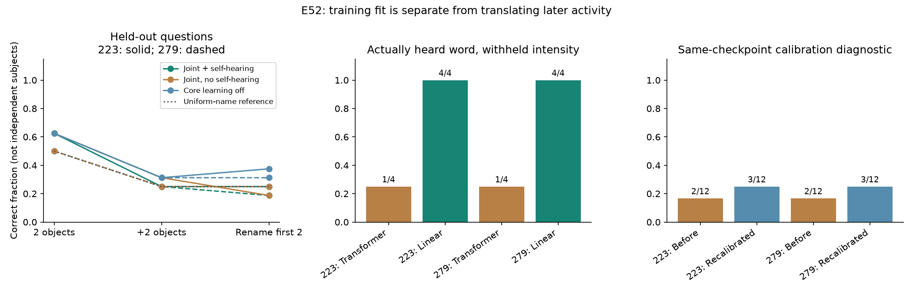

# E52：读出听词信息的缺口已定位，联想翻译仍未解决

> **修订 r3 · 2026-10-10**
> 修订原因：原件存储位置已迁移并核验，追加当前位置解析说明，保留原实验结论。
> 原版：[report.zh.md](report.zh.md)；父版本 r2：[report.r2.zh.md](report.r2.zh.md)

> **修订 r2 · 2026-10-10**
> 修订原因：生成证据移出 Git 并完成校验归档；追加位置登记，保留原字节与结论。
> 原版：[report.zh.md](report.zh.md)；父版本 r1：[report.zh.md](report.zh.md)

2026-10-05。[English](report.en.md) · [设计及分期补充](design.zh.md) · [实际问题和回答](../../../.work/coadaptive-language-20261005/outputs.html) · [结构化结果](/api/v2/storage/research-artifacts/research-artifact:b915861279b3db70f3879cf7/content)

本轮把**个体表达器持续学习、保留教学记录、听见自己实际输出、接受教师纠正**的流程真正接通并跑了对照。它仍是外设，Core动力学、默认参数和输入映射均未修改。

最明确的新定位是：**同一批原始活动，线性转写器在两个来源分别读对4/4个未训练强度的实际听词测试，原Transformer分别只有1/4。** 这部分信息已经在外设拿到的数据里，不能归咎于Core没有响应。不过，仅识别听词的转写器仍不能可靠翻译问后联想；下面分开列出。

**“一个不断学习的外设”已经实现；“只把ThreeMind已经形成的内容忠实翻译出来”尚未完成。** 教学拟合与课后提问明显分离，关内核学习的外设也能学会教学样本。不能把外设自己的答题能力记在Core名下；同样，不能因这个外设失准就断言Core中没有信息。旧E50的命名、通路屏蔽与移植证据保持原结论和适用条件。

## 怎样执行

两个来源，每个比较自听、不自听、关Core可塑性三组，共六条持续教学轨迹。每条分三阶段：0先教两个球；1加两个盒；2交换两球的名字，盒名不变。红色和蓝色各有球、盒，以不同语句交叉限定所指，而不是只变观察角度。

例句包括“这个红球叫甲。”“甲是红色的。”“甲是球。”“与红盒同色的球叫甲。”。每条首次连续10遍，再有2/4秒间隔复习。每阶段另有八轮问答教学，表达器每四条更新一次。原始回答包括错词也可经原感官返回，之后教师通过正常文本示范。外设监督来自教师，不进入测试输入；测试只看原始局部活动过程，没有减去无提示副本或按答案选节点。

核心区别：原共同学习组将**问后、回答前的活动**与教师随后给出的正确词配对训练。这可能教会外设自己答题，所以按用户补充，另做只教词语转写、从不给物体—名字答案的严格对照。

## 共同学习的结果

| 来源 | 组别 | 阶段 | 教学现场实际回答 | 事后教学拟合 | 独立提问 | 冻结基础表达器 |
| --- | --- | --- | --- | --- | --- | --- |
| 223 | 共同学习＋自听 | 0 | 2/8 | 8/8 | 5/8 | 5/8 |
| 223 | 共同学习＋自听 | 1 | 4/8 | 8/8 | 4/16 | 5/16 |
| 223 | 共同学习＋自听 | 2 | 1/8 | 8/8 | 4/16 | 3/16 |
| 223 | 关内核学习，外设照学 | 0 | 2/8 | 8/8 | 5/8 | 5/8 |
| 223 | 关内核学习，外设照学 | 1 | 4/8 | 8/8 | 5/16 | 5/16 |
| 223 | 关内核学习，外设照学 | 2 | 3/8 | 8/8 | 6/16 | 3/16 |
| 223 | 共同学习，不自听 | 0 | 2/8 | 8/8 | 5/8 | 5/8 |
| 223 | 共同学习，不自听 | 1 | 4/8 | 8/8 | 5/16 | 5/16 |
| 223 | 共同学习，不自听 | 2 | 2/8 | 5/8 | 3/16 | 3/16 |
| 279 | 共同学习＋自听 | 0 | 2/8 | 8/8 | 4/8 | 4/8 |
| 279 | 共同学习＋自听 | 1 | 1/8 | 8/8 | 4/16 | 4/16 |
| 279 | 共同学习＋自听 | 2 | 0/8 | 8/8 | 3/16 | 4/16 |
| 279 | 关内核学习，外设照学 | 0 | 2/8 | 8/8 | 5/8 | 5/8 |
| 279 | 关内核学习，外设照学 | 1 | 4/8 | 8/8 | 5/16 | 5/16 |
| 279 | 关内核学习，外设照学 | 2 | 3/8 | 8/8 | 5/16 | 4/16 |
| 279 | 共同学习，不自听 | 0 | 2/8 | 8/8 | 4/8 | 4/8 |
| 279 | 共同学习，不自听 | 1 | 1/8 | 8/8 | 4/16 | 4/16 |
| 279 | 共同学习，不自听 | 2 | 0/8 | 8/8 | 4/16 | 4/16 |

阶段0是两名字判断，始终说一个名字可得4/8；后两阶段四名字均衡，始终说一个名字可得4/16。这是直观参照，不是假设独立同分布后的显著性检验。每道题来自副本，同源题不能当作独立意识。两来源、三组的具体结果都列出，没有只选成功题。

“教学现场实际回答”发生在当轮教师示范及训练更新之前；阶段0的前四次因表达器未校准而静默，也计入8轮分母。它与训练结束后重读旧样本的“拟合”是两件不同的事。

冻结基础外设未学过新增物体名称，其列用于比较后续适配，不是公平的同知识考试。自听组增加真实文本输入，因此它与不自听组的差异也包含额外曝光，不能自动全部归因于“闭环”。

“关内核学习”具体是从空白开始设置`plasticity=false`；仍保留瞬时激活、抑制和触达历史，并不是删除所有状态。该开关同时停用部分结构遗忘更新，故不能把它称为只删除一种生物学习过程。源阶段配置已检查，除了已登记的种子和此开关之外相同。

外设回放按样本等权，不代表历史上四个物体曝光数相等：前两个先学，后两个后加。这是本次持续学习课程的实际边界；同快照校准新增部分每物体两例，但旧回放仍保留该不均衡。不能把本轮结果全归因于“共同学习”这一个因素。

## 不教任务答案，只教词语转写

在主意识的独立副本中，只输入“甲。”“乙。”“丁。”“戊。”，教外设把实际听到的词转写出来；正式问答轨迹不接收这些答案。每阶段8条样本，后续沿用旧参数并回放旧示范。它依然会进行计算，所谓严格是切断任务事实的直接监督，不是假装能从软件结构上证明它绝无答题能力。

| Source / 来源 | Stage / 阶段 | Word transcription fit / 转写拟合 | Actual naming / 实际命名 | Frozen transcriber / 冻结转写器 |
| --- | --- | --- | --- | --- |
| 223 / feedback | 0 | 2/8 | 4/8 | 4/8 |
| 223 / no-feedback | 0 | 2/8 | 4/8 | 4/8 |
| 223 / no-core-learning | 0 | 2/8 | 3/8 | 3/8 |
| 279 / feedback | 0 | 2/8 | 4/8 | 4/8 |
| 279 / no-feedback | 0 | 2/8 | 4/8 | 4/8 |
| 279 / no-core-learning | 0 | 2/8 | 3/8 | 3/8 |

转写训练的成功只证明能读直接听词，问后回忆是否可用仍单独看右侧。若未过7/8转写校准门槛，后续未执行不是Core的阴性结果。直接听词、联想牵动词和准备表达，不能预先认定三者活动分布相同。

### 同一批资料，换一个简单的数值读法

两来源均在阶段0只拟合2/8，故停止原Transformer转写扩展。核查甲/乙的原始活动，差异峰值约0.08584，120ms采样仍约0.06180，并没有全部漏掉。随后登记线性岭回归对照：原始六字段、相同时刻，不减基线、不居中、不归一化；仅阶段0的八个听词样本、固定正则系数0.0001。另取四副本，输入未用于拟合的0.5强度词语。

| 来源 / Source | 转写拟合 / Fit | 新强度听词：线性 / Heard: linear | 同一测试：Transformer | 问答主组 / Main questions | 不自听 / No self-hearing | 关可塑性 / Core plasticity off |
| --- | --- | --- | --- | --- | --- | --- |
| 223 | 8/8 | 4/4 | 1/4 | 10/40 | 10/40 | 11/40 |
| 279 | 8/8 | 4/4 | 1/4 | 12/40 | 11/40 | 12/40 |

线性转写器**已在这两个来源和四词条件下读会了实际听词**，表明Transformer转写失败属于当前外设学习/表示环节的缺口，并非数据里完全没有区别。它只在有限词表中选择，不能生成任意句子，也没有学到物体问答答案。冻结它后读取三个教学阶段的问答，并未出现可靠命名优势。此结果把“直接听词”和“问后表达”区分开了，不能由前者的成功自动补全后者。

## 时间与教学背景的定位补充

在看到首来源“教学8/8、后期提问4/16”后追加此诊断，明确是事后提出的新问题。用同一阶段2快照的8个副本均衡采集示范，仍保留原24条，再训练1000步。另采新视角和两种未校准的新问法，共12题；原表达器和新表达器读取同一实际轨迹。

| Source / 来源 | Calibration fit / 校准拟合 | Original head / 原表达器 | Same-checkpoint calibration / 同快照校准 |
| --- | --- | --- | --- |
| 223 | 3/8 | 2/12 | 3/12 |
| 279 | 4/8 | 2/12 | 3/12 |

这仍是**有任务答案监督的校准**。如果改善，只能说明同状态校准能缓解部分读出问题，不能据此直接宣布“纯翻译成功”或“内核推理成功”；若仍失败，也不能把所有原因归于Core。两类教学数据的数量、状态覆盖同时变化，不能把差异全归于时间单因子。

## 内部过程与没有问题时的输出

同来源、同阶段、同问法而不同对象的312对原始局部过程，312对存在数值差异；其中256对仍被当前外设说成同一个词。比较只用于分析，差值没有送给表达器或Core。存在差异不等于已经形成语义；但表达相同也不能证明意识活动相同。详细数值见[活动诊断](activity-results.json)。

| Source / 来源 | Arm / 组别 | Stage / 阶段 | Actual words / 原话 | Association-positive samples / 联想字段非零采样 |
| --- | --- | --- | --- | --- |
| 223 | feedback | 0 | 甲。 | 4/101 |
| 223 | feedback | 1 | 甲。 | 12/101 |
| 223 | feedback | 2 | 甲。 | 12/101 |
| 223 | no-core-learning | 0 | 甲。 | 0/101 |
| 223 | no-core-learning | 1 | 甲。 | 0/101 |
| 223 | no-core-learning | 2 | 甲。 | 0/101 |
| 223 | no-feedback | 0 | 甲。 | 4/101 |
| 223 | no-feedback | 1 | 甲。 | 12/101 |
| 223 | no-feedback | 2 | 甲。 | 12/101 |
| 279 | feedback | 0 | 乙。 | 4/101 |
| 279 | feedback | 1 | 甲。 | 12/101 |
| 279 | feedback | 2 | 甲。 | 12/101 |
| 279 | no-core-learning | 0 | 乙。 | 0/101 |
| 279 | no-core-learning | 1 | 乙。 | 0/101 |
| 279 | no-core-learning | 2 | 甲。 | 0/101 |
| 279 | no-feedback | 0 | 乙。 | 4/101 |
| 279 | no-feedback | 1 | 甲。 | 12/101 |
| 279 | no-feedback | 2 | 乙。 | 12/101 |

无提示指没有额外物体或语言问题，**物理遥测背景仍在**。联想字段非零反映记录中的局部过程，不等于这些词已经被证明是“内心独白”。没有给无提示活动强加空白真值，也没有给这些词编故事。

## 工具、预算与边界

新增[可持续学习外设](../../../docs/zh/reference/adaptive-expression.md)：Python/CLI、有界教学回放、延续参数、独立检查点、原话自听；每次更新重建优化器，不是快权重算法。默认自听关闭。5项针对性测试通过，CPU CLI训练/保存/读取跑通，两条实际CPU解码与GPU记录一致；这是小型功能验证，不是全设备数值保证。现有UI可查看研究报告和证据，生产聊天接入新外设尚未实现。

另提炼`lab.tools.local_word_transcriber.LocalWordTranscriber`，支持原始过程训练、解码和无pickle的快照；两项强度泛化、只读性和保存恢复测试通过。本轮合计7项针对性测试。

本批306份实验结果记录，计入预算的来源阶段/副本340，记录计算72.93分钟。原预算640、180分钟，本地证据3GiB软限、含归档及数据库8GiB硬限；共享账户显示用量52%至54%，其中可能含其他任务。最终存储计数保存于本批“交付与资源”记录及仓库`delivery.json`。单worker，旧数据不删除、不覆盖，未操作Docker或用户服务。Core版本、旧表达器、旧实验保持原义；额外校准为另存分支。

已登记的选择性通路对照是否运行，见最终解释附录；不会用没有足够有效命名的组强行解释“语义消失”。复杂关系迁移、自由对话、昨天复述、实际发射流与状态观察流的比较，仍是后续问题。

## 最终解释与下一步

**本轮没有获得可靠的物体命名、关系推理或自然对话；但确实定位到一个外设缺口，并做出了能读对实际听词的工具。** 两个结论各有证据，不相互抵消。

| 问题 | 本轮答案 | 依据 |
| --- | --- | --- |
| 共同塑造、听见自己说的话，本轮是否改善答题？ | 没有显示出优势 | 主组24/80，不自听25/80，关Core学习31/80；始终说一个合法名字也可得24/80 |
| 能否证明回答来自Core学会的物体对应？ | 本轮不能 | 不学习的Core搭配可学习外设，成绩没有更差；这不能独立证明它更聪明，也不足以把正确答案归给Core学习 |
| 外设拿到的数据是否完全没有可读区别？ | 已排除“完全没有” | 只学八条实际听词的线性读出，在0.5这一未训练强度下，两来源各4/4；同轨迹上的Transformer各1/4 |
| 简单读出是否已能翻译联想？ | 尚未做到 | 冻结听词读出，主组问答22/80、不自听21/80、关Core学习23/80；没有出现可靠任务命名 |
| 多种说法指向同一事物的翻译验证通过了吗？ | 未通过 | 大量不同活动被表达为同一个名字；必须同时区分不同所指，不能只看多句输出一致 |
| 是否找到可信的内心独白？ | 本轮没有 | 无提示时仍有背景和联想活动，但词语反复输出，与该词所指之间尚无可靠验证 |

两来源的听词结果并非广泛的语言测试：只有四词、同一感官接线、同一相对观察窗口，测试强度位于训练的0.4和0.6之间。因此它证明的是**这一接口上的原始局部过程可用于词语转写**。线性读出可以利用匿名通道身份和数值过程；不能把它称为已经理解物体，或证明它会读懂新的意识。

312对不同对象的原始局部过程全部存在数值区别，其中256对却被表达为同一词。这指出当前表达压缩有丢失区别的风险；并不自动证明每一种区别都是已学语义。实际采样核查见[诊断](sampling-diagnostic.json)：差异通过了局部选择和17时刻采样，不能用“全部漏采了”解释此次听词失败。后续还要分别定位特征表示、池化和训练优化，不能笼统归罪于Transformer架构。

同快照校准从两个来源各2/12变为各3/12，但新增教学本身仅拟合3/8、4/8。这点改善不足以成为默认配置。历史回放的样本数不均衡，且原始观察随模拟背景和经历变化；尚未拆开这些因素。

**预登记的选择性通路屏蔽、匹配屏蔽、恢复、跨阶段替换本轮没有执行。** 扩展条件是先有可靠命名，而本轮未满足。不是“消融没有影响”，更不是推翻E50已完成的通路结果；这是避免对不可靠的回答继续强行归因。

接下来建议先做小型、可定位的工作：

1. 把已通过的听词转写器作为最低读出标准，修正当前Transformer在相同原始资料上的欠拟合，再谈增加模型或扩大课程。
2. 同一个意识分别采集直接听词、物体引发的关联活动、无提示活动，比较它们的时间过程。监督仅留在外设教学，推理不加所指标签；检验跨时间和反向经历，避免把早先学会的答案硬套到新状态。
3. 将当前复制状态的观察通路与实际输出总线发出的信号作有限对照。这一项仍未实施，不能称接口瓶颈已全部排除。
4. 读出稳定后，固定外设，再进行连接屏蔽、恢复、经历替换；多句所指的交叉验证与干预证据一同支持内容归属。

本轮停止扩展课程，交付工具、失败资料和定位结果。Core、默认值及既有表达器不变。无需为了本轮结果另加语义规则、修改刺激或重写意识内核。

## 2026-10-07：系统连续性核查补注

上一阶段的Core、表达权重与教学缓存确实延续，不属于每阶段随机重建。旧manifest明确Adam每次更新重启；完整优化器、随机位置和近期窗口尚未一起保存。保留已测的共同更新及固定外设对照；下一版补全学习状态，不把旧结果全部作废，也不声称旧版是完整连续状态恢复。

[Continuity audit / 连续性核查](../../../docs/zh/plans/system-continuity-audit.md)

## 数据位置修订

选定的生成证据已逐字节校验归档。原报告、评判标准、结论及数据内 source_commit 均保留。以下逻辑下载需要当前主机管理员身份，数据目录未整体公开。

`data/experiments/2026-10-05-coadaptive-language/`

[Location and hash index / 位置及哈希登记](../../artifact-index/2026-10-09-relocations.json)

- [results.json](/api/v2/storage/research-artifacts/research-artifact:b915861279b3db70f3879cf7/content) — 1264155 B; SHA-256 `d8c25e5ea4008493533229335e98b0c6cd49e36a736248e96c1ac2d461272910`.

> **存储位置修订 · 2026-10-10**
> 本版追加已核验的原件迁移说明：本次清单中的原件迁至 `E:\ThreeMindData`，科学身份、哈希、原实验日期、测量与结论不变。保留正文中的路径表示历史来源，当前位置通过已登记的证据引用解析。仓库文档与冻结夹具留在原处，源副本保留；结构化查询数据及运行中的检查点仍存数据库。本说明不表示缺失的历史资料已恢复。
