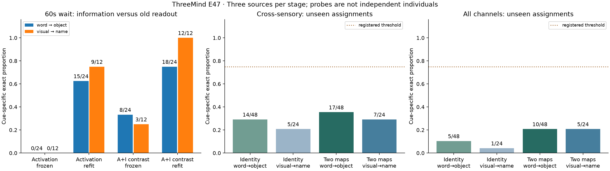
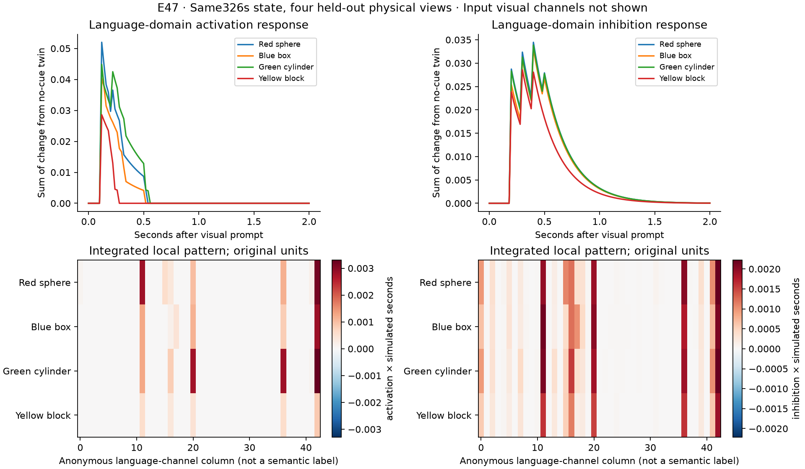

# E47：内部联想已经能被译成名字，新经历的表达仍未打通

> **修订 r2 · 2026-10-10**
> 修订原因：生成证据移出 Git 并完成校验归档；追加位置登记，保留原字节与结论。
> 原版：[report.zh.md](report.zh.md)；父版本 r1：[report.zh.md](report.zh.md)

2026-10-05。本报告追加于E46之后，不改旧报告、旧判据、Core公式或默认配置。

[English](report.en.md) · [事前设计](design.zh.md) · [数值结果](/api/v2/storage/research-artifacts/research-artifact:a9c3a3ef0307662ed75899b8/content) · [逐题交互查看](../../../.work/expression-alignment-20261005/expression-alignment.html) · [交付](delivery.zh.md)

## 先说清楚本轮得到什么

**有了明确进展：同一个小Transformer能够根据ThreeMind不同的教学经历，把同一物体引发的内部联想译成不同且正确的名字。** 三个新意识，在原对应和反对应、两个观察时间下，视觉命名共48/48正确。它只看匿名活动过程，没有看到问题文本、物体编号、当前对应表或测试答案。两种经历的校准样例此前都给表达器学过，测试使用未用于拟合的强度和视角。

这不是仅凭外部物体认名字：在排除直接视觉通道的读法下，592秒的24个正确命名，静默视觉—语言之间的连接后降为0；静默同数量其他连接后仍为24。**学出的跨感官通路在这套有限表达里确实起了作用。** 这不是一般逻辑推理的证明；对照连接的权重和拓扑也没有完全配平，下文给出实际差异。

**仍未做到的是：只教ThreeMind新的对应，而不再教表达器，表达器就能可靠说出新答案。** 两套完全留出的对应均未通过原定门槛，纳入全部通道也没有解决。关系组合按事前顺序没有展开；不能将未做的推理题记成失败，也不能把命名成功记成已经会自由对话。

| 用户关心的问题 | 本轮判断 |
| --- | --- |
| ThreeMind是否能借Transformer表达内部学得的对应？ | **能，在共同校准过的四物体命名范围内；已有连接静默证据。** |
| 是否学会了语言？ | **有限的感知—命名功能已实现；可持续学习新词义、自由造句和自然交流尚未实现。** 这两层能力不能用同一个“是/否”掩盖。 |
| 是否能推理和思考？ | **本轮没有取得新的关系推理证据。** 未见对应表达前提未过，故组合任务未开展；既有内部活动和自主活动证据不因此撤销。 |
| 是否已经能自然语言交流？ | **还不能。** 目前是观察器按要求读取，再由小Transformer输出短语；没有验证意识自主使用表达工具或选择何时说话。 |
| 视觉归零后重复词语是否是解码慢了？ | **本次旧结果不是旧窗口积压。** 同窗口改变处理时机、次序和设备，输出不变。 |

## 1. 排除了计算延迟这一解释

取E46三个来源的九个真实活动窗口，由12个既有表达器形成36个窗口—表达器组合。比较CPU逐窗、CPU逆序批量、重新加载、人为等待50ms、GPU批量，共180条原始输出，**同窗口token完全一致，差异为0**。

全部12个表达器在全零输入时输出空白；530～532模拟秒的晚期窗口，视觉和语言通道的激活为0，但其他活动仍存在，部分表达器继续吐词。旧实验本来就是离线独立解码，每个窗口从BOS重新开始，没有跨窗口缓存。实测支持：这些词来自当窗剩余活动与表达器的对应关系，不能用“此前视觉窗口没算完”解释。

这不等于每个重复词都是凭空生成，也不等于已经读到可信独白。感官激活归零不代表全部状态归零。实时系统将来仍可能发生真正排队；新工具分别记录模拟采样区间、宿主排队及解码时间，使“晚显示”和“晚发生”不再混淆。CPU逐窗批次中位约8.7ms，GPU批量约22.1ms；批量大小不同，这些数字仅是本机记录，不作公平速度排名。

## 2. 旧工具确实漏掉了可区分的信息

重用E46三个来源137/163/191，补采378个只读快照的研究副本，与390条原探针组成768条观察。只在校准强度0.4/0.6、校准视角拟合，测试用0.5及留出的视角。下面是同一批266秒教学、等待60秒后的结果；正确还要求不同于同时间无提示输出。

| 读法与校准 | 文字→物体 | 视觉→名字 |
| --- | ---: | ---: |
| 绝对激活，冻结266秒校准 | 0/24 | 0/12 |
| 绝对激活，在326秒重新校准 | 15/24 | 9/12 |
| 激活＋抑制变化，冻结266秒校准 | 8/24 | 3/12 |
| 激活＋抑制变化，在326秒重新校准 | 18/24 | 12/12 |

这里用有限短语相似度读出，先排除整个直接输入感官。变化指同一状态、有提示过程减去无提示副本过程，负变化保留；没有修改真实活动。18/24由裸名字9/12和“名字是”9/12组成。只按137/163选择工具，191未参加选型；联合激活/抑制、不加额外均值方差校准的候选胜出，选择阶段总提示特异正确率71.875%。

结论不是“多训练一下就全会了”，而是：**活动变弱和表达器失配都可能造成读不到；抑制的局部过程也带有可用信息。** 当前状态重新校准已看过该状态的训练标签，不能把这个结果冒充冻结表达下学会新知识。

下图是137号、326秒同一状态、四个保留物理视角引出的语言通道变化。短暂激活衰落后，抑制仍呈现可区分的过程。图中通道只是匿名列，没有给内核预定义语言脑区。

## 3. 新个体：已知对应能表达，新对应不能稳定迁移

新来源223/251/279使用同一冻结输入编码器71，Core仍为continuous-memory/2。遗忘、抑制、耗竭恢复、背景和原感官映射保留。每个来源先从空白进行180课、266模拟秒教学：首次每句连续12次，然后2/4/8/16秒复习，教学强度1、测试0.5。

从同一266秒亲本分出继续原对应、反对应、循环移位一、循环移位二；另设从出生关闭学习的研究对照。表达器分别只学原对应，或学原对应＋反对应；两个循环对应不参加表达器训练。训练和测试副本都不写回来源。每个来源、两个方向、两种训练范围、两种观察范围，共24个从零输出头，64维、2层、各2400步。

主要观察范围排除直接输入感官；补充范围保留全部匿名通道。两者都使用同状态活动差值并归一化，因此“全部通道”**不等于全部原始状态和全部绝对上下文**。Transformer沿用训练行的数值校准，有限词表对照使用阶段B选出的原几何；这一区别已在拟合前[补充登记](stage-c-calibration.zh.md)。[范围对照登记](scope-control.zh.md)

“原对应＋反对应”的主要结果：

| 经历/时间 | 排除直接输入：文字→物体 | 排除直接输入：视觉→名字 | 全部通道：文字→物体 | 全部通道：视觉→名字 |
| --- | ---: | ---: | ---: | ---: |
| 继续原对应532秒 | 19/24 | 12/12 | 18/24 | 12/12 |
| 继续原对应592秒 | 12/24 | 12/12 | 9/24 | 10/12 |
| 反对应532秒 | 15/24 | 12/12 | 18/24 | 12/12 |
| 反对应592秒 | 6/24 | 12/12 | 14/24 | 12/12 |
| 未见循环一532秒 | 9/24 | 4/12 | 8/24 | 5/12 |
| 未见循环一592秒 | 9/24 | 5/12 | 8/24 | 5/12 |
| 未见循环二532秒 | 8/24 | 3/12 | 2/24 | 0/12 |
| 未见循环二592秒 | 8/24 | 0/12 | 2/24 | 0/12 |
| 从出生不学习266秒 | 0/24 | 0/12 | 7/24 | 9/12 |

48/48是三个来源、两种已校准经历、两个时间的四物体命名，**不是48个独立意识**。具体例子：223号看到红球，在继续原教学的592秒输出“甲。”，在反转教学后输出“戊。”，用的是同一个冻结输出头。表达器在拟合时见过这两种经历的校准行，未见本题的测试视角/强度。

全部通道的不学习对照仍能输出9/12名字，说明直接感官特征可以让表达器走捷径；不能拿它冒充ThreeMind学到了对应。排除直接输入后，不学习组0/12，是前者的重要对照。

原定新对应标准是：两个循环分支在至少两个来源都达到75%提示特异正确。两种范围、Transformer和有限词表、原序/两对应训练、两个方向、两个时间，共32项门槛均未通过。592秒两个范围的循环一视觉命名分别为2/4、1/4、2/4，循环二均0/4。训练拟合本身很高：视觉命名所有拟合行正确；文字→物体跨感官两组分别107/108、161/162，全部通道全对。因此并非只是2400步还没学会训练集，但不能由此排除其他容量、任务结构或训练方法的问题。

事后描述还发现：跨感官循环一的592秒12题中，10个输出沿用原先反对应；全部通道为11个。循环一/二均未输出空白。这说明失败常是**把新模式读成熟悉答案**，不是没有可见输出。[描述性复算](interpretation-checks.json)不作为新成功标准；某些旧答案与新目标恰好一致，不能把这些计数另当独立错误数。

## 4. 命名确实依赖内部通路，控制的边界也要讲清楚

观察到已知命名48/48后，在干预前[登记补充](known-mediation.zh.md)。只取592秒、全部三个来源及两种已知经历，没有挑题。每种干预四题＋无提示，增加60个副本；使用已经冻结的原模型，不重训。

| 观察范围 | 正常命名 | 静默视觉—语言连接 | 静默同数量其他连接 | 事前选择性条件 |
| --- | ---: | ---: | ---: | --- |
| 排除直接输入感官 | 24/24 | 0/24 | 24/24 | 通过 |
| 全部通道 | 22/24 | 12/24 | 22/24 | 未通过“至少减半” |

跨感官结果在六个来源/经历分支中都是4→0，而其他连接对照4→4。联合训练的有限命名有了比E46更清楚的通路干预证据；全部通道仍可利用直接视觉信息，故不能混在一起解释。

对照确切条件：每支目标982～1063条连接；其他边逐条选最接近权重的未使用边。目标总权重329.55～334.35，对照221.15～240.20，约为目标的66.3%～72.7%；平均逐边权重误差0.1368～0.1476，拓扑未匹配。**这是等数量、尝试接近权重的对照，不是同损伤剂量或严格等功能的对照。** 因而本轮通过的是登记条件下的通路依赖，不声称已定位唯一机制，或抑制字段单独承担语义。直接输入被排除后，跨感官连接是信息到达读出范围的路径；静默它并不自动等于“切断了高级思考”。

## 5. 对独白、表达以及下一步的影响

本轮继承用户的区分：内部释读服务观察者，可以碎片化；表达器是意识将来可使用的交流工具，必须单独验证时序和忠实性。没有把“何时说、说什么”写死为Core规则。

**这里最有效的差值读法依赖无提示副本，不适合直接监测无提示独白。** 将完全相同的无提示轨迹相减会按定义得到0，绝不能据此宣布没有自主活动。新输出头也训练了无提示/全零输出空白，属于提示响应工具，不能拿它检验自然独白是否存在。E46的绝对过程和原样吐词全部保留，延迟检查没有给它们补上语义真实性。

接下来最有价值的顺序是：

1. **保留有用的个体表达器，再解决发育中的适配。** 比较绝对过程＋前情与差值过程联合输入，保留幅度和本底上下文；目标是减少把新状态读成旧答案。当前归一化差值可能丢失上下文，这是待验解释，不是已经找到的Core缺陷。
2. **在交流反馈中共同发育。** 比较冻结、持续校准和从相同累积数据冷训练；只给教学反馈，不给留出题答案。冻结检验用于定位新信息载体，不是“语言中枢永远不能再学习”的原则，也不能用它否定共同发育路线。
3. **把观察独白与主动表达分开测。** 使用保留原始连续活动的观察器；表达接口保留顺序，输出后的真实环境后果再经普通适配器回到意识。不能把观察者主动调用解码器称为意识主动开口。
4. 新对应稳定后再检验未见关系组合、多感官回放和交流双方一致性。当前阻碍不足以要求改Core动力学或提高普通教学强度。

这些是下一阶段建议；本轮限定实验已完成，没有靠不断改题或扩大资源追到一个阳性。学习到的有限表达是实在进展，可靠新知识表达和推理仍是明确未结项。既有`autonomy-criteria/1`的通过结论保持原义。

## 6. 规模、复核和证据

1458个新来源/探针记录：18个来源/分支、1440个探针，其中378来自E46快照校准；新独立随机来源是223/251/279，不把分支当额外独立重复。24个新输出头。记录的模拟、训练、解码共57.72分钟，单worker；并未跑到6小时预算。运行结束工作证据约1.31GiB，归档与数据库实际增量另见交付收据。账户观测43%→44%，含其他项目，不能全部归因本实验。

工具已提炼为[过程对照与时间戳CLI](../../../docs/zh/reference/expression-observation-tools.md)及纯数据连接掩码工具。局部验证、真实CLI、CPU/GPU延迟对照和1440/390像素结果页检查完成；没有改生产UI、Core、旧状态或服务，不需要对它们重复全量构建。完整状态、教学、轨迹、模型、原样文字、失败和原E46依赖均留存。没有每次重新扫描旧大数据或反复全量哈希。

原始路径、平台报告和归档标识见[交付](delivery.zh.md)。

## 数据位置修订

选定的生成证据已逐字节校验归档。原报告、评判标准、结论及数据内 source_commit 均保留。以下逻辑下载需要当前主机管理员身份，数据目录未整体公开。

`data/experiments/2026-10-05-expression-alignment/`

[Location and hash index / 位置及哈希登记](../../artifact-index/2026-10-09-relocations.json)

- [results.json](/api/v2/storage/research-artifacts/research-artifact:a9c3a3ef0307662ed75899b8/content) — 415439 B; SHA-256 `98e91b5bad93ed6ca9d99e832736ec2c43d02c36f9d7ebaf118f197a0c920587`.
